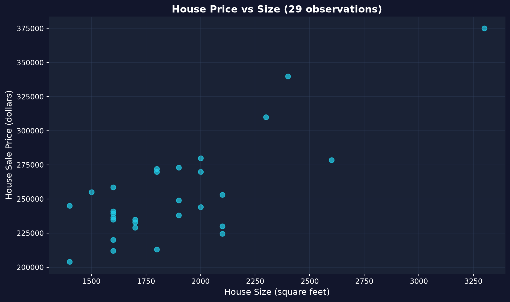
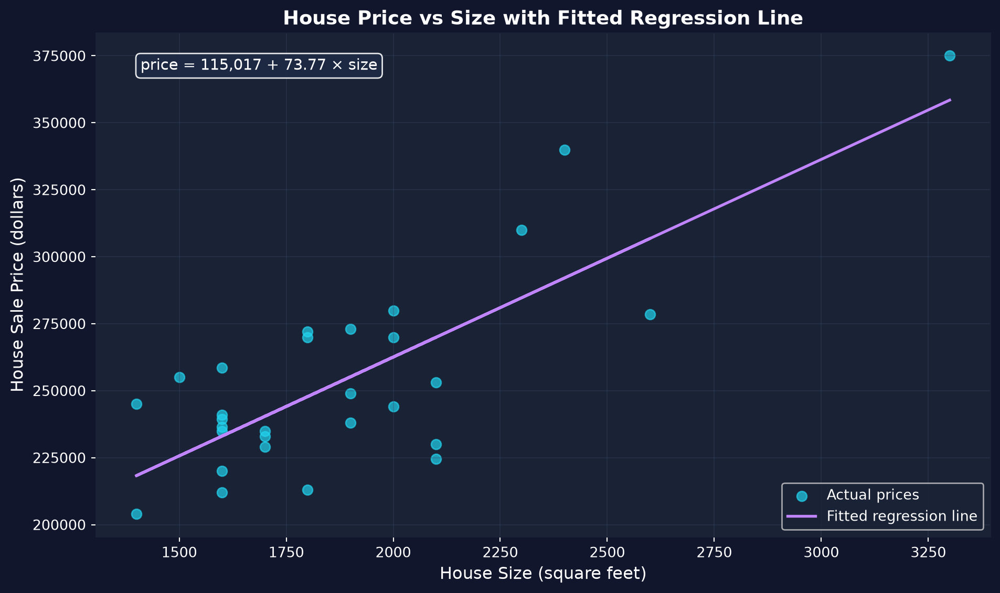

# 問い {.divider background-color="#008CB7"}

[第1幕 · 緊張]{.act}

## 経済学者は経済を使って実験することができません

私たちは、人々にランダムに異なる所得を割り当てたり、ある都市にだけ減税を行い別の都市には行わない、といったことはできません。

. . .

では、ある経済変数が別の経済変数とどのように連動して動くのかを、どうやって測るのでしょうか。**回帰**（計量経済学の中心的な道具）は、観測されたデータの雲を、読み取ることのできる一本の線に変えてくれます。

::: {.notes}
実験科学とは異なり、経済学はほとんどの場合、観測データを使って研究します。回帰とは、私たちが制御できなかったデータから関係性を定量化する方法なのです。
:::

## これから進む道のり

::: {.incremental}
- 回帰が**何か**——そしてなぜそれが計量経済学の中心的な道具なのか
- pandasで経済データを**読み込み、探索**する
- 散布図で関係を**可視化**する
- pyfixestでOLS(最小二乗法)により単回帰を**当てはめる**
- 傾き、切片、$R^2$ を——経済的な意味で**解釈**する
:::

## 本章を支える6つの考え方

::: {.incremental}
- **回帰** — データを通る、統計的な最適な当てはめの線
- **Y と X** — 説明したい結果（$Y$）と説明する変数（$X$）
- **切片 $\beta_0$ · 傾き $\beta_1$** — 線がどこから始まり、どれだけ急かを表す
- **OLS** — *二乗*残差の和を最小にする線を選ぶ
- **$R^2$** — 線が説明する $Y$ の変動の割合（0から1）
- **相関 $\neq$ 因果** — 回帰は $Y$ と $X$ がどう一緒に動くかを測るのであって、原因を測るのではない
:::

[傾きは、ほとんどの場合、あなたが実際に関心を持っている数値そのものです。]{.takeaway .fragment}

# データから当てはめた線へ {.divider background-color="#7A209F"}

[第2幕 · 調査]{.act}

## 私たちの問い：大きな家ほど高く売れるのか？

カリフォルニア州Davisにおける29件の住宅売却（1999年）。2つの列がこの物語を担います——**price（価格）** と **size（広さ）** です。

$$\text{price} = \beta_0 + \beta_1 \cdot \text{size} + \varepsilon$$

[私たちが求めたいのは $\beta_1$——1平方フィート増えるごとに予測される価格の変化です。OLSは、点と線の間の二乗の隔たりをできるだけ小さくするように $\beta_0, \beta_1$ を選びます。]{.comment}

## ステップ1 — pandasでデータを読み込み、探索する

``` {.python code-line-numbers="1|3-4|5|7-8"}
import pandas as pd                          # pandas → load & handle tabular data

# dataset: 29 house sales in Davis, CA, 1999 (price, size, bedrooms, …)
url = "https://raw.githubusercontent.com/quarcs-lab/data-open/master/AED/AED_HOUSE.DTA"
data = pd.read_stata(url)                    # read the Stata .dta into a DataFrame

data.head()                                  # peek at the first few rows
data.describe().round(2)                     # summary stats: mean, std, min, max, quartiles
```

[↗ Colab で試す](https://colab.research.google.com/notebooks/empty.ipynb){.colab-link target="_blank" data-preview-link="false"}

::: {.notes}
平均価格 ≈ $253,910、平均の広さ ≈ 1,883 平方フィート。価格は $204k〜$375k の範囲です。モデル化の前に必ず記述しましょう——スケールとばらつきを把握しておくことで、後で回帰が解釈しやすくなります。
:::

## ステップ2 — モデル化の前に必ず可視化する

``` {.python code-line-numbers="1-2|4-5|7|8-9"}
import pandas as pd                          # tabular data
import matplotlib.pyplot as plt               # plotting

url = "https://raw.githubusercontent.com/quarcs-lab/data-open/master/AED/AED_HOUSE.DTA"
data = pd.read_stata(url)                    # load the 29 Davis, CA house sales

fig, ax = plt.subplots(figsize=(10, 6))      # one figure + axes
ax.scatter(data["size"], data["price"],      # x = size, y = price
           s=80, alpha=0.7, color="#22d3ee") # marker size, transparency, colour
plt.show()                                   # render the scatter plot
```

[↗ Colab で試す](https://colab.research.google.com/notebooks/empty.ipynb){.colab-link target="_blank" data-preview-link="false"}

## 広さとともに価格は上がる——関係は本物だが緩やかである



[散布図は正直な第一印象です——どんなモデルも当てはめる前に、方向とばらつきを見せてくれます。]{.takeaway .fragment}

## ステップ3 — pyfixestでOLSにより回帰を当てはめる

``` {.python code-line-numbers="1|3-4|6-7|9|10"}
!pip install -q pyfixest                     # install pyfixest in Colab (-q = quiet; not preinstalled)

import pandas as pd                          # tabular data
import pyfixest as pf                         # pyfixest → OLS regression, R-style formulas

url = "https://raw.githubusercontent.com/quarcs-lab/data-open/master/AED/AED_HOUSE.DTA"
data = pd.read_stata(url)                    # load the 29 Davis, CA house sales

fit = pf.feols("price ~ size", data=data)    # OLS: regress price on size (intercept auto-added)
fit.summary()                                # β0, β1, SEs, t, p, R²
```

[↗ Colab で試す](https://colab.research.google.com/notebooks/empty.ipynb){.colab-link target="_blank" data-preview-link="false"}

::: {.notes}
pyfixest.feols は本プロジェクトの推定ツールであり、Rのfixestと同じ `y ~ x` の数式構文を使います。1行でモデルを当てはめ、summary() が完全な表を出力します。
:::

## OLSが線を引く：price = 115,017 + 73.77 × size



[傾き $\beta_1 = \$73.77$/平方フィート · 切片 $\beta_0 = \$115{,}017$ · $R^2 = 0.62$。]{.takeaway .fragment}

## 3つの数値を読み解く

::: {.incremental}
- **傾き $\beta_1 = \$73.77$** — 1平方フィート増えるごとに、価格はおよそ **\$74** 高くなることと関連しています（100平方フィートあたり ≈ \$7,400）。
- **切片 $\beta_0 = \$115{,}017$** — 単に線が $x=0$ を横切る位置にすぎません。広さ0平方フィートの家には意味がないので、深読みしないようにしましょう。
- **$R^2 = 0.62$** — 広さだけで価格の変動のおよそ **62%** を説明します。残りの38%は立地、状態、築年数などです。
:::

[有意性だけでなく、大きさを報告しましょう：1平方フィートあたり \$74 こそが経済的に意味のある発見です。]{.takeaway .fragment}

# 正しく読み解く {.divider background-color="#C21E72"}

[第3幕 · 解決]{.act}

## 陥りやすい誤り——そしてその訂正

[反論。]{.objection}「1平方フィートごとに \$74 *増える*——だから家を100平方フィート広げれば \$7,400 増える。」

. . .

[応答。]{.rebuttal} **相関は因果ではありません。** 大きな家は、より新しく、立地がよく、よりよく改装されてもいます——傾きは、品質の効果まで広さの手柄にしてしまうのです。アイスクリームの売上と溺死のように、どちらも夏に増えますが、一方が他方の原因というわけではありません。

[回帰は $Y$ と $X$ がどう一緒に動くかを示します。因果として読むには、代替的な説明を排除する設計が必要です。]{.takeaway .fragment}

## 次へ持ち越すべきこと

::: {.incremental}
- 回帰は計量経済学の中心的な道具です。$Y$ が $X$ とともにどう変化するかを定量化します。
- 単純なモデルは $y = \beta_0 + \beta_1 x + \varepsilon$ であり、**OLS** は二乗残差を最小にします。
- **傾き** は相関を測り、**$R^2$** は当てはまりを測ります——どちらも因果を証明するものではありません。
- Pythonのワークフローは **読み込み → 探索 → 可視化 → モデル化 → 解釈** です（`pandas`, `matplotlib`, `pyfixest`）。
- データの範囲を越えて外挿してはいけません。また、標本が一般化できると決めつけてもいけません。
:::

# 線を当てはめ、傾きを読み取る——そして、それが本当に原因なのかを問いましょう。 {.divider background-color="#C21E72"}
