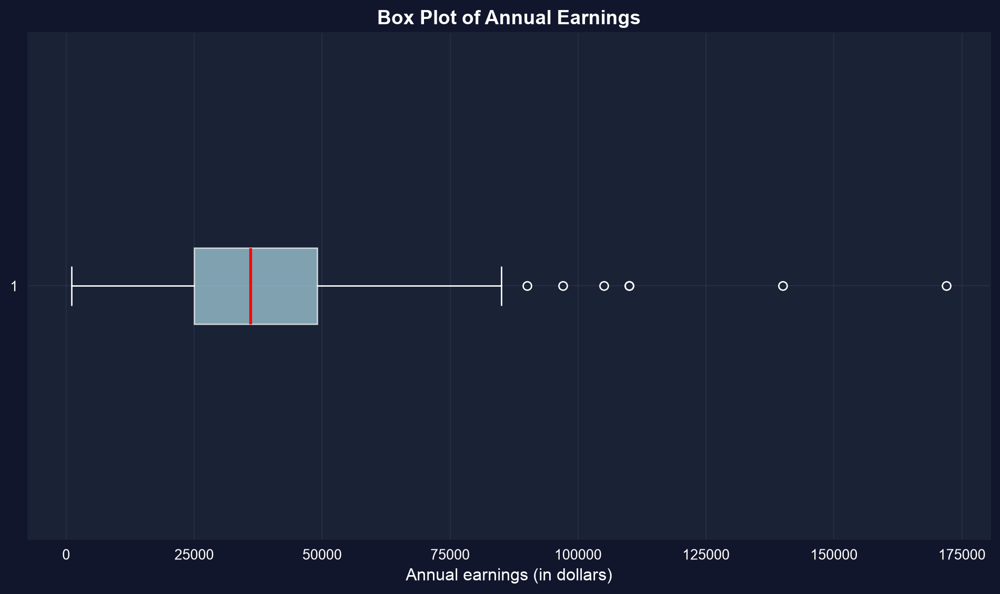
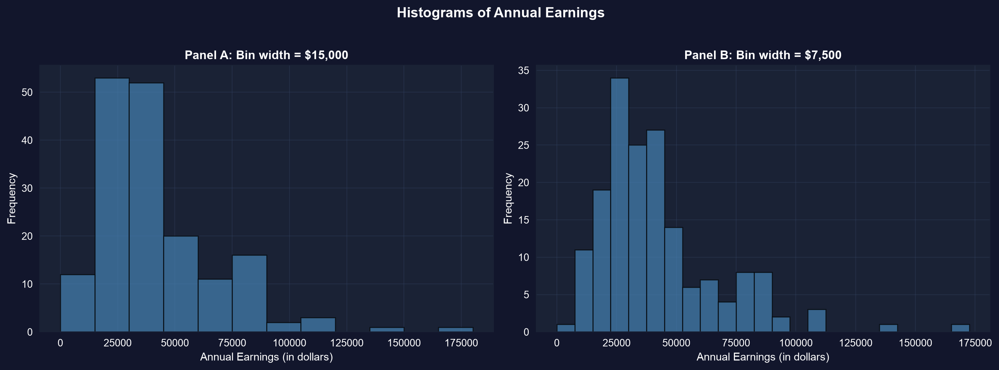
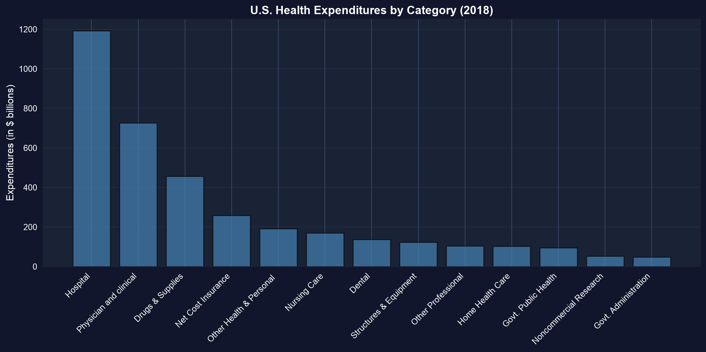
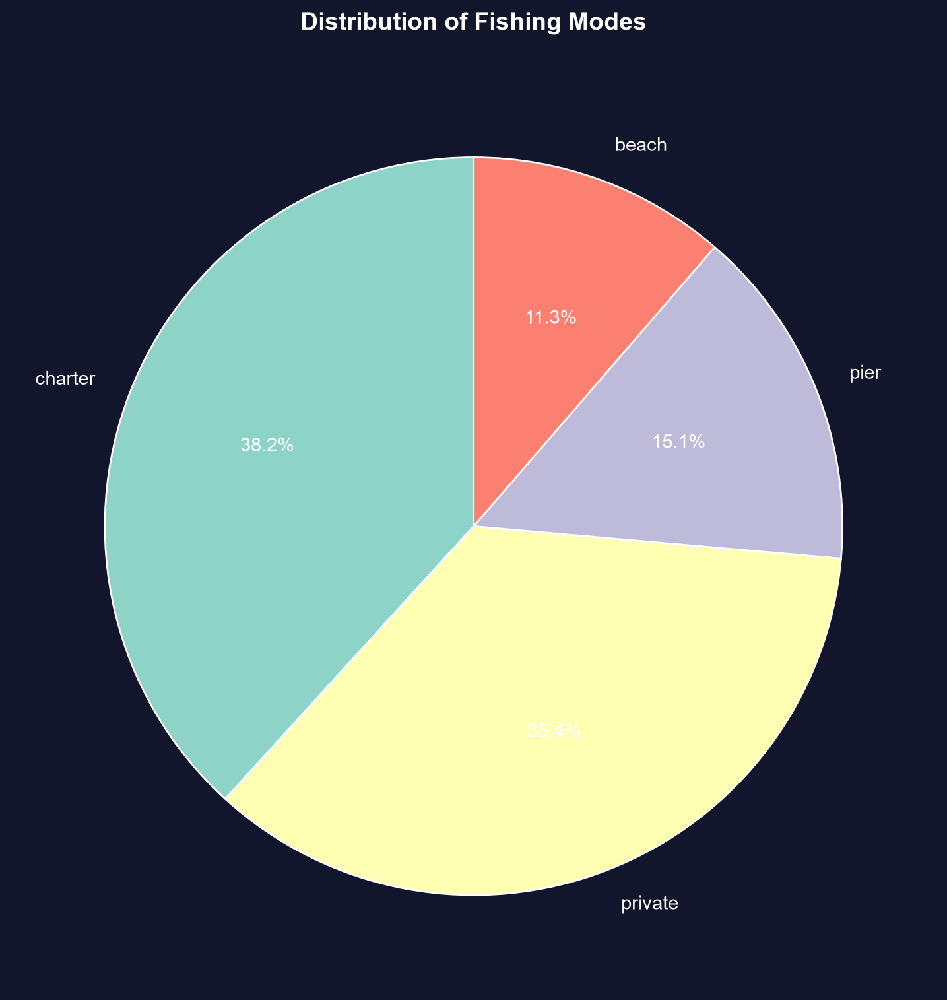
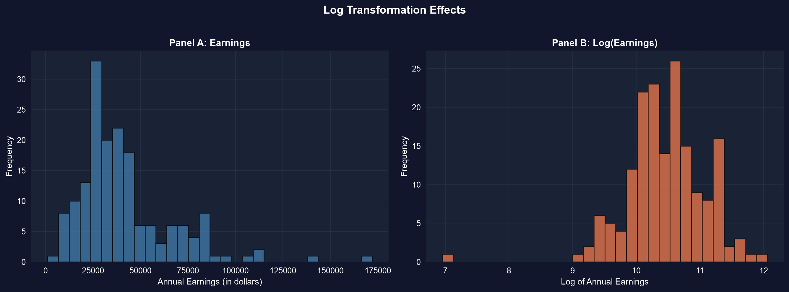
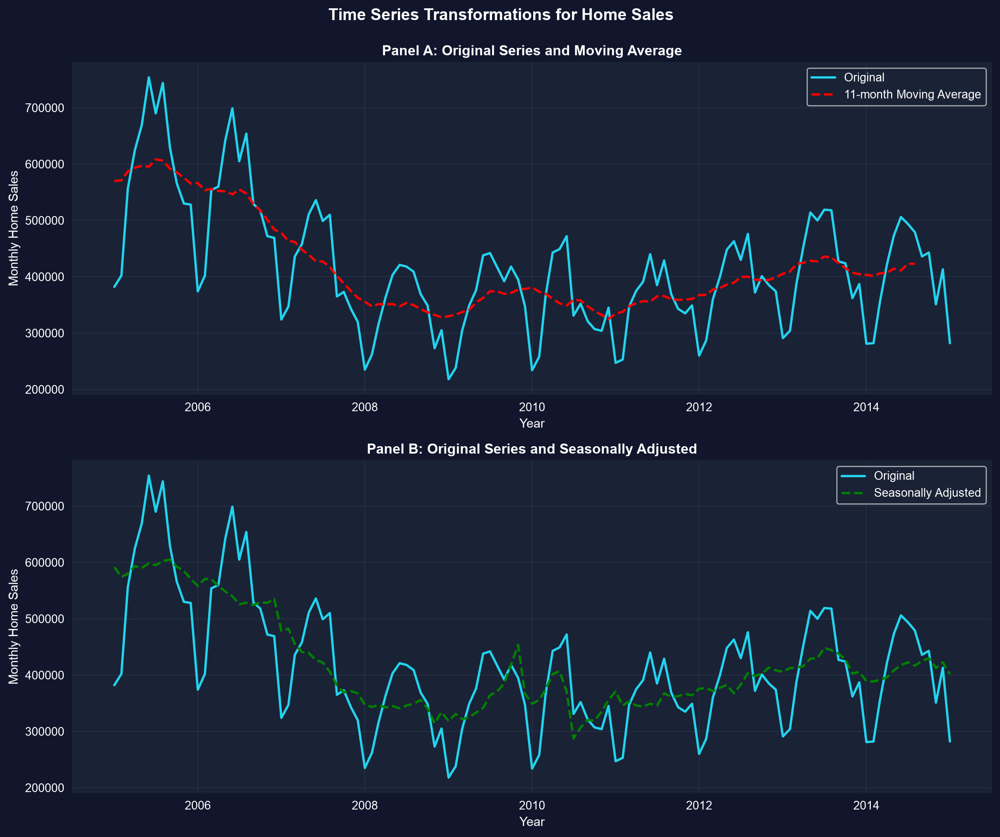

# 問い {.divider background-color="#008CB7"}

[第I幕 · 一つの変数]{.act}

## 171個の数値があります。さて、どうしますか？

30歳でフルタイムで働く女性171人の年間所得です。171個のドル金額が並んだ列を
ひと目見ても、何もわかりません。

. . .

**一変量の要約**とは、その列をわずかな数値 — そしていくつかのグラフ — に圧縮し、
中心、散らばり、形を明らかにする方法です。

::: {.notes}
一変量 = 一つの変数。モデリングに入る前に、まず要約します。この章はそのための
道具箱です。数値のための要約統計量、形のためのグラフを扱います。
:::

## これから学ぶこと

::: {.incremental}
- 平均、中央値、散らばり、形の統計量で変数を**要約する**
- 数値データを**可視化する** — 箱ひげ図、ヒストグラム、密度、折れ線グラフ
- 棒グラフと円グラフでカテゴリを**比較する**
- 対数で歪んだデータを**変換し**、z値で尺度を**そろえる**
- 移動平均と季節調整で時系列を**平滑化する**
:::

## この章を支える6つの考え方

::: {.incremental}
- **平均 vs. 中央値** — 外れ値に引っ張られる平均値と、正直な中央の値
- **標準偏差** — 点が平均からどれだけ離れているかの典型的な距離
- **四分位数とIQR（四分位範囲）** — $Q_1$、$Q_2$、$Q_3$ がデータを4つに分ける。IQR $= Q_3 - Q_1$
- **歪度** — 非対称性。$> 1$ は長い右の裾を意味する
- **尖度** — 裾の重さ。超過尖度 $> 0$ は正規曲線より外れ値が多いことを意味する
- **z値** — $z_i = (x_i - \bar{x})/s$、「平均から何標準偏差離れているか」に再スケールした値
:::

[歪んだ経済データでは、中央値のほうが通常はより正直な「典型的」な値になります。]{.takeaway .fragment}

# 数値から形へ {.divider background-color="#7A209F"}

[第II幕 · 調査]{.act}

## まず数値から始める：中心、散らばり、形

``` {.python code-line-numbers="1-2|4-6|8|9"}
import pandas as pd                          # tabular data
from scipy import stats                      # skewness & kurtosis

# dataset: 171 full-time working women aged 30, 2010 (earnings in $)
url = "https://raw.githubusercontent.com/quarcs-lab/data-open/master/AED/AED_EARNINGS.DTA"
data = pd.read_stata(url)                    # read the Stata .dta into a DataFrame

data[["earnings"]].describe().round(0)       # count, mean, std, min, quartiles, max
stats.skew(data["earnings"]), stats.kurtosis(data["earnings"])  # shape: 1.71, 4.32 (excess)
```

[↗ Colab で試す](https://colab.research.google.com/notebooks/empty.ipynb){.colab-link target="_blank" data-preview-link="false"}

::: {.notes}
pandasは中心と散らばりを一度の呼び出しで返し、scipy.statsが形を加えます。scipyは既定で超過
尖度（生の値 − 3）を返すため、0が正規曲線の基準になります。
:::

## 平均が中央値の上にある — 歪みを示す手がかり

::: {.incremental}
- **平均 $= \$41{,}413$** だが **中央値 $= \$36{,}000$** — \$5,413（15%）の差。
- **標準偏差 $= \$25{,}527$** — 平均の62%：巨大な散らばり。
- **$Q_1 = \$25{,}000$、$Q_3 = \$49{,}000$** → IQR $= \$24{,}000$ が中央の半分を含む。
- **歪度 $= 1.71$**（$> 1$ = 強く歪んでいる）；**超過尖度 $= 4.32$**（重い裾）。
:::

[高所得者がわずかに存在し（最大 \$172,000）平均を押し上げます。「典型的」な値としては中央値を報告しましょう。]{.takeaway .fragment}

## 箱ひげ図はそれらの統計量を一枚の絵に描く



[中央値は中心より左にあり、右のひげが長い — このグラフこそが歪みそのものです。]{.takeaway .fragment}

## ヒストグラムは分布全体を示す — ビン幅は選択である

``` {.python code-line-numbers="1-2|4-5|7|8-9|10"}
import pandas as pd                          # tabular data
import matplotlib.pyplot as plt               # plotting

url = "https://raw.githubusercontent.com/quarcs-lab/data-open/master/AED/AED_EARNINGS.DTA"
earnings = pd.read_stata(url)["earnings"]    # the single variable

fig, ax = plt.subplots(1, 2, figsize=(12, 5))         # two panels side by side
ax[0].hist(earnings, bins=12, color="#22d3ee", edgecolor="black")  # wider bins → coarse shape
ax[1].hist(earnings, bins=25, color="#22d3ee", edgecolor="black")  # narrower bins → fine detail
plt.show()                                   # render the histograms
```

[↗ Colab で試す](https://colab.research.google.com/notebooks/empty.ipynb){.colab-link target="_blank" data-preview-link="false"}

## 広いビンは形を、狭いビンは詳細を与える



[必ず複数のビン幅を試しましょう — それぞれが異なる問いに答えます。]{.takeaway .fragment}

## カテゴリには、棒グラフが各部分を順位づける



[プロットする前にカテゴリを並べ替え、順位がひと目で読めるようにしましょう。]{.takeaway .fragment}

## カテゴリデータ：数えて、割合を示す

``` {.python code-line-numbers="1-2|4-5|7|8|9-10"}
import pandas as pd                          # tabular data
import matplotlib.pyplot as plt               # plotting

url = "https://raw.githubusercontent.com/quarcs-lab/data-open/master/AED/AED_FISHING.DTA"
data = pd.read_stata(url)                    # 1,182 recreational fishers

counts = data["mode"].value_counts()         # frequency of each fishing site
counts / counts.sum() * 100                  # relative frequency (% of total)
plt.pie(counts, labels=counts.index, autopct="%1.1f%%")  # each slice = a site's share
plt.show()                                   # render the pie chart
```

[↗ Colab で試す](https://colab.research.google.com/notebooks/empty.ipynb){.colab-link target="_blank" data-preview-link="false"}

::: {.notes}
value_counts()が度数表を作り、normalize=True（または合計で割る）が相対度数を与えます。
ボートによるモード（チャーター38% + プライベート35%）が選択全体の約74%を占めます。
:::

## ボート釣りが1,182件の選択を支配する



[円グラフは割合を示します。カテゴリが多い場合は、並べ替えた棒グラフのほうがより明快に比較できます。]{.takeaway .fragment}

## 対数は右に歪んだ経済データを手なずける

``` {.python code-line-numbers="1-3|5-6|8|9|10"}
import numpy as np                           # natural logarithm
import pandas as pd                          # tabular data
from scipy import stats                      # skewness

url = "https://raw.githubusercontent.com/quarcs-lab/data-open/master/AED/AED_EARNINGS.DTA"
data = pd.read_stata(url)                    # load the 171 earnings

data["ln_earnings"] = np.log(data["earnings"])   # log-transform the skewed variable
stats.skew(data["earnings"])                      # 1.71  → strong right skew
stats.skew(data["ln_earnings"])                   # -0.91 → nearly symmetric
```

[↗ Colab で試す](https://colab.research.google.com/notebooks/empty.ipynb){.colab-link target="_blank" data-preview-link="false"}

::: {.notes}
対数は、乗法的で右に歪んだデータ（所得、価格、富）を対称性へと変換します。
対数スケールでは平均（10.46）と中央値（10.49）がほぼ一致します。対数には正の値が必要です。
:::

## 対数スケールは長い裾を正規曲線へと収束させる



[多くの検定は正規曲線の形を前提とします。対数変換は、歪んだ経済データをそこへ到達させる方法です。]{.takeaway .fragment}

## 時系列はトレンドを明らかにするために平滑化が必要

``` {.python code-line-numbers="1|3-4|5|7|8"}
import pandas as pd                          # tabular data

url = "https://raw.githubusercontent.com/quarcs-lab/data-open/master/AED/AED_MONTHLYHOMESALES.DTA"
data = pd.read_stata(url).query("year >= 2005")   # monthly U.S. home sales, 2005+
data = data.sort_values("daten")             # ensure time order

data["ma11"] = data["exsales"].rolling(11, center=True).mean()  # 11-month moving average
data[["exsales", "ma11"]].describe().round(0)     # raw (noisy) vs smoothed series
```

[↗ Colab で試す](https://colab.research.google.com/notebooks/empty.ipynb){.colab-link target="_blank" data-preview-link="false"}

::: {.notes}
移動平均は各点を近隣の点と平均し、月ごとのノイズを打ち消します。
一方、季節調整は夏のピーク / 冬の谷という繰り返しのパターンを取り除きます。
:::

## 平滑化は2007〜2011年の住宅バブル崩壊を明らかにする



[移動平均は季節的なノイズを打ち消し、季節調整は予測可能なパターンそのものを取り除きます。]{.takeaway .fragment}

# 正しく読み解く {.divider background-color="#C21E72"}

[第III幕 · 解決]{.act}

## 形に合った要約を選ぶ

[反論。]{.objection}「平均とヒストグラムを報告すればいい — 要約とはそういうものだ。」

. . .

[応答。]{.rebuttal} 適切な要約は**形**によって決まります。歪んだ所得では、
平均は「典型的」な値を過大評価するので、**中央値**と**IQR**を先頭に置きましょう。ヒストグラムの
語る物語は**ビン幅**によって変わります。そして生の時系列は、**平滑化**するまでそのトレンドを隠します。

[データに道具を合わせましょう：歪み → 中央値と対数；カテゴリ → 棒グラフ；時間 → 移動平均。]{.takeaway .fragment}

## 持ち帰るべきこと

::: {.incremental}
- 中心（**平均/中央値**）、散らばり（**標準偏差、IQR**）、形（**歪度、尖度**）を要約する。
- 歪んだ経済データでは、**中央値**が正直な中心であり、**平均**は外れ値に引っ張られる。
- データの種類に応じてグラフを選ぶ：**ヒストグラム/箱ひげ図/折れ線**（数値）、**棒/円**（カテゴリ）。
- **対数**は右に歪んだデータを対称化し、**z値**は異なる変数を一つのスケールにそろえる。
- 時系列では、**移動平均**がノイズを平滑化し、**季節調整**が繰り返しのパターンを取り除く。
:::

# 数値を要約し、次に形を描く — そしてデータに道具を選ばせる。 {.divider background-color="#C21E72"}
