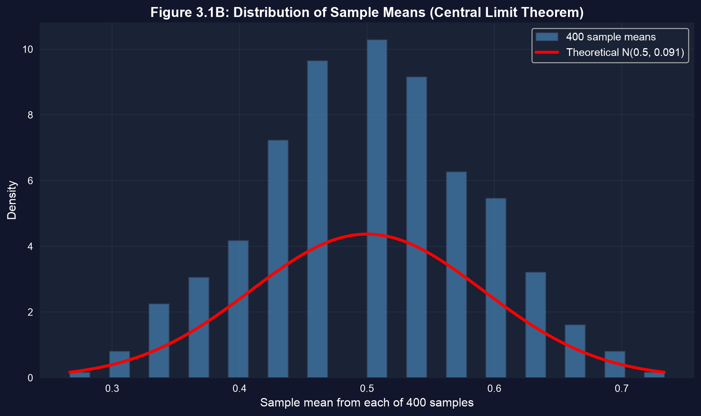
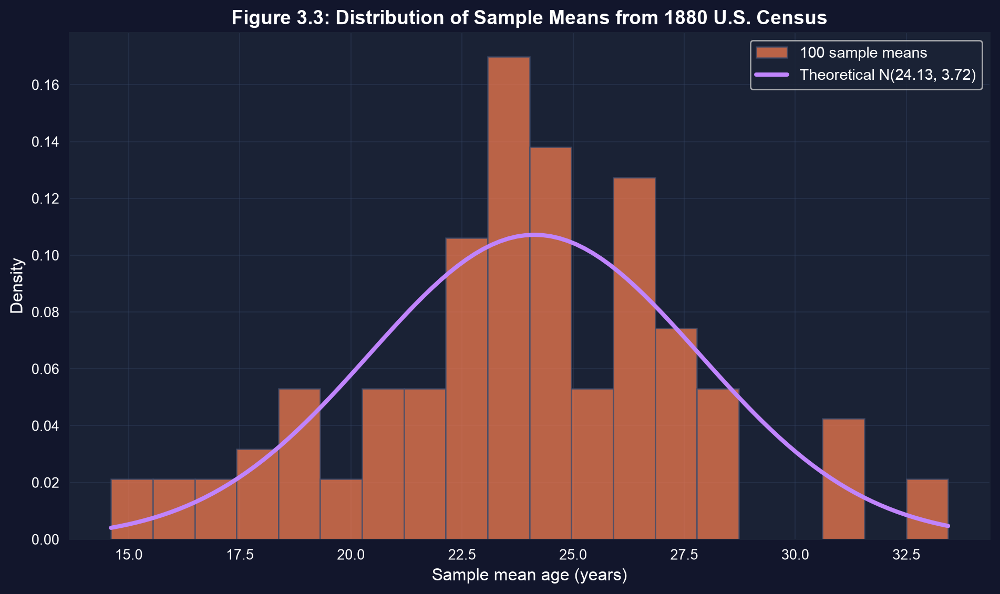

# 問い {.divider background-color="#008CB7"}

[第I幕 · 緊張]{.act}

## 一つの標本平均はたった一回の抽出にすぎない

あなたが30人に調査して平均所得 \$52,000 を得たとします。別の人が異なる30人に調査して
\$48,000 を得ました。どちらが正しいのでしょうか。

. . .

どちらも正しいのです。それぞれの $\bar{x}$ は、標本ごとに変化する**確率変数** $\bar{X}$ の**一つの実現値**です。この章では、$\bar{X}$ の*分布*がどのような形をしているのか、そしてそれをどう使うのかを問います。

::: {.notes}
第2章（手元のデータを記述する）から推測（データが世界について何を語るか）への飛躍は、この考え方を経由します。すなわち、あなたが計算する統計量それ自体がランダムである、ということです。
:::

## これから向かう先

::: {.incremental}
- **$\bar{X}$ は確率変数である** — 固定された数値ではない
- その**平均と分散**：$E[\bar{X}] = \mu$ と $\operatorname{Var}[\bar{X}] = \sigma^2/n$
- その**標本分布** — コイン投げの実験を通して見る
- **中心極限定理**（CLT）：歪んだデータからでも $\bar{X}$ はほぼ正規分布になる
- **標準誤差** $se(\bar{X}) = s/\sqrt{n}$ — そして $n$ が大きいほど推定が鋭くなる理由
:::

## 六つの考え方がこの章を支える

::: {.incremental}
- **母数と統計量** — $\mu$ は固定されており未知である。$\bar{x}$ は計算され、変化する
- **推定量** — 一つの規則（$\bar{X} = \tfrac{1}{n}\sum X_i$）。*推定値*はその規則が返す一つの数値である
- **不偏性** — $E[\bar{X}] = \mu$：系統的な過大評価も過小評価もない
- **有効性** — 不偏推定量の中で、$\bar{X}$ は最も振れ幅が小さい
- **一致性** — $\operatorname{Var}[\bar{X}] = \sigma^2/n \to 0$ なので、$n$ が大きくなるにつれて $\bar{X} \to \mu$ となる
- **大数の法則** — その収束を保証する形式的な根拠
:::

[あなたが計算する数値はランダムである。その分布こそが推測の土台となる。]{.takeaway .fragment}

# 一つの標本から分布へ {.divider background-color="#7A209F"}

[第II幕 · 調査]{.act}

## 実験：30回のコイン投げによる400個の標本

公正なコインは $\mu = 0.5$、$\sigma^2 = 0.25$ をもちます。30回投げて表が出た割合を記録する —
それが一つの $\bar{x}$ です。これを**400回**行えば、標本分布が立ち現れる様子を見ることができます。

$$\bar{X} = \frac{1}{n}\sum_{i=1}^{n} X_i, \qquad E[\bar{X}] = \mu, \qquad \operatorname{Var}[\bar{X}] = \frac{\sigma^2}{n}$$

[教科書は400個の平均をあらかじめ計算してくれています — まずそれを読み込んで要約してみましょう。]{.comment}

## ステップ1 — pandasで400個の標本平均を読み込んで要約する

``` {.python code-line-numbers="1-2|4-5|6|8-9|11-12"}
import pandas as pd                          # pandas → load & handle tabular data
import numpy as np                           # numpy → sqrt and array math

url = "https://raw.githubusercontent.com/quarcs-lab/data-open/master/AED/AED_COINTOSSMEANS.DTA"
data = pd.read_stata(url)                    # 400 sample means, each from n = 30 tosses
xbar = data["xbar"]                          # the column of 400 sample means

print(xbar.mean())                           # empirical E[X̄]  → 0.5004
print(xbar.std())                            # empirical SD     → 0.0887

print(np.sqrt(0.25 / 30))                    # theoretical σ/√n → 0.0913
data.describe().round(4)                      # full summary of the 400 means
```

[↗ Colab で試す](https://colab.research.google.com/notebooks/empty.ipynb){.colab-link target="_blank" data-preview-link="false"}

::: {.notes}
経験的な平均 0.5004 ≈ μ = 0.5（不偏）。経験的な標準偏差 0.0887 ≈ 理論値 σ/√n = 0.0913。データは、何かを証明する前にこの公式を裏づけています。
:::

## 400個の平均は0.5を中心とする釣鐘型に積み上がる



[標本平均のヒストグラムは、まさに標本分布そのものです — $\mu$ を中心とし、$\sigma/\sqrt{n}$ の広がりをもちます。]{.takeaway .fragment}

## 精度は公式である：$sd(\bar{X}) = \sigma/\sqrt{n}$

標本が大きくなっても中心は移動しません — **広がりが縮む**のです。ただし注意点として、縮むのは
$n$ ではなく $\sqrt{n}$ に従います。

| $n$ | $\sigma/\sqrt{n}$ |
|---|---|
| 10 | 0.158 |
| 30 | 0.091 |
| 100 | 0.050 |
| 400 | 0.025 |
| 1000 | 0.016 |

[標準誤差を**半分**にするには、標本サイズを**4倍**にしなければなりません — 精度は高くつきます。]{.takeaway .fragment}

## ステップ2 — モンテカルロ・シミュレーションで分布を再現する

``` {.python code-line-numbers="1|3|4|5-7|9-10"}
import numpy as np                           # numpy → random draws + arrays

np.random.seed(10101)                        # fix the seed → reproducible result
means = np.zeros(400)                        # container for 400 sample means
for i in range(400):                         # repeat the experiment 400 times
    sample = np.random.binomial(1, 0.5, 30)  # 30 fair coin tosses (each 0 or 1)
    means[i] = sample.mean()                 # store this sample's mean X̄

print(means.mean())                          # ≈ 0.50   → unbiased
print(means.std())                           # ≈ 0.091  → matches σ/√n
```

[↗ Colab で試す](https://colab.research.google.com/notebooks/empty.ipynb){.colab-link target="_blank" data-preview-link="false"}

::: {.notes}
シミュレーションは計量経済学者の顕微鏡です。公式を信じきれないときは、自分でデータを生成して確かめます。ここでは E[X̄] = μ と SD = σ/√n をほぼ正確に再現しています。
:::

## 中心極限定理：歪んだデータ、正規な平均

1880年の米国国勢調査の年齢は**大きく右に歪んでいます**（$\mu = 24.13$、$\sigma = 18.61$）。それでも、$n = 25$ の標本100個の平均はおなじみの釣鐘型を描きます。



[CLT：十分な数の抽出を平均すれば、母集団の形が*どうであれ* $\bar{X}$ は正規分布に近づきます。]{.takeaway .fragment}

## ステップ3 — 標本分布を理論上の正規分布とともに可視化する

``` {.python code-line-numbers="1-3|5-6|8|9-11|12-13|14"}
import numpy as np, pandas as pd             # arrays + data
import matplotlib.pyplot as plt               # plotting
from scipy.stats import norm                  # scipy → the normal pdf for the overlay

url = "https://raw.githubusercontent.com/quarcs-lab/data-open/master/AED/AED_COINTOSSMEANS.DTA"
xbar = pd.read_stata(url)["xbar"]            # the 400 coin-toss sample means

fig, ax = plt.subplots(figsize=(10, 6))      # one figure + axes
ax.hist(xbar, bins=20, density=True,         # empirical sampling distribution
        color="#008CB7", alpha=0.75)         # (density so it compares to a pdf)
grid = np.linspace(xbar.min(), xbar.max(), 200)
ax.plot(grid, norm.pdf(grid, 0.5, np.sqrt(0.25 / 30)),  # theoretical N(μ, σ²/n)
        color="#C21E72", lw=3)               # DataPink curve on top
plt.show()                                   # render histogram + normal overlay
```

[↗ Colab で試す](https://colab.research.google.com/notebooks/empty.ipynb){.colab-link target="_blank" data-preview-link="false"}

## 良い推定量の三つのしるし — そして $\bar{X}$ はその三つすべてを満たす

::: {.incremental}
- **不偏** — 400個のコイン標本にわたって平均は**0.5004**であり、真の $\mu = 0.5$ に一致します。
- **有効** — その標準偏差**0.0887**は理論上の下限 $\sigma/\sqrt{n} = 0.0913$ にぴたりと収まります。これより振れ幅の小さい不偏推定量は他にありません。
- **一致** — $\operatorname{Var}[\bar{X}] = \sigma^2/n \to 0$：国勢調査の年齢では、$\bar{X}$ の標準偏差は $n=25$ での3.72から $n=5{,}000$ での0.26へと減少します。
:::

[不偏、有効、一致 — だからこそ標本平均は主力となる推定量なのです。]{.takeaway .fragment}

# 正しく読み取る {.divider background-color="#C21E72"}

[第III幕 · 解決]{.act}

## 注意点 — 標本は代表的でなければならない

[異論。]{.objection}「データが多ければ多いほど、真実に近づけるはずだ。」

. . .

[応答。]{.rebuttal} それは**単純無作為抽出**のもとでのみ成り立ちます。ある集団を過剰に抽出すると — たとえば母集団が男女50対50なのに女性を70%にすると — $n$ がどれほど大きくても、単純平均は**偏ります**。その対処法は、逆確率ウェイト $w_i = 1/\pi_i$ を用いた**加重平均**であり、これが真の母集団平均を回復します。

[一致性は代表的な標本を前提とします。偏った設計は誤った数値に収束します。]{.takeaway .fragment}

## 次に持ち運ぶべきこと

::: {.incremental}
- 標本平均 $\bar{x}$ は、確率変数 $\bar{X}$ の**一つの抽出**です。
- $E[\bar{X}] = \mu$（不偏）であり、$\operatorname{Var}[\bar{X}] = \sigma^2/n$（精度は $n$ とともに高まる）です。
- **標準誤差** $se(\bar{X}) = s/\sqrt{n}$ — これを半分にするにはデータが4倍必要です。
- **CLT** により、母集団が正規でなくても $\bar{X}$ はほぼ正規になります。
- これらすべては代表的な標本を前提とします。そうでなければ、設計を補正するために**ウェイトを付けて**ください。
:::

# 平均を計算する — そしてそれが分布からの一つの抽出であることを忘れないでください。 {.divider background-color="#C21E72"}
