# 一つの標本、母集団全体 {.divider background-color="#008CB7"}

[第一幕 · 緊張]{.act}

::: {.notes}
これは後続のすべての章が依拠する章です。本書のすべての回帰表は標準誤差、t統計量、p値、そして信頼区間を報告しますが、その四つすべてが、最も単純な推定量である標本平均についてここで導入されます。学生が一つの平均に関する論理を習得すれば、回帰の章で変わるのは推定量だけで、推論の仕方は変わりません。
:::

## 測るのは標本だが、関心があるのは母集団

30歳でフルタイムで働く女性**171**人を調査したところ、平均収入は**\$41,413**でした。この171人そのものに関心があるわけではありません。関心があるのは、2010年にアメリカでフルタイムで働く30歳の女性*全員*です。

. . .

標本平均 $\bar{x}$ は母集団平均 $\mu$ に対する最良の推測ですが、一回の抽出にすぎません。別の171人の標本をとれば異なる数値が得られます。**統計的推測**はこの一つの数値を、不確実性を定量化した言明に変えます。それは**範囲**（信頼区間）か、あるいは**主張に対する判定**（仮説検定）のいずれかです。

[この章全体が一つの問いに答えます。$\bar{x}$ はもっともらしくどこまで $\mu$ から離れうるのか。]{.takeaway .fragment}

::: {.notes}
推測とは、手元にある標本から、記述したい母集団への橋渡しです。母集団平均は固定された未知の数値であることを強調してください。ランダムなのは標本であり、したがって標本平均と、それから構成されるすべての区間なのです。
:::

## 11の停留所 — どの行でもクリックすると飛べます {.smaller}

| 停留所 | 問い | 道具 | 主な結果 |
|:----|:-------------------------|:-----------------|:--------------------------|
| [4.1](#s41) | 一つの標本平均はどれほど正確か | 標準誤差 $s/\sqrt{n}$ | \$41,413, 標準誤差 \$1,952 |
| [4.2](#s42) | どの物差しで測るか | $t$ 分布 | $t_{170,\,0.025} = 1.974$ |
| [4.3](#s43) | $\mu$ のどの値がもっともらしいか | 信頼区間 | 95% 信頼区間 [\$37,559, \$45,266] |
| [4.4](#s44) | $\mu = \$40{,}000$ は信用できるか | 両側 $t$ 検定、検出力 | $t = 0.72$, $p = 0.470$ |
| [4.5](#s45) | ガソリン、男性収入、GDP成長 | 三つの検定 | 棄却するのはガソリンのみ（$t = -5.26$） |
| [4.6](#s46) | $\mu$ は \$40,000 を*超える*か | 片側検定 | $p = 0.235$ |
| [4.7](#s47) | 選挙戦は互角か | 比率、$z$ 検定 | 52.1%, $p = 0.199$ |
| [CS 1](#cs1) | 世界の生産性は変化したか | 信頼区間、Welchと対応のある検定 | 対応のある $t = 10.90$ |
| [CS 2](#cs2) | ボリビアの発展は均等か | 信頼区間、一標本・二標本検定 | Tarija − Pando = 14.7 ポイント |
| [総合](#synth) | すべての検定は何を語ったか | 一つの物差し、一つのチェックリスト | — |

::: {.notes}
4.1〜4.7節は章に沿っています。二つのケーススタディは、六つの課題のそれぞれを実際の出力とともに実行します。章が印刷していない結果は「本スライド用に計算」と注記しています。Mでメニュー、Oで概観グリッドが開きます。停留所のラベルはリンクです。
:::

## 一つの公式がこの章全体を支える

$$t \;=\; \frac{\text{推定値} \;-\; \text{仮説値}}{\text{標準誤差}} \qquad\qquad \text{信頼区間} \;=\; \text{推定値} \;\pm\; \text{臨界値} \times \text{標準誤差}$$

::: {.incremental}
- ここでの**推定値**は $\bar{x}$（比率の場合は $\hat{p}$）です。第7章ではこれが回帰の傾き $b_2$ になります
- **標準誤差**は、推定値が標本を繰り返したときにどれだけ変動するかを測ります
- **臨界値**は $t$ 分布（比率の場合は正規分布）から得られます
:::

[この一対の公式を一度学べば、本書のあらゆる推測の表が読めるようになります。]{.takeaway .fragment}

::: {.notes}
章の重要なポイント9：手法は他のパラメータにも一般化します。明示的に先を示してください。第7章では同じ t = (b − β*)/se(b) と b ± t × se(b) がすべての回帰出力に現れます。
:::

## 七つのアイデアがこの章を支える

::: {.incremental}
- **$H_0$ 対 $H_a$**：検定するデフォルトの主張と、それが崩れたとき受け入れる対立仮説
- **検定統計量 $t$**：推定値が $H_0$ の値から標準誤差いくつ分だけ離れているか
- **$p$値**：*$H_0$ が真であれば*、これと少なくとも同じくらい極端なデータが得られる確率
- **有意水準 $\alpha$**：受け入れる誤警報の割合、通常 $0.05$
- **臨界値**：棄却域を画する $t$ 上のカットオフ
- **第一種・第二種の誤り**：誤警報と見逃し。**検出力** $= 1-\beta$
- **信頼区間**：両側検定が棄却しないような $\mu$ の値の範囲
:::

[検定は決して $H_0$ を*証明*しません。データがそれを棄却できるかを問うだけです。]{.takeaway .fragment}

::: {.notes}
これらは章の重要なポイントの用語集です。p値の定義に時間をかけてください。それはH0のもとで計算されるデータに関する確率であって、H0が真である確率では決してありません。
:::

## すべてのスライドを貫く糸：どの検定にも問う三つの問い

| 問い | 答えるもの | 失敗するのは… |
|:--|:--|:--|
| **実在するか** | $t$、$p$値、信頼区間 | 差が標準誤差に対して小さいとき |
| **重要か** | 差の大きさ、人々が気にかける単位で | 些細な差を正確に推定したとき |
| **そもそも判別できたか** | 検出力、信頼区間の幅 | 実在する差が大きな標準誤差に隠れているとき |

[この資料のすべての例が三つの問いすべてを受けます。統計的有意性は最初の問いにしか答えません。]{.takeaway .fragment}

::: {.notes}
これがこの資料を貫く糸です。ガソリン価格（4.5）は実在し重要です。女性収入 対 \$40,000（4.4）は重要かもしれないが判別できませんでした。ボリビアの平均IMDS 対 50（CS2）は実在するがほとんど重要ではありません。最後の総合スライドですべての検定を一つの物差しに載せます。
:::

# 第二幕 · 一つの標本から母集団へ {.divider background-color="#7A209F"}

[4.1〜4.7節 · 推定、区間、検定]{.act}

::: {.notes}
七つの節は、いずれも同じ弧を描きます。問い → 手法 → コード → 出力 → 解釈 → 留意点。女性収入の標本が4.1〜4.4節と4.6節を担い、4.5節は三つの新しいデータセットを加え、4.7節はイエス・ノー型のデータに切り替わります。
:::

# 4.1節 · 一つの標本平均はどれほど正確か {#s41 .divider background-color="#7A209F"}

[標本平均 · 標準偏差 · 標準誤差]{.act}

::: {.notes}
4.1節：動機づけとなる例。道具は標本平均、標本標準偏差、そして標準誤差です。
:::

## 問い：30歳の女性はいくら稼ぐか {.smaller}

**データ。** `AED_EARNINGS.DTA`：2010年にアメリカでフルタイムで働く30歳の女性171人、年間収入（ドル）。

| 記号 | 名称 | 測るもの |
|:--|:--|:--|
| $\bar{x}$ | 標本平均 | 母集団平均 $\mu$ の点推定値 |
| $s$ | 標本標準偏差 | **個々の**収入がどれだけばらつくか |
| $\text{se}(\bar{x}) = s/\sqrt{n}$ | 標準誤差 | **標本平均**が標本間でどれだけ変動するか |

[二つの異なるばらつき。$s$ は人々を記述し、標準誤差は私たちの推定値を記述します。]{.takeaway .fragment}

::: {.notes}
データははるかに大きな母集団からの標本です。章の重要なポイント4.1：標準誤差は μ の推定値としての x̄ の精度を測ります。学生はしばしば s と se を混同するので、この表で一度立ち止まる価値があります。
:::

## 収入は右に歪んでいる：少数の高所得者が平均を押し上げる

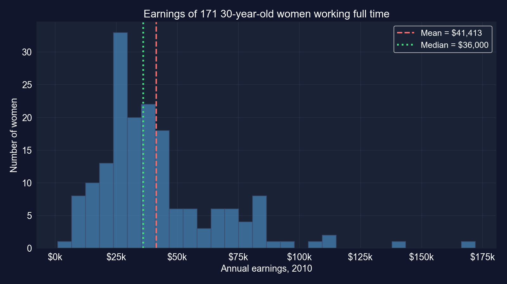

[女性の64%が平均より少なく稼いでいます。ここでの推測は**平均**に関するものであり、平均は典型的な稼ぎ手ではありません。]{.takeaway .fragment}

::: {.notes}
章のデータから本スライド用に計算した図です。収入は$1,050から$172,000に及び、歪度は1.71です。n = 171 では中心極限定理により、収入が歪んでいても平均の標本分布は正規分布に近く、t に基づく推測はなお妥当です。歪んだ母集団からのごく小さな標本では妥当ではありません。
:::

## コード：データを読み込み、標準誤差を計算する

``` {.python code-line-numbers="1-3|4-6|7-10|11-14"}
import numpy as np                          # square roots
import pandas as pd                         # tabular data
from scipy import stats                     # t and normal distributions (used later)
url = "https://raw.githubusercontent.com/quarcs-lab/data-open/master/AED/AED_EARNINGS.DTA"
data_earnings = pd.read_stata(url)          # 171 women aged 30, full-time, 2010
earnings = data_earnings["earnings"]        # annual earnings in dollars
n = len(earnings)                           # sample size
mean_earnings = earnings.mean()             # sample mean x-bar
std_earnings = earnings.std(ddof=1)         # sample std dev s (divides by n - 1)
se_earnings = std_earnings / np.sqrt(n)     # standard error = s / sqrt(n)
print(f"n = {n}")                           # 171
print(f"Mean: ${mean_earnings:,.2f}")       # point estimate of mu
print(f"Std dev: ${std_earnings:,.2f}")     # spread across women
print(f"Std error: ${se_earnings:,.2f}")    # spread of x-bar across samples
```

[↗ Colab で試す](https://colab.research.google.com/notebooks/empty.ipynb){.colab-link target="_blank" data-preview-link="false"}

::: {.notes}
自己完結型：空のColabセルに貼り付けてください。ddof=1 は n ではなく n − 1 で割ることで標本標準偏差を与えます。4.2〜4.4節と4.6節のすべてが、この四つの数値を再利用します。
:::

## 出力：ノイズの多い標本から得た正確な推定値 {.smaller}

:::: {.columns}
::: {.column width="48%"}
| 統計量 | 値 |
|:--|--:|
| $n$ | 171 |
| 平均 $\bar{x}$ | \$41,412.69 |
| 中央値 | \$36,000.00 |
| 標準偏差 $s$ | \$25,527.05 |
| 標準誤差 $s/\sqrt{n}$ | [\$1,952.10]{.key} |

[$\text{se} = 25{,}527.05/\sqrt{171} = 1{,}952.10$]{.comment}
:::
::: {.column width="52%"}
**標準誤差が $n$ とともにどう変わるか**（同じ $s$）：

| 標本サイズ | 標準誤差 |
|:--|--:|
| $n = 43$（¼の数） | \$3,893 |
| $n = 171$（私たちのもの） | \$1,952 |
| $n = 684$（4倍） | \$976 |
:::
::::

[個々の収入は約 \$25,500 ばらつきますが、その171個の*平均*はわずか約 \$1,950 しかばらつきません。]{.takeaway .fragment}

::: {.notes}
標準誤差が s の13分の1なのは √171 ≈ 13.1 だからです。43人の女性では標準誤差はおよそ倍増し、$3,893 になります。ちょうど 2 × 1,952 = 3,904 にならないのは、43 が 171/4 より少し多いからです。一般に、標本を4分の1にすると標準誤差は倍になり、4倍にすると半分になります。
:::

## 標準誤差の読み方

::: {.incremental}
- **反復抽出の意味**：171人の女性の標本を何度も抽出すれば、その平均は典型的には $\mu$ から約 \$1,950 だけ異なるでしょう
- **平均に対する精度**：\$1,952 は \$41,413 の5%未満なので、推定値はそれなりに正確です
- **平方根の法則**：精度は $\sqrt{n}$ とともに高まるので、標準誤差を半分にするには**4倍**のデータが必要です
:::

[重要なポイント4.1：標準誤差は、これ以降のすべての区間と検定の背後にある唯一の数値です。]{.takeaway .fragment}

::: {.notes}
平方根の法則は、調査が高くつく理由です。±$3,900から±$1,950にするには4倍の標本が、±$975にするには16倍が必要です。
:::

## 標準誤差が前提とすること

:::: {.columns}
::: {.column width="50%"}
### 必要とするもの
- **無作為標本**：各女性は母集団からの独立な抽出である
- 公式 $s/\sqrt{n}$ は**独立性**の上に成り立つ
:::
::: {.column width="50%"}
### 捉えないもの
- **非標本誤差**：誤って報告された収入、無回答
- **従属性**：クラスター化されたデータや時系列データには別の標準誤差が必要（第7, 12, 17章）
:::
::::

[標準誤差は標本ノイズのみを、しかも独立性のもとでのみ測ります。4.5節のGDP成長が、独立性が崩れたときに何が起こるかを示します。]{.takeaway .fragment}

::: {.notes}
標準的な留意点。この公式は独立な抽出について導かれています。クラスターを持つ調査データや、今四半期が前四半期に似ている時系列はこれを破り、s/√n 公式は真の不確実性を過小評価します。
:::

# 4.2節 · なぜ正規分布でなく $t$ の物差しなのか {#s42 .divider background-color="#7A209F"}

[$t$ 統計量 · 自由度 · 厚い裾]{.act}

::: {.notes}
4.2節：t統計量とt分布。道具は標本平均の標準化、自由度、臨界値です。
:::

## $t$ 統計量は標本平均を標準化する

$$t = \frac{\bar{x} - \mu}{\text{se}(\bar{x})} = \frac{\bar{x} - \mu}{s/\sqrt{n}} \;\sim\; T(n-1)$$

::: {.incremental}
- もし $\sigma$ を知っていれば、$(\bar{x}-\mu)/(\sigma/\sqrt{n})$ は標準正規分布に従うでしょう
- $\sigma$ を $s$ で**推定**するため、その追加の不確実性が裾を厚くします。これが自由度 $n-1$ の $t$ 分布です
- 母集団が正規分布のとき厳密に成り立ちます。そうでなくても中程度の $n$ では良い近似です（中心極限定理）
:::

[裾が厚いほど臨界値は大きくなります。それが $\sigma$ を知らないことの代償です。]{.takeaway .fragment}

::: {.notes}
重要なポイント4.2。自由度が n − 1 なのは、s を計算する前に平均を推定するのに自由度を一つ使うからです。
:::

## $t$ 分布は $n$ が大きくなるにつれて正規分布に近づく

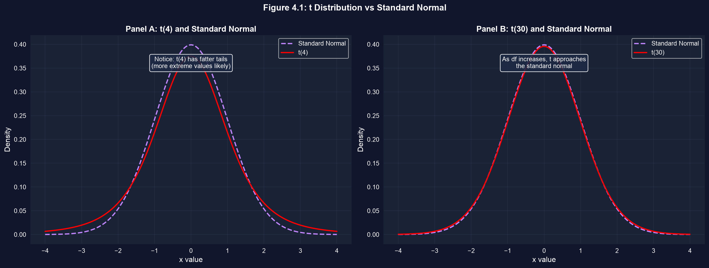

[自由度4では、±2を超える値は正規分布のもとでの2倍以上起こりやすくなります。]{.takeaway .fragment}

::: {.notes}
章の図4.1。本スライド用に計算した数値：P(|T| > 2) は t(4) で11.6%、t(30) で5.5%、標準正規分布で4.6%です。
:::

## コード：異なる自由度に対する臨界値

``` {.python code-line-numbers="1|2-4|5-6"}
from scipy import stats                     # t and normal distributions
for df in [4, 9, 30, 99, 170]:              # degrees of freedom = n - 1
    t_crit = stats.t.ppf(0.975, df)         # 97.5th percentile: two-sided 5% cutoff
    print(f"df = {df:>3}: t critical = {t_crit:.3f}")
z_crit = stats.norm.ppf(0.975)              # the normal's cutoff, for comparison
print(f"normal:   z critical = {z_crit:.3f}")   # 1.960
```

[↗ Colab で試す](https://colab.research.google.com/notebooks/empty.ipynb){.colab-link target="_blank" data-preview-link="false"}

[本スライド用に計算。章の演習3は $n = 10$ と $n = 100$ の場合を求めます。]{.comment}

::: {.notes}
自己完結型。ppf は逆CDF（パーセント点関数）で、ある確率をその下に持つカットオフを返します。0.975 は上側の裾に2.5%を残し、これが両側5%の臨界値です。
:::

## 出力：$n = 171$ では $t$ のカットオフはほぼ正規分布のもの

| 自由度 | 標本サイズ $n$ | 両側5%臨界値 |
|:--|--:|--:|
| 4 | 5 | 2.776 |
| 9 | 10 | 2.262 |
| 30 | 31 | 2.042 |
| 99 | 100 | 1.984 |
| 170 | 171 | [1.974]{.key} |
| 正規分布（$\infty$） | — | 1.960 |

[私たちの標本では $t$ 臨界値1.974は1.96の1%以内です。だからこそ「推定値 ± 2 標準誤差」の目安が機能します。]{.takeaway .fragment}

::: {.notes}
章の目安：n > 30 では t(n−1, 0.025) ≈ 2 です。補正が重要なのは小標本のときだけです。10観測では カットオフが2.26なので、1.96を使うと区間が狭すぎることになります。
:::

# 4.3節 · $\mu$ のどの値がもっともらしいか {#s43 .divider background-color="#7A209F"}

[信頼区間 · 誤差の幅 · 信頼度と精度のトレードオフ]{.act}

::: {.notes}
4.3節：信頼区間。道具は信頼区間の公式、正しい反復抽出の解釈、そして信頼度と幅のトレードオフです。
:::

## 信頼区間は推定値 ± 誤差の幅

$$\bar{x} \;\pm\; t_{n-1,\,\alpha/2} \times \text{se}(\bar{x})$$

::: {.incremental}
- $t_{n-1,\,\alpha/2}$：臨界値。95%信頼では $\alpha = 0.05$ で、各裾に2.5%を残します
- **誤差の幅** $= t_{n-1,\,\alpha/2} \times \text{se}(\bar{x})$
- **意味**：抽出を何度も繰り返せば、このように構成した区間の約95%が $\mu$ を含みます
:::

[区間はランダムで、$\mu$ は固定です。95%は*手法*を記述するもので、この一つの区間を記述するものではありません。]{.takeaway .fragment}

::: {.notes}
重要なポイント4.3。「95%の信頼がある」という言い回しは反復抽出の性質の略記です。n > 30 の目安：x̄ ± 2 × se。
:::

## コード：平均収入に対する95%信頼区間

``` {.python code-line-numbers="1-5|6-8|9-11|12-13"}
import numpy as np                          # square roots
import pandas as pd                         # tabular data
from scipy import stats                     # t distribution
url = "https://raw.githubusercontent.com/quarcs-lab/data-open/master/AED/AED_EARNINGS.DTA"
earnings = pd.read_stata(url)["earnings"]   # 171 women, annual earnings
n = len(earnings)                           # sample size
mean_earnings = earnings.mean()             # x-bar
se_earnings = earnings.std(ddof=1) / np.sqrt(n)    # s / sqrt(n)
conf_level = 0.95                           # confidence level
alpha = 1 - conf_level                      # 0.05
t_crit = stats.t.ppf(1 - alpha/2, n - 1)    # critical value t(170, 0.025)
margin_of_error = t_crit * se_earnings      # half-width of the interval
print(mean_earnings - margin_of_error, mean_earnings + margin_of_error)  # the CI
```

[↗ Colab で試す](https://colab.research.google.com/notebooks/empty.ipynb){.colab-link target="_blank" data-preview-link="false"}

::: {.notes}
自己完結型。章のコードは、4.1節の変数を再利用する点を除いて同一です。
:::

## 出力：\$37,559 から \$45,266 {.smaller}

| 要素 | 値 |
|:--|--:|
| 標本平均 $\bar{x}$ | \$41,412.69 |
| 標準誤差 | \$1,952.10 |
| 臨界値 $t_{170,\,0.025}$ | 1.9740 |
| 誤差の幅 $1.9740 \times 1{,}952.10$ | \$3,853.48 |
| **95%信頼区間** | [[\$37,559.21,&nbsp;\$45,266.17]]{.key} |

[幅 \$7,707 · $t(170)$ 分布で計算]{.comment}

[データは約 \$37,600 から \$45,300 までのどの母集団平均とも整合的です。]{.takeaway .fragment}

::: {.notes}
区間は$36,000と$46,000を除外するので、これらの値はμとしてもっともらしくありません。一方$40,000は余裕をもって区間内に入ります。この最後の事実は4.4節の仮説検定の結果として再び現れます。
:::

## 区間を正しく読む

:::: {.columns}
::: {.column width="50%"}
### 正しい
- このように構成した区間の95%が、反復抽出にわたって $\mu$ を含む
- 「$\mu$ が \$37,559 から \$45,266 の間にあると95%の信頼がある」、上記の略記として
- 区間は**標本抽出**の不確実性のみを反映する
:::
::: {.column width="50%"}
### 誤り
- 「$\mu$ が**この**区間にある確率が95%である」
- 「女性の95%が \$37,559 から \$45,266 の間で稼ぐ」
- 「区間がデータの95%を含む」
:::
::::

[区間は**平均**に関するものです。個々の収入は \$1,050 から \$172,000 に及びます。]{.takeaway .fragment}

::: {.notes}
二つ目の誤った読み方は学生の課題で最もよく見られます。信頼区間の幅（約$7,700）を個々の収入の標準偏差（約$25,500）と対比してください。
:::

## シミュレーション：40区間のうち39が平均を捉える

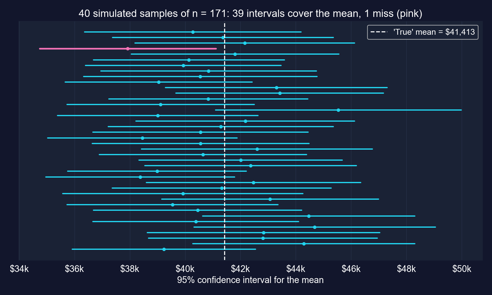

[各区間は $\mu$ を含むか含まないかのいずれかです。95%は手続きの長期的な的中率です。]{.takeaway .fragment}

::: {.notes}
章の演習8の精神に沿って本スライド用に作成したシミュレーション（シード42）です。観測された171の収入を母集団とみなし（その平均$41,413を「真の」μとする）、復元抽出で171の標本を40回抽出します。40区間なら約2回の外れが期待されますが、1回でした。収入は歪んでいますが、t区間はn = 171でよく機能します。
:::

## コード：同じデータを90%、95%、99%信頼で

``` {.python code-line-numbers="1|2-4|5-8|9"}
# continues from the previous block (n, mean_earnings, se_earnings defined)
for conf in [0.90, 0.95, 0.99]:              # three confidence levels
    alpha = 1 - conf                        # tail probability, split in two
    t_crit = stats.t.ppf(1 - alpha/2, n - 1)    # larger for higher confidence
    ci_lower = mean_earnings - t_crit * se_earnings   # lower bound
    ci_upper = mean_earnings + t_crit * se_earnings   # upper bound
    width = ci_upper - ci_lower             # full width of the interval
    label = f"{conf*100:.0f}%"              # "90%", "95%", "99%"
    print(f"{label:<5} t={t_crit:.3f} [{ci_lower:,.2f}, {ci_upper:,.2f}] width {width:,.2f}")
```

[↗ Colab で試す](https://colab.research.google.com/notebooks/empty.ipynb){.colab-link target="_blank" data-preview-link="false"}

::: {.notes}
三つの行の間で変わるのは臨界値だけです。推定値とその標準誤差は同じです。
:::

## 出力：より高い信頼度は幅を要する {.smaller}

| 水準 | 臨界値 | 下限 | 上限 | 幅 |
|:--|--:|--:|--:|--:|
| 90% | 1.654 | \$38,184.17 | \$44,641.21 | \$6,457.03 |
| 95% | 1.974 | \$37,559.21 | \$45,266.17 | \$7,706.97 |
| 99% | 2.605 | \$36,327.35 | \$46,498.03 | [\$10,170.68]{.key} |

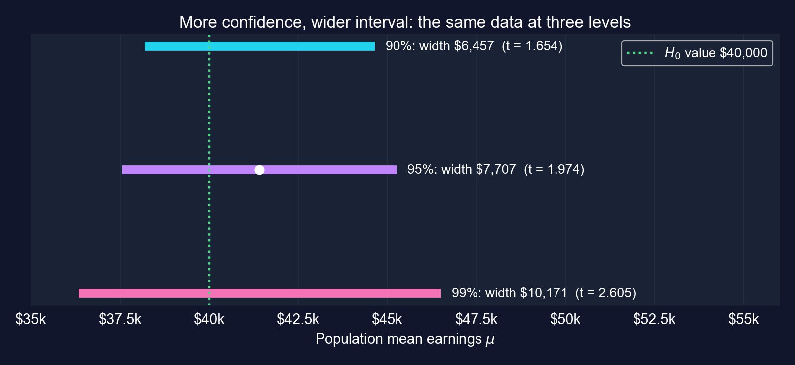{height="270"}

[90%から99%信頼へ移ると区間は58%広くなります。より大きな標本だけが信頼度と精度の両方を買えます。]{.takeaway .fragment}

::: {.notes}
幅の比 10,170.68 / 6,457.03 = 1.575。n = 684（4倍）ならどの区間も約半分の幅になります。95%は経済学の慣例です。誤った主張が高くつくときは99%、探索的な作業には90%が使われます。
:::

# 4.4節 · $\mu = \$40{,}000$ は信用できるか {#s44 .divider background-color="#7A209F"}

[両側検定 · $p$値 · 臨界値 · 第一種・第二種の誤り · 検出力]{.act}

::: {.notes}
4.4節：両側仮説検定。道具はH0とHa、検定統計量、二つの等価な決定規則、信頼区間との双対性、二種類の誤り、そして検出力です。
:::

## 仮説検定は、主張がデータに耐えるかを問う

$$H_0: \mu = \mu_0 \quad \text{対} \quad H_a: \mu \neq \mu_0 \qquad\qquad t = \frac{\bar{x} - \mu_0}{\text{se}(\bar{x})} \sim T(n-1) \text{（$H_0$ が真のとき）}$$

::: {.incremental}
- **$p$値規則**：$p = 2 \times \Pr[T_{n-1} \geq |t|]$。$p < \alpha$ なら $H_0$ を棄却
- **臨界値規則**：$|t| > t_{n-1,\,\alpha/2}$ なら $H_0$ を棄却
- 二つの規則は**常に一致**し、両方とも信頼区間と一致します。$\mu_0$ が $100(1-\alpha)\%$ 区間の外にあるときにちょうど棄却します
:::

[検定は推定値と主張の差を**標準誤差**単位で測り、主張が真であればその差がどれほど異常かを問います。]{.takeaway .fragment}

::: {.notes}
重要なポイント4.4。例：α = 0.05 で H0: μ = $40,000 に対し Ha: μ ≠ $40,000。
:::

## コード：$H_0: \mu = \$40{,}000$ を検定する

``` {.python code-line-numbers="1-6|7|8|9|10|11-13"}
import numpy as np                          # square roots
import pandas as pd                         # tabular data
from scipy import stats                     # t distribution
url = "https://raw.githubusercontent.com/quarcs-lab/data-open/master/AED/AED_EARNINGS.DTA"
earnings = pd.read_stata(url)["earnings"]   # 171 women, annual earnings
n, mean_earnings = len(earnings), earnings.mean()          # n and x-bar
se_earnings = earnings.std(ddof=1) / np.sqrt(n)            # standard error
mu0 = 40000                                 # hypothesized value under H0
t_stat = (mean_earnings - mu0) / se_earnings               # distance in SEs
p_value = 2 * (1 - stats.t.cdf(abs(t_stat), n - 1))        # two-sided p-value
t_crit_95 = stats.t.ppf(0.975, n - 1)       # critical value for alpha = 0.05
print(f"t = {t_stat:.4f}, p = {p_value:.4f}, critical = ±{t_crit_95:.4f}")
print("Reject H0" if p_value < 0.05 else "Do not reject H0")   # the decision
```

[↗ Colab で試す](https://colab.research.google.com/notebooks/empty.ipynb){.colab-link target="_blank" data-preview-link="false"}

::: {.notes}
自己完結型。stats.t.cdf(|t|, n − 1) は |t| より下の確率で、1からそれを引くと上側の裾の面積になり、両側検定ではそれを2倍します。
:::

## 出力：$H_0$ を棄却しない {.smaller}

:::: {.columns}
::: {.column width="46%"}
| | 値 |
|:--|--:|
| $\bar{x} - \mu_0$ | \$1,412.69 |
| 標準誤差 | \$1,952.10 |
| $t$統計量 | [0.7237]{.key} |
| $p$値（両側） | 0.4703 |
| 臨界値 | ±1.9740 |
| $\alpha = 0.05$ での決定 | 棄却しない |

[$\$40{,}000$ は95%信頼区間 [\$37,559, \$45,266] の内側にある]{.comment}
:::
::: {.column width="54%"}
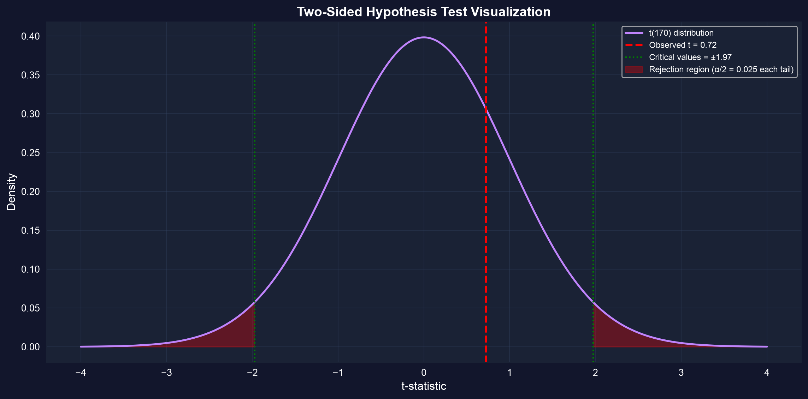
:::
::::

[標本平均は \$40,000 から標準誤差一つ分未満の距離にあり、ありふれた量の標本ノイズです。]{.takeaway .fragment}

::: {.notes}
両方の規則が一致します：p = 0.4703 > 0.05 で、|t| = 0.72 < 1.974。もしμが本当に$40,000なら、これと少なくとも同じくらい離れた標本平均が（どちらの方向であれ）約47%の確率で生じます。
:::

## 「棄却しない」が意味すること、意味しないこと

::: {.incremental}
- **意味すること**：データは $\mu = \$40{,}000$ と*整合的*である
- **意味しないこと**：$\mu = \$40{,}000$ であること。\$41,000、\$43,000、\$45,000 も整合的で、信頼区間はそれらをすべて挙げます
- **$p$値は** $\Pr[H_0 \text{ が真}]$ **ではない**：それは*$H_0$ が真であれば*これと少なくとも同じくらい大きな差が生じる確率です
- 結果は**第二種の誤り**かもしれません：この標本が検出するには小さすぎる、実在する差
:::

[重要なポイント4.6：「棄却しない」は「受け入れる」ではありません。データがなお許す差の大きさを示す信頼区間を報告してください。]{.takeaway .fragment}

::: {.notes}
証拠の不在は不在の証拠ではありません。この区間は$40,000より最大$5,266上の母集団平均を許します。
:::

## 二つの間違え方 {.smaller}

| | 現実に $H_0$ が真 | 現実に $H_0$ が偽 |
|:--|:--|:--|
| **$H_0$ を棄却** | **第一種の誤り**（誤警報）、確率 $\alpha$ | 正しい：**検出力** $= 1-\beta$ |
| **$H_0$ を棄却しない** | 正しい、確率 $1-\alpha$ | **第二種の誤り**（見逃し）、確率 $\beta$ |

::: {.incremental}
- $\alpha$ は私たちが**選びます**（例：0.05）。$\beta$ は $n$、真の差、そして $\alpha$ に依存します
- $\alpha$ を0.01に下げると誤警報は減りますが $\beta$ は**上がり**ます。0.10に上げるとその逆になります
- **より大きな標本**（または、より大きな真の効果）だけが両方を同時に下げます
:::

[収入の検定では棄却しなかったので、犯しえた唯一の誤りは第二種の誤りです。]{.takeaway .fragment}

::: {.notes}
各誤りのコストに応じてαを選びます。誤った主張が非常に高くつく医学試験ではα = 0.01を、探索的な作業では時に0.10を使います。検出力の通常の目標は80%（β = 0.20）です。
:::

## コード：この検定が実在する差を検出できる見込みはどれほどだったか

``` {.python code-line-numbers="1|2-3|4-7|8"}
# continues from the previous block (earnings, mu0 defined) — computed for these slides
s = earnings.std(ddof=1)                    # sample std dev, treated as known
for n_size in [171, 684]:                   # our sample, and 4x larger
    se = s / np.sqrt(n_size)                # standard error at this n
    df, c = n_size - 1, stats.t.ppf(0.975, n_size - 1)   # df and 5% critical value
    nc = (41412.69 - mu0) / se              # gap in SEs if the true mean were $41,412.69
    power = stats.nct.sf(c, df, nc) + stats.nct.cdf(-c, df, nc)   # P(|T| > c)
    print(f"n = {n_size}: power = {power:.3f}")   # probability of rejecting H0
```

[↗ Colab で試す](https://colab.research.google.com/notebooks/empty.ipynb){.colab-link target="_blank" data-preview-link="false"}

::: {.notes}
検出力は章では計算されておらず、言葉で論じられています。この計算はスライド用に追加しました。真の平均が$41,412.69なら、検定統計量は非心度 (μ − μ0)/se を持つ非心t分布に従います。検出力は |T| が臨界値を超える確率です。stats.nct はscipyの非心tです。
:::

## 出力：この検定は \$1,400 の差を検出する見込みがほとんどなかった {.smaller}

:::: {.columns}
::: {.column width="40%"}
| 真の平均 | $n = 171$ | $n = 684$ |
|:--|--:|--:|
| \$41,413 | [0.11]{.key} | 0.30 |
| \$45,000 | 0.72 | 1.00 |

[$\mu = \$40{,}000$ の両側5%検定の検出力]{.comment}

**80%の検出力で検出される最小の差：**

- \$5,500（$n = 171$）
- \$2,738（$n = 684$）
:::
::: {.column width="60%"}
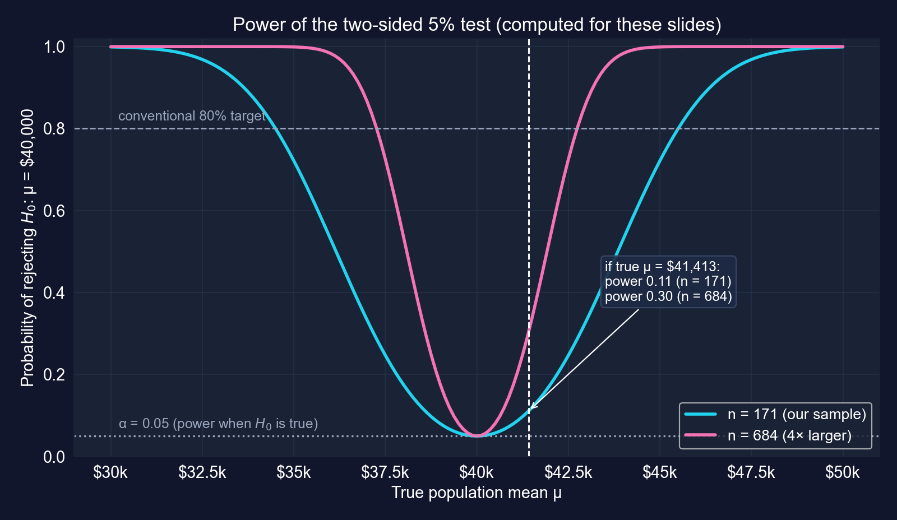
:::
::::

[たとえ \$41,413 が真実だったとしても、検定は11%の確率でしか棄却しないでしょう。ここで棄却しないことは、$\mu$ についてよりも標本サイズについて多くを語っています。]{.takeaway .fragment}

::: {.notes}
本スライド用に計算。章自身の論法（重要なポイントの用語集）：標本を4倍にするとtは約1.45に倍増しますが、なお1.96を下回ります。検出力曲線がそれを正確にします。684人の女性でもμ = $41,413での検出力はなお0.30にすぎません。n = 684, μ = $45,000では検出力は0.9992で、1.00と表示されます。検出力はμ = μ0でちょうどα = 0.05に等しくなります。
:::

# 4.5節 · 実際の問いに対する三つの検定 {#s45 .divider background-color="#7A209F"}

[ガソリン価格 · 男性収入 · GDP成長]{.act}

::: {.notes}
4.5節は同じ両側検定を三つの新しいデータセットに適用し、三つの非常に異なる答えを与えます。それぞれが、糸の三つの問い—実在するか、重要か、判別できたか—を問う機会です。
:::

## 同じ検定、三つのデータセット、三つの異なる教訓 {.smaller}

| 例 | データ | $H_0$ | $t$ | $p$ | 決定 | 教訓 |
|:--|:--|:--|--:|--:|:--|:--|
| ガソリン価格 | 32給油所、Yolo郡 | $\mu = \$3.81$ | [−5.26]{.key} | <&nbsp;0.0001 | 棄却 | 小さな差も非常に正確でありうる |
| 男性収入 | 30歳の男性191人 | $\mu = \$50{,}000$ | 0.50 | 0.617 | 棄却しない | 重い裾、不正確な平均 |
| GDP成長 | 241四半期、アメリカ | $\mu = 2.0\%$ | −0.07 | 0.946 | 棄却しない | 従属データ、標準誤差が小さすぎる |

[一つのレシピ、三つの判定。解釈は常に数字の背後にあるデータに依存します。]{.takeaway .fragment}

::: {.notes}
重要なポイント4.7：検定のパターンは応用を通じて同じで、意味は文脈から来ます。次のスライドでは各例を独自の弧に沿って追います。
:::

## ガソリン価格：Yolo郡の価格は州の価格と異なるか

**問い。** Yolo郡の給油所の平均価格は、カリフォルニアの平均 \$3.81 / ガロンと異なるか。

**データ。** `AED_GASPRICE.DTA`：三つの都市の32給油所（West Sacramento 15、Davis 10、Woodland 7）。

$$H_0: \mu = 3.81 \qquad H_a: \mu \neq 3.81 \qquad \text{自由度} 31 \text{ の } t$$

[両側の問い：価格は州平均より高くも低くもなりえます。]{.takeaway .fragment}

::: {.notes}
章はこれを統計的 対 実際的有意性の古典的な例として位置づけます。自由度31の臨界値は2.04で、標本が小さいため1.96を少し上回ります。
:::

## コード：ガソリン価格の主張を検定する

``` {.python code-line-numbers="1-5|6-9|10-12|13"}
import numpy as np                          # square roots
import pandas as pd                         # tabular data
from scipy import stats                     # t distribution
url = "https://raw.githubusercontent.com/quarcs-lab/data-open/master/AED/AED_GASPRICE.DTA"
price = pd.read_stata(url)["price"]         # price per gallon at 32 stations
mean_price = price.mean()                   # sample mean
std_price = price.std(ddof=1)               # sample std dev
n_price = len(price)                        # 32 stations
se_price = std_price / np.sqrt(n_price)     # standard error
mu0_price = 3.81                            # California state average
t_stat_price = (mean_price - mu0_price) / se_price               # distance in SEs
p_value_price = 2 * (1 - stats.t.cdf(abs(t_stat_price), n_price - 1))   # two-sided p
print(f"mean {mean_price:.4f}, se {se_price:.4f}, t {t_stat_price:.4f}, p {p_value_price:.6f}")
```

[↗ Colab で試す](https://colab.research.google.com/notebooks/empty.ipynb){.colab-link target="_blank" data-preview-link="false"}

::: {.notes}
自己完結型。章のコードです。
:::

## 出力：14セントの差、標準誤差5つ分以上の幅 {.smaller}

:::: {.columns}
::: {.column width="40%"}
| | 値 |
|:--|--:|
| $n$ | 32 |
| 平均 | \$3.6697 |
| 標準偏差 | \$0.1510 |
| 標準誤差 | \$0.0267 |
| $t$ | [−5.2577]{.key} |
| $p$（両側） | 0.00001 |
| 95%信頼区間 | [\$3.615,&nbsp;\$3.724] |
:::
::: {.column width="60%"}
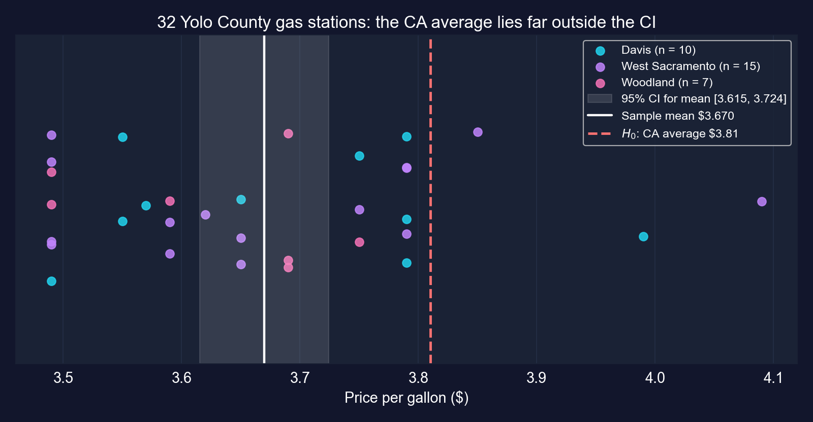
:::
::::

[$H_0$ を棄却：Yolo郡の価格は州平均より低く、\$3.81 は95%信頼区間のはるか外にあります。]{.takeaway .fragment}

::: {.notes}
p = 0.0000103で、章は0.0000と印刷し< 0.0001と記述します。95%信頼区間（本スライド用に t(31) = 2.04 で計算）は$3.615から$3.724です。図はすべての給油所を示します。白い帯は平均に対する信頼区間で、個々の価格に対するものではありません。
:::

## 実在するか、そして重要か

::: {.incremental}
- **実在するか** はい：$t = -5.26$。価格は給油所間でほとんど変動しない（標準偏差15¢）ので、標準誤差は3¢未満で、14セントの差は容易に検出できます
- **重要か** 14¢ × 15ガロン = **1タンクあたり \$2.10**。年に52回給油すれば、約**年 \$109**：世帯にとって意味があります
- **判別できたか** はい、容易に：小さな標準誤差による高い検出力、わずか32給油所でも
:::

[重要なポイント4.5：小さな差でも、正確に測定されれば高度に有意でありえます。有意性は差の大きさではなく、その標準誤差に対する差に関するものです。]{.takeaway .fragment}

::: {.notes}
章の実際的有意性の計算は、丸めた14¢の差を使います：0.14 × 15 = $2.10、× 52 = $109.20。丸めない14.03¢の差では年額は$109.44です。
:::

## ガソリン価格検定への留意点

::: {.incremental}
- **標本抽出**：三つの都市の32給油所であって、郡の全給油所の無作為標本ではありません。West Sacramentoだけで標本のほぼ半分です
- **時点**：一回のスナップショット。比較が公平であるには、州平均が同じ期間を指す必要があります
- **基準値それ自体が推定値**：\$3.81 は既知の定数として扱われています
- 検定が言うのはYoloの価格が**平均的に**低いということです。ある給油所は \$4.09 で売っています
:::

[0.00001 の $p$値が解決するのは標本ノイズの問題だけです。無作為でない標本や、ずれた基準値を直すことはできません。]{.takeaway .fragment}

::: {.notes}
標準的な留意点。都市の件数はデータの都市変数から来ます。価格が一日で収集され、州平均が月平均を指すなら、差の一部は場所ではなく時点を反映しているかもしれません。
:::

## 男性収入：30歳の男性は \$50,000 より多く稼ぐか

**データ。** `AED_EARNINGSMALE.DTA`：フルタイムで働く30歳の男性191人、2010年。

**章の検定**は両側です：

$$H_0: \mu = 50{,}000 \qquad H_a: \mu \neq 50{,}000$$

[問いは**方向性がある**（「より多い」）ので、その自然な形は片側です。章はそれを4.6節に送ります。本スライドは両方を報告します。]{.takeaway .fragment}

::: {.notes}
章はここで両側検定を計算し、片側検定の方が適切だと注記します。4.6節はその片側の例を代わりに女性収入のデータで実行するので、男性の片側p値は本スライド用に計算します。
:::

## コード：男性収入の主張を検定する

``` {.python code-line-numbers="1-5|6-9|10-13|14-15"}
import numpy as np                          # square roots
import pandas as pd                         # tabular data
from scipy import stats                     # t distribution
url = "https://raw.githubusercontent.com/quarcs-lab/data-open/master/AED/AED_EARNINGSMALE.DTA"
earnings_male = pd.read_stata(url)["earnings"]   # 191 men, annual earnings
mean_male = earnings_male.mean()            # sample mean
std_male = earnings_male.std(ddof=1)        # sample std dev
n_male = len(earnings_male)                 # 191
se_male = std_male / np.sqrt(n_male)        # standard error
mu0_male = 50000                            # hypothesized value
t_stat_male = (mean_male - mu0_male) / se_male                      # distance in SEs
p_value_male = 2 * (1 - stats.t.cdf(abs(t_stat_male), n_male - 1)) # two-sided p
p_upper_male = 1 - stats.t.cdf(t_stat_male, n_male - 1)             # one-sided (Ha: mu > 50,000)
print(f"mean {mean_male:,.2f}, se {se_male:,.2f}, t {t_stat_male:.4f}")   # estimate and t
print(f"two-sided p {p_value_male:.4f}, one-sided p {p_upper_male:.4f}")   # both p-values
```

[↗ Colab で試す](https://colab.research.google.com/notebooks/empty.ipynb){.colab-link target="_blank" data-preview-link="false"}

::: {.notes}
自己完結型。最後の計算行（p_upper_male）は本スライド用に追加したもので、残りは章のコードです。
:::

## 出力：\$2,354 の差が \$4,706 の標準誤差に埋もれている {.smaller}

:::: {.columns}
::: {.column width="40%"}
| | 値 |
|:--|--:|
| $n$ | 191 |
| 平均 | \$52,353.93 |
| 中央値 | \$38,000 |
| 標準偏差 | \$65,034.74 |
| 標準誤差 | \$4,705.75 |
| $t$ | [0.5002]{.key} |
| $p$（両側） | 0.6175 |
| $p$（片側、$H_a: \mu > 50{,}000$） | 0.3087 |
| 95%信頼区間 | [\$43,072,&nbsp;\$61,636] |
:::
::: {.column width="60%"}
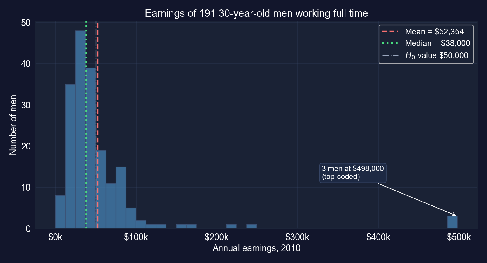
:::
::::

[どちらにしても棄却しません。男性の平均収入が \$50,000 を超えるかは未解決です。信頼区間は \$43,100 から \$61,600 に及びます。]{.takeaway .fragment}

::: {.notes}
片側pと95%信頼区間は本スライド用に計算しています。tが正（Haの方向）なので、片側p値は両側の半分です。
:::

## なぜ男性収入の検定は検出力がこれほど低いのか

::: {.incremental}
- **重い裾**：三人の男性がデータの上限値 \$498,000 に記録され、一人が \$1 に記録されています。標準偏差（\$65,035）は女性の2.5倍です
- 平均（\$52,354）は中央値（\$38,000）をはるかに上回ります。上限値の三人を除けば \$45,243 になります
- 大きな標準偏差は大きな標準誤差を意味するので、\$2,354 の差は標準誤差わずか半分です
:::

[ここで棄却しないことは、主としてノイズに関する言明です。三人に左右される平均は、推測にとって脆弱な標的です。]{.takeaway .fragment}

::: {.notes}
章は棄却しない理由を三つ挙げます：H0が真、検出力不足、高い変動性。データは三つ目を強く示します。上限値の三観測を除いた平均は、本スライド用に計算した単なる記述的な確認であって、推奨される推定量ではありません。上限値があると、真の平均はむしろ標本平均より高いはずです。中央値などのロバストな要約は本書の後の方で扱います。
:::

## GDP成長：アメリカの成長は年平均2%だったか

**データ。** `AED_REALGDPPC.DTA`：アメリカの実質一人当たりGDP、**四半期**、1959Q1〜2020Q1。変数 `growth` は**前年同期比**成長率なので1960Q1から始まります：**241の四半期観測**。

$$H_0: \mu = 2.0 \qquad H_a: \mu \neq 2.0 \quad (\text{年率パーセント})$$

[241観測が何であるかに注意してください：重なり合う四四半期の成長率であって、241の別個の年ではありません。]{.takeaway .fragment}

::: {.notes}
データから検証：growth は 100 × (realgdppc_t / realgdppc_(t−4) − 1) に等しいです。各観測は四つの四半期のうち三つを前の観測と共有するので、連続する観測は強く相関します。したがって241観測は241の独立な年ではなく、データは約60年をカバーします。
:::

## コード：2%の基準値を検定する

``` {.python code-line-numbers="1-5|6-9|10-12|13-14"}
import numpy as np                          # square roots
import pandas as pd                         # tabular data
from scipy import stats                     # t distribution
url = "https://raw.githubusercontent.com/quarcs-lab/data-open/master/AED/AED_REALGDPPC.DTA"
growth = pd.read_stata(url)["growth"].dropna()   # first 4 quarters have no YoY growth
mean_growth = growth.mean()                 # average growth, % per year
std_growth = growth.std(ddof=1)             # sample std dev
n_growth = len(growth)                      # 241 quarters
se_growth = std_growth / np.sqrt(n_growth)  # SE, assuming independent observations
mu0_growth = 2.0                            # benchmark under H0
t_stat_growth = (mean_growth - mu0_growth) / se_growth                    # distance in SEs
p_value_growth = 2 * (1 - stats.t.cdf(abs(t_stat_growth), n_growth - 1))  # two-sided p
print(f"mean {mean_growth:.4f}, se {se_growth:.4f}, t {t_stat_growth:.4f}, p {p_value_growth:.4f}")
print(f"lag-1 autocorrelation {growth.autocorr(1):.2f}")   # neighbouring quarters move together
```

[↗ Colab で試す](https://colab.research.google.com/notebooks/empty.ipynb){.colab-link target="_blank" data-preview-link="false"}

::: {.notes}
自己完結型。章のコードに加えて、各四半期の値と前四半期の値の相関である growth.autocorr(1) を本スライド用に追加しています。
:::

## 出力：平均は1.99%だが、観測は独立ではない {.smaller}

:::: {.columns}
::: {.column width="40%"}
| | 値 |
|:--|--:|
| $n$（四半期） | 241 |
| 平均 | 1.9905% |
| 標準偏差 | 2.1781 |
| 標準誤差（i.i.d.） | 0.1403 |
| $t$ | [−0.0680]{.key} |
| $p$（両側） | 0.9458 |
| 95%信頼区間（i.i.d.） | [1.71%,&nbsp;2.27%] |
| ラグ1自己相関 | 0.87 |
:::
::: {.column width="60%"}
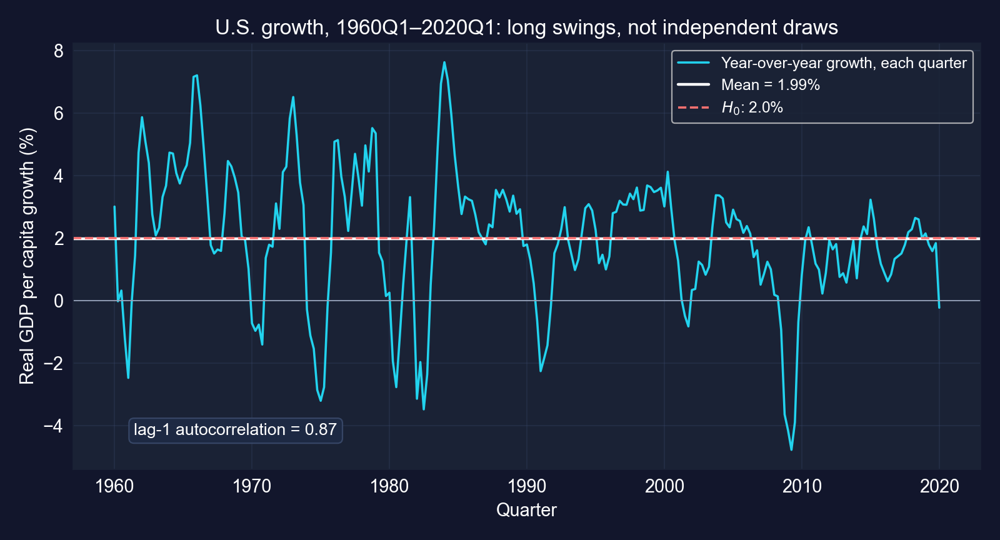
:::
::::

[2%を棄却しません。しかしラグ1相関が0.87なので、i.i.d.の標準誤差は真の不確実性を過小評価しています。]{.takeaway .fragment}

::: {.notes}
信頼区間と自己相関は本スライド用に計算しています。図は長い波（1974〜75年、1980〜82年、2008〜09年の景気後退）を示しており、平均の周りの独立な抽出ではありません。AR(1)系列の大まかな目安では、「実効的な」標本は241ではなく n(1 − ρ)/(1 + ρ) ≈ 17 独立観測となります。正しい標準誤差（HAC、第12章と第17章）は0.14の数倍になるでしょう。
:::

## 棄却しないことは2%の基準値を「検証」しない

::: {.incremental}
- **実在するか** 2%との差の証拠はないので、結果は「2%と整合的」であって「2%が確認された」ではありません
- **判別できたか** 出力が示すよりは控えめに。0.14の標準誤差は241の独立観測を前提としますが、隣接する四半期は重なります
- **重要か** はい：1.5%対2.5%の成長は、60年にわたって非常に異なる生活水準へと複利で積み上がります
:::

[重要なポイント4.6はここにも当てはまります：データは2%を棄却できませんが、それは長期率が2%*である*ことを示しません。従属データでは、より広い区間を報告してください。]{.takeaway .fragment}

::: {.notes}
棄却しないことはH0を決して確認せず、重なり合う241観測は241の独立な抽出よりはるかに少ない情報しか持ちません。章も両方の点（棄却しないことは証明ではない、1次の自己相関が約0.87なので i.i.d. の t 検定は近似にすぎない）を述べ、第17章を指し示しています。本スライドはその留意点を前面に置きます。
:::

# 4.6節 · $\mu$ は \$40,000 を*超える*か {#s46 .divider background-color="#7A209F"}

[片側（方向性のある）検定 · 上側と下側の裾]{.act}

::: {.notes}
4.6節：片側検定。道具は上側・下側の裾を持つ仮説、片裾のp値と臨界値、そして片側検定が正当であるのはどんなときかです。
:::

## 方向性のある主張は棄却域全体を一つの裾に置く {.smaller}

| 検定 | $H_0$ | $H_a$ | $p$値 | 棄却するのは |
|:--|:--|:--|:--|:--|
| 上側 | $\mu \leq \mu^*$ | $\mu > \mu^*$ | $\Pr[T_{n-1} \geq t]$ | $t > t_{n-1,\,\alpha}$ |
| 下側 | $\mu \geq \mu^*$ | $\mu < \mu^*$ | $\Pr[T_{n-1} \leq t]$ | $t < -t_{n-1,\,\alpha}$ |
| 両側 | $\mu = \mu^*$ | $\mu \neq \mu^*$ | $2\Pr[T_{n-1} \geq \lvert t \rvert]$ | $\lvert t \rvert > t_{n-1,\,\alpha/2}$ |

::: {.incremental}
- 立証したい主張は $H_a$ に置きます
- $\alpha$ のすべてが一つの裾に収まるので臨界値は小さくなります：$n = 171$ では **1.974** ではなく **1.654**
- $t$ が $H_a$ の予測する符号を持てば、片側 $p$ は両側 $p$ の**半分**です。そうでなければ**0.5を上回ります**
:::

[片側検定は選んだ方向では検出力が高く、もう一方の方向には盲目です。]{.takeaway .fragment}

::: {.notes}
重要なポイント4.8。「両側p値の半分」の規則は、推定値がHaの予測する側に落ちるときにのみ成り立ちます。ケーススタディ1の課題4が逆の場合を示します。
:::

## コード：$H_a: \mu > \$40{,}000$ の上側検定

``` {.python code-line-numbers="1-6|7|8|9|10|11"}
import numpy as np                          # square roots
import pandas as pd                         # tabular data
from scipy import stats                     # t distribution
url = "https://raw.githubusercontent.com/quarcs-lab/data-open/master/AED/AED_EARNINGS.DTA"
earnings = pd.read_stata(url)["earnings"]   # 171 women, annual earnings
n, se_earnings = len(earnings), earnings.std(ddof=1) / np.sqrt(len(earnings))   # n and SE
mu0 = 40000                                 # H0: mu <= 40,000
t_stat = (earnings.mean() - mu0) / se_earnings     # same t as the two-sided test
p_value_upper = 1 - stats.t.cdf(t_stat, n - 1)     # upper-tail area only
t_crit_upper = stats.t.ppf(0.95, n - 1)     # all 5% in the upper tail
print(f"t = {t_stat:.4f}, one-sided p = {p_value_upper:.4f}, critical = {t_crit_upper:.4f}")
```

[↗ Colab で試す](https://colab.research.google.com/notebooks/empty.ipynb){.colab-link target="_blank" data-preview-link="false"}

::: {.notes}
自己完結型。臨界値で0.975でなく0.95である点に注意してください。αを二つの裾に分けません。
:::

## 出力：基準が下がってもなお棄却なし {.smaller}

:::: {.columns}
::: {.column width="46%"}
| | 片側 | 両側 |
|:--|--:|--:|
| $t$統計量 | 0.7237 | 0.7237 |
| $p$値 | [0.2351]{.key} | 0.4703 |
| 臨界値 | 1.6539 | ±1.9740 |
| 決定 | 棄却しない | 棄却しない |

[$0.2351 = 0.4703 / 2$、$t > 0$ が $H_a$ の予測する方向を指すから]{.comment}
:::
::: {.column width="54%"}
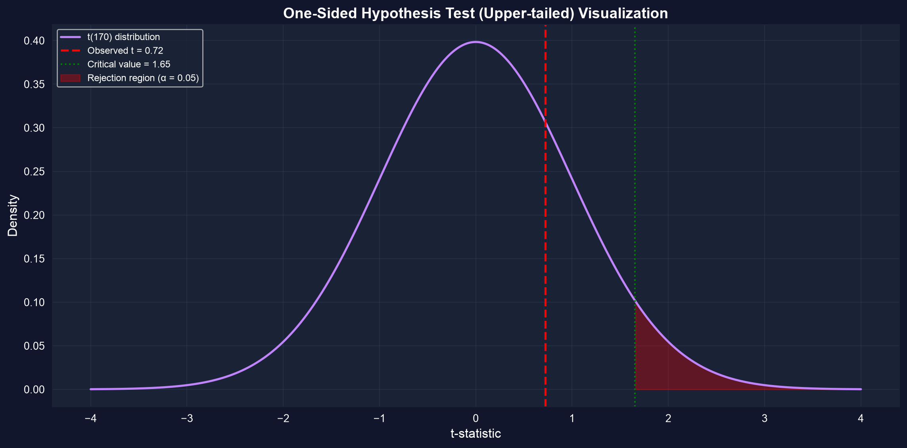
:::
::::

[平均収入が \$40,000 を超えると結論できません。どの検定を使っても、差はその標準誤差に対して小さいのです。]{.takeaway .fragment}

::: {.notes}
図は章の片側の可視化です。陰影のついた上側の裾が5%すべてを保持し、1.654で切られています。観測されたt = 0.72はそれにはるかに届きません。
:::

## 片側検定が正当であるのはどんなときか

:::: {.columns}
::: {.column width="50%"}
### 使うべきとき
- 理論や政策がデータを見る**前に**方向を定めている
- 一方向だけが決定を変える（偽薬より*優れた*薬、所得を*上げる*政策）
:::
::: {.column width="50%"}
### 避けるべきとき
- どちらの方向も興味深い
- その分野が両側検定を報告する（経済学は通常そうする）
- 両側の $p = 0.08$ を見た**後で**片側の $p = 0.04$ を得るために切り替える：それは $p$ハッキングです
:::
::::

[データを見る前に方向を決めてください。後から選んだ片側検定の真の誤警報率は5%ではなく10%です。]{.takeaway .fragment}

::: {.notes}
研究者が推定値の指す向きを見てから裾を選べば、事実上10%水準で両側検定を実施しながら5%と報告していることになります。だから選択は事前指定でなければなりません。
:::

# 4.7節 · 選挙戦は互角か {#s47 .divider background-color="#7A209F"}

[比率 · 二値データ · $z$ 検定]{.act}

::: {.notes}
4.7節：比率。道具は0/1データの平均としての標本比率、その標準誤差、正規分布に基づく信頼区間とz検定です。
:::

## 比率は単なる0/1データの平均

$$\hat{p} = \bar{x} = \frac{\#\text{はい}}{n} \qquad \text{se}(\hat{p}) = \sqrt{\frac{\hat{p}(1-\hat{p})}{n}} \qquad \text{信頼区間：} \hat{p} \pm z_{\alpha/2}\,\text{se}(\hat{p})$$

::: {.incremental}
- 各有権者を1（民主党）または0（それ以外）と符号化します：$\hat{p}$ が標本平均で、分散は $\hat{p}(1-\hat{p})$ です
- $n$ が大きいとき（目安：$n\hat{p} \geq 10$ かつ $n(1-\hat{p}) \geq 10$）は**正規**臨界値1.96を使います
- $H_0: p = p_0$ を検定するには、**$H_0$ が含意する**標準誤差を使います：$z = (\hat{p} - p_0)/\sqrt{p_0(1-p_0)/n}$
:::

[平均について学んだすべてが引き継がれます。変わるのは標準誤差の公式だけです。]{.takeaway .fragment}

::: {.notes}
重要なポイント4.9。二つの異なる標準誤差が現れます：信頼区間は p̂(1 − p̂)/n を、検定は p0(1 − p0)/n を使います。H0のもとでは分散がわかっているからです。p̂ = 0.521 と p0 = 0.5 ではほとんど同一です（0.01646 対 0.01648）。
:::

## コード：921人の有権者のうち480人が民主党に投票するつもり

``` {.python code-line-numbers="1-2|3-6|7-9|10-16"}
import numpy as np                          # square roots
from scipy import stats                     # normal distribution
n_total = 921                               # voters polled
n_success = 480                             # intend to vote Democrat
p_hat = n_success / n_total                 # sample proportion
se_prop = np.sqrt(p_hat * (1 - p_hat) / n_total)   # SE at p-hat (for the CI)
z_crit = 1.96                               # normal critical value, 95%
ci_lower_prop = p_hat - z_crit * se_prop    # lower bound
ci_upper_prop = p_hat + z_crit * se_prop    # upper bound
p0 = 0.50                                   # H0: tied race
se_under_h0 = np.sqrt(p0 * (1 - p0) / n_total)     # SE implied by H0
z_stat = (p_hat - p0) / se_under_h0         # z statistic
p_value_prop = 2 * (1 - stats.norm.cdf(abs(z_stat)))   # two-sided p (normal)
print(f"p_hat {p_hat:.4f}, se {se_prop:.4f}")   # estimate and its SE
print(f"95% CI [{ci_lower_prop:.4f}, {ci_upper_prop:.4f}]")   # interval
print(f"z {z_stat:.4f}, p {p_value_prop:.4f}")   # test of a tied race
```

[↗ Colab で試す](https://colab.research.google.com/notebooks/empty.ipynb){.colab-link target="_blank" data-preview-link="false"}

::: {.notes}
自己完結型。章のコードです。データファイルはなく、世論調査は二つの件数として与えられます。
:::

## 出力：52.1%、しかし互角を排除できない {.smaller}

:::: {.columns}
::: {.column width="40%"}
| | 値 |
|:--|--:|
| $\hat{p}$ | 0.5212 |
| 標準誤差 | 0.0165 |
| 95%信頼区間 | [0.4889,&nbsp;0.5534] |
| 誤差の幅 | ±3.2 pp |
| $z$（対 0.50） | 1.2851 |
| $p$値 | [0.1988]{.key} |

[$n\hat{p} = 480$, $n(1-\hat{p}) = 441$：どちらも10をはるかに上回る]{.comment}
:::
::: {.column width="60%"}
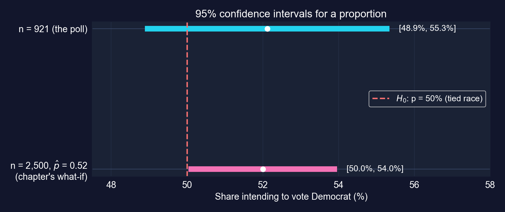
:::
::::

[互角を棄却しません：信頼区間 [48.9%, 55.3%] は50%を含みます。リードは±3.2ポイントの幅で2.1パーセントポイントです。]{.takeaway .fragment}

::: {.notes}
z = 1.29：標本比率は50%より標準誤差1.29個分上にあります。選挙戦が本当に互角なら、これと少なくとも同じくらい大きな差が約20%の確率で生じます。図の下のバーは章の仮定の例で、次のスライドで論じます。
:::

## 同じ割合、より大きな調査：52%はいつ有意になるか

::: {.incremental}
- 章の仮定の例：**同じ**割合52%を、**2,500**人の有権者から
- 標準誤差は0.010に下がり、95%信頼区間 [50.0%, 54.0%]、$z = 2.00$、$p = 0.045$：**5%でぎりぎり有意**
- 0.52ではなく厳密な $\hat{p} = 0.5212$ では：$z = 2.12$、$p = 0.034$
:::

[有権者については何も変わらず、標本サイズだけが変わりました。統計的有意性は効果と同じくらい $n$ に関わります。]{.takeaway .fragment}

::: {.notes}
章の数字はp̂を0.52に丸めて使い、厳密なp̂版は本スライド用に計算しています。いずれにせよ信頼区間の下限は50%をわずかに上回る程度（p̂ = 0.52で50.04%）なので、ここでの「有意」は紙一重の判断です。実際的な面では、2ポイントのリードは選挙では大きな意味を持つので、これは効果が重要でありうるのにまだ判別できない場合です。
:::

## 世論調査への留意点

::: {.incremental}
- 標準誤差は**標本誤差**のみをカバーします。無回答や考えを変える人はその中に入っていません
- 「投票するつもり」は「投票する」ではありません：有権者の母集団は調査された母集団と異なります
- 正規近似は $n\hat{p}$ と $n(1-\hat{p})$ の両方が大きいことを要します。稀な事象には厳密法を使います
:::

[報告された誤差の幅（±3.2ポイント）は真の不確実性の下限であって、上限ではありません。]{.takeaway .fragment}

::: {.notes}
調査からの比率に対する標準的な留意点。同じ論理が就業率、支持率、市場シェアにも当てはまります。
:::

# ケーススタディ1 · 世界の労働生産性は変化したか {#cs1 .divider background-color="#7A209F"}

[Mendezの収束クラブデータ · 108か国 · 1990年と2014年 · 六つの課題]{.act}

::: {.notes}
ケーススタディ1は章のあらゆる道具を国際的な生産性に適用します。章は課題を穴埋めテンプレートと出力のない概要として与えますが、各課題はここで穴を埋めて実行され、その出力が報告されます。したがって章で印刷されていない結果はすべて「本スライド用に計算」です。
:::

## 問い：国々の間の生産性成長と格差 {.smaller}

**データ。** Mendez (2020) 収束クラブパネル：**108か国 × 25年（1990〜2014年）= 2,700観測**。1990年と2014年の労働生産性 `lp`（労働者一人当たり産出、ドル）と `region` を使います。

| 課題 | 問い | 道具（節） |
|:--|:--|:--|
| 1 | 2014年の平均生産性の範囲は | 信頼区間、95% 対 99%（4.3） |
| 2 | 平均生産性は変化したか、1990 → 2014 | 二標本と対応のある $t$ 検定（4.4） |
| 3 | アフリカはヨーロッパより下か | 二標本検定、差の信頼区間 |
| 4 | 2014年の平均は \$50,000 を超えるか | 片側検定（4.6） |
| 5 | 半数超の国が成長したか | 比率（4.7） |
| 6 | どの地域が異なるか | 多数の検定、多重検定 |

[六つの課題、一つのデータセット：章の道具一式を一つの開発の問いに。]{.takeaway .fragment}

::: {.notes}
経済的文脈：収束仮説は、貧しい国々が豊かな国々より速く成長するはずだと述べます。課題は平均生産性の水準と変化を検定します。収束を直接検定するものではなく、それには初期水準に対する成長の回帰（後の章）が必要です。
:::

## コード：パネルを読み込み、二つの横断面を取り出す

``` {.python code-line-numbers="1-4|5-7|8-9|10-12"}
import numpy as np                          # square roots
import pandas as pd                         # tabular data
from scipy import stats                     # t and normal distributions
import matplotlib.pyplot as plt             # plots
url = ("https://raw.githubusercontent.com/quarcs-lab/"            # Mendez (2020) repository
       "mendez2020-convergence-clubs-code-data/master/assets/dat.csv")
df = pd.read_csv(url).set_index(["country", "year"])     # panel indexed by country-year
lp_1990 = df.loc[df.index.get_level_values("year") == 1990, "lp"]   # productivity, 1990
lp_2014 = df.loc[df.index.get_level_values("year") == 2014, "lp"]   # productivity, 2014
print(f"Observations: {len(df):,}; countries: {df.index.get_level_values('country').nunique()}")
print(f"1990: n={len(lp_1990)}, mean={lp_1990.mean():,.0f}, std={lp_1990.std():,.0f}")
print(f"2014: n={len(lp_2014)}, mean={lp_2014.mean():,.0f}, std={lp_2014.std():,.0f}")
```

[↗ Colab で試す](https://colab.research.google.com/notebooks/empty.ipynb){.colab-link target="_blank" data-preview-link="false"}

::: {.notes}
自己完結型。章の読み込みセルです。このケーススタディの後続のすべてのブロックはここから続きます。pandasの.std()はデフォルトでddof=1、すなわち標本標準偏差を使います。
:::

## 出力：平均が上がり、ばらつきも上がった {.smaller}

:::: {.columns}
::: {.column width="40%"}
| | 1990 | 2014 |
|:--|--:|--:|
| 国数 | 108 | 108 |
| 平均 | \$23,224 | [\$40,977]{.key} |
| 中央値 | \$16,985 | \$32,781 |
| 標準偏差 | \$20,089 | \$33,853 |
| 標準誤差 | \$1,933 | \$3,258 |
:::
::: {.column width="60%"}
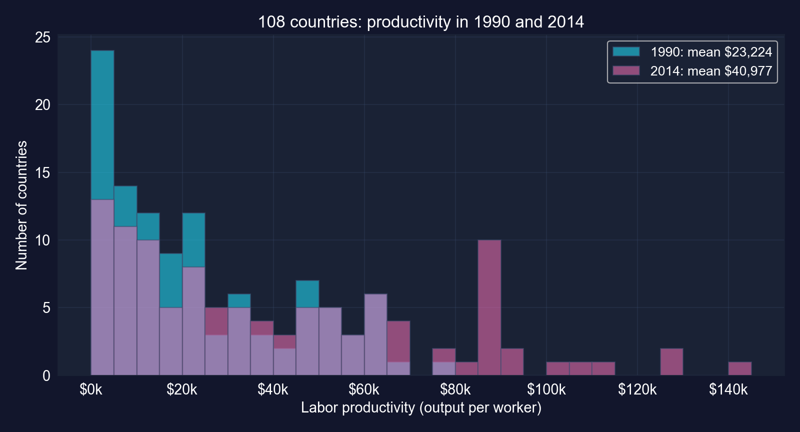
:::
::::

[平均生産性は76%上昇し、国間の標準偏差は69%上昇しました。どちらの分布も右に歪んでいます。]{.takeaway .fragment}

::: {.notes}
章の読み込みセルから本スライド用に計算。水準の標準偏差が上昇すること自体は、収束に対する賛否の証拠ではありません。収束は通常対数で研究されます（一定のパーセント格差はドル格差の拡大を意味する）。二つの問いを別に保ってください。これらの課題は平均に関するものです。
:::

## 課題1のコード：2014年の95%と99%信頼区間（テンプレート穴埋め）

``` {.python code-line-numbers="1|2-5|6-8|9-11|12-14"}
# continues from the previous block
n_2014 = len(lp_2014)                       # 108 countries
mean_2014 = lp_2014.mean()                  # blank 1: sample mean
std_2014 = lp_2014.std()                    # blank 2: sample std dev
se_2014 = std_2014 / np.sqrt(n_2014)        # standard error
t_crit_95 = stats.t.ppf(1 - 0.05/2, df=n_2014 - 1)   # blank 3: df = n - 1
me_95 = t_crit_95 * se_2014                 # 95% margin of error
ci_95 = (mean_2014 - me_95, mean_2014 + me_95)       # blanks 4-5: the bounds
t_crit_99 = stats.t.ppf(1 - 0.01/2, df=n_2014 - 1)   # 99% critical value
me_99 = t_crit_99 * se_2014                 # 99% margin of error: wider
ci_99 = (mean_2014 - me_99, mean_2014 + me_99)       # 99% bounds
se_1990 = lp_1990.std() / np.sqrt(len(lp_1990))      # 1990 for comparison
me_1990 = stats.t.ppf(0.975, df=len(lp_1990) - 1) * se_1990   # 1990 margin
print(ci_95, ci_99, 2 * me_95, 2 * me_1990)          # bounds and widths
```

[↗ Colab で試す](https://colab.research.google.com/notebooks/empty.ipynb){.colab-link target="_blank" data-preview-link="false"}

::: {.notes}
章の課題1テンプレートの六つの穴を埋めたもの：平均、標準偏差、df = n − 1、二つの境界、そして「より広い」。最後の穴の答え：99%信頼区間は95%信頼区間より広いです。
:::

## 課題1の出力：2014年の区間は広く、1990年のそれより広い {.smaller}

| | 平均 | 95%信頼区間 | 95%幅 | 99%信頼区間 | 99%幅 |
|:--|--:|:--|--:|:--|--:|
| 2014 | \$40,977 | [[\$34,519,&nbsp;\$47,435]]{.key} | \$12,915 | [\$32,434,&nbsp;\$49,520] | \$17,086 |
| 1990 | \$23,224 | [\$19,392,&nbsp;\$27,056] | \$7,664 | [\$18,154,&nbsp;\$28,293] | \$10,139 |

[$t_{107,\,0.025} = 1.982$, $t_{107,\,0.005} = 2.623$；両年とも $n = 108$ · 本スライド用に計算]{.comment}

::: {.incremental}
- 99%信頼区間は**より広い**（テンプレートの最後の穴）：より高い信頼度は幅を要します
- 2014年の区間は1990年のそれより**69%広い**です。同じ $n$ で、国々がよりばらついたからです
- 二つの95%区間は重なりません：平均が変化したという最初のヒントです
:::

[精度は標本サイズだけでなくばらつきにも依存します：同じ108か国で、はるかに精度の低い平均。]{.takeaway .fragment}

::: {.notes}
幅の比 12,915/7,664 = 1.685 は、nが同じなので標準偏差の比（33,853/20,089）に等しくなります。重ならない区間は有意差を含意しますが、重なる区間は逆を含意しません。課題2が適切な検定を実行します。
:::

## 課題2のコード：平均生産性は変化したか。二つの検定

``` {.python code-line-numbers="1|2-4|5-7|8-9|10-13"}
# continues from the previous block
se_1990, se_2014 = lp_1990.std() / np.sqrt(108), lp_2014.std() / np.sqrt(108)   # each SE
se_diff = np.sqrt(se_1990**2 + se_2014**2)  # blanks 1-2: SE of the difference
t_stat = (lp_2014.mean() - lp_1990.mean()) / se_diff   # blanks 3-4: Welch t
t_scipy, p_scipy = stats.ttest_ind(lp_2014, lp_1990, equal_var=False)   # blanks 5-6
print(f"Welch: diff {lp_2014.mean() - lp_1990.mean():,.0f}, se {se_diff:,.0f}")
print(f"       t {t_scipy:.3f}, p {p_scipy:.2e}")              # blank 7: Reject
# computed for these slides: the same 108 countries appear in both years
x14, x90 = lp_2014.droplevel("year"), lp_1990.droplevel("year")   # align by country
t_pair, p_pair = stats.ttest_rel(x14, x90)  # paired test = one-sample t on the changes
change = x14 - x90                          # within-country change
print(f"Paired: mean change {change.mean():,.0f}, se {change.std() / np.sqrt(108):,.0f}")
print(f"        t {t_pair:.3f}, p {p_pair:.2e}")   # paired test result
```

[↗ Colab で試す](https://colab.research.google.com/notebooks/empty.ipynb){.colab-link target="_blank" data-preview-link="false"}

::: {.notes}
前半は章の課題2テンプレートを埋めたもの（Welchの不等分散検定）です。章自身の議論問題は1990年と2014年の標本が同じ国々を含むことに触れ、対応のある検定を示唆します。対応のある検定は本スライド用に計算しています。droplevel("year")は指標から年を取り除き、二つのSeriesが国で揃うようにします。
:::

## 課題2の出力：判定は同じだが、対応のある検定ははるかに鋭い {.smaller}

| | Welch（独立標本） | 対応のある（同じ国々） |
|:--|--:|--:|
| 平均変化、1990 → 2014 | \$17,753 | \$17,753 |
| 変化の標準誤差 | \$3,788 | [\$1,628]{.key} |
| $t$ | 4.687 | [10.904]{.key} |
| 自由度 | 174.0 | 107 |
| $p$値 | 0.000006 | <&nbsp;10⁻¹⁸ |
| 変化の95%信頼区間 | [\$10,277,&nbsp;\$25,229] | [\$14,526,&nbsp;\$20,981] |

[対応のある結果は本スライド用に計算 · Welchは章のテンプレート]{.comment}

[どちらにしても $H_0$ を棄却：平均生産性は約 \$17,800（+76%）上昇しました。対応をとると標準誤差が57%縮みます。]{.takeaway .fragment}

::: {.notes}
Welch検定は二つの年を独立標本として扱うので、その標準誤差は豊かな国々と貧しい国々の間の巨大な差を含みます。対応のある検定は国内の変化だけを見ます。点推定値は同一で、異なるのは標準誤差、したがって t、p、信頼区間だけです。
:::

## なぜ対応が役立つか：各国が自身と比較される

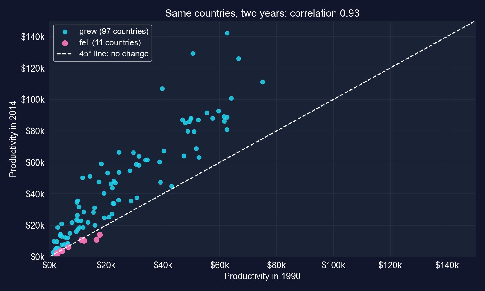{height="430"}

[二つの年は0.93で相関しています：豊かな国々は豊かなままでした。差分をとるとその共有された水準が除かれ、変化だけが残ります。]{.takeaway .fragment}

::: {.notes}
国内の変化の標準偏差（$16,920）は、どちらの年の標準偏差（$20,089と$33,853）よりも小さいです。二つの年がこれほど高く相関しているからです。だから対応のある標準誤差はWelchの標準誤差の半分未満なのです。経済的には：平均的な国の労働者一人当たり産出は約$17,800上がりました。相関は本スライド用に計算しています。
:::

## 課題3のコード：2014年のアフリカ 対 ヨーロッパ

``` {.python code-line-numbers="1|2-4|5|6-9|10-12"}
# continues from the previous block
df_2014 = df.loc[df.index.get_level_values("year") == 2014]       # 2014 cross-section
lp_africa = df_2014.loc[df_2014["region"] == "Africa", "lp"]      # 26 countries
lp_europe = df_2014.loc[df_2014["region"] == "Europe", "lp"]      # 30 countries
t_stat, p_val = stats.ttest_ind(lp_africa, lp_europe, equal_var=False)   # Welch test
v_a, v_e = lp_africa.var() / len(lp_africa), lp_europe.var() / len(lp_europe)   # s^2/n
diff = lp_africa.mean() - lp_europe.mean()  # difference in means
se_diff = np.sqrt(v_a + v_e)                # SE of the difference
df_w = (v_a + v_e)**2 / (v_a**2 / (len(lp_africa) - 1) + v_e**2 / (len(lp_europe) - 1))  # Welch df
t_c = stats.t.ppf(0.975, df_w)              # critical value at the Welch df
print(f"diff {diff:,.0f}, t {t_stat:.2f}, p {p_val:.1e}")              # gap and test
print(f"95% CI [{diff - t_c*se_diff:,.0f}, {diff + t_c*se_diff:,.0f}]")   # CI for the gap
```

[↗ Colab で試す](https://colab.research.google.com/notebooks/empty.ipynb){.colab-link target="_blank" data-preview-link="false"}

::: {.notes}
章の課題3の構造で「YOUR CODE HERE」を完成させたものです。ヨーロッパの標準偏差がアフリカの2倍なので、課題2と一貫してWelch（equal_var=False）を使います。プールされた分散版はt = −11.02を与えますが、結論は同じです。
:::

## 課題3の出力：\$61,000 の格差、精度よく推定 {.smaller}

:::: {.columns}
::: {.column width="46%"}
| | アフリカ | ヨーロッパ |
|:--|--:|--:|
| $n$ | 26 | 30 |
| 平均 | \$11,211 | \$72,572 |
| 中央値 | \$5,722 | \$66,862 |
| 標準偏差 | \$12,261 | \$25,966 |

| アフリカ − ヨーロッパ | 値 |
|:--|--:|
| 差 | [−\$61,361]{.key} |
| 標準誤差（Welch, df 42.6） | \$5,316 |
| $t$ | −11.54 |
| 95%信頼区間 | [−\$72,084,&nbsp;−\$50,638] |
:::
::: {.column width="54%"}
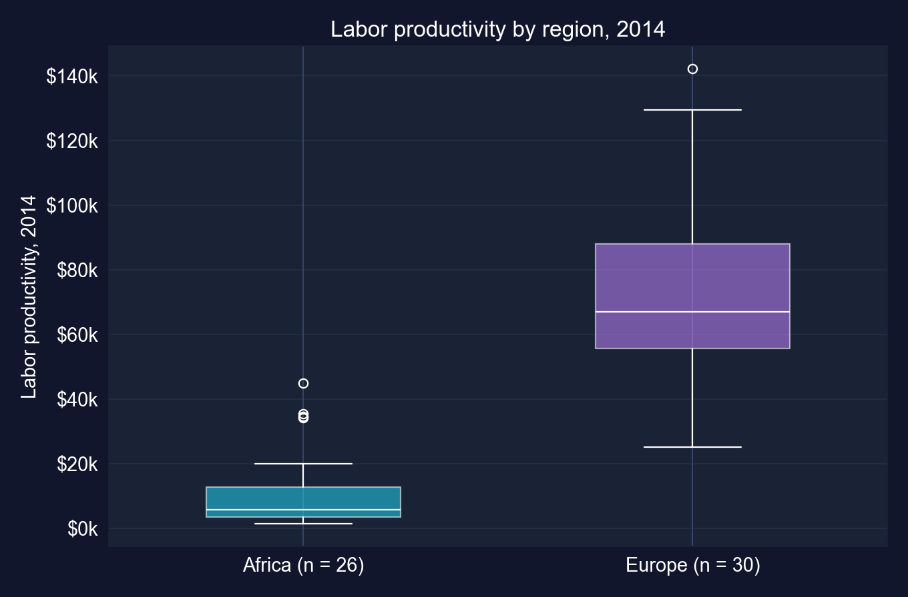
:::
::::

[平均の相等を棄却（$p < 10^{-13}$）。平均的なヨーロッパの労働者は、平均的なアフリカの労働者の6.5倍を産出します。]{.takeaway .fragment}

::: {.notes}
本スライド用に計算。実在するか？圧倒的に。重要か？甚大に：格差はアフリカまたは世界の平均より大きいです。判別できたか？容易に：標準誤差$5,316、臨界値2.02で、約$10,700を超えるどんな格差もすでに有意です。留意点：アフリカの分布は非常に歪んでおり（中央値$5,722 対 平均$11,211）、$30,000を超える少数の外れ値があります。平均は典型的なアフリカの国ではありません。
:::

## 課題4のコード：2014年の平均は \$50,000 を超えるか

``` {.python code-line-numbers="1|2-3|4|5|6-7"}
# continues from the previous block
res_greater = stats.ttest_1samp(lp_2014, popmean=50000, alternative="greater")   # Ha: mu > 50,000
res_two = stats.ttest_1samp(lp_2014, popmean=50000, alternative="two-sided")     # Ha: mu != 50,000
res_less = stats.ttest_1samp(lp_2014, popmean=50000, alternative="less")         # for contrast only
print(f"mean {lp_2014.mean():,.0f}, t {res_greater.statistic:.3f}")              # t is negative
print(f"p (greater) {res_greater.pvalue:.4f}, p (two-sided) {res_two.pvalue:.4f}")  # chapter's
print(f"p (less) {res_less.pvalue:.4f}")    # never switch to this after seeing t
```

[↗ Colab で試す](https://colab.research.google.com/notebooks/empty.ipynb){.colab-link target="_blank" data-preview-link="false"}

::: {.notes}
章の課題4の概要を書き出したものです。scipyのttest_1sampはalternative引数をとります："greater"、"less"、"two-sided"。"less"の行は次のスライドでp-hackingの指摘をするためだけに追加しています。
:::

## 課題4の出力：推定値が間違った方向を指すとき {.smaller}

| $H_a$ | $t$ | $p$値 | 5%での決定 |
|:--|--:|--:|:--|
| $\mu > 50{,}000$（章の主張） | −2.770 | [0.9967]{.key} | 棄却しない |
| $\mu \neq 50{,}000$ | −2.770 | 0.0066 | 棄却 |
| $\mu < 50{,}000$（事前指定なし） | −2.770 | 0.0033 | — |

[標本平均 \$40,977 · 片側臨界値 1.659 · 本スライド用に計算]{.comment}

::: {.incremental}
- 平均は \$50,000 を**下回る**ので $t < 0$ となり、上側の $p$ は $1 - 0.0066/2 = 0.9967$ で、両側 $p$ の半分ではありません
- 生産性が基準値を超えると**結論できません**。両側検定はそれが低い側で異なると言います
- 符号を見た後で $H_a: \mu < 50{,}000$ に切り替えるのは $p$ハッキングでしょう
:::

[0.5を上回る片側 $p$値は、データが期待した方向に*反して*指していることを意味します。]{.takeaway .fragment}

::: {.notes}
これは章の議論問題に答えます：ここでは推定値がHaの反対側に落ちるので片側p値は両側より大きくなります。この文脈での第一種の誤り：真の平均が$50,000以下なら、5%検定がそれを誤って基準値超と宣言するのは最大5%の確率です。
:::

## 課題5のコード：どの割合の国が成長したか

``` {.python code-line-numbers="1|2-3|4-6|7-8|9-10"}
# continues from the previous block
growth = (lp_2014.droplevel("year") > lp_1990.droplevel("year")).astype(int)   # 1 if lp rose
n = len(growth)                             # 108 countries
p_hat = growth.mean()                       # share of growth winners
se_p = np.sqrt(p_hat * (1 - p_hat) / n)     # SE at p-hat (for the CI)
ci = (p_hat - 1.96 * se_p, p_hat + 1.96 * se_p)       # 95% normal CI
z = (p_hat - 0.5) / np.sqrt(0.5 * 0.5 / n)  # z test of H0: p = 0.5
p_val = 2 * stats.norm.sf(abs(z))           # two-sided p-value
print(f"{growth.sum()} of {n}: p_hat {p_hat:.3f}, CI [{ci[0]:.3f}, {ci[1]:.3f}]")   # share
print(f"z {z:.2f}, p {p_val:.1e}")          # test of H0: p = 0.5
```

[↗ Colab で試す](https://colab.research.google.com/notebooks/empty.ipynb){.colab-link target="_blank" data-preview-link="false"}

::: {.notes}
章の四つのヒントから構築しました。droplevelのステップは章のヒントが警告するものです：生のSeriesを比較すると、その (country, year) 指標が異なるため失敗します。
:::

## 課題5の出力：十か国中九か国が成長 {.smaller}

| | 値 |
|:--|--:|
| 2014年に生産性が高かった国 | 108か国中97か国 |
| $\hat{p}$ | [0.898]{.key} |
| 95%信頼区間 | [0.841,&nbsp;0.955] |
| $z$（対 0.5） | 8.28 |
| $p$値 | <&nbsp;10⁻¹⁵ |

[本スライド用に計算 · $n(1-\hat{p}) = 11$、目安の10をわずかに上回る]{.comment}

**生産性が下がった11か国：** カメルーン、中央アフリカ共和国、コンゴ民主共和国、ハイチ、ホンジュラス、キルギス共和国、ニカラグア、ニジェール、シエラレオネ、タジキスタン、トーゴ。

[半数をはるかに超える国々が成長しましたが、下がった11か国はすべて1990年に貧しい側の半分にありました：成長は全員に共有されたわけではありません。]{.takeaway .fragment}

::: {.notes}
下がった国々はサブサハラ・アフリカ、中央アメリカ、中央アジアに集中しています。1990年には11か国すべてが貧しい側の半分（うち6か国は最も貧しい四分の一）にありました。本スライド用に計算。「失敗」が11か国だけなので正規近似は境界線上ですが、結論はいずれにせよカットオフからほど遠いです。留意点：108か国はより大きな母集団の無作為標本ではないので、ここでの「推測」は、起こりえた国々の仮説的な超母集団に関するものです。
:::

## 課題6のコード：すべての地域、すべての組

``` {.python code-line-numbers="1-2|3-6|7-10|11-13"}
# continues from the previous block (df_2014 from Task 3)
import itertools                            # all pairs of regions
by_region = df_2014.groupby("region")["lp"]                         # 5 regions
stats_r = by_region.agg(["count", "mean", "std"])                   # n, mean, s
stats_r["se"] = stats_r["std"] / np.sqrt(stats_r["count"])          # SE of each mean
stats_r["tc"] = stats.t.ppf(0.975, stats_r["count"] - 1)            # t critical, df = n - 1
for a, b in itertools.combinations(sorted(stats_r.index), 2):        # 10 pairs
    xa = df_2014.loc[df_2014["region"] == a, "lp"]                  # region a
    xb = df_2014.loc[df_2014["region"] == b, "lp"]                  # region b
    print(a, b, stats.ttest_ind(xa, xb, equal_var=False))           # Welch test
stats_r["lo"] = stats_r["mean"] - stats_r["tc"] * stats_r["se"]    # lower 95% bound
stats_r["hi"] = stats_r["mean"] + stats_r["tc"] * stats_r["se"]    # upper 95% bound
print(stats_r.round(0))                     # the CI table
```

[↗ Colab で試す](https://colab.research.google.com/notebooks/empty.ipynb){.colab-link target="_blank" data-preview-link="false"}

::: {.notes}
章の課題6で提案された手法を、itertools.combinationsのループで実装しました。5地域なら10組あります。
:::

## 課題6の出力：地域別平均とその信頼区間 {.smaller}

| 地域 | $n$ | 平均 | 標準誤差 | 95%信頼区間 |
|:------|---:|------:|------:|:--------------------|
| アフリカ | 26 | \$11,211 | \$2,405 | [\$6,259,&nbsp;\$16,164] |
| 南北アメリカ | 22 | \$32,836 | \$5,167 | [\$22,092,&nbsp;\$43,581] |
| アジア | 28 | \$38,725 | \$6,282 | [\$25,836,&nbsp;\$51,615] |
| ヨーロッパ | 30 | \$72,572 | \$4,741 | [\$62,876,&nbsp;\$82,268] |
| オセアニア | [2]{.key} | \$75,067 | \$10,980 | [−\$64,444,&nbsp;\$214,577] |

[オセアニア = オーストラリアとニュージーランド；自由度1では $t_{1,\,0.025} = 12.7$ · 本スライド用に計算]{.comment}

[四つの地域は有用な精度で推定されます。二か国のオセアニアはそうではありません。]{.takeaway .fragment}

::: {.notes}
章の課題文はアフリカ、ヨーロッパ、アジア、南北アメリカに言及します。データにはわずか二か国のオセアニアも含まれます。自由度1のt区間は臨界値12.7を使うので、爆発的に広がります。
:::

## 地域別信頼区間を一目で：オセアニアの区間は役に立たない

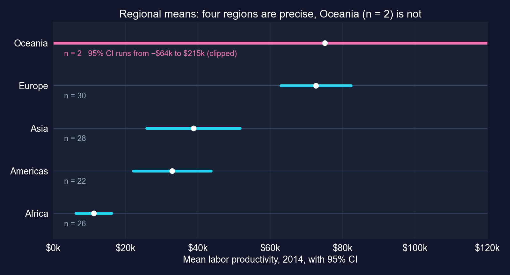{height="430"}

[二か国では、オセアニアの区間は負の生産性すら含みます。その平均はいかなる有用な意味でも「わかって」いません。]{.takeaway .fragment}

::: {.notes}
本スライド用に計算した図です。ヨーロッパの区間はアフリカ、南北アメリカ、アジアのそれと重なりません。南北アメリカとアジアは大きく重なり、次のスライドの対ごとの検定と一致します。
:::

## 課題6の出力：十の検定と多重検定の問題 {.smaller}

| 組 | 差 | $t$ | $p$ | 5%? | Bonferroni (0.005)? |
|:--|--:|--:|--:|:-:|:-:|
| アフリカ − ヨーロッパ | −\$61,361 | −11.54 | <&nbsp;0.0001 | ✓ | ✓ |
| 南北アメリカ − ヨーロッパ | −\$39,736 | −5.67 | <&nbsp;0.0001 | ✓ | ✓ |
| アジア − ヨーロッパ | −\$33,847 | −4.30 | 0.0001 | ✓ | ✓ |
| アフリカ − アジア | −\$27,514 | −4.09 | 0.0002 | ✓ | ✓ |
| アフリカ − 南北アメリカ | −\$21,625 | −3.79 | 0.0007 | ✓ | ✓ |
| 南北アメリカ − アジア | −\$5,889 | −0.72 | 0.473 | | |
| アフリカ − オセアニア | −\$63,856 | −5.68 | 0.095 | | |
| 南北アメリカ − オセアニア | −\$42,230 | −3.48 | 0.110 | | |
| アジア − オセアニア | −\$36,341 | −2.87 | 0.119 | | |
| ヨーロッパ − オセアニア | −\$2,495 | −0.21 | 0.861 | | |

[Welch検定 · 本スライド用に計算]{.comment}

[5%で10の検定を行うと、少なくとも一つの誤警報が出る確率は最大40%です。ここでは同じ5組が0.005のBonferroniカットオフを生き残ります。]{.takeaway .fragment}

::: {.notes}
10の独立な検定のファミリーワイズ誤り率：1 − 0.95^10 = 0.401。Bonferroniはαを検定数で割ります：0.05/10 = 0.005。オセアニアを含むすべての組は、最大$64,000の格差があるにもかかわらず有意ではありません。二観測ではほとんど情報が得られないからです：大きく、おそらく重要な差を、単に検出できないのです。それがまた「判別できたか」の問いです。
:::

## ケーススタディ1：六つの課題が合わさると

::: {.incremental}
- **時間を通じた変化**：平均生産性は約 \$17,800（+76%）上昇。対応のある検定がこれを紛れもなくします（$t = 10.9$）
- **地域格差**：ヨーロッパがはるかに先行。アフリカ、南北アメリカ、アジアはそれより有意に後れています。南北アメリカ 対 アジアは区別できません
- **広がり**：108か国中97か国が成長。成長しなかった11か国はすべて1990年に貧しい側の半分にありました
- **手法の教訓**：単位が繰り返すときは対応をとる。片側検定は間違った方向を指しうる。多数の検定は誤警報を膨らませる。極小の群は役に立たない区間を与える
:::

[正しい検定はデータがどう生成されたかに依存します：同じ国々を二度は、二つの独立標本ではありません。]{.takeaway .fragment}

::: {.notes}
収束について：これらの課題は大きく持続的な水準格差を示し、後退した国々がすべて貧しい側の半分から始まったことを示します。適切な収束検定（初期生産性が成長を予測するか）には回帰が必要で、第5章以降で扱います。
:::

# ケーススタディ2 · ボリビアの発展は県の間で均等か {#cs2 .divider background-color="#7A209F"}

[DS4Bolivia · 333の自治体 · 9県 · 六つの課題]{.act}

::: {.notes}
ケーススタディ2は章の道具をボリビアの地域内発展に持ち込みます。章の課題1〜6のコードセルはここで実行され、その出力が報告されます。課題5のCohenのdとWelch版は本スライド用に計算しています。
:::

## 問い：自治体の発展はボリビアの県の間で異なるか {.smaller}

**データ。** DS4Bolivia（`ds4bolivia_v20250523.csv`）：339の自治体。うち**333**が、使用する五つの変数すべてで完全なデータを持ちます。アウトカム：**自治体持続可能開発指数（IMDS）**、0〜100。

| 課題 | 問い | 道具 |
|:--|:--|:--|
| 1 | 全国平均IMDSは | 95%信頼区間 |
| 2 | 平均的な自治体は中間点50にあるか | 両側一標本検定 |
| 3 | どの県が異なるか | 県ごとの信頼区間、フォレストプロット |
| 4 | ラパスは全国平均を上回るか | 片側検定 |
| 5 | 上位と下位の県の格差はどれほど大きいか | 二標本検定 |
| 6 | 政策ブリーフは何を言うべきか | 要約表 |

[同じ道具一式、新しい問い：統計的有意性 対 政策的関連性。]{.takeaway .fragment}

::: {.notes}
章の本文はデータセットが339の自治体をカバーすると述べ、これはファイルについて正しいです。mun、dep、imds、ln_NTLpc2017、pop2017についてdropna()した後の分析標本は333です。県の規模は11（Tarija）から87（La Paz）に及びます。
:::

## コード：データを読み込み、IMDSを要約する

``` {.python code-line-numbers="1-4|5-6|7-8|9-10"}
import numpy as np                          # square roots
import pandas as pd                         # tabular data
from scipy import stats                     # t distribution
import matplotlib.pyplot as plt             # forest plot
url_bol = "https://raw.githubusercontent.com/quarcs-lab/ds4bolivia/master/ds4bolivia_v20250523.csv"
bol = pd.read_csv(url_bol)                  # 339 municipalities, 350+ columns
key_vars = ["mun", "dep", "imds", "ln_NTLpc2017", "pop2017"]   # variables used here
bol_key = bol[key_vars].dropna().copy()     # complete cases: 333 municipalities
print(bol_key["imds"].describe().round(2))  # IMDS summary statistics
print(bol_key["dep"].value_counts().sort_index())   # municipalities per department
```

[↗ Colab で試す](https://colab.research.google.com/notebooks/empty.ipynb){.colab-link target="_blank" data-preview-link="false"}

::: {.notes}
自己完結型。章の読み込みセルです。このケーススタディの後続のすべてのブロックはそこから続きます。
:::

## 出力：IMDSは50のすぐ上に中心を持つ {.smaller}

:::: {.columns}
::: {.column width="40%"}
| IMDS | 値 |
|:--|--:|
| 自治体数 | 333 |
| 平均 | 51.16 |
| 標準偏差 | 6.76 |
| 最小値 | 35.70 |
| 中央値 | 50.80 |
| 最大値 | 80.20 |

| 県 | $n$ | 県 | $n$ |
|:--|--:|:--|--:|
| La Paz | 87 | Chuquisaca | 29 |
| Santa Cruz | 55 | Beni | 18 |
| Cochabamba | 47 | Pando | 13 |
| Potosí | 38 | Tarija | 11 |
| Oruro | 35 | | |
:::
::: {.column width="60%"}
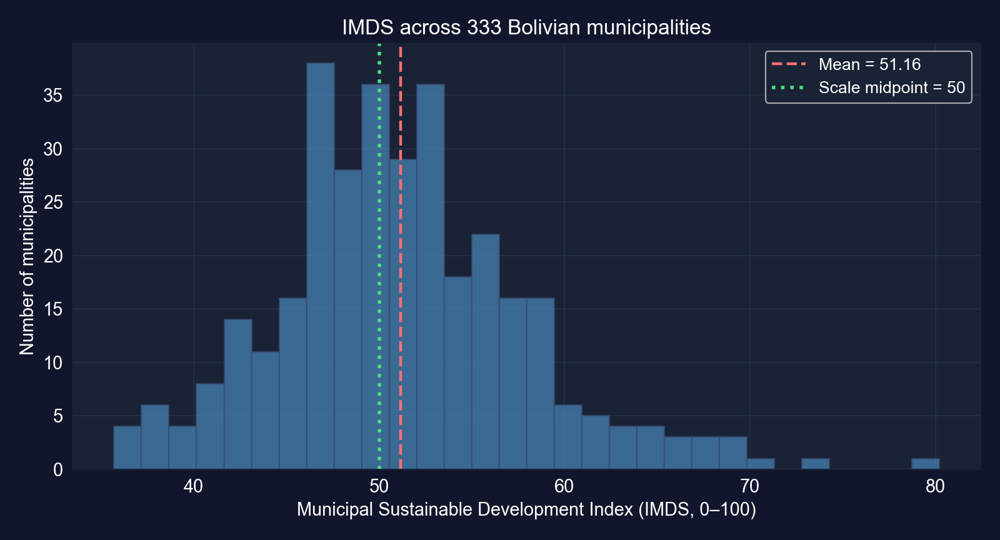
:::
::::

[自治体の72%が45から58の間のスコアです。県の規模は8倍に及ぶので、県レベルの精度も変わります。]{.takeaway .fragment}

::: {.notes}
四分位数：47.1と55.0（describe()の出力から）。最高スコア80.2は自治体ラパス（市）に属し、次がCochabamba（73.7）とTarija（70.6）です。45から58の間の割合は本スライド用に計算しています。
:::

## 課題1〜2のコード：全国信頼区間と中間点検定

``` {.python code-line-numbers="1|2-4|5|6|7-8"}
# continues from the previous block
n = len(bol_key["imds"])                    # 333 municipalities
x_bar = bol_key["imds"].mean()              # national mean IMDS
se = bol_key["imds"].std() / np.sqrt(n)     # standard error
ci_low, ci_high = stats.t.interval(0.95, df=n - 1, loc=x_bar, scale=se)   # Task 1: 95% CI
t_stat, p_value = stats.ttest_1samp(bol_key["imds"], popmean=50)          # Task 2: H0: mu = 50
print(f"mean {x_bar:.4f}, se {se:.4f}, CI [{ci_low:.4f}, {ci_high:.4f}]")
print(f"t {t_stat:.4f}, p {p_value:.6f}")   # reject H0 if p < 0.05
```

[↗ Colab で試す](https://colab.research.google.com/notebooks/empty.ipynb){.colab-link target="_blank" data-preview-link="false"}

::: {.notes}
章の課題1と課題2のセルを結合したものです。stats.t.intervalはx̄ ± t × seを直接構成します。ttest_1sampは4.4節と同じt統計量を計算します。
:::

## 課題1〜2の出力：50を有意に上回るが、約1点だけ {.smaller}

| 課題 | 結果 |
|:--|:--|
| 1 · 平均IMDS | 51.1580（標準誤差 0.3704） |
| 1 · 95%信頼区間 | [50.43,&nbsp;51.89] |
| 2 · $H_0: \mu = 50$ | $t$ = [3.1258]{.key}, $p$ = 0.0019 → 棄却 |
| 2 · 50との差 | 0〜100スケールで1.16点 |

::: {.incremental}
- **実在するか** はい：50は95%信頼区間の外にあり、$t = 3.13$
- **重要か** かろうじて：平均的な自治体は中間点より1.2点上です
- **判別できたか** 容易に：333の自治体が0.37の標準誤差を与えるので、1点の差さえ際立ちます
:::

[重要なポイント4.12が働いています：大標本は、小さく政策的に無関係な差を統計的に有意にします。]{.takeaway .fragment}

::: {.notes}
章の解釈：真の平均自治体開発指数が50.43と51.89の間にあると95%の信頼があります。留意点：333の自治体は本質的にボリビアの自治体の全母集団であって、無作為標本ではありません。ここでの「母集団」は概念的なもの（自治体のアウトカムを生成する過程）です。また50はスケールの中間点であって政策目標ではないので、それを棄却することの意味は限られます。
:::

## 課題3のコード：各県の信頼区間

``` {.python code-line-numbers="1|2-3|4-5|6-7|8"}
# continues from the previous block
dept_stats = (bol_key.groupby("dep")["imds"]                  # one row per department
              .agg(["mean", "std", "count"]).sort_values("mean"))   # mean, s, n
dept_stats["se"] = dept_stats["std"] / np.sqrt(dept_stats["count"])          # SE per department
dept_stats["t_crit"] = stats.t.ppf(0.975, df=dept_stats["count"] - 1)        # df = n - 1 each
dept_stats["ci_low"] = dept_stats["mean"] - dept_stats["t_crit"] * dept_stats["se"]    # lower
dept_stats["ci_high"] = dept_stats["mean"] + dept_stats["t_crit"] * dept_stats["se"]   # upper
print(dept_stats[["mean", "se", "ci_low", "ci_high", "count"]].round(2))     # the table
```

[↗ Colab で試す](https://colab.research.google.com/notebooks/empty.ipynb){.colab-link target="_blank" data-preview-link="false"}

::: {.notes}
章の課題3のセル（そのフォレストプロットのコードは次のスライドで図として示されます）。自由度が異なるので各県が独自の臨界値を得ます：Tarijaはt(10) = 2.23、La Pazはt(86) = 1.99。
:::

## 課題3の出力：二県が上、三県が全国平均の下 {.smaller}

:::: {.columns}
::: {.column width="45%"}
| 県 | $n$ | 平均 | 95%信頼区間 |
|:--|--:|--:|:--|
| Tarija | 11 | [60.60]{.key} | [56.91,&nbsp;64.29] |
| Santa Cruz | 55 | 54.31 | [53.01,&nbsp;55.62] |
| Cochabamba | 47 | 52.50 | [50.01,&nbsp;55.00] |
| La Paz | 87 | 50.98 | [49.83,&nbsp;52.12] |
| Beni | 18 | 50.79 | [48.59,&nbsp;52.98] |
| Oruro | 35 | 50.68 | [48.96,&nbsp;52.41] |
| Chuquisaca | 29 | 47.80 | [45.28,&nbsp;50.31] |
| Potosí | 38 | 47.57 | [45.05,&nbsp;50.09] |
| Pando | 13 | [45.92]{.key} | [42.39,&nbsp;49.46] |
:::
::: {.column width="55%"}
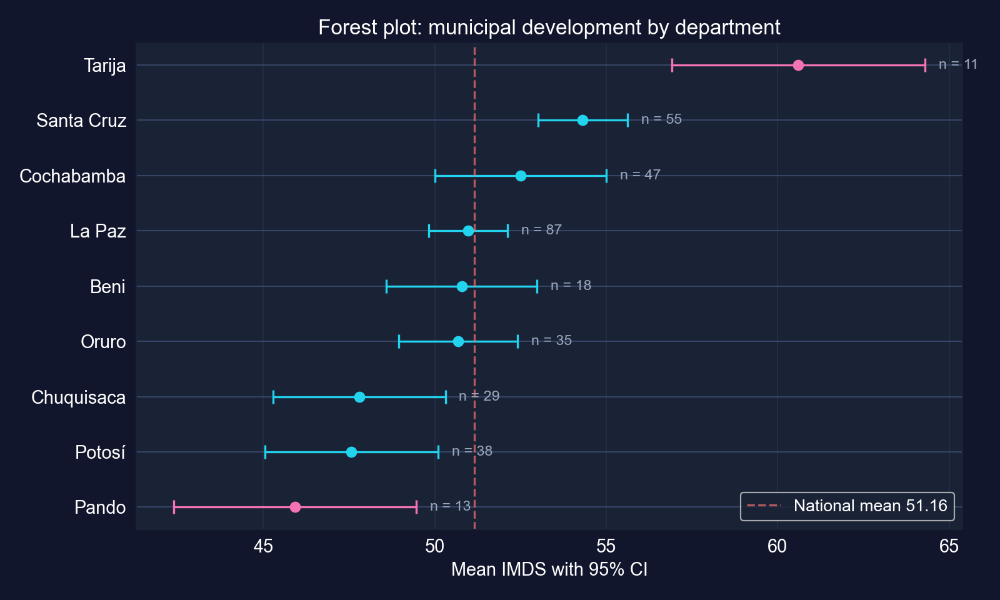
:::
::::

[TarijaとSanta Cruzは全国平均51.16を明確に上回ります。Chuquisaca、Potosí、Pandoは明確に下回ります。]{.takeaway .fragment}

::: {.notes}
フォレストプロットの読み方：重ならない区間は有意差を含意しますが、重なる区間は差がないことを含意しません（二つの95%信頼区間が少し重なっても、二標本検定がなお棄却しうる）。フォレストプロットで候補を見つけ、それから気になる比較を検定してください。小さな県（Tarija 11、Pando 13）が最も広い区間を持ちます：重要なポイント4.13。
:::

## 課題4のコード：ラパスは全国平均を上回るか

``` {.python code-line-numbers="1|2-3|4|5|6"}
# continues from the previous block
la_paz = bol_key[bol_key["dep"] == "La Paz"]["imds"]   # 87 municipalities
national_mean = bol_key["imds"].mean()      # 51.16, treated as a fixed benchmark
t_stat_lp, p_two = stats.ttest_1samp(la_paz, popmean=national_mean)   # two-sided first
p_one = p_two / 2 if t_stat_lp > 0 else 1 - p_two / 2   # one-sided, Ha: mu_LP > national
print(f"La Paz mean {la_paz.mean():.4f}, t {t_stat_lp:.4f}, one-sided p {p_one:.4f}")
```

[↗ Colab で試す](https://colab.research.google.com/notebooks/empty.ipynb){.colab-link target="_blank" data-preview-link="false"}

::: {.notes}
章の課題4のセル。p_oneを計算する行は4.6節の方向チェックを実装します：tがHaの予測する方向を指すときにのみ両側pを半分にします。
:::

## 課題4の出力：首都県は平均を上回っていない {.smaller}

| | 値 |
|:--|--:|
| ラパスの自治体数 | 87 |
| ラパスの平均IMDS | 50.98 |
| 全国平均（基準値） | 51.16 |
| $t$ | −0.312 |
| 片側 $p$（$H_a$：上回る） | [0.622]{.key} |
| 両側 $p$ | 0.756 |

::: {.incremental}
- ラパスの平均は全国平均をわずかに**下回る**ので片側 $p$ は0.5を超えます：ラパスがより発展しているという証拠はありません
- **留意点**：基準値はラパス自身を含み（333自治体中87、26%）、既知の定数として扱われています。ラパス 対 残りの二標本比較の方がすっきりします
:::

[政府の所在地を抱えても、その県の*自治体*が平均的により発展するわけではありません。]{.takeaway .fragment}

::: {.notes}
ラパスの87自治体のほとんどは農村です。ラパス市とエルアルト市はそのうちのわずか二つに数えられます。県平均は人口に関わらず各自治体を等しく重み付けするので、典型的な自治体を記述するのであって、典型的な人を記述するのではありません。
:::

## 課題5のコード：上位の県 対 下位の県

``` {.python code-line-numbers="1|2-4|5-6|7|8-13"}
# continues from the previous block
dept_means = bol_key.groupby("dep")["imds"].mean()   # mean IMDS by department
top_dept, bot_dept = dept_means.idxmax(), dept_means.idxmin()   # Tarija and Pando
top_values = bol_key[bol_key["dep"] == top_dept]["imds"]         # 11 municipalities
bot_values = bol_key[bol_key["dep"] == bot_dept]["imds"]         # 13 municipalities
t_stat_2s, p_value_2s = stats.ttest_ind(top_values, bot_values)  # pooled-variance test (chapter)
t_w, p_w = stats.ttest_ind(top_values, bot_values, equal_var=False)   # Welch, for comparison
n1, n2 = len(top_values), len(bot_values)   # group sizes
pooled_var = ((n1 - 1) * top_values.var() + (n2 - 1) * bot_values.var()) / (n1 + n2 - 2)
sp = np.sqrt(pooled_var)                    # pooled standard deviation
gap = top_values.mean() - bot_values.mean() # the development gap
print(f"gap {gap:.2f}, t {t_stat_2s:.3f}, p {p_value_2s:.1e}")   # chapter's test
print(f"Welch t {t_w:.3f}, p {p_w:.1e}, Cohen's d {gap / sp:.2f}")   # added checks
```

[↗ Colab で試す](https://colab.research.google.com/notebooks/empty.ipynb){.colab-link target="_blank" data-preview-link="false"}

::: {.notes}
章の課題5のセルは、デフォルトのequal_var=True（プールされた分散）でstats.ttest_indを使います。Welch版とCohenのd（章の課題6のセルで示唆される、プールされた標準偏差単位の格差）は本スライド用に計算しています。
:::

## 課題5の出力：TarijaとPandoの間の14.7点の格差 {.smaller}

| | Tarija（上位） | Pando（下位） |
|:--|--:|--:|
| 自治体数 | 11 | 13 |
| 平均IMDS | 60.60 | 45.92 |
| 標準偏差 | 5.50 | 5.85 |

| 比較 | 値 |
|:--|--:|
| 格差 | [14.68点]{.key} |
| $t$（プール） / $p$ | 6.292 / 0.0000025 |
| $t$（Welch） / $p$ | 6.326 / 0.0000024 |
| Cohenの $d$ | 2.58 標準偏差 |

[WelchとCohenの $d$ は本スライド用に計算]{.comment}

[実在し、大きい：格差は県内標準偏差の約2.6個分で、IMDSの全国標準偏差の2倍以上です。]{.takeaway .fragment}

::: {.notes}
章のコードは10点を超える格差を「実質的」とラベル付けします：統計的基準ではなく目安です。留意点：二つの県は9県の中の極端値だから選ばれたのです（36の可能な組）。見てから最大の格差を選ぶことはその有意性を膨らませます。ここでは格差があまりに大きいので結論はどんな妥当な補正にも耐えますが、習慣が重要です。
:::

## 課題6：政策ブリーフは何を言うべきか

::: {.incremental}
- **差は実在する**：Tarija（60.6）とSanta Cruz（54.3）が先頭。Pando（45.9）、Potosí（47.6）、Chuquisaca（47.8）が後れ、信頼区間が全国平均51.2を除外します
- **政策的に関連しないものもある**：全国平均は50を有意に上回りますが、わずか1.2点です
- **精度は不均一**：TarijaとPandoは11と13の自治体に基づきます。その信頼区間は約7点の幅です
- **限界**：自治体は人ではない（人口の重みなし）。333はほぼ国全体。IMDSは合成指数。36の可能な県の組は誤警報を招く
:::

[良いブリーフは格差、その信頼区間、その政策的意味を報告し、検定が語れないことを述べます。]{.takeaway .fragment}

::: {.notes}
章の課題6は200〜300語のブリーフを求めます。そのコードセルは課題3のスライドで示した県の要約表を構築します。Tarijaの信頼区間は7.4点、Pandoは7.1点の幅です。重要なポイント4.12と4.13の両方が当てはまります。
:::

# 正しく読む {#synth .divider background-color="#C21E72"}

[第三幕 · 解決]{.act}

::: {.notes}
総合：すべての検定を一つの物差しに載せ、糸（実在するか、重要か、判別できたか）を再訪し、正しい検定を選び、チェックリストを携えて去ります。
:::

## この資料のすべての検定を一つの物差しに

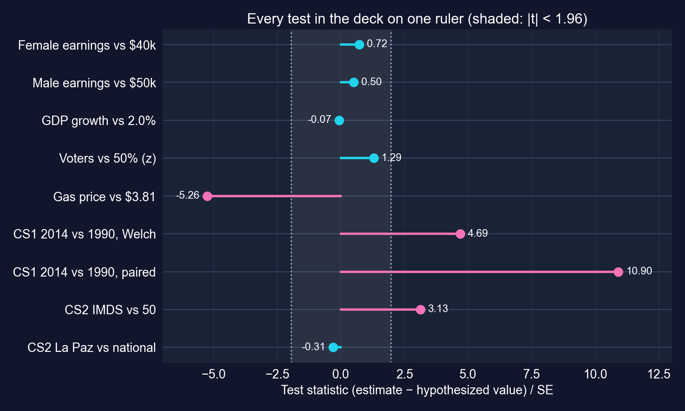

[同じ ±1.96 の帯があらゆる判定を決めます。変わるのは、差が何を意味するかです。]{.takeaway .fragment}

::: {.notes}
すべての数値は上記のスライドから来ています。ケーススタディ1の課題2の二つのバーに注目してください：同じ平均変化が、二つの年を誤って独立標本として扱うとt = 4.69、正しく対応をとるとt = 10.90を与えます。
:::

## 糸を事例ごとに：実在するか、重要か、判別できたか {.smaller}

| 検定 | 実在するか | 重要か | 判別できたか |
|:--|:--|:--|:--|
| ガソリン 対 \$3.81 | はい、$t = -5.26$ | はい、≈ \$109/年 | はい：極小の標準誤差 |
| 女性収入 対 \$40k | いいえ、$t = 0.72$ | おそらく | **いいえ**：\$41,413 で検出力 0.11 |
| 男性収入 対 \$50k | いいえ、$t = 0.50$ | おそらく | **いいえ**：重い裾による標準誤差 \$4,706 |
| GDP成長 対 2% | いいえ、$t = -0.07$ | はい、1 pp が複利で効く | **見かけほどではない**：自己相関 0.87 |
| 世論調査 対 50% | いいえ、$z = 1.29$ | はい、選挙は接戦 | $n = 921$ では無理、2,500 でぎりぎり |
| CS1 2014 対 1990 | はい、対応のある $t = 10.9$ | はい、+\$17,753 | はい、対応をとれば |
| CS2 IMDS 対 50 | はい、$t = 3.13$ | [かろうじて：1.2点]{.key} | はい：$n = 333$ |
| CS2 Tarija 対 Pando | はい、$t = 6.29$ | はい、14.7点 | はい、$n$ = 11, 13 にもかかわらず |

[有意性は最初の列にしか答えません。完全な答えは三つすべてを埋めます。]{.takeaway .fragment}

::: {.notes}
この資料を貫く糸を一つの表に。三つ目の列の二つの「いいえ」の行に注目してください：判別できないとき、棄却しないことは情報を与えず、信頼区間が正直な要約です。
:::

## 正しい検定を選ぶ {.smaller}

| 状況 | 検定 | Python | 例 |
|:--|:--|:--|:--|
| 一つの平均 対 ある値 | 一標本 $t$ | `stats.ttest_1samp` | 収入 対 \$40,000 |
| 事前に定めた方向性のある主張 | 片側 $t$ | `alternative="greater"` | ラパス 対 全国平均 |
| 二つの独立群 | Welch二標本 $t$ | `stats.ttest_ind(…, equal_var=False)` | アフリカ 対 ヨーロッパ |
| 同じ単位を二度測定 | 対応のある $t$ | `stats.ttest_rel` | 1990 対 2014、同じ国々 |
| イエス・ノー型のアウトカム | 比率 $z$ | `stats.norm` | 有権者、成長した国々 |
| 多数の比較 | $\alpha$ を調整 | Bonferroni $\alpha/k$ | 10の地域の組 |
| 時間を通じて従属 | HAC標準誤差（第12, 17章） | — | GDP成長 |

[検定をデータの生成のされ方に合わせてください：独立性、対応、方向、検定の数のすべてが重要です。]{.takeaway .fragment}

::: {.notes}
Welch版は二群に対する安全なデフォルトです。プール版は分散の相等を前提とします。最後の行は指針です：章のGDP検定はデータが持たない独立性を前提としています。
:::

## 誘惑的な間違い — そして訂正

[異論。]{.objection}「$p < 0.05$ だから効果は実在し重要だ。$p > 0.05$ だから効果はない。」

. . .

[応答。]{.rebuttal} ボリビアの平均IMDSは50と「有意に」1.2点異なります：実在するが重要ではありません。女性収入は \$40,000 を有意に上回りませんでしたが、検定は \$1,400 の差を検出する確率が11%でした：棄却なし、しかし効果の不在の証拠でもありません。

[推定値とその信頼区間をまず報告してください。$p$値はそれらへの脚注です。]{.takeaway .fragment}

::: {.notes}
章の「避けるべきよくある間違い」：p値はH0が真である確率ではない。統計的有意性は実際的重要性ではない。片側検定には事前の正当化が必要である。
:::

## どの検定にも問う五つの問い

::: {.incremental}
1. **$H_0$ は正確に何か**、そして関心のある主張は $H_a$ にあるか。方向は事前に定めたか
2. **観測は独立か**。繰り返す単位は対応を求める。時系列とクラスターには別の標準誤差が必要
3. **差はどれほど大きいか**、重要な単位（ドル、点、パーセントポイント）で
4. **信頼区間はどれほど広く**、検出力はどれほどか。検定は重要な差を検出できたか
5. **検定を何回行ったか**。5%で10の検定は誤警報の確率を約40%に高める
:::

[これら五つの問いが、$p$値を判定から証拠へと変えます。]{.takeaway .fragment}

::: {.notes}
学生が本書の残りのすべての推測の表に適用できるチェックリストです。問い2と4は、章自身のGDPと収入の例が最も必要としたものです。
:::

## 携えていくもの

::: {.incremental}
- **標準誤差** $s/\sqrt{n}$ があらゆる区間と検定を駆動し、$\sqrt{n}$ でしか縮みません
- $\sigma$ を推定するときは **$t$ 分布**を使います。$n \approx 100$ では正規分布に近いです
- **95%信頼区間**は、両側5%検定が棄却しない値の集合です。反復抽出の言明として読んでください
- $t = (\text{推定値} - \text{仮説値})/\text{標準誤差}$：第7〜17章のすべての検定のレシピ
- **棄却しない ≠ 受け入れる**：「効果なし」と結論する前に検出力と信頼区間を確認してください
- **実在するか、重要か、判別できたか** あらゆる結果に三つすべてを問うてください
:::

::: {.notes}
章の重要なポイントの復習を、この資料が検証したこと—検出力、対応、多重検定、従属性—で更新したものです。
:::

# 平均を推定し、信頼区間で囲み、それから気になる主張を検定し、それが重要かを問いなさい。 {.divider background-color="#C21E72"}
