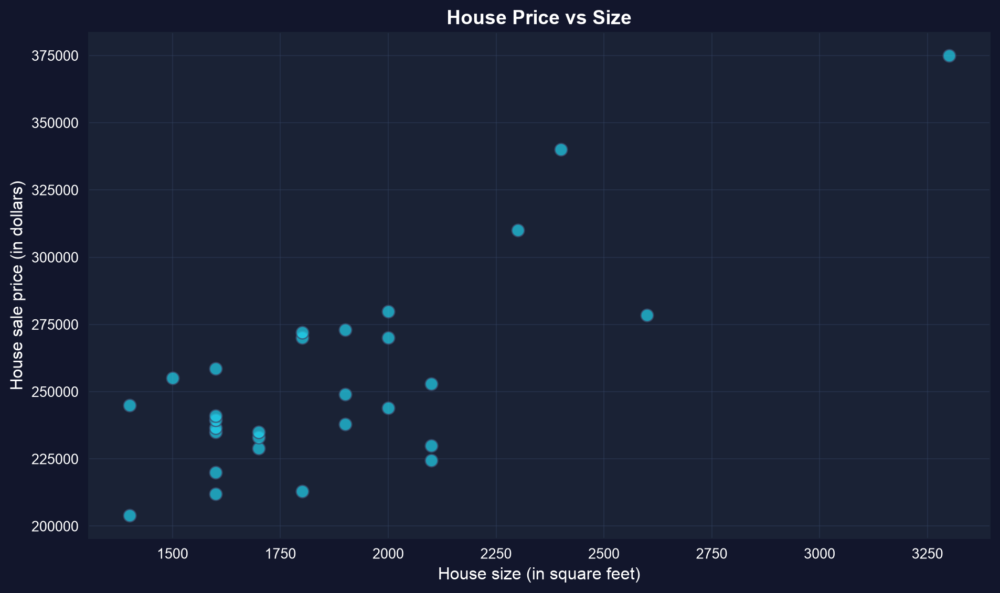
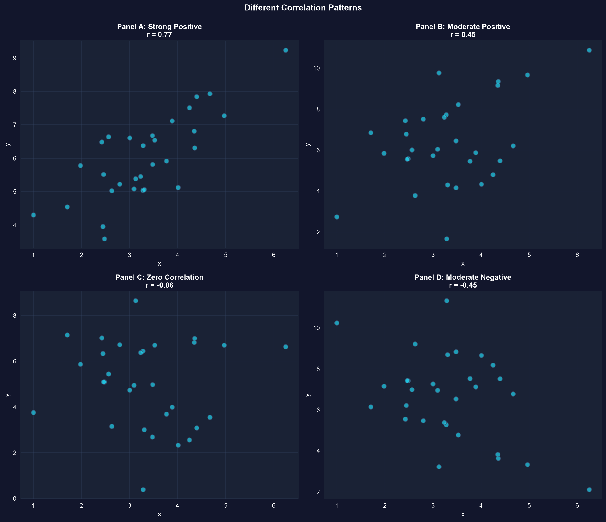
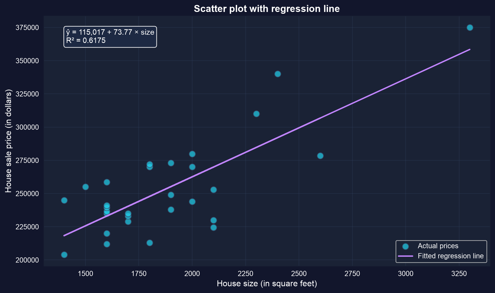
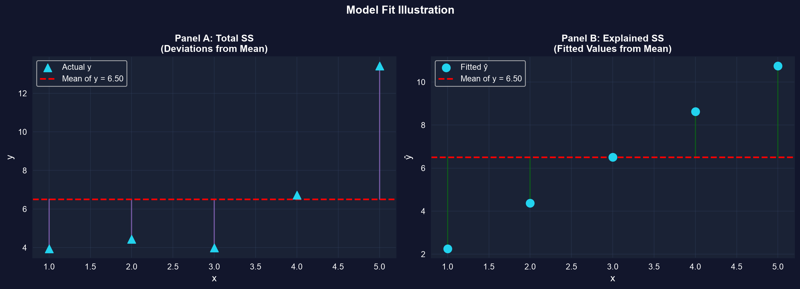
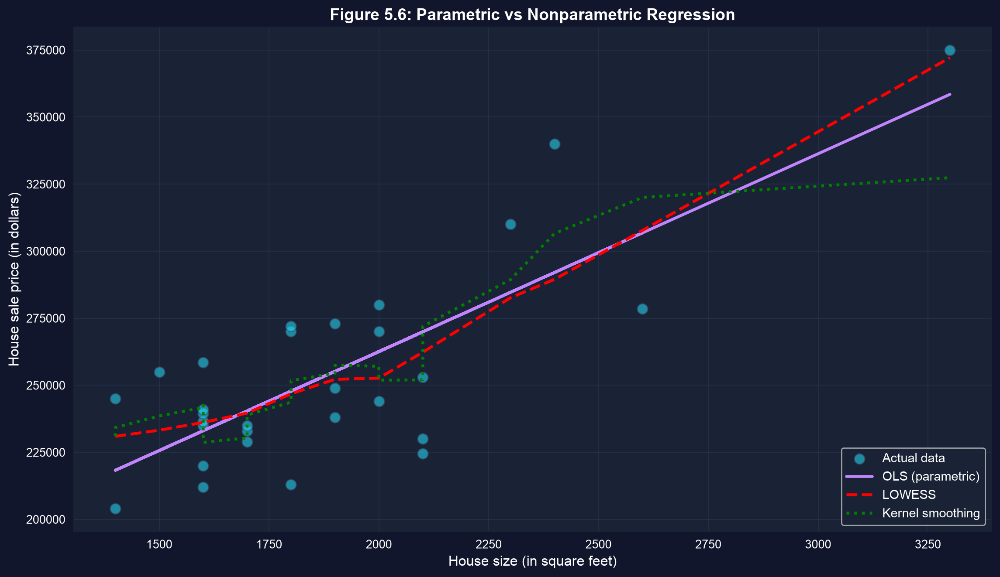

# La pregunta {.divider background-color="#008CB7"}

[Acto I · La tensión]{.act}

## ¿De verdad las casas más grandes se venden por más — y por *cuánto*?

Un conjunto de datos de ventas de casas: para cada casa vemos **dos** números — su **tamaño** y su **precio**.

. . .

Mirar una sola casa no nos dice nada. La *relación entre las dos columnas* es la historia — y
queremos **medirla**, no solo intuirla.

::: {.notes}
Abre con la pregunta concreta. Tenemos datos bivariados: dos mediciones por observación. Todo el
capítulo trata de resumir el vínculo entre ellas con un número y una línea.
:::

## Hacia dónde vamos

::: {.incremental}
- **Ver** la relación — diagramas de dispersión y tablas de doble entrada
- **Medir** su fuerza — correlación y covarianza
- **Modelar**la — la línea de regresión por mínimos cuadrados ordinarios (MCO)
- **Juzgar** el ajuste — $R^2$ y el error estándar de la regresión
- **Interpretar**la honestamente — asociación no es causalidad
:::

## Tres ideas sostienen todo el capítulo

**Asociación** — ¿tienden $x$ e $y$ a moverse juntas, y en qué dirección?

**Correlación** $r$ — un único número sin unidades en $[-1, 1]$ para la *fuerza* de un vínculo **lineal**.

**Regresión** — una línea $\hat{y} = b_1 + b_2 x$ que *predice* $y$ a partir de $x$.

[Resumir una relación significa convertir una nube de puntos en una dirección, un número y una línea.]{.takeaway .fragment}

::: {.notes}
Estos tres términos reaparecen en cada capítulo posterior. La correlación mide; la regresión predice.
:::

# Ver y medir el vínculo {.divider background-color="#7A209F"}

[Acto II · La investigación]{.act}

## Empieza mirando: el precio sube con el tamaño — pero no perfectamente



[Un diagrama de dispersión es el primer resumen de los datos bivariados — dirección y dispersión, antes de cualquier número.]{.takeaway .fragment}

::: {.notes}
Señala la clara pendiente positiva y la dispersión vertical para cualquier tamaño dado — otros factores (lote,
antigüedad, ubicación) también mueven el precio.
:::

## Dibuja el diagrama de dispersión en unas pocas líneas

``` {.python code-line-numbers="1-2|4-5|7|8-9|10"}
import pandas as pd                          # tabular data
import matplotlib.pyplot as plt               # plotting

url = "https://raw.githubusercontent.com/quarcs-lab/data-open/master/AED/AED_HOUSE.DTA"
houses = pd.read_stata(url)                  # load the 29 Davis, CA house sales

fig, ax = plt.subplots(figsize=(10, 6))      # create one figure + axes
ax.scatter(houses["size"], houses["price"],  # x = size, y = price
           s=80, alpha=0.7, color="#22d3ee") # marker size, transparency, colour
plt.show()                                   # render the scatter plot
```

[↗ Pruébalo en Colab](https://colab.research.google.com/notebooks/empty.ipynb){.colab-link target="_blank" data-preview-link="false"}

::: {.notes}
matplotlib es la biblioteca de gráficos de referencia. Una sola llamada a `scatter` convierte las dos columnas en la
imagen de la diapositiva anterior.
:::

## La correlación mide la fuerza; la covarianza solo da el signo

:::: {.columns}
::: {.column width="50%"}
### Covarianza
- el signo indica la **dirección**
- lleva las **unidades** de $x \times y$ (dólares × pies²)
- la escala no es comparable entre conjuntos de datos
:::
::: {.column width="50%"}
### Correlación $r$
- **sin unidades**, siempre en $[-1, 1]$
- $r = s_{xy} / (s_x s_y)$
- comparable entre cualquier par de variables
:::
::::

[La covarianza dice *en qué dirección*; la correlación dice *con qué fuerza* — en una escala que cualquiera puede leer.]{.takeaway .fragment}

## $r$ capta la fuerza *lineal* — y puede pasar por alto una curva



[$r$ cerca de $\pm 1$ significa una línea apretada; $r \approx 0$ significa que no hay vínculo *lineal* — no necesariamente que no haya vínculo alguno.]{.takeaway .fragment}

::: {.notes}
Una correlación cero aún puede ocultar una relación no lineal fuerte (p. ej. una forma de U). r solo ve la
parte de línea recta. Para nuestros datos de casas r = 0.7858.
:::

## Mide el vínculo: correlación y covarianza en pandas

``` {.python code-line-numbers="1|3-4|6-7|9-10"}
import pandas as pd                          # tabular data

url = "https://raw.githubusercontent.com/quarcs-lab/data-open/master/AED/AED_HOUSE.DTA"
houses = pd.read_stata(url)                  # load the 29 Davis, CA house sales

cov = houses[["price", "size"]].cov()        # covariance matrix (carries units: $ × sq ft)
corr = houses[["price", "size"]].corr()      # correlation matrix (unit-free, in −1…1)

r = corr.loc["price", "size"]                # pull out the single correlation number
print(f"r = {r:.4f}")                        # → r = 0.7858
```

[↗ Pruébalo en Colab](https://colab.research.google.com/notebooks/empty.ipynb){.colab-link target="_blank" data-preview-link="false"}

::: {.notes}
`.corr()` y `.cov()` son métodos de DataFrame de pandas. La celda fuera de la diagonal es el número que queremos;
la correlación estandariza la covarianza mediante las dos desviaciones estándar.
:::

## La línea de regresión convierte la nube en una predicción

$$\hat{y} = b_1 + b_2\, x$$

[$b_1$ es el **intercepto** ($y$ predicho cuando $x = 0$); $b_2$ es la **pendiente** — el cambio predicho
en $y$ ante un aumento de una unidad en $x$. MCO elige $b_1, b_2$ para minimizar la suma de cuadrados residuales.]{.comment}

::: {.notes}
Define el residuo e_i = y_i − ŷ_i. MCO minimiza Σ e_i². Esto generaliza la media muestral: una
regresión solo con intercepto devuelve ȳ.
:::

## MCO traza la única línea de mejor ajuste a través de la nube



[Pendiente $b_2 = \$73.77$ por pie²; intercepto $b_1 = \$115{,}017$ — se predice que una casa 100 pies² más grande cueste unos **\$7,377** más.]{.takeaway .fragment}

::: {.notes}
La pendiente es el número con significado económico. El intercepto aquí es una extrapolación fuera de rango
(no hay casas de 0 pies²), así que no lo sobreinterpretes.
:::

## Ajusta la línea de regresión en Python

``` {.python code-line-numbers="1|3-4|6-8|10-11"}
!pip install -q pyfixest                   # install pyfixest in Colab (-q = quiet; not preinstalled)

import pandas as pd                         # pandas → load & handle tabular data
import pyfixest as pf                        # pyfixest → fast OLS regression + tidy output

# dataset: 29 house sales in Davis, CA (price, size, bedrooms, …)
url = "https://raw.githubusercontent.com/quarcs-lab/data-open/master/AED/AED_HOUSE.DTA"
houses = pd.read_stata(url)                 # read the Stata .dta file into a DataFrame

m = pf.feols("price ~ size", data=houses)   # fit OLS: regress price on size
m.summary()                                 # report intercept b1, slope b2, SEs, R²
```

[↗ Pruébalo en Colab](https://colab.research.google.com/notebooks/empty.ipynb){.colab-link target="_blank" data-preview-link="false"}

::: {.notes}
Autocontenido — pégalo en una celda vacía de Colab y corre de principio a fin: carga los datos de casas AED
directamente del repo de datos abiertos del proyecto, luego ajusta y reporta la regresión. pyfixest es
el paquete de estimación del proyecto. (La propia presentación no se ejecuta; este es el flujo ejecutable.)
:::

## $R^2$ divide la variación total en explicada y sobrante

$$R^2 = \frac{\text{explained SS}}{\text{total SS}} = 1 - \frac{\text{residual SS}}{\text{total SS}}$$



[Aquí $R^2 = 0.617$: el tamaño explica cerca del **62%** de la variación en el precio, dejando 38% a todo lo demás. (Y $R^2 = r^2 = 0.7858^2$.)]{.takeaway .fragment}

::: {.notes}
Para la regresión simple R² siempre es igual a r². El error estándar de la regresión, s_e, mide el
residuo típico en las unidades de y (dólares).
:::

## Una curva flexible verifica el supuesto de línea recta



[Ajusta primero una curva flexible; si se pega a la línea recta, el resumen lineal simple es confiable.]{.takeaway .fragment}

::: {.notes}
La regresión no paramétrica no impone ninguna forma funcional. Compararla con la línea MCO es una verificación rápida y
honesta de que el modelo lineal no esconde curvatura.
:::

# Leerlo correctamente {.divider background-color="#C21E72"}

[Acto III · La resolución]{.act}

## El error tentador — y la corrección

[Objeción.]{.objection} "El tamaño y el precio tienen $r = 0.79$, así que **un mayor tamaño causa un mayor precio**."

. . .

[Respuesta.]{.rebuttal} **Asociación no es causalidad.** Las variables de confusión (ubicación, tamaño del lote), la causalidad
inversa y la selección pueden crear una correlación. Una línea resume; no identifica una causa.

[Una correlación gana una lectura causal solo con un diseño que descarte las alternativas.]{.takeaway .fragment}

## Qué llevarse

::: {.incremental}
- Un **diagrama de dispersión** es el primer resumen honesto de dos variables.
- La **correlación** $r \in [-1, 1]$ mide la fuerza *lineal*, sin unidades; la **covarianza** solo da el signo.
- **MCO** ajusta $\hat{y} = b_1 + b_2 x$ minimizando los residuos al cuadrado; la **pendiente** es el titular.
- **$R^2$** reporta la proporción de variación explicada — y $R^2 = r^2$ para la regresión simple.
- **Asociación $\neq$ causalidad** — siempre la última palabra en la interpretación.
:::

# Mide la relación, modélala con una línea — y luego resiste llamarla causa. {.divider background-color="#C21E72"}
