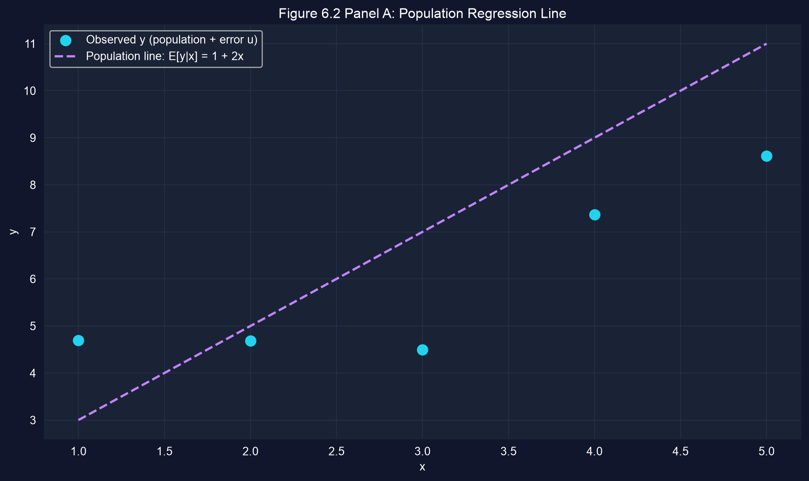
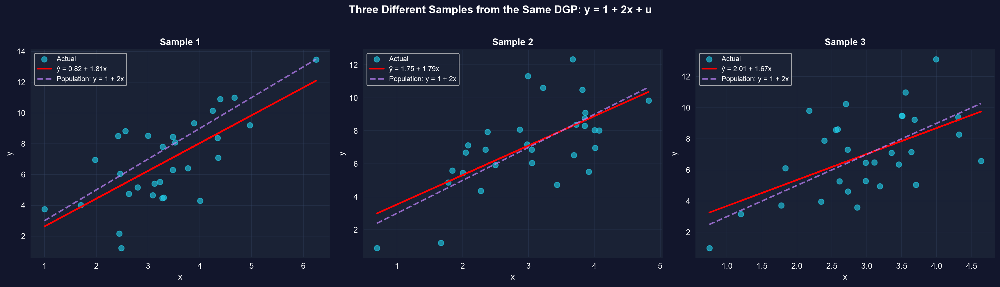
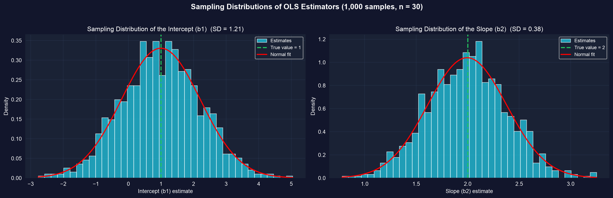

# La pregunta {.divider background-color="#008CB7"}

[Acto I · La tensión]{.act}

## Ajustamos una recta — pero la verdad vive en una población que nunca vemos

El capítulo 5 nos mostró *cómo* ajustar una regresión. Pero nuestra recta $\hat{y} = b_1 + b_2 x$ proviene de
una sola muestra ruidosa. Detrás de ella está una **recta poblacional** $\beta_1 + \beta_2 x$ que nunca podemos observar.

. . .

Entonces, ¿por qué deberíamos confiar en una estimación que sabemos que está equivocada? Este capítulo responde a eso — con las
propiedades estadísticas que hacen de **MCO** el estimador por defecto en econometría.

::: {.notes}
Todo el capítulo trata sobre la brecha entre la recta muestral que calculamos y la recta poblacional que
queremos. Propiedades como la insesgadez nos dicen cómo razonar sobre esa brecha.
:::

## Hacia dónde vamos

::: {.incremental}
- **Población vs muestra** — la recta que queremos ($\beta_1+\beta_2x$) vs la recta que obtenemos ($b_1+b_2x$)
- **Variabilidad muestral** — por qué cada muestra da una recta diferente
- **Insesgadez** — por qué MCO está *en lo correcto en promedio*, mostrado por Monte Carlo
- **Errores estándar** — cómo medir la precisión de una sola estimación
- **MELI y normalidad** — por qué MCO es la mejor opción, y por qué funcionan las tablas $t$
:::

## Seis ideas anclan este capítulo

::: {.incremental}
- **Media condicional $E[Y\mid X]$** — la recta poblacional; la parte sistemática de $Y$ dado $X$
- **Error $u$ vs residuo $e$** — el choque no observado vs la desviación observada respecto de $\hat{y}$
- **Homocedasticidad** — la dispersión del error $\operatorname{Var}[u\mid x]=\sigma_u^2$ es constante en $x$
- **$s_e$** — el error estándar de la regresión, $\sqrt{\text{RSS}/(n-2)}$: tamaño típico del residuo
- **MELI** — bajo los cuatro supuestos, MCO tiene la menor varianza de cualquier regla lineal insesgada
- **Normalidad asintótica** — a medida que $n$ crece, $b_2$ es aproximadamente normal, así que aplican las tablas $t$
:::

[MCO está equivocado en cada muestra — pero en lo correcto en promedio, y podemos decir exactamente cuán equivocado.]{.takeaway .fragment}

# Población vs muestra {.divider background-color="#7A209F"}

[Acto II · La investigación]{.act}

## Una verdad conocida: datos generados a partir de $y = 1 + 2x + u$

Para estudiar MCO, el capítulo usa **datos generados** donde *conocemos* la respuesta:

$$y = \underbrace{1 + 2x}_{E[y\mid x]} + u, \qquad u \sim N(0,\ \sigma_u^2=4)$$

[Intercepto verdadero $\beta_1=1$, pendiente verdadera $\beta_2=2$. La columna `Eygivenx` es la recta poblacional
exactamente; `u` es el choque aleatorio que aleja cada `y` observado de ella.]{.comment}

## Paso 1 — ajusta la recta muestral con pyfixest, compárala con la verdad

``` {.python code-line-numbers="1|3-4|6-7|9|10-11"}
!pip install -q pyfixest                     # install pyfixest in Colab (-q = quiet; not preinstalled)

import pandas as pd                          # tabular data
import pyfixest as pf                         # pyfixest → OLS, R-style formulas

url = "https://raw.githubusercontent.com/quarcs-lab/data-open/master/AED/AED_GENERATEDDATA.DTA"
data = pd.read_stata(url)                    # 5 points generated from y = 1 + 2x + u

fit = pf.feols("y ~ x", data=data)           # OLS: regress observed y on x
fit.coef()                                   # sample estimates b1, b2
fit.summary()                                # full table: coefs, SEs, t, p, R2
```

[↗ Pruébalo en Colab](https://colab.research.google.com/notebooks/empty.ipynb){.colab-link target="_blank" data-preview-link="false"}

::: {.notes}
Ajustar la y observada (no Eygivenx) da b1 = 2.81, b2 = 1.05, R2 = 0.769 — alejados de los verdaderos 1 y 2
porque n = 5 y los errores resultaron empujar la recta. Esa brecha es todo el punto.
:::

## Una muestra falla: $\hat{y} = 2.81 + 1.05x$ vs la verdadera $1 + 2x$



[Con solo $n=5$, la estimación ($b_2=1.05$) cae lejos de la verdad ($\beta_2=2$). Esto no es un error — es variabilidad muestral.]{.takeaway .fragment}

## El mismo proceso, tres muestras, tres rectas diferentes



[Las pendientes salieron 1.81, 1.79, 1.67; los interceptos 0.82, 1.75, 2.01. Una muestra nunca revela la verdad — solo da un sorteo de una distribución de estimaciones.]{.takeaway .fragment}

## Paso 2 — simula 1,000 muestras para ver el comportamiento del estimador

``` {.python code-line-numbers="1-2|4-6|8-13|15-16"}
import numpy as np                           # random draws + arrays
import pyfixest as pf                         # OLS on each simulated sample

np.random.seed(42)                           # reproducible simulation
n, n_sims = 30, 1000                         # 1,000 samples of n = 30
b1_true, b2_true, sigma_u = 1, 2, 2          # the known DGP y = 1 + 2x + u

slopes = []                                  # collect b2 from each sample
for _ in range(n_sims):
    x = np.random.normal(3, 1, n)            # draw regressors
    u = np.random.normal(0, sigma_u, n)      # draw mean-zero errors
    y = b1_true + b2_true * x + u            # build y from the true model
    slopes.append(pf.feols("y ~ x", data=pd.DataFrame({"x": x, "y": y})).coef()["x"])

np.mean(slopes)                              # ≈ 2.00  → unbiased
np.std(slopes)                               # ≈ 0.38  → sampling variability
```

[↗ Pruébalo en Colab](https://colab.research.google.com/notebooks/empty.ipynb){.colab-link target="_blank" data-preview-link="false"}

::: {.notes}
Monte Carlo = repetir el estudio 1,000 veces en la computadora. Pendiente media 1.9944, DE 0.3836;
intercepto medio 0.9960, DE 1.2069. El promedio cae en la verdad aunque ninguna muestra individual lo haga.
:::

## En lo correcto en promedio: las estimaciones se centran en el verdadero $\beta_2 = 2$



[Pendiente media $=1.994$ (verdadera $2$), DE $=0.38$; intercepto medio $=0.996$ (verdadero $1$). **Insesgadez** y **normalidad asintótica**, vistas directamente.]{.takeaway .fragment}

## 6.4 — la precisión tiene una fórmula: el error estándar de la pendiente

Para una sola muestra no podemos promediar sobre mundos — pero podemos *estimar* la dispersión:

$$s_e=\sqrt{\frac{\text{RSS}}{n-2}}, \qquad se(b_2)=\frac{s_e}{\sqrt{\sum_i (x_i-\bar{x})^2}}$$

[Divide la RSS entre $n-2$ porque se estiman dos parámetros ($b_1,b_2$). La pendiente es precisa cuando
$s_e$ es pequeño (buen ajuste) y los $x$ están ampliamente dispersos.]{.comment}

## Paso 3 — calcula los errores estándar a mano, verifícalos contra el modelo

``` {.python code-line-numbers="1-2|4-6|8-11|13-15|17-18"}
import numpy as np                           # arrays + math
import pyfixest as pf                         # to check our hand calculation

data = pd.DataFrame({"x": [1, 2, 3, 4, 5],   # artificial 5-point dataset
                     "y": [1, 2, 2, 2, 3]})
fit = pf.feols("y ~ x", data=data)           # fitted line: y_hat = 0.8 + 0.4x

b1, b2 = fit.coef()["Intercept"], fit.coef()["x"]
data["resid"] = data["y"] - (b1 + b2 * data["x"])   # residuals e = y - y_hat
RSS = np.sum(data["resid"] ** 2)             # residual sum of squares
Sxx = np.sum((data["x"] - data["x"].mean()) ** 2)   # spread of x

s_e   = np.sqrt(RSS / (len(data) - 2))       # standard error of the regression
se_b2 = s_e / np.sqrt(Sxx)                   # standard error of the slope

print(se_b2, fit.se()["x"])                  # hand value == model value ✓
```

[↗ Pruébalo en Colab](https://colab.research.google.com/notebooks/empty.ipynb){.colab-link target="_blank" data-preview-link="false"}

::: {.notes}
Los errores estándar no son magia — RSS → s_e → se(b2) a partir de fórmulas transparentes, y el número a mano
coincide exactamente con el EE que reporta pyfixest. Esto desmitifica la tabla de regresión.
:::

## Tres palancas controlan la precisión

::: {.incremental}
- **Ajuste del modelo ($s_e$)** — residuos más pequeños encogen cada error estándar.
- **Tamaño de muestra ($n$)** — $se(b_2)\propto 1/\sqrt{n}$: cuadruplica $n$ para reducir a la mitad el EE.
- **Dispersión de $x$** — un $\sum(x_i-\bar{x})^2$ amplio fija la pendiente; un $x$ agrupado la deja suelta.
:::

[En los datos de convergencia de 108 países, el capital por trabajador está dispersado casi tanto como su media — exactamente la condición que estima la pendiente con precisión.]{.takeaway .fragment}

# Leerlo correctamente {.divider background-color="#C21E72"}

[Acto III · La resolución]{.act}

## "Mi estimación está equivocada — así que MCO falló." No exactamente.

[Objeción.]{.objection} "Mi pendiente es 1.05 pero la verdad es 2.0. El método está roto."

. . .

[Respuesta.]{.rebuttal} **Una sola estimación equivocada es lo esperado, no un fallo.** Bajo los cuatro
supuestos (modelo correcto, errores de media cero, homocedasticidad, independencia) MCO es **insesgado** —
en lo correcto *en promedio* — y **MELI**, la regla lineal insesgada más ajustada. Una muestra es un sorteo; el
error estándar te dice cuán lejos podría estar.

[No preguntes "¿es mi estimación exactamente correcta?" Pregunta "¿qué tan precisa es?" — eso es lo que reporta el error estándar.]{.takeaway .fragment}

## Qué llevarse adelante

::: {.incremental}
- La **recta poblacional** $\beta_1+\beta_2x$ es el objetivo; la **recta muestral** $b_1+b_2x$ es una estimación ruidosa de ella.
- MCO es **insesgado**: $E[b_2]=\beta_2$ — Monte Carlo centra 1,000 estimaciones en la verdad.
- Los **errores estándar** cuantifican la variabilidad muestral; $se(b_2)=s_e/\sqrt{\sum(x_i-\bar{x})^2}$.
- La precisión mejora con **mejor ajuste, mayor $n$ y mayor dispersión en $x$**.
- Bajo los cuatro supuestos MCO es **MELI** y asintóticamente **normal** — la licencia para pruebas $t$ e intervalos.
:::

# Ajusta la recta, reporta su error estándar — la estimación es un sorteo, no la verdad. {.divider background-color="#C21E72"}
