# 一つの標本、一つの傾き：どこまで信頼してよいのか？ {.divider background-color="#008CB7"}

[第I幕 · 緊張]{.act}

::: {.notes}
この章は回帰の傾きを母集団に関する主張へと変換します。第6章は点推定値を与えてくれました。第7章はそれがどれほど正確か、真の傾きのどの値をデータが排除するか、そしてそれに関する主張をどう検定するかを教えます。同じ道具一式を、次に二つの実際のケーススタディに適用します。108か国と、333のボリビアの自治体です。
:::

## 傾きの推定値だけでは物語は完結しない

第6章は一つの数を与えてくれました。カリフォルニア州デービスで売却された29軒の住宅では、1平方フィート増えるごとに価格が **\$73.77** 高くなるのと結びついています。別の29軒の標本なら別の数が出るでしょう。

. . .

ですから本当の問いは *「傾きはいくつか？」* ではなく **「どこまで信頼してよいのか？」** です。推測は一つの推定値を **範囲**（信頼区間）と **判定**（仮説検定）へと変えます。

[このデッキのすべての結果は三つの問いに答えます。*正確か？ 本物か？ 重要か？* そしてその下にもう一つ。*標準誤差は正直か？*]{.takeaway .fragment}

::: {.notes}
推定値 b2 = 73.77 は標本分布から引かれた一つのくじです。推測は、手元にある唯一の標本だけを使ってその分布を記述します。四つの問いはこのデッキを貫く糸です。正確さ（EEとIC）、統計的有意性（検定）、経済的有意性（文脈の中での大きさ）、そして正直な不確実性（古典的な標準誤差 vs 不均一分散にロバストな標準誤差）です。これらは各パートの終わりと総合のところでスコアカードとして戻ってきます。
:::

## これから進む道：各パートをクリックするとそこへ飛べます {.smaller}

| パート | 問い | 道具 | 主要な結果 |
|:-----|:--------------------------|:----------------|:--------------------------|
| [7.1](#sec-71) | 大きな住宅ほど高く売れるか？ | OLS（最小二乗法）、29軒 | $b_2 = 73.77$ \$/平方フィート |
| [7.2](#sec-72) | 傾きはゼロからノイズ何個分離れているか？ | $t$統計量 | $t = 6.60$ |
| [7.3](#sec-73) | データが排除できない傾きはどれか？ | 信頼区間 | [50.84, 96.70] |
| [7.4](#sec-74) | 面積はそもそも重要か？ | $\beta_2 = 0$ の検定 | 棄却、$p < 0.001$ |
| [7.5](#sec-75) | 傾きは1平方フィートあたり\$90か？ | 両側検定 | 棄却しない、$p = 0.158$ |
| [7.6](#sec-76) | それは\$90より*小さい*か？ | 片側検定 | 5%で棄却しない、$p = 0.079$ |
| [7.7](#sec-77) | 標準誤差は正直か？ | HC1 ロバスト標準誤差 | 11.17 → 11.33 |
| [ケース1](#cs-1) | 資本と生産性、108か国 | 上記すべて | ロバスト標準誤差が48%大きい |
| [ケース2](#cs-2) | 夜間光と発展、ボリビア | 上記すべて | 傾き3.37、ロバスト標準誤差が18%大きい |
| [総合](#synthesis) | あらゆる回帰に引き継がれるものは何か？ | スコアカード | — |

::: {.notes}
パートのラベルはリンクです。一つをクリックするとその区切りに飛びます。Mを押すとメニュー（すべてのスライドタイトル）、Oを押すと概観グリッドが出ます。7.1〜7.7節はすべて同じ29軒を使うので、各ステップは同じ回帰に道具を一つずつ加えていきます。二つのケーススタディは次に、章自身のコードと実際の出力を使い、課題ごとに新しいデータへすべての道具を適用します。
:::

## すべての検定の背後にある母集団モデル

$$y_i = \beta_1 + \beta_2 x_i + u_i \qquad\text{推定は}\qquad \hat y_i = b_1 + b_2 x_i$$

::: {.incremental}
1. **線形性**：母集団モデルは $y = \beta_1 + \beta_2 x + u$
2. **条件付き平均ゼロ**：$E[u_i \mid x_i] = 0$
3. **分散一定（均一分散）**：$\operatorname{Var}[u_i \mid x_i] = \sigma_u^2$
4. **独立性**：$i \neq j$ について $u_i$ は $u_j$ と独立
:::

[仮定1〜2が $b_2$ を不偏にします。仮定3〜4は*古典的な*標準誤差が必要とするもので、ロバスト標準誤差（7.7）は仮定3を外します。]{.takeaway .fragment}

::: {.notes}
これらは章の仮定1〜4です。何をもたらすかで整理すると分かりやすいです。1と2は係数について（不偏性）、3と4はその標準誤差についてです。3が崩れると（不均一分散）、係数自体は問題ありませんが古典的な標準誤差が誤りになります。不均一分散にロバストな標準誤差がそれを直します。4が崩れると（クラスター化データや時系列データ）、クラスターまたはHAC標準誤差が必要で、後の章がそれを使います。2が崩れると、どんな標準誤差も推定値を救えません。それは推測ではなく研究デザインの問題です。
:::

## 六つの考えがこの章を支える

::: {.incremental}
- **帰無仮説** $H_0: \beta_2 = 0$：$x$ が $y$ に線形の効果を持たないという既定の主張
- **標準誤差** $\operatorname{se}(b_2)$：傾きが標本ごとにどれだけ変動するか
- **$t$統計量** $t = (b_2 - \beta_2^{*})/\operatorname{se}(b_2)$：帰無値からの距離をEE単位で表したもの
- **臨界値** $t_{n-2,\,\alpha/2}$：棄却を引き起こす境目
- **誤差の幅** $t_{n-2,\,\alpha/2}\times\operatorname{se}(b_2)$：信頼区間の半分の幅
- **有意性の検定**：標本ノイズを考えたうえで、係数はゼロと区別できるか？
:::

[統計的有意性は経済的有意性ではありません。最初のスライドから最後まで、両方を視野に入れておきましょう。]{.takeaway .fragment}

::: {.notes}
これらは章の六つの重要概念です。後のすべてのスライドは三つの数から組み立てられます。推定値 b2、その標準誤差、そして自由度 n − 2 です。臨界値と誤差の幅はそこから導かれ、t統計量、p値、区間も同様です。
:::

# 第II-a幕 · 一つの回帰、七つの道具 {.divider background-color="#7A209F"}

[7.1〜7.7節 · カリフォルニア州デービスの29軒]{.act}

::: {.notes}
7.1節から7.7節まで、すべて住宅価格を住宅面積に回帰させる同じ回帰で作業します。各節は推測の道具を一つずつ加えます。t統計量、信頼区間、有意性の検定、特定の値の検定、片側検定、そしてロバスト標準誤差です。
:::

# 7.1 · 大きな住宅ほど高く売れるか？ {#sec-71 .divider background-color="#7A209F"}

[例 · 29軒の住宅売却に対するOLS]{.act}

::: {.notes}
7.1節：動機づけの例と回帰出力の全体です。あとで検定するすべての数は、この一つの表の上にあります。
:::

## データ：1999年にセントラル・デービスで売却された29軒 {.smaller}

**データ。** `AED_HOUSE.DTA`：1999年にカリフォルニア州セントラル・デービスで売却された29軒の販売価格と特性。

| 変数 | 意味 | 平均 | 標準偏差 | 最小値 | 最大値 |
|:--|:--|--:|--:|--:|--:|
| `price` | 販売価格、ドル | 253,910 | 37,391 | 204,000 | 375,000 |
| `size` | 住宅面積、平方フィート | 1,883 | 398 | 1,400 | 3,300 |

[その他の列（`bedrooms`、`bathrooms`、`lotsize`、`age`、`monthsold`、`list`）は第10〜11章の重回帰まで待ちます。]{.comment}

$$\text{price}_i = \beta_1 + \beta_2\,\text{size}_i + u_i$$

[$\beta_2$ は母集団の傾きです。面積が1平方フィート異なる住宅どうしの、期待される価格差です。]{.takeaway .fragment}

::: {.notes}
29観測は小標本で、まさにそれこそがこの章が正規分布ではなくt分布にこだわる理由です。平均価格は約253,910ドル、平均面積は約1,883平方フィートです。面積は1,400から3,300平方フィートまでで、3,300平方フィートの住宅は他から遠く離れているので、傾きに大きな重みを持ちます。この傾きは住宅間の関連であって、ある住宅に1平方フィート足したときに建築業者が得る価格ではありません。
:::

## コード：データを読み込んで回帰を当てはめる

``` {.python code-line-numbers="1-4|5-7|8-9"}
!pip install -q pyfixest                     # pyfixest is not preinstalled in Colab
import pandas as pd                          # tabular data
import pyfixest as pf                        # OLS with R-style formulas
from scipy import stats                      # t-distribution: critical values, p-values
url = "https://raw.githubusercontent.com/quarcs-lab/data-open/master/AED/AED_HOUSE.DTA"
data_house = pd.read_stata(url)              # 29 house sales, Davis CA, 1999
print(data_house[["price", "size"]].describe())  # mean, SD, min, max of the two variables
model_basic = pf.feols("price ~ size", data=data_house)  # OLS, classical (iid) SEs
model_basic.summary()                        # coefficients, SEs, t, p, 95% CIs, R²
```

[↗ Colab で試す](https://colab.research.google.com/notebooks/empty.ipynb){.colab-link target="_blank" data-preview-link="false"}

::: {.notes}
自己完結型です。空のColabセルに貼り付けてください。vcov引数がないと、pyfixestは均一分散を仮定する古典的な標準誤差を報告します。これはちょうど章の表7.1のとおりです。7.7節でロバスト標準誤差に切り替えます。
:::

## 出力：1平方フィートあたり\$73.77、ゼロから標準誤差6.6個分 {.smaller}

| 変数 | 係数 | EE | $t$ | $p$ | 95% CI |
|:--|--:|--:|--:|--:|:--|
| 切片 | 115,017.283 | 21,489.360 | 5.35 | <&nbsp;0.001 | [70,924.76,&nbsp;159,109.81] |
| `size` | [73.771]{.key} | 11.175 | 6.60 | <&nbsp;0.001 | [50.84,&nbsp;96.70] |

[N = 29 · 古典的（iid）標準誤差 · $R^2 = 0.617$ · 自由度 $n - 2 = 27$]{.comment}

::: {.incremental}
- **係数**：1平方フィート増えるごとに、平均して価格が\$73.77高くなるのと結びつく
- **EE 11.175**：29軒のある標本から別の標本へ、傾きはおおむね\$11ほど動く
- **$t$ = 6.60** と **CI [50.84, 96.70]**：ゼロはもっともらしい傾きの範囲のはるか外側にある
:::

[一つの表だけで、もう章の問いに答えています。7.1〜7.7の残りは、各列がどこから来てどう読むかを説明します。]{.takeaway .fragment}

::: {.notes}
推定式：price = 115,017 + 73.77 × size。R² = 0.617：面積だけで価格の変動の約62%を説明します。切片は0平方フィートの住宅の予測価格で、データのはるか外側への外挿です（最小の住宅は1,400平方フィート）。したがって経済的な意味はなく、ただ直線を固定するだけです。sizeのp値は 4.4 × 10⁻⁷ で、ほとんどのソフトウェアは0.000と印字します。
:::

## 直線は当てはまるが、住宅はその周りに散らばる

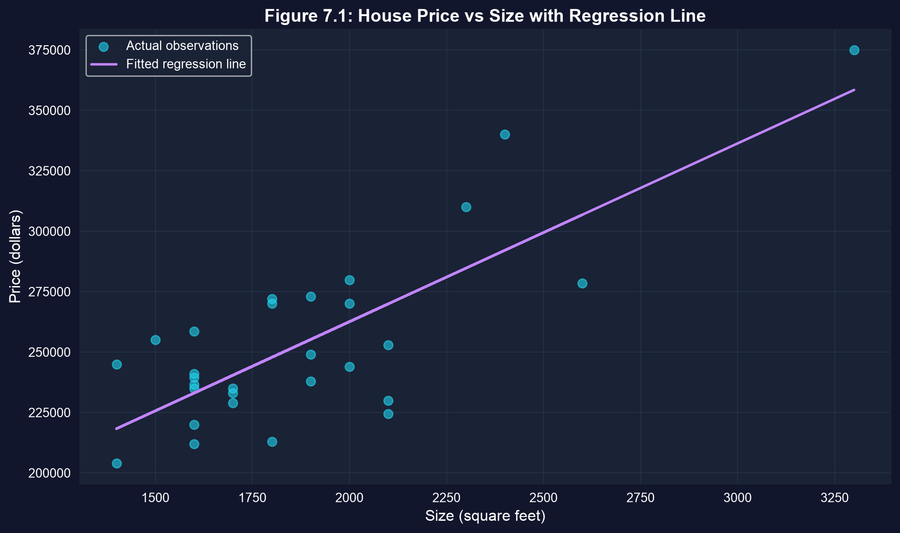{height="400"}

[推測は散らばりを数値化します。縦の隙間が大きいほど、傾きは正確に定まりません。]{.takeaway .fragment}

::: {.notes}
向き：正。形：おおむね線形。散らばり：残差は約 −45,400 から +47,900 ドルの範囲です。3,300平方フィートの大きな住宅に注意してください。xの平均から遠い点はレバレッジが高く、直線を自分のほうへ引き寄せます。たった29軒では、そのような一点が傾きとその標準誤差の両方に効いてきます。
:::

# 7.2 · t統計量：ノイズに対する信号 {#sec-72 .divider background-color="#7A209F"}

[傾きの標準誤差 · $T(n-2)$ 分布]{.act}

::: {.notes}
7.2節：傾きの標準誤差、何がそれを大きくまたは小さくするか、そして推定値を標準化するt統計量です。
:::

## 傾きは確率変数である

::: {.incremental}
- **母集団**：$E[y \mid x] = \beta_1 + \beta_2 x$、未知の $\beta_2$ を伴う
- **標本**：OLSは $b_2 = 73.77$ を与える。$b_2$ の **標本分布** からの一つのくじ
- 仮定1〜4のもとで：$\;E[b_2] = \beta_2$ かつ $\operatorname{Var}[b_2] = \dfrac{\sigma_u^2}{\sum_{i=1}^{n}(x_i - \bar x)^2}$
- $\sigma_u^2$ は決して分からないので、$s_e^2 = \dfrac{1}{n-2}\sum_{i=1}^{n}(y_i - \hat y_i)^2$ で置き換える
:::

$$\operatorname{se}(b_2) = \frac{s_e}{\sqrt{\sum_{i=1}^{n}(x_i - \bar x)^2}}$$

[標準偏差は*データ*の散らばりを表し、標準誤差は標本をまたいだ*推定値*の散らばりを表します。]{.takeaway .fragment}

::: {.notes}
重要な区別：標準偏差は観測値の性質、標準誤差は推定量の性質です。分散の式は古典的なもので、均一分散と独立性のもとで有効です。n − 2 で割るのは、同じデータから二つのパラメータ（切片と傾き）を推定し、自由度を二つ消費したからです。
:::

## 三つのつまみが標準誤差を決める

$$\operatorname{se}(b_2) = \frac{s_e}{\sqrt{\sum (x_i - \bar x)^2}} \approx \frac{s_e}{\sqrt{n}\;s_x}$$

| つまみ | 大きくすると | $\operatorname{se}(b_2)$ への効果 |
|:--|:--|:--|
| 残差の散らばり $s_e$ | 当てはまりが悪く、ノイズが多い | **大きく** |
| 標本サイズ $n$ | 住宅がより多い | **小さく**、速さ $1/\sqrt n$ で：EEを半分にするには $n$ を4倍に |
| $x$ の散らばり $s_x$ | 面積の範囲がより広い | **小さく**：極端な $x$ の値が傾きを固定する |

[正確な傾きには、密な当てはまり、多くの観測、そして $x$ の広い散らばりが必要です。三つとも運ではなくデザインの選択です。]{.takeaway .fragment}

::: {.notes}
章のシーソーの直感：直線は平均の点を中心に回転します。xの値が広く散らばっていれば、傾きのわずかな変化が端で大きな差を生むので、データが傾きを固定します。xの値がまとまっていれば、多くの傾きがほぼ同じくらいよく当てはまります。√n·s_x による近似は章の近道で、正確な分母は s_x が n − 1 を使うとき √(n−1)·s_x です。
:::

## コード：標準誤差を手で作る

``` {.python code-line-numbers="1-6|7-10|11-14"}
!pip install -q pyfixest                     # pyfixest is not preinstalled in Colab
import numpy as np                           # square roots and sums
import pandas as pd                          # tabular data
import pyfixest as pf                        # OLS with R-style formulas
url = "https://raw.githubusercontent.com/quarcs-lab/data-open/master/AED/AED_HOUSE.DTA"
data_house = pd.read_stata(url); model_basic = pf.feols("price ~ size", data=data_house)
n = len(data_house)                          # 29 houses
e = model_basic.resid()                      # residuals y - y_hat
s_e = np.sqrt((e**2).sum() / (n - 2))        # standard error of the regression
x = data_house["size"]                       # the regressor
sxx = ((x - x.mean())**2).sum()              # total variation in x
se_formula = s_e / np.sqrt(sxx)              # classical se(b2), exact
se_shortcut = s_e / (np.sqrt(n) * x.std())   # chapter's shortcut with sqrt(n)
print(s_e, np.sqrt(sxx), se_formula, se_shortcut, model_basic.se()["size"])
```

[↗ Colab で試す](https://colab.research.google.com/notebooks/empty.ipynb){.colab-link target="_blank" data-preview-link="false"}

::: {.notes}
自己完結型です。resid() はOLSの残差を返します。正確な式はpyfixestの標準誤差を小数点以下すべてまで再現します。近道は、正確な式が √(n − 1) を意味するところで √n を使うため、わずかに小さくなります。
:::

## 出力：式が表をぴったり再現する {.smaller}

| 要素 | 値 |
|:--|--:|
| $s_e$、回帰の標準誤差 | 23,550.66 |
| $\sqrt{\sum (x_i - \bar x)^2}$ | 2,107.46 |
| $s_x$、面積の標準偏差 | 398.27 |
| $\operatorname{se}(b_2) = s_e / \sqrt{\sum (x_i - \bar x)^2}$ | [11.175]{.key} |
| 近道 $s_e / (\sqrt{n}\, s_x)$ | 10.98 |
| pyfixest `se()["size"]` | 11.175 |

[$23{,}550.66 / 2{,}107.46 = 11.175$：回帰表の中にブラックボックスは何もありません。]{.takeaway .fragment}

::: {.notes}
典型的な住宅は当てはめ直線から約23,551ドル離れています。面積の全変動の平方根で割ると、1平方フィートあたり11.175ドルの標準誤差になります。近道が10.98になるのは、√29 × 398.27 が √28 × 398.27 = √Σ(x − x̄)² より少し大きいからです。R² が0.62ではなく0.10なら標準誤差は約1.5倍になるという章の主張は確認できます。√(0.90/0.383) = 1.53 で、価格の分散を一定に保っています。
:::

## $t$統計量は推定値を標準化する

$$t = \frac{b_2 - \beta_2^{*}}{\operatorname{se}(b_2)} \;\sim\; T(n-2) \quad\text{（} H_0: \beta_2 = \beta_2^{*} \text{ のもとで）}$$

::: {.incremental}
- もし $\sigma_u$ が分かっていれば、この比は標準正規 $N(0,1)$ になる
- $\sigma_u$ を $s_e$ で推定すると不確実性が加わるので、この比は自由度 $n - 2$ のスチューデントの $t$ に従う
- $H_0: \beta_2 = 0$ について：$\;t = \dfrac{73.77}{11.17} = 6.60$
:::

[$t = 6.60$ は、傾きがそれ自身の標準誤差6.6個分だけゼロの上にあることを意味します。]{.takeaway .fragment}

::: {.notes}
自由度：29観測から推定した2パラメータを引いて = 27。これは第4章の一変量t統計量 (x̄ − μ)/se(x̄) ~ T(n − 1) の二変量版です。唯一の違いは、パラメータをもう一つ推定するので自由度をもう一つ消費することです。
:::

## コード：$t$ の要素を取り出す

``` {.python code-line-numbers="1|2-5|6-7"}
# continues from the previous block (model_basic already fitted)
coef_size = model_basic.coef()["size"]       # b2
se_size = model_basic.se()["size"]           # se(b2)
t_stat_size = model_basic.tstat()["size"]    # t for H0: beta2 = 0
p_value_size = model_basic.pvalue()["size"]  # two-sided p-value
print(f"t = b2 / se(b2) = {coef_size:.4f} / {se_size:.4f} = {t_stat_size:.4f}")
print(f"p-value: {p_value_size:.6f}")        # prints 0.000000 at 6 decimals
```

[↗ Colab で試す](https://colab.research.google.com/notebooks/empty.ipynb){.colab-link target="_blank" data-preview-link="false"}

[出力：$t = 73.7710 / 11.1749 = 6.6015$；$p = 4.4 \times 10^{-7}$、これは0.000000と印字されます。]{.takeaway .fragment}

::: {.notes}
coef()、se()、tstat()、pvalue() はそれぞれ変数名で索引付けされたpandasのSeriesを返します。p値は非常に小さく、小数6桁ではゼロしか表示されません。文字どおりのゼロではないので、p = 0.000 ではなく p < 0.001 と書いてください。
:::

## 7.2の後のスコアカード

| 問い | 住宅の傾きに対する答え |
|:--|:--|
| 正確か？ | $\operatorname{se}(b_2) = 11.17$：推定値の約15% |
| 本物か？ | $t = 6.60$、どんな慣例的な境目もはるかに超える |
| 重要か？ | 7.4で判断する |
| EEは正直か？ | ここまでは古典的なEE；7.7で確認 |

[正確さは相対的です。EE 11 は傾き74の隣では小さく、傾き5の隣では巨大でしょう。]{.takeaway .fragment}

::: {.notes}
スコアカードはこのデッキを貫く糸です。進むにつれて埋まっていきます。7.7までに住宅の傾きについて各行が答えられ、二つのケーススタディは自分自身のスコアカードを持ちます。EEと推定値の比 11.17/73.77 = 0.15 は、t統計量の逆数です。
:::

# 7.3 · 信頼区間：データが排除できない傾き {#sec-73 .divider background-color="#7A209F"}

[推定値 ± 臨界値 × 標準誤差]{.act}

::: {.notes}
7.3節：傾きの信頼区間を構築し、計算し、正しく解釈すること、そしてなぜ正規分布ではなくt分布なのかです。
:::

## 信頼区間は推定値 ± 誤差の幅

$$b_2 \;\pm\; t_{n-2,\,\alpha/2}\times\operatorname{se}(b_2)$$

$$73.77 \;\pm\; 2.052 \times 11.17 \;=\; 73.77 \pm 22.93 \;=\; [50.84,\ 96.70]$$

::: {.incremental}
- $t_{27,\,0.025} = 2.052$：$T(27)$ の各裾に2.5%を残す値
- **誤差の幅** 22.93：区間の半分の幅
- 手早い近似：$b_2 \pm 2\times\operatorname{se}(b_2)$
:::

[区間は1平方フィートあたり\$46にわたります。面積は明らかに重要ですが、その価格は「\$51から\$97のどこか」としか定まっていません。]{.takeaway .fragment}

::: {.notes}
第4章の一般的な手順が引き継がれます。推定値 ± 臨界値 × 標準誤差。自由度27では95%の臨界値は1.96ではなく2.052です。幅 2 × 22.93 = 45.86 ドルは、29軒がどれだけのことを語れるかの正直な要約です。
:::

## コード：pyfixestと手計算による区間

``` {.python code-line-numbers="1-5|6|7-11|12"}
!pip install -q pyfixest                     # pyfixest is not preinstalled in Colab
import pandas as pd, pyfixest as pf          # data and OLS
from scipy import stats                      # Student's t quantiles
url = "https://raw.githubusercontent.com/quarcs-lab/data-open/master/AED/AED_HOUSE.DTA"
data_house = pd.read_stata(url); model_basic = pf.feols("price ~ size", data=data_house)
print(model_basic.confint())                 # 95% CIs for intercept and slope
df = len(data_house) - 2                     # 27 degrees of freedom
t_crit = stats.t.ppf(0.975, df)              # 2.5% in the upper tail
b2, se2 = model_basic.coef()["size"], model_basic.se()["size"]
ci_lower, ci_upper = b2 - t_crit * se2, b2 + t_crit * se2   # estimate ± margin
print(t_crit, t_crit * se2, ci_lower, ci_upper)
z_lo, z_hi = b2 - 1.96 * se2, b2 + 1.96 * se2  # normal-based interval, for comparison
```

[↗ Colab で試す](https://colab.research.google.com/notebooks/empty.ipynb){.colab-link target="_blank" data-preview-link="false"}

::: {.notes}
自己完結型です。stats.t.ppf(0.975, 27) は T(27) の97.5パーセンタイルです。最後の行は章にはありません。正規の臨界値を誤って使った場合に得られる区間を計算し、次のスライドで差を示すためのものです。
:::

## 出力：手計算の区間が `confint()` とぴったり一致する {.smaller}

| 量 | $t(27)$ に基づく | 正規に基づく（比較用） |
|:--|--:|--:|
| 臨界値 | 2.052 | 1.960 |
| 誤差の幅 | 22.93 | 21.90 |
| $\beta_2$ の95% CI | [[50.84,&nbsp;96.70]]{.key} | [51.87,&nbsp;95.67] |

[`confint()` は `size` に [50.84, 96.70]、切片に [70,924.76, 159,109.81] を返す · 正規の列はこのスライド用に計算]{.comment}

[自由度27では、正しい区間は正規のものより4.7%広くなります。$\sigma_u$ を推定したことの、小さいが確かな代償です。]{.takeaway .fragment}

::: {.notes}
2.052/1.960 = 1.047 なので、tに基づく幅は4.7%広くなります（章はこれを5%に丸めています）。ソフトウェアは常にt分布を使います。正規の列は何が問題になるかを示すためだけにあります。大標本では二つの列は収束します。
:::

## 小標本はより重い裾を必要とする {.smaller}

:::: {.columns}
::: {.column width="58%"}
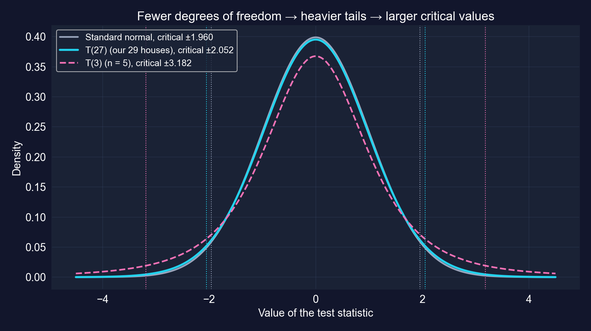
:::
::: {.column width="42%"}
| $n$ | 自由度 | $t_{\text{自由度},\,0.025}$ | 1.960との比 |
|:--|--:|--:|--:|
| 5 | 3 | 3.182 | +62% |
| 10 | 8 | 2.306 | +18% |
| 29 | 27 | [2.052]{.key} | +5% |
| 30 | 28 | 2.048 | +5% |
| 100 | 98 | 1.984 | +1% |
| $\infty$ | — | 1.960 | 0% |
:::
::::

[自由度が少ないほど、裾は重く、臨界値は大きく、区間は広くなります。約100観測を超えると差は無視できます。]{.takeaway .fragment}

::: {.notes}
t分布は正規と同じく対称で釣鐘型ですが、分散は 自由度/(自由度 − 2) > 1 なので、より多くの確率が裾に乗ります。自由度が増えると正規に収束します。章のルール：常にtを使うこと。ソフトウェアがそうしており、どんなnでも正しいからです。約30観測を下回ると最も効いてきます。章の表は n = 30 を2.048（+4%）と載せています。正確に計算すると 2.048/1.960 = 1.045 なので、スライドは+5%に丸めています。
:::

## 信頼水準は確実さと幅を引き換えにする

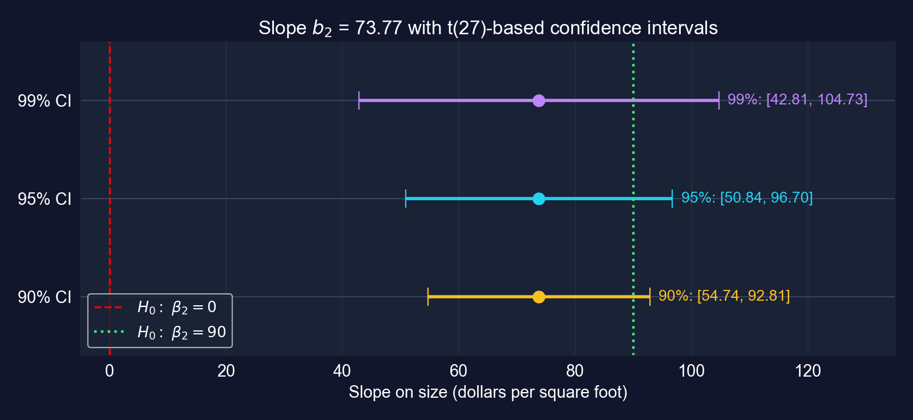

[90%: [54.74, 92.81] · 95%: [50.84, 96.70] · 99%: [42.81, 104.73]。より高い信頼を求めると、より広く情報の少ない範囲を買うことになります。]{.takeaway .fragment}

::: {.notes}
臨界値：90%は1.703、95%は2.052、99%は2.771、すべて自由度27です。90%と99%の区間は、同じ推定値とEEからこのスライド用に計算しています。1平方フィートあたり\$90がどの区間にも入っていることに注意してください。これは7.5節の検定を予告します。また90%区間の上端92.81が90に近いことにも注意してください。これは7.6の片側検定を予告します。
:::

## 「95%信頼」が意味すること、しないこと

::: {.incremental}
- **誤り**：「$\beta_2$ が50.84と96.70の間にある確率は95%」
- **正しい**：多くの標本を引き、それぞれから区間を構築すれば、それらの区間の約**95%**が $\beta_2$ を含む
- $\beta_2$ は固定された数で、標本ごとに変わるのは**区間**のほう
- 私たちの区間 [50.84, 96.70] は $\beta_2$ を含むか含まないかのどちらか。95%は手続きの長期的な成功率を表す
:::

[幅は三つのものに依存します。信頼水準、標本サイズ（EEと臨界値の両方を通じて）、そして残差のノイズです。]{.takeaway .fragment}

::: {.notes}
これは章の重要概念7.2です。頻度論的な解釈は微妙で、誤った版は、出版された研究でさえ非常に多く見られます。言葉で言う有用な方法：「この区間を生み出した手続きは、真の傾きを95%の頻度で捉える」。次のスライドはシミュレーションでこの考えを可視化します。
:::

## 100の標本、100の区間：約95が真実を覆う

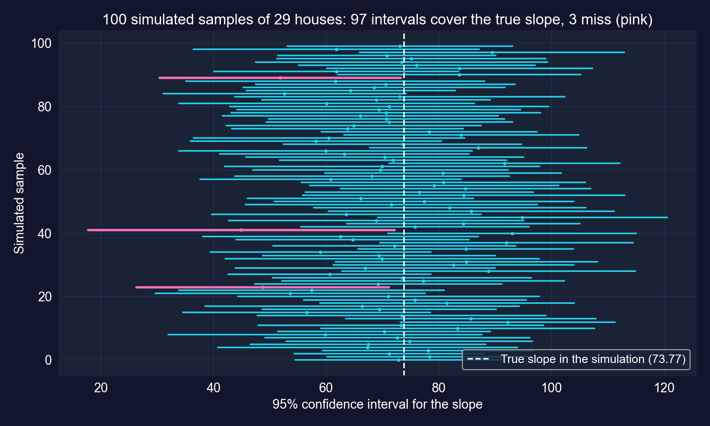{height="400"}

[このシミュレーションでは、100区間のうち97が真の傾きを含み、3が外します。95%は*手続き*の性質です。]{.takeaway .fragment}

::: {.notes}
このスライド用に作成。シミュレーションは29軒の面積を保ち、真の切片と傾きを章の推定値に等しく設定し、標準偏差が s_e = 23,551 に等しい正規の誤差を引き、回帰を100回再推定し、毎回tに基づく95%区間を構築します。97が真実を覆います。別のシードなら95に近い数になるでしょう。現実には、これらの線のうち一本しか見えず、それが外れの一本かどうかは決して分かりません。
:::

## 五観測では、区間が膨れ上がる {.smaller}

``` {.python code-line-numbers="1-3|4-5|6-8"}
# continues from the previous block (pd, pf, stats already imported)
df_artificial = pd.DataFrame({"x": [1, 2, 3, 4, 5],    # the chapter's artificial data
                              "y": [1, 2, 2, 2, 3]})
model_artificial = pf.feols("y ~ x", data=df_artificial)   # OLS on 5 points
coef_x, se_x = model_artificial.coef()["x"], model_artificial.se()["x"]
t_crit_art = stats.t.ppf(0.975, 5 - 2)                 # only 3 degrees of freedom
print(coef_x, se_x, t_crit_art)                        # slope, SE, critical value
print(coef_x - t_crit_art * se_x, coef_x + t_crit_art * se_x)  # 95% CI
```

[↗ Colab で試す](https://colab.research.google.com/notebooks/empty.ipynb){.colab-link target="_blank" data-preview-link="false"}

| $b_2$ | EE | $t$ | $t_{3,\,0.025}$ | 95% CI |
|--:|--:|--:|--:|:--|
| 0.400 | 0.115 | 3.46 | 3.182 | [[0.03,&nbsp;0.77]]{.key} |

[$t = 3.46$ であっても、区間はほぼゼロから推定値のほぼ2倍まで走ります。自由度3では臨界値は1.96ではなく3.182です。]{.takeaway .fragment}

::: {.notes}
章の人工的な例です。傾き0.40は5%で有意（p = 0.041）ですが、かろうじてです。区間の下端は0.03です。臨界値が2.052の住宅データと比べてください。小標本は二重に罰せられます。標準誤差が大きく、臨界値も大きいのです。
:::

# 7.4 · 傾きはゼロと異なるか？ {#sec-74 .divider background-color="#7A209F"}

[統計的有意性の検定 · $p$値 · 経済的有意性]{.act}

::: {.notes}
7.4節：統計的有意性の検定、p値と臨界値のルール、そして統計的有意性と経済的有意性の決定的な違いです。
:::

## 統計的有意性の検定

$$H_0: \beta_2 = 0 \qquad\text{vs.}\qquad H_a: \beta_2 \neq 0, \qquad t = \frac{b_2}{\operatorname{se}(b_2)} \sim T(n-2) \text{（} H_0 \text{ のもとで）}$$

::: {.incremental}
- **$p$値ルール**：$p = \Pr\big[\,|T_{n-2}| > |t|\,\big] < \alpha$ なら水準 $\alpha$ で $H_0$ を棄却する
- **臨界値ルール**：$|t| > t_{n-2,\,\alpha/2}$ なら $H_0$ を棄却する
- 二つのルールは常に一致する。$\alpha$ は **第I種の誤り**（真の $H_0$ を棄却すること）の確率
- 決して $H_0$ を「採択」しない。棄却するか、または**棄却しない**かのどちらか
:::

[説明変数が統計的に「重要」になるのは、その係数がゼロから遠すぎて標本ノイズのせいにできないときです。]{.takeaway .fragment}

::: {.notes}
重要概念7.3の五段階の流れ：H0とHaを立て、α（通常0.05）を選び、検定統計量を計算し、p値を求め、決定し、そしてその決定を平易な言葉に翻訳します。帰無仮説は私たちが覆そうとする主張で、立証責任はデータにあります。
:::

## コード：検定を二通りで実行する

``` {.python code-line-numbers="1-4|5-6|7-9"}
!pip install -q pyfixest                     # pyfixest is not preinstalled in Colab
import pandas as pd, pyfixest as pf; from scipy import stats
url = "https://raw.githubusercontent.com/quarcs-lab/data-open/master/AED/AED_HOUSE.DTA"
data_house = pd.read_stata(url); model_basic = pf.feols("price ~ size", data=data_house)
t_stat_size = model_basic.tstat()["size"]    # b2 / se(b2)
p_value_size = model_basic.pvalue()["size"]  # Pr[|T27| > |t|]
t_crit = stats.t.ppf(0.975, len(data_house) - 2)       # 5% two-sided cutoff
print(t_stat_size, p_value_size, t_crit)
print("Reject H0" if p_value_size < 0.05 else "Fail to reject H0")
```

[↗ Colab で試す](https://colab.research.google.com/notebooks/empty.ipynb){.colab-link target="_blank" data-preview-link="false"}

::: {.notes}
自己完結型です。p値アプローチはpをαと比較し、臨界値アプローチは|t|を2.052と比較します。両方とも同じ決定に至ります。同じ比較を二つの尺度で表現しているからです。
:::

## 出力：面積はどんな慣例的な水準でも有意 {.smaller}

| $H_0$ | $t$ | $p$（両側） | 臨界値、5% | 決定 |
|:--|--:|--:|--:|:--|
| $\beta_2 = 0$ | 6.60 | [$4.4\times 10^{-7}$]{.key} | ±2.052 | 棄却 |

::: {.incremental}
- $|t| = 6.60 > 2.052$、かつ $p < 0.001$：5%、1%、そしてはるか先まで棄却
- **$p$値の読み方**：*もし* $\beta_2$ が本当に0なら、これほど大きな $|t|$ は100万標本に1回未満しか起きない
- $H_0$ が真である確率では**なく**、効果の大きさも測らない
:::

[言葉での結論：1999年のデービスでは、大きな住宅ほど高く売れ、その関連はこの標本のまぐれとするにはあまりに強い。]{.takeaway .fragment}

::: {.notes}
p = 4.4 × 10⁻⁷ なので、帰無仮説のもとでの確率は100万分の約0.44です。0.000と印字するソフトウェアは丸めています。章のp値表は 0.01 < p ≤ 0.05 を「有意」、0.05 < p ≤ 0.10 を「限界的に有意」とラベル付けします。これらは慣例であって法則ではなく、p = 0.049 と p = 0.051 は本質的に同じ証拠を持ちます（重要概念7.8）。
:::

## 統計的に有意でも重要とは限らない

:::: {.columns}
::: {.column width="50%"}
**統計的有意性**

- 効果はゼロと区別できるか？
- $t = b_2/\operatorname{se}(b_2)$ に、つまり $n$、ノイズ、$x$ の散らばりに駆動される
- 巨大な $n$ があれば、些細な効果でも「有意」になる
:::
::: {.column width="50%"}
**経済的有意性**

- 効果は重要といえるほど大きいか？
- $b_2$ の **大きさ** に、文脈の中で駆動される
- 臨界値の表ではなく、分野の知識を必要とする
:::
::::

[アスタリスクだけでなく、大きさとその信頼区間を報告しましょう。区間は両方の問いに同時に答えます。]{.takeaway .fragment}

::: {.notes}
重要概念7.4。二つの失敗モード：正確に推定されたが極小の効果（統計的に有意、経済的に些細）、そして大きいが不正確な効果（経済的に重要、統計的に非有意）。章の職業訓練の例：時給50セントの賃金増（p = 0.001）は2,000時間で年間約1,000ドルで、プログラムの費用が500ドルなら価値があり、10,000ドルならありません。
:::

## 1平方フィートあたり\$73.77は経済的に大きいか？ {.smaller}

| 比較 | 含意される価格差 | 95% CIを使って |
|:--|--:|:--|
| 10平方フィート追加 | \$738 | — |
| 100平方フィート追加 | [\$7,377]{.key} | [\$5,084,&nbsp;\$9,670] |
| 面積の1標準偏差（398平方フィート） | \$29,381 | 平均価格の11.6% |

[100平方フィートの行：章 · CIと1標準偏差の行は $b_2$ とその区間からこのスライド用に計算]{.comment}

[区間の*下*端でさえ、100平方フィートあたり約\$5,100で、\$254,000の住宅では意味のある額です。効果は統計的にも経済的にも有意です。]{.takeaway .fragment}

::: {.notes}
章は100平方フィートに7,377ドル、10平方フィートに約738ドルを計算します。CIを100倍すると範囲5,084から9,670が得られます。面積の1標準偏差の差（398平方フィート）は29,381ドルと結びつき、平均価格253,910ドルの約11.6%です。経済的有意性は判断です。これらの比較は判断に具体的な材料を与えます。これは住宅間の関連であって、部屋を一つ足す価値ではないことを覚えておいてください。
:::

# 7.5 · 傾きは1平方フィートあたり\$90か？ {#sec-75 .divider background-color="#7A209F"}

[特定の値の両側検定 · CI–検定の双対性]{.act}

::: {.notes}
7.5節：傾きが特定の非ゼロの値に等しいかを検定すること、そしてなぜそれがその値が信頼区間の内側にあるかを問うことと同じなのかです。
:::

## 特定の値の検定：同じ手順、新しい帰無値

$$H_0: \beta_2 = 90 \qquad\text{vs.}\qquad H_a: \beta_2 \neq 90$$

$$t = \frac{b_2 - 90}{\operatorname{se}(b_2)} = \frac{73.77 - 90}{11.17} = -1.452$$

::: {.incremental}
- 両側 $p = \Pr\big[\,|T_{27}| > 1.452\,\big]$
- 5%で棄却するのは $|t| > 2.052$ のときだけ
- 90はどこから来るのか？ 不動産業者の目安、建築費のベンチマーク、先行研究
:::

[変わるのは分子だけです。検定は、推定値が*主張された*値から標準誤差何個分離れているかを問います。]{.takeaway .fragment}

::: {.notes}
有意性の検定は β2* = 0 の特殊な場合です。経済的に興味深いベンチマークはどれも同じように検定できます。tの符号は、推定値が主張のどちら側に落ちるかを教えます。ここでは推定値は90より16.23ドル下です。
:::

## コード：$H_0: \beta_2 = 90$ を検定する

``` {.python code-line-numbers="1-4|5-8|9-10"}
!pip install -q pyfixest                     # pyfixest is not preinstalled in Colab
import pandas as pd, pyfixest as pf; from scipy import stats
url = "https://raw.githubusercontent.com/quarcs-lab/data-open/master/AED/AED_HOUSE.DTA"
data_house = pd.read_stata(url); model_basic = pf.feols("price ~ size", data=data_house)
null_value, df = 90, len(data_house) - 2     # claimed slope; 27 degrees of freedom
coef_size, se_size = model_basic.coef()["size"], model_basic.se()["size"]
t_stat_90 = (coef_size - null_value) / se_size              # distance from 90 in SEs
p_value_90 = 2 * (1 - stats.t.cdf(abs(t_stat_90), df))      # two-sided p-value
print(t_stat_90, p_value_90, stats.t.ppf(0.975, df))        # t, p, critical value
print(model_basic.confint().loc["size"])                    # is 90 inside the CI?
```

[↗ Colab で試す](https://colab.research.google.com/notebooks/empty.ipynb){.colab-link target="_blank" data-preview-link="false"}

::: {.notes}
自己完結型です。stats.t.cdf は |t| より下の確率を与えます。その1から引いて2倍したものが両側の裾の面積です。最後の行は区間を印字するので、双対性を目で確認できます。
:::

## 出力：1平方フィートあたり\$90はデータと整合的 {.smaller}

:::: {.columns}
::: {.column width="40%"}
| | 値 |
|:--|--:|
| $t$ | −1.452 |
| $p$（両側） | [0.158]{.key} |
| 臨界値 | ±2.052 |
| 95% CI | [50.84,&nbsp;96.70] |
| 5%での決定 | 棄却しない |
:::
::: {.column width="60%"}
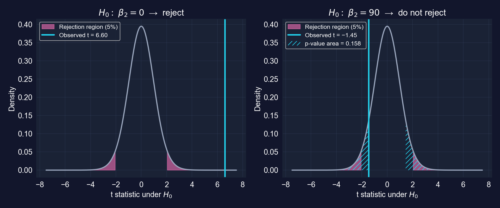
:::
::::

[$p = 0.158 > 0.05$ かつ90は [50.84, 96.70] の内側：同じことを言う二つの方法です。]{.takeaway .fragment}

::: {.notes}
もし真の傾きが90なら、90から（どちらの方向にも）少なくとも16.23ドル離れた推定値は約16%の標本で起きます。これは珍しくありません。図は二つの検定を同じ T(27) 密度の上に並べます。ゼロの検定は圧倒的に棄却し、90の検定はしません。
:::

## 信頼区間は検定の族である

::: {.incremental}
- $\beta_2^{*}$ が95% CIの**外側**にあるとき**ちょうどそのとき** $H_0: \beta_2 = \beta_2^{*}$ を5%で棄却する
- 0は [50.84, 96.70] の外側 → 棄却；90は内側 → 棄却しない
- しかし60、75、95も内側：データは**それらすべて**と整合的
- 「$\beta_2 = 90$ を棄却しない」は「$\beta_2 = 90$」を**意味しない**
:::

[棄却しないことはデータの検出力に関する言明であって、帰無仮説の証明ではありません。区間を報告すれば、もっともらしい値すべてが一度に見えます。]{.takeaway .fragment}

::: {.notes}
章のキーポイント4。双対性は信頼区間を単一の検定より情報豊かにします。一つの区間がすべての両側検定に一度に答えます。よくある誤りは「棄却しない」を「採択する」と読むことです。29軒では、データは90と60を区別できません。重要概念7.9：決して「β2 = 90が証明された」と結論しないこと。
:::

# 7.6 · 傾きは\$90より*小さい*か？ {#sec-76 .divider background-color="#7A209F"}

[片側の方向性検定]{.act}

::: {.notes}
7.6節：方向性仮説、棄却域が片方の裾だけにある場合、そして両側p値を半分にできる条件です。
:::

## 片側検定は主張を対立仮説に置く

| 検定 | $H_0$ | $H_a$（主張） | 棄却する条件 | $p$値 |
|:--|:--|:--|:--|:--|
| 上側裾 | $\beta_2 \le \beta_2^{*}$ | $\beta_2 > \beta_2^{*}$ | $t > t_{n-2,\,\alpha}$ | $\Pr[T_{n-2} > t]$ |
| 下側裾 | $\beta_2 \ge \beta_2^{*}$ | $\beta_2 < \beta_2^{*}$ | $t < -t_{n-2,\,\alpha}$ | $\Pr[T_{n-2} < t]$ |

::: {.incremental}
- **実証したい**主張は $H_a$ に入れるので、データがそれを証明しなければならない
- 5%のすべてが片方の裾に乗る：2.052ではなく $t_{27,\,0.05} = 1.703$
- 方向はデータを見る**前**に、理論から選ぶ
:::

[片側検定は予測された方向でより大きな検出力を持ち、もう一方ではまったく持ちません。]{.takeaway .fragment}

::: {.notes}
重要概念7.5。片側検定は、理論が方向を予測し、その方向のずれだけに関心があるときに適切です。学術誌は通常、両側検定を期待します。推定値を見てから方向を選ぶのは一種の釣りだからです。
:::

## コード：90の両方の片側検定

``` {.python code-line-numbers="1-6|7-8|9-10"}
!pip install -q pyfixest                     # pyfixest is not preinstalled in Colab
import pandas as pd, pyfixest as pf; from scipy import stats
url = "https://raw.githubusercontent.com/quarcs-lab/data-open/master/AED/AED_HOUSE.DTA"
data_house = pd.read_stata(url); model_basic = pf.feols("price ~ size", data=data_house)
df = len(data_house) - 2                     # 27 degrees of freedom
t_stat_90 = (model_basic.coef()["size"] - 90) / model_basic.se()["size"]
p_value_upper = 1 - stats.t.cdf(t_stat_90, df)   # Ha: beta2 > 90 (right tail)
p_value_lower = stats.t.cdf(t_stat_90, df)       # Ha: beta2 < 90 (left tail)
t_crit_one = stats.t.ppf(0.95, df)               # one-sided 5% critical value
print(t_stat_90, p_value_upper, p_value_lower, t_crit_one)
```

[↗ Colab で試す](https://colab.research.google.com/notebooks/empty.ipynb){.colab-link target="_blank" data-preview-link="false"}

::: {.notes}
自己完結型です。両側検定と同じt統計量で、変わるのは裾の面積だけです。章のセルは両方向を実行して非対称性を示します。
:::

## 出力：主張の方向がすべてを決める {.smaller}

:::: {.columns}
::: {.column width="38%"}
| | 下側裾 | 上側裾 |
|:--|--:|--:|
| $H_a$ | $\beta_2 < 90$ | $\beta_2 > 90$ |
| $t$ | −1.452 | −1.452 |
| $p$ | [0.079]{.key} | 0.921 |
| 境目、5% | −1.703 | +1.703 |
| 決定 | 棄却しない | 棄却しない |
:::
::: {.column width="62%"}
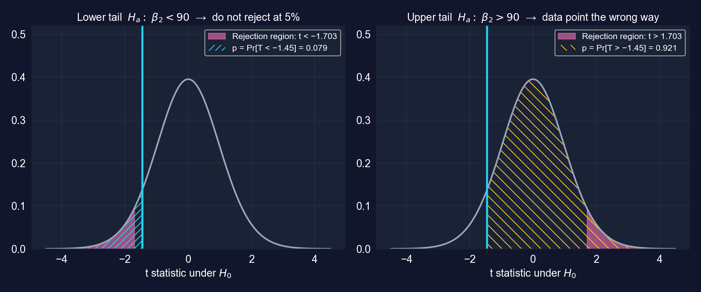
:::
::::

[傾きが\$90を下回るという証拠は示唆的です（$p = 0.079$）。5%では不十分、10%では十分です。\$90を*上回る*という証拠は皆無です（$p = 0.921$）。]{.takeaway .fragment}

::: {.notes}
下側裾のp値0.079は両側の0.158の半分です。推定値（73.77）が主張の側（90より下）に落ちるからです。上側裾のp値は 1 − 0.079 = 0.921 で0.5より上です。推定値が主張の間違った側に落ちるからです。両側p値を半分にできるのは最初の状況だけです。
:::

## 推定値が自分の方向を指すときだけ $p$ 値を半分にする

::: {.incremental}
- ソフトウェアは $H_0: \beta_2 = 0$ について**両側**の $p$ 値を報告する
- 片側の有意性検定：$b_2$ が**予測された符号**なら、片側 $p$ = 両側 $p$ / 2
- $b_2$ が**間違った符号**なら、片側 $p > 0.5$：棄却は不可能
- 住宅の例：$H_a: \beta_2 > 0$ は $p = 2.2\times 10^{-7}$ を与え、$4.4\times 10^{-7}$ の半分
:::

[このデッキの以前の版は $H_a: \beta_2 > 90$ について $p$ 値を半分にしていました。それは誤りです。$b_2 = 73.77 < 90$ なので、正しい片側 $p$ は0.921です。]{.takeaway .fragment}

::: {.notes}
半分にするルールには条件が付いており、その条件を落とすのはよくある失敗です。章は正しく述べており（「符号が正しければ」）、そのコードは両方の裾を計算します。実践的な助言：推定の前に理論から方向を決め、迷ったら両側検定を報告しましょう。
:::

# 7.7 · 標準誤差は正直か？ {#sec-77 .divider background-color="#7A209F"}

[不均一分散 · HC1 ロバスト標準誤差 · 残差診断]{.act}

::: {.notes}
7.7節：誤差分散が一定でないとき推測に何が起きるか、そして不均一分散にロバストな標準誤差がそれをどう直すかです。
:::

## 不均一分散は古典的な標準誤差を壊す

**仮定3**はすべての観測について $\operatorname{Var}[u_i \mid x_i] = \sigma_u^2$ だと言います。**不均一分散**：$\operatorname{Var}[u_i \mid x_i] = \sigma_i^2$ が $i$ とともに変わる。

| 何が | 不均一分散のもとで |
|:--|:--|
| 係数 $b_2$ | 依然として**不偏**かつ一致的 |
| 古典的な $\operatorname{se}(b_2)$ | **誤り**、小さすぎるか大きすぎる |
| $t$、$p$、信頼区間 | **無効**（サイズが誤り、被覆が誤り） |

[その修正は推定値には手を触れず、不確実性を修理します。不均一分散にロバストな標準誤差です。]{.takeaway .fragment}

::: {.notes}
不均一分散は横断面でよく見られます。支出は裕福な世帯間でより変動し、売上は大企業間でより変動し、住宅価格は大きな住宅間でより変動します。古典的な標準誤差のバイアスの向きはパターンに依存するので、形を知らないと予測できません。ロバスト標準誤差は不均一分散があってもなくても有効ですが、これは大標本での結果です。n = 29 戸しかない今回は近似的に有効であるにとどまります。
:::

## 古典的 vs ロバスト：一つの式、一つの変更 {.smaller}

$$\operatorname{se}(b_2) = \frac{s_e}{\sqrt{\sum (x_i - \bar x)^2}} \qquad\qquad \operatorname{se}_{\text{HC0}}(b_2) = \frac{\sqrt{\sum e_i^2\,(x_i - \bar x)^2}}{\sum (x_i - \bar x)^2}$$

::: {.incremental}
- 古典的：すべての観測に対して一つの**プールされた**残差分散 $s_e^2$
- ロバスト（White / Huber–White）：各残差の二乗 $e_i^2$ が、その観測のレバレッジ $(x_i - \bar x)^2$ で重み付けされる
- **HC1** = HC0 × $\sqrt{n/(n-k)}$、自由度補正。$n = 29$、$k = 2$ で係数は1.036
- 変種：HC2（レバレッジ重み付け）、HC3（より保守的）；時系列にはHAC、グループ化データにはクラスターロバスト
:::

[章はHC0の式を印字しますが（住宅の傾きで10.93）、そのコードと表はHC1（`vcov="HC1"`、11.33）を使い、Stataの `robust` と一致します。]{.takeaway .fragment}

::: {.notes}
極端なxの値での大きな残差こそ、古典的な式が見逃すものです。HC1はHC0の分散を n/(n − k) 倍します。住宅データでは HC0 = 10.932、HC1 = 10.932 × √(29/27) = 11.330 です。このデッキは式をHC0とラベル付けし、HC1の数を報告するので、二つは混同されません。
:::

## コード：HC1 ロバスト標準誤差で再推定する

``` {.python code-line-numbers="1-5|6|7-14"}
!pip install -q pyfixest                     # pyfixest is not preinstalled in Colab
import pandas as pd, pyfixest as pf          # data and OLS
url = "https://raw.githubusercontent.com/quarcs-lab/data-open/master/AED/AED_HOUSE.DTA"
data_house = pd.read_stata(url)
model_basic = pf.feols("price ~ size", data=data_house)              # classical SEs
robust_results = pf.feols("price ~ size", data=data_house, vcov="HC1")  # robust SEs
comparison_df = pd.DataFrame({
    "Coefficient": model_basic.coef(),            # identical in both fits
    "Std. Error": model_basic.se(),               # classical
    "Robust SE": robust_results.se(),             # HC1
    "t-stat (standard)": model_basic.tstat(),
    "t-stat (robust)": robust_results.tstat(),
})
print(comparison_df); robust_results.summary()   # full table reports "Inference: HC1"
```

[↗ Colab で試す](https://colab.research.google.com/notebooks/empty.ipynb){.colab-link target="_blank" data-preview-link="false"}

::: {.notes}
自己完結型です。pyfixestの既定は古典的（iid）標準誤差で、vcov="HC1" は不均一分散にロバストなものを要求します。係数はこれまでとまったく同じに計算され、変わるのは分散の推定だけです。
:::

## 出力：傾きのEEはほとんど動かない {.smaller}

| 変数 | 係数 | 古典的EE | ロバストEE | 変化 | ロバスト $t$ | ロバスト95% CI |
|:--|--:|--:|--:|--:|--:|:--|
| 切片 | 115,017.3 | 21,489.4 | 20,298.7 | −5.5% | 5.67 | [73,368,&nbsp;156,667] |
| `size` | 73.771 | 11.175 | [11.330]{.key} | +1.4% | 6.51 | [50.52,&nbsp;97.02] |

[N = 29 · HC1 標準誤差 · 両係数についてロバスト $p < 0.001$ · $R^2 = 0.617$（不変）]{.comment}

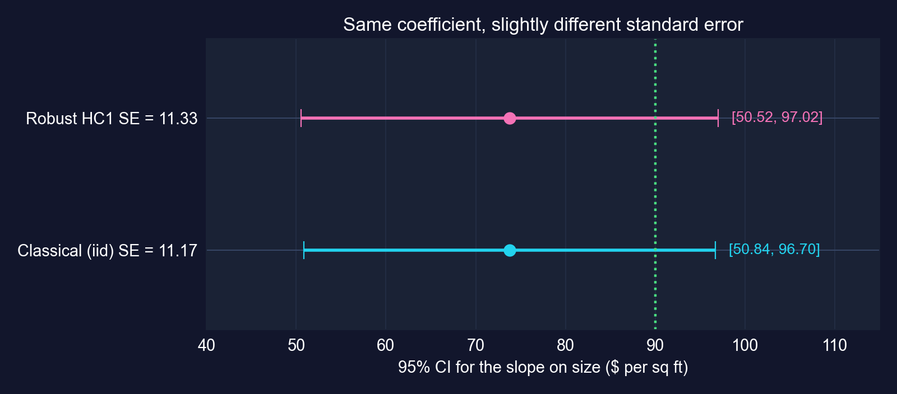{height="250"}

[ロバスト推測は同じ判定に至ります。面積は有意（$t = 6.51$）で、\$90は依然として棄却されません（ロバスト $t = -1.43$、$p = 0.163$）。]{.takeaway .fragment}

::: {.notes}
ロバストEEは傾きで1.4%大きく、切片で5.5%小さいです。ロバストEEは通常は大きいですが、常にではありません。90のロバスト検定（このスライド用に計算）は t = −1.432、p = 0.163 を与え、古典的EEでの −1.452、0.158 に対するものです。これほど変化が小さいと、ここでは不均一分散は推測を歪めていません。章の目安：10%未満の差は不均一分散がわずかであることを示し、20%超の差はロバストEEを要求します。
:::

## 残差チェック：強い漏斗はないが、点はたった29個

:::: {.columns}
::: {.column width="60%"}
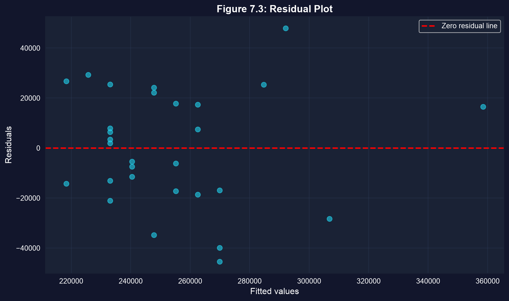{height="380"}
:::
::: {.column width="40%"}
| 当てはめ値 | 住宅 | 残差の標準偏差 |
|:--|--:|--:|
| 中央値以下 | 16 | \$19,258 |
| 中央値超 | 13 | \$27,670 |

[分割はこのスライド用に計算；中央値での同値が半分どうしを不均等にする。]{.comment}
:::
::::

[散らばりは高価な住宅でやや大きいですが、明確な漏斗はなく、ロバストEEは古典的なものと一致します。29個の点では、目では問いに決着をつけられません。ロバストEEにはできます。]{.takeaway .fragment}

::: {.notes}
このデッキの以前の版は残差を「パターンがない」と呼びました。より注意深い読み方：残差はトレンドなくゼロの周りに散らばり、散らばりは高い当てはめ値で少し広く（標準偏差 27,670 vs 19,258）、3,300平方フィートの大きな住宅が右に遠く座っています。それはまさにロバストEEが安い保険になる状況です。もしパターンが効いていたなら、ロバストEEと古典的EEは乖離するはずで、実際には乖離しません。
:::

## ベストプラクティス：結果を見る前にEEを決める

::: {.incremental}
- **横断面**：既定で不均一分散にロバスト（`vcov="HC1"`）
- **時系列**：HAC標準誤差（Newey–West）；**グループ化データ**：クラスターロバスト標準誤差
- 不均一分散を事前検定してから選ぶことは**しない**。ただロバストEEを使う
- 有意性を得るために古典的EEとロバストEEを切り替えてはならない。それはp-hackingです
- ロバストEEが古典的なものより**はるかに**大きければ、EEだけでなくモデルを調べる
:::

[ロバストEEは安い保険です。誤差が均一分散なら古典的EEに近い値になり、そうでなければ大標本で推測を正直に保ちます。]{.takeaway .fragment}

::: {.notes}
章の実践ガイドから。ロバストEEと古典的EEの大きな隔たりは症状です。それは単に分散が不均等なだけでなく、関数形の定式化の誤り（例えば、対数で推定すべき関係）を示すことがあります。ケーススタディ1で48%の隔たりを見ます。
:::

## スコアカード：7.1〜7.7の後の住宅の傾き {.smaller}

| 問い | 答え |
|:--|:--|
| 正確か？ | EE 11.17（古典的）、11.33（ロバスト）；95% CIの幅は約\$46 |
| 本物か？ | $t = 6.60$（ロバスト6.51）、$p < 0.001$：$\beta_2 = 0$ を棄却 |
| どの値がもっともらしいか？ | [50.84, 96.70]：\$90は両側で棄却されず（$p = 0.158$）、5%の片側でも棄却されない（$p = 0.079$） |
| 重要か？ | 100平方フィートあたり\$7,377；CIの下端（\$5,084）でさえ相当な額 |
| EEは正直か？ | ロバストEEは古典的なものの1.4%以内；残差に強い漏斗はない |

[完全な答えはアスタリスクだけでなく五行すべてを報告します。大きさ、正確さ、検定、もっともらしい範囲、そして使ったEEです。]{.takeaway .fragment}

::: {.notes}
これは章が推奨するモデルの記述です。「1平方フィート増えるごとに73.77ドル高い価格と結びつく（ロバストEE = 11.33、t = 6.51、p < 0.001）；ロバストEEと古典的EEはほぼ同一；95% CIは [50.52, 97.02]」。次に、二つの実際のケーススタディについて同じ五行です。
:::

# 第II-b幕 · 二つのケーススタディ、すべての課題 {.divider background-color="#7A209F"}

[新しいデータでの道具一式すべて：108か国 · 333自治体]{.act}

::: {.notes}
章は二つのケーススタディで締めくくられ、それぞれ六つの課題があります。各課題はここで章のコード（章がヒントしか与えないところは補完）で実行され、実際の出力とその解釈が付きます。章に現れない結果は「このスライド用に計算」とラベル付けされます。
:::

# ケーススタディ1 · 108か国にわたる資本と労働生産性 {#cs-1 .divider background-color="#7A209F"}

[Convergence Clubs データ（Mendez 2020）· 2014年の横断面 · 課題1〜6]{.act}

::: {.notes}
ケーススタディ1は Convergence Clubs データセットを使います。108か国について、2014年の労働生産性（労働者一人あたりGDP）と労働者一人あたり物的資本です。
:::

## 問い：生産性は資本にどれほど強く結びついているか？

**研究課題。** 2014年に、労働者一人あたり資本がより多い国では労働者一人あたり産出がどれだけ高いか、そしてどれほど正確に言えるか？

$$\text{productivity}_i = \beta_1 + \beta_2\,\text{capital}_i + u_i$$

::: {.incremental}
- `productivity` = `lp`、実質の労働者一人あたりGDP（ドル）；`capital` = `kl`、労働者一人あたり物的資本（ドル）
- 108か国：ヨーロッパ30、アジア28、アフリカ26、アメリカ大陸22、オセアニア2
- 章はこれを**収束**の背景として枠づけますが、厳密には*水準*の横断面は収束を検定しません。収束は*成長率*についてのものです（重要概念7.7）
:::

[ここで検定できるのは、7.1〜7.7の道具による、国をまたいだ関連の強さと正確さです。]{.takeaway .fragment}

::: {.notes}
重要概念7.7は絶対収束を、初期所得とその後の成長の負の関係と定義します。この回帰には成長率が一切入っていません。ある一年の生産性水準を資本水準に関連づけるものです。推測の有用な練習であり、成長会計の構成要素でもありますが、収束の検定ではありません。スライドはその区別を明示的に保ちます。
:::

## コード：2014年の横断面を読み込む

``` {.python code-line-numbers="1-4|5-6|7-10|11"}
!pip install -q pyfixest                     # pyfixest is not preinstalled in Colab
import pandas as pd, pyfixest as pf          # data and OLS
from scipy import stats                      # t-distribution for manual tests
url_cc = "https://raw.githubusercontent.com/quarcs-lab/mendez2020-convergence-clubs-code-data/master/assets/dat.csv"
data_convergence = pd.read_csv(url_cc)       # 108 countries x 25 years (1990-2014)
data_2014 = data_convergence[data_convergence["year"] == 2014].copy()  # one cross-section
data_2014["productivity"] = data_2014["lp"]  # labor productivity: GDP per worker
data_2014["capital"] = data_2014["kl"]       # physical capital per worker
print(f"Sample: {len(data_2014)} countries in 2014")
print(data_2014["region"].value_counts())    # regional composition
data_2014[["productivity", "capital"]].describe()   # summary statistics
```

[↗ Colab で試す](https://colab.research.google.com/notebooks/empty.ipynb){.colab-link target="_blank" data-preview-link="false"}

::: {.notes}
自己完結型：ケーススタディ1の最初のブロックです。データセットは縦長パネル（国 × 年）で、year == 2014 でフィルタすると国ごとに一観測になります。地域の件数の行はこのスライド用に加えました。
:::

## 出力：国をまたいだ巨大な散らばり {.smaller}

| 変数 | 平均 | 標準偏差 | 最小値 | 中央値 | 最大値 |
|:--|--:|--:|--:|--:|--:|
| `productivity`（労働者一人あたり\$） | 40,977 | 33,853 | 1,371 | 32,781 | 142,220 |
| `capital`（労働者一人あたり\$） | 165,854 | 158,299 | 2,482 | 108,046 | 552,395 |

[N = 108か国、2014年]{.comment}

[労働者一人あたり産出は約100倍、労働者一人あたり資本は約200倍の幅があります。$x$ の変動が十分あるので傾きが正確になり、誤差分散が一定でないかもしれないという示唆でもあります。]{.takeaway .fragment}

::: {.notes}
平均的な国は労働者一人あたり約166,000ドルの資本と41,000ドルの産出を持ちます。章の述べるとおりです。両変数とも平均が中央値を上回ります。分布は右に歪んでおり、豊かで資本集約的な国の長い裾を持ちます。結果のスケールがこれほど変動すると、誤差の散らばりも通常は変動します。
:::

## 課題1のコード：関係を推定する

``` {.python code-line-numbers="1-2|3-6|7-8"}
# continues from the previous block (data_2014 already built)
model_convergence = pf.feols("productivity ~ capital", data=data_2014)  # classical SEs
beta2 = model_convergence.coef()["capital"]       # slope
se_beta2 = model_convergence.se()["capital"]      # classical SE
t_stat = model_convergence.tstat()["capital"]     # t for H0: beta2 = 0
p_value = model_convergence.pvalue()["capital"]   # two-sided p-value
ci_95 = model_convergence.confint().loc["capital"]  # 95% CI
model_convergence.summary()                       # full table
```

[↗ Colab で試す](https://colab.research.google.com/notebooks/empty.ipynb){.colab-link target="_blank" data-preview-link="false"}

::: {.notes}
章の課題1（誘導あり）：推定し、係数を解釈し、95% CIを構築し、有意性を検定し、経済的有意性を判断します。章のコードはここで古典的EEを使い、課題3でロバストEEに切り替え、7.1〜7.7節を映します。
:::

## 課題1の出力：資本1ドルあたり20セントの産出 {.smaller}

| 変数 | 係数 | EE | $t$ | $p$ | 95% CI |
|:--|--:|--:|--:|--:|:--|
| 切片 | 7,894.468 | 1,713.521 | 4.61 | <&nbsp;0.001 | [4,497.25,&nbsp;11,291.69] |
| `capital` | [0.1995]{.key} | 0.0075 | 26.63 | <&nbsp;0.001 | [0.1846,&nbsp;0.2143] |

[N = 108 · 古典的（iid）標準誤差 · $R^2 = 0.870$ · 自由度 = 106]{.comment}

::: {.incremental}
- **(a) 係数**：労働者一人あたり資本が\$1,000多い国は、平均して労働者一人あたり産出が約\$199多い
- **(b) CI**：傾きは0.185〜0.214という狭い範囲に定まる
- **(c) 有意性**：$t = 26.63$ なので $p$ は本質的にゼロ：$\beta_2 = 0$ を棄却
:::

[(d) 経済的に大きい：資本の1標準偏差の差（\$158,299）は労働者一人あたり産出\$31,576と結びつき、平均の77%です。]{.takeaway .fragment}

::: {.notes}
R² = 0.87：労働者一人あたり資本だけで、労働者一人あたり産出の国をまたいだ変動の87%を説明します。1標準偏差の比較はこのスライド用に計算（0.1995 × 158,299 = 31,576；平均生産性40,977で割って = 77%）。参考までに、平均産出と平均資本の比は0.247で、傾きより少し上です。ここでのすべては関連です。資本がより多い国は人的資本も多く、技術もより良く、制度もより強いのです。
:::

## 課題2のコード：傾きに関する三つの仮説を検定する

``` {.python code-line-numbers="1-2|3-5|6-9"}
# continues from the previous block (beta2, se_beta2, t_stat, p_value defined)
df_c = int(model_convergence._N) - len(model_convergence.coef())  # 108 - 2 = 106
t_test_05 = (beta2 - 0.5) / se_beta2                               # (b) H0: beta2 = 0.5
p_value_05 = 2 * (1 - stats.t.cdf(abs(t_test_05), df=df_c))        # two-sided
null_value_c = 0.30                                                 # (c) pessimist's bound
t_test_pessimist = (beta2 - null_value_c) / se_beta2                # distance from 0.30
p_value_pessimist_lower = stats.t.cdf(t_test_pessimist, df=df_c)    # Ha: beta2 < 0.30
print(t_stat, p_value, t_test_05, p_value_05)                       # (a) and (b)
print(t_test_pessimist, p_value_pessimist_lower)                    # (c)
```

[↗ Colab で試す](https://colab.research.google.com/notebooks/empty.ipynb){.colab-link target="_blank" data-preview-link="false"}

::: {.notes}
課題2（半誘導）：(a) 有意性、(b) 章のベンチマーク0.5の両側検定、(c) 資本の寄与が0.30未満だという悲観論者の主張の片側検定です。悲観論者の主張は対立仮説に入るので、下側裾が正しいものです。
:::

## 課題2の出力：データは0.5を棄却し、悲観論者を支持する {.smaller}

| 仮説 | $t$ | $p$ | 5%での決定 |
|:--|--:|--:|:--|
| (a) $H_0: \beta_2 = 0$ vs $\beta_2 \neq 0$ | 26.63 | <&nbsp;0.001 | 棄却：資本は重要 |
| (b) $H_0: \beta_2 = 0.5$ vs $\beta_2 \neq 0.5$ | −40.12 | <&nbsp;0.001 | 棄却：傾きは0.5をはるかに下回る |
| (c) $H_0: \beta_2 \ge 0.30$ vs $H_a: \beta_2 < 0.30$ | −13.42 | [$6.7\times 10^{-25}$]{.key} | $H_0$ を棄却：$\beta_2 < 0.30$ の**証拠** |

[自由度 = 106 · 古典的EE、章の課題2のとおり]{.comment}

[悲観論者の主張は棄却されず、*支持*されます。$H_0: \beta_2 \ge 0.30$ を棄却することが、片側検定が $H_a$ に置かれた主張を確認する仕方です。]{.takeaway .fragment}

::: {.notes}
章の設問は「悲観論者の主張を棄却するか？」と問います。主張が対立仮説にあるので、答えは「いいえ」です。検定は主張に有利に帰無仮説を棄却し、章のコードは「Evidence supports β2 < 0.30」と印字します。0.5のベンチマークについて：国をまたいだ傾きは生産関数の意味での資本の限界生産物ではありません。資本とともに動くすべて（技術、教育、制度）を混ぜ込んでいるからです。したがって0.5の棄却は、関連がそのベンチマークより弱いと言うのであって、理論が間違っていると言うのではありません。
:::

## 課題3のコード：ロバスト標準誤差

``` {.python code-line-numbers="1-2|3-5|6-8"}
# continues from the previous block (classical fit and tests done)
robust_model = pf.feols("productivity ~ capital", data=data_2014, vcov="HC1")
se_beta2_robust = robust_model.se()["capital"]          # HC1 SE
t_stat_robust = robust_model.tstat()["capital"]         # robust t
pct_change = 100 * (se_beta2_robust - se_beta2) / se_beta2   # % change in SE
ci_95_robust = robust_model.confint().loc["capital"]    # robust 95% CI
print(se_beta2, se_beta2_robust, pct_change, t_stat, t_stat_robust)
print(ci_95.values, ci_95_robust.values)                # classical vs robust CI
```

[↗ Colab で試す](https://colab.research.google.com/notebooks/empty.ipynb){.colab-link target="_blank" data-preview-link="false"}

::: {.notes}
課題3（半誘導）：古典的EEとHC1 EEを比較し、有意性を再検定し、区間を比較します。章のコードは10%を超える差を不均一分散の証拠として印をつけます。
:::

## 課題3の出力：ロバストEEは48%大きい {.smaller}

| 変数 | 係数 | 古典的EE | ロバストEE | 変化 | ロバスト $t$ | ロバスト95% CI |
|:--|--:|--:|--:|--:|--:|:--|
| 切片 | 7,894.468 | 1,713.521 | 1,356.336 | −20.8% | 5.82 | [5,205.40,&nbsp;10,583.54] |
| `capital` | 0.1995 | 0.0075 | [0.0111]{.key} | +48.4% | 17.94 | [0.1774,&nbsp;0.2215] |

[N = 108 · HC1 標準誤差 · 両方についてロバスト $p < 0.001$ · 傾きの古典的CI：[0.1846, 0.2143]]{.comment}

::: {.incremental}
- 傾きのEEは半分だけ増える：$t$ は26.63から17.94に下がり、区間は48%広がる
- $\beta_2 = 0$ についての判定は変わらないが、課題1で主張した**正確さ**は過大だった
- ロバスト再検定（このスライド用に計算）：$\beta_2 = 0.5$ は $t = -27.03$；$\beta_2 = 0.30$ は $t = -9.04$；同じ決定
:::

[48%の隔たりは不均一分散の大きな信号です。ロバストEEを報告しましょう。古典的なものはデータが持たない正確さを主張します。]{.takeaway .fragment}

::: {.notes}
章のルールに従って（差が20%超：ロバストEEを使わなければならない）。ここでは古典的EEは傾きには小さすぎ、切片には大きすぎます。バイアスの向きが不均一分散のパターンに依存することを示しています。tが18近くなので結論は覆りませんが、境界的な場合には48%の過小評価が非有意な結果を「有意」に変えてしまうでしょう。
:::

## 不均一分散はどこから来るのか

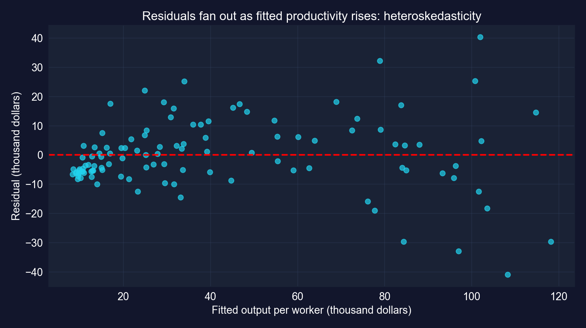{height="380"}

[残差は漏斗状に開きます。残差の標準偏差は当てはめ値の下半分で\$6,822、上半分で\$15,795です。貧しい国はまた直線の下に集まっており、直線が何らかの曲率を見逃している兆候です。]{.takeaway .fragment}

::: {.notes}
これは課題5(c)が求める残差プロットです。章のコードはそれを描かないので、ここで計算します。二つのパターン：明確な漏斗（散らばりが低い当てはめ値から高い当てはめ値へ2倍以上になる）、そして最貧国の間の負の残差の連なりで、関係が水準で線形でないことを示唆します。どちらも古典的EEが信頼できない理由であり、後者は対数の定式化も示唆します。後の章がそれを使います。
:::

## 課題4のコード：傾きは所得グループで異なるか？

``` {.python code-line-numbers="1-4|5-6|7-10"}
# continues from the previous block
threshold = data_2014["productivity"].median()             # the chapter's split
high_income = data_2014[data_2014["productivity"] > threshold].copy()
developing = data_2014[data_2014["productivity"] <= threshold].copy()
robust_high = pf.feols("productivity ~ capital", data=high_income, vcov="HC1")
robust_dev = pf.feols("productivity ~ capital", data=developing, vcov="HC1")
for name, res in [("High-income", robust_high), ("Developing", robust_dev)]:
    b, se = res.coef()["capital"], res.se()["capital"]
    t_05 = (b - 0.5) / se; dfx = int(res._N) - len(res.coef())   # test beta2 = 0.5
    print(name, int(res._N), b, se, res.tstat()["capital"], t_05, 2 * stats.t.sf(abs(t_05), dfx))
```

[↗ Colab で試す](https://colab.research.google.com/notebooks/empty.ipynb){.colab-link target="_blank" data-preview-link="false"}

::: {.notes}
課題4（より自立的）：標本を生産性の中央値で分割し、各半分でロバストETを使って回帰を推定し、各グループで β2 = 0.5 を検定します。これは章自身のコードです。最初の行に注目してください。分割は結果（アウトカム）に対して行われ、これは解釈に効いてきます（二スライド先）。
:::

## 課題4の出力：高生産性の国でより平らな傾き {.smaller}

| グループ | N | 傾き | ロバストEE | $t$ | 95% CI | $\beta_2 = 0.5$ の $t$ | $R^2$ |
|:--|--:|--:|--:|--:|:--|--:|--:|
| 高生産性 | 54 | [0.1541]{.key} | 0.0172 | 8.97 | [0.1196,&nbsp;0.1886] | −20.13 | 0.680 |
| 低生産性 | 54 | [0.2059]{.key} | 0.0209 | 9.84 | [0.1639,&nbsp;0.2479] | −14.06 | 0.722 |
| 全標本 | 108 | 0.1995 | 0.0111 | 17.94 | [0.1774,&nbsp;0.2215] | −27.03 | 0.870 |

[HC1 標準誤差 · 生産性の中央値\$32,781で分割 · 各半分で自由度 = 52 · すべて $p < 0.001$]{.comment}

[両方の傾きが有意で、両方とも0.5をはるかに下回ります。額面どおりに取れば、より豊かな国では資本に結びつく追加産出が少なく、収穫逓減と整合的です。]{.takeaway .fragment}

::: {.notes}
章の表です。両グループの傾きはゼロを棄却し、0.5を棄却します。二つの区間はわずかにしか重なりません（0.164から0.189）。章は重要概念7.9で二つの読み方を示します。補完性（豊かな国の傾きが高い）または収穫逓減（途上国の傾きが高い）で、データは後者を指します。しかし次のスライドは、標本の分割の仕方がこの比較を偏らせることを示します。
:::

## 注意：結果で分割すると傾きが歪む {.smaller}

:::: {.columns}
::: {.column width="56%"}
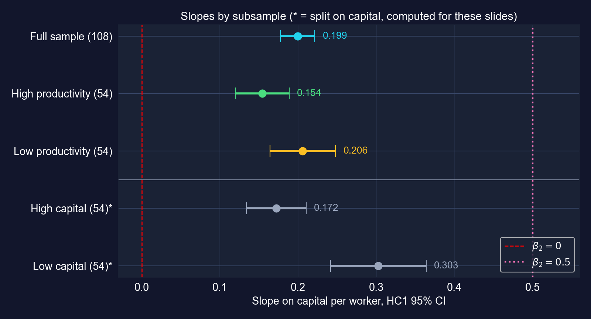
:::
::: {.column width="44%"}
| 資本で分割* | 傾き | ロバストEE |
|:--|--:|--:|
| 高資本（54） | 0.1720 | 0.0190 |
| 低資本（54） | [0.3026]{.key} | 0.0305 |

[* このスライド用に計算 · 資本の中央値\$108,046で分割]{.comment}
:::
::::

[$y$ で選択すると各グループ内で結果が切り詰められ、両方の傾きが平らになります。$x$ で分割するとそれを避けられ、低資本の傾きは章の0.206より約47%急になります。]{.takeaway .fragment}

::: {.notes}
なぜか：「高生産性」グループ内では、構築上すべての国のyが32,781を上回るので、資本は高いが運悪く産出が低い国が除外されます。もう一方のグループでは逆のことが起きます。その切り詰めが両方の傾きをゼロへ押しやります。説明変数で分割すると結果は切り詰められないので、グループ間で傾きを比較する標準的な方法です。同じ推定量、同じ標準誤差で、変わるのは分割変数だけです。収穫逓減の読み方は生き残り（0.303 vs 0.172）、隔たりはより大きくなります。依然として関連であって、因果的な限界生産物ではありません。
:::

## 課題5：全分析の一枚の絵

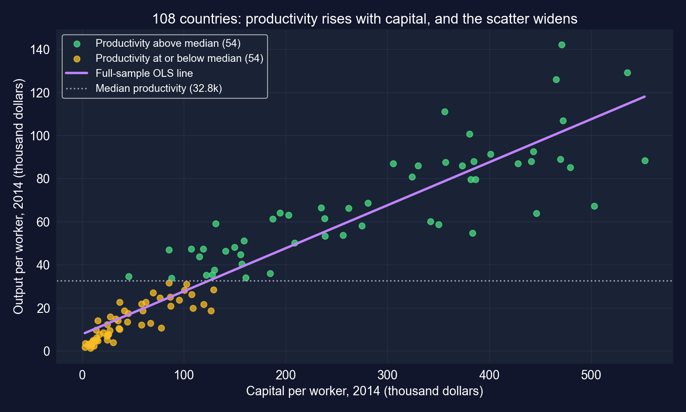{height="370"}

[絵は表が語ったすべてを見せます。強い正の傾き、広がる散らばり（不均一分散）、そして雲を $y$ に沿って水平に切る分割です。]{.takeaway .fragment}

::: {.notes}
課題5は (a) グループと回帰直線付きの散布図、(b) 係数プロット、(c) 残差プロットを求めます。三つとも最後の四スライドにあります。この散布図、係数プロット、残差プロットです。中央値の点線が雲を水平に切る様子に注目してください。それが結果での選択の問題を可視化したものです。
:::

## 課題5のコード：章が開いたままにする診断プロット

``` {.python code-line-numbers="1-3|4-7|8-10"}
# continues from the previous block (model_convergence already fitted)
import matplotlib.pyplot as plt              # plotting
import numpy as np                           # array handling
fitted = model_convergence.predict()         # fitted productivity
resid = model_convergence.resid()            # residuals
plt.scatter(fitted, resid, alpha=0.7)        # residuals vs fitted (Task 5c)
plt.axhline(0, color="red", linestyle="--"); plt.xlabel("Fitted"); plt.ylabel("Residual"); plt.show()
low = fitted <= np.median(fitted)            # split by fitted value, not by y
print(np.std(resid[low], ddof=1), np.std(resid[~low], ddof=1))   # residual SD by half
```

[↗ Colab で試す](https://colab.research.google.com/notebooks/empty.ipynb){.colab-link target="_blank" data-preview-link="false"}

[出力：残差の標準偏差\$6,822（当てはめ値の下半分）vs \$15,795（上半分）、課題3の下で示した漏斗形の背後にある数です。]{.takeaway .fragment}

::: {.notes}
章の課題5(c)にはコードがありません。このブロックは章の方法だけでそれを補完します（残差プロット、および二群の標準偏差比較）。章自身の課題5のコードは二つの散布図パネルと係数プロットを描き、それらのプロットはスライドの図として再現されています。
:::

## 課題6：実際の数を使った研究要約 {.smaller}

> 108か国の2014年の横断面を使い、労働者一人あたり産出と労働者一人あたり物的資本の関連を推定します。労働者一人あたり資本が\$1,000増えるごとに、労働者一人あたり産出が**\$199**多いことと結びつきます（HC1 ロバストEE = 0.011、$t = 17.9$、$p < 0.001$；95% CI [0.177, 0.222]）。資本は国をまたいだ変動の87%を説明します。ロバストEEは古典的なものより48%大きく、残差は当てはめ生産性とともに漏斗状に開くので、ロバスト推測のみを報告します。傾きは0.5のベンチマークをはるかに下回ります（$t = -27.0$）。標本を労働者一人あたり資本で分割すると、傾きは資本の乏しい国で0.30、資本の豊かな国で0.17であり、収穫逓減と整合的です。これらは関連です。資本は技術、人的資本、制度とともに動き、水準の回帰は収束を検定しません。

[良い要約は、大きさ、ロバストな正確さ、重要な検定、そしてデザインの限界を、その順で報告します。]{.takeaway .fragment}

::: {.notes}
課題6は、課題、データと方法、発見、推測、経済的解釈、限界をカバーする200〜300語の要約を求めます。この版はこのスライド用に検証された数だけを使い、資本分割の傾きはデッキ内でスライド用に計算したとラベル付けされています。学生は自分自身のものを書くべきで、これは構造のモデルです。
:::

## スコアカード：ケーススタディ1

| 問い | 答え |
|:--|:--|
| 正確か？ | ロバストEE 0.0111；CI [0.177, 0.222] |
| 本物か？ | ロバスト $t = 17.94$：$\beta_2 = 0$ を棄却 |
| どの値がもっともらしいか？ | 0.5ではない（$t = -27.0$）；0.30を下回る（$p < 0.001$、片側） |
| 重要か？ | 資本の1標準偏差 ↔ 労働者一人あたり産出\$31,576（平均の77%） |
| EEは正直か？ | 古典的EEでは**いいえ**：ロバストEEは48%大きい；残差が漏斗状に開く |

[住宅と同じ道具一式ですが、四行目では逆の教訓です。ここではロバストEEは任意ではありません。]{.takeaway .fragment}

::: {.notes}
住宅のスコアカードとの対比：あちらでは古典的EEとロバストEEが1.4%以内で一致していました。ここでは48%異なります。どちらの場合も係数はEEの選択によらず同一で、変わるのは私たちがどれだけ知っていると主張してよいかです。
:::

# ケーススタディ2 · 夜間光はボリビアの発展を追跡するか？ {#cs-2 .divider background-color="#7A209F"}

[DS4Bolivia · 339自治体 · 課題1〜6]{.act}

::: {.notes}
ケーススタディ2は第1章のDS4Boliviaプロジェクトに戻ります。衛星の夜間光は自治体がどれほど発展しているかを教えてくれるでしょうか？ 第7章は、その関連が統計的に有意か、どれほど正確に推定されるかを問います。
:::

## 問い：光と発展の関連は本物か、どれほど大きいか？

**研究課題。** ボリビアの自治体にわたって、夜間光と発展の関連は統計的に有意か、そしてどれほど正確に推定できるか？

$$\text{imds}_i = \beta_1 + \beta_2\,\ln(\text{NTL per capita})_i + u_i$$

::: {.incremental}
- `imds`：自治体持続可能発展指数、0〜100
- `ln_NTLpc2017`：一人あたり夜間光の対数、2017年
- 9県の339自治体；333が両変数を持つ
:::

[$x$ が対数なので、$\beta_2$ は一人あたり光が $e \approx 2.72$ 倍されたときのIMDSのポイント変化です。光を2倍にするとポイントが $\beta_2 \ln 2 \approx 0.69\,\beta_2$ 増えます。]{.takeaway .fragment}

::: {.notes}
level-logモデルです。結果は指数のポイント、説明変数は対数です。log NTLの1単位の増加は一人あたり光が2.72倍高いこと、172%の増加を意味します。章の課題6が述べるとおりです。光を2倍にすることは対数で0.693の増加です。6自治体は光の変数を欠き、回帰から脱落します。
:::

## コード：DS4Bolivia データを読み込む

``` {.python code-line-numbers="1-4|5-7|8-10"}
!pip install -q pyfixest                     # pyfixest is not preinstalled in Colab
import pandas as pd, pyfixest as pf          # data and OLS
from scipy import stats                      # t-distribution for manual tests
url_bol = "https://raw.githubusercontent.com/quarcs-lab/ds4bolivia/master/ds4bolivia_v20250523.csv"
bol = pd.read_csv(url_bol)                   # 339 municipalities, 351 columns
bol_key = bol[["mun", "dep", "imds", "ln_NTLpc2017"]].copy()   # keep what we need
reg_data = bol_key[["imds", "ln_NTLpc2017"]].dropna()          # complete cases only
print(f"Total municipalities: {len(bol_key)}")
print(f"Complete cases for regression: {len(reg_data)}")
reg_data.describe().round(3)                 # summary statistics
```

[↗ Colab で試す](https://colab.research.google.com/notebooks/empty.ipynb){.colab-link target="_blank" data-preview-link="false"}

::: {.notes}
自己完結型：ケーススタディ2の最初のブロックです。dropna() は両変数を持つ333自治体を保ちます。回帰が欠損データでいくつの観測を失うかを常に報告しましょう。
:::

## 出力：333自治体、発展の広い散らばり {.smaller}

| 変数 | 平均 | 標準偏差 | 最小値 | 最大値 |
|:--|--:|--:|--:|--:|
| `imds`（0〜100） | 51.16 | 6.76 | 35.70 | 80.20 |
| `ln_NTLpc2017` | 13.88 | 1.18 | 9.06 | 17.06 |

[N = 339自治体のうち完全なケース333]{.comment}

[IMDSは44.5ポイントにわたり、光の対数は8単位にわたります。これは、最も暗い自治体と最も明るい自治体の間で一人あたり光が約3,000倍異なることを意味します。]{.takeaway .fragment}

::: {.notes}
exp(17.06 − 9.06) = exp(8.0) ≈ 2,980。IMDSの範囲35.7から80.2は、章が課題6で経済的有意性に使うものさしです。光の対数で最も暗い自治体がすべて最も発展していないわけではないことに注意してください。関係はノイズが多いのです。
:::

## 課題1のコード：傾きを推定して検定する

``` {.python code-line-numbers="1-3|4-5|6-8"}
# continues from the previous block (reg_data already built)
model = pf.feols("imds ~ ln_NTLpc2017", data=reg_data)   # classical SEs
model.summary()                                          # full table
t_stat = model.tstat()["ln_NTLpc2017"]                   # t for H0: beta2 = 0
p_value = model.pvalue()["ln_NTLpc2017"]                 # two-sided p-value
print(model.coef()["ln_NTLpc2017"], model.se()["ln_NTLpc2017"], t_stat, p_value)
print("Reject H0" if p_value < 0.05 else "Fail to reject H0")
print(model._r2)                                         # R-squared
```

[↗ Colab で試す](https://colab.research.google.com/notebooks/empty.ipynb){.colab-link target="_blank" data-preview-link="false"}

::: {.notes}
課題1（誘導あり）：IMDSを光の対数に回帰させるOLS、tとpを取り出し、H0: β2 = 0 を5%で検定します。
:::

## 課題1の出力：光の対数1単位あたり3.4 IMDSポイント {.smaller}

:::: {.columns}
::: {.column width="50%"}
| 変数 | 係数 | EE | $t$ | $p$ |
|:--|--:|--:|--:|--:|
| 切片 | 4.377 | 3.544 | 1.24 | 0.218 |
| `ln_NTLpc2017` | [3.370]{.key} | 0.254 | 13.25 | <&nbsp;0.001 |

[N = 333 · 古典的EE · $R^2 = 0.347$]{.comment}

$H_0: \beta_2 = 0$ を棄却：$t = 13.25$。
:::
::: {.column width="50%"}
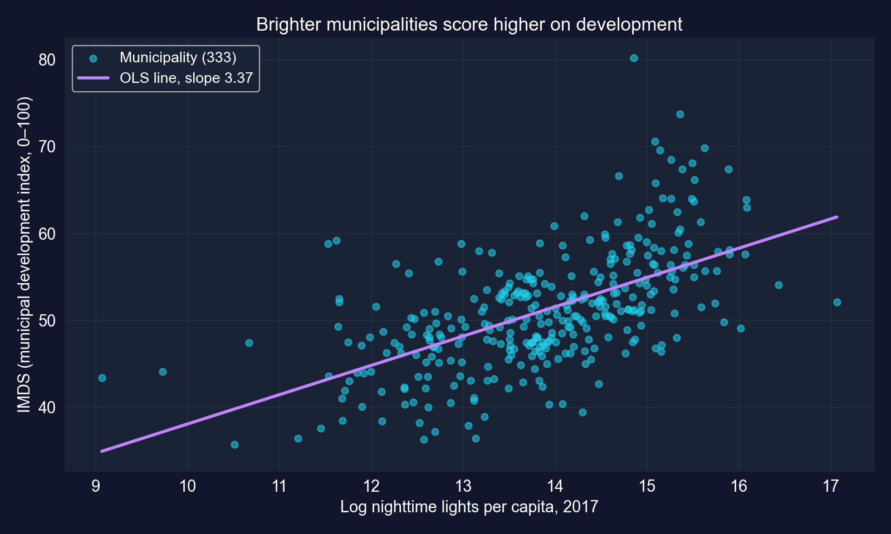
:::
::::

[より明るい自治体は測定可能なほど発展していますが、光はIMDSの変動の35%しか説明しません。]{.takeaway .fragment}

::: {.notes}
傾きはゼロから13標準誤差です。切片は光の対数 = 0 でのIMDSの予測で、データのはるか外側（最小9.06）にあり解釈できません。その非有意性は無関係です。R² = 0.347 は変動の65%を他の要因に残します。だからこそ章は後で重回帰に衛星エンベディングを加えます。
:::

## 課題2：傾きの95%信頼区間 {.smaller}

``` {.python code-line-numbers="1-2|3-5"}
# continues from the previous block (model already fitted)
ci = model.confint()                                     # 95% CIs, classical SEs
ci_lower = ci.loc["ln_NTLpc2017"].iloc[0]                # lower bound
ci_upper = ci.loc["ln_NTLpc2017"].iloc[1]                # upper bound
print(ci_lower, ci_upper, ci_lower <= 0 <= ci_upper)     # does it contain zero?
```

[↗ Colab で試す](https://colab.research.google.com/notebooks/empty.ipynb){.colab-link target="_blank" data-preview-link="false"}

| 点推定値 | 95% CI | 0を含むか？ |
|--:|:--|:--|
| 3.370 | [[2.87,&nbsp;3.87]]{.key} | いいえ |

[正しい読み方：このように構築した区間は真の傾きを95%の頻度で捉え、これは光の対数1単位あたり2.87から3.87 IMDSポイントまで走ります。ゼロはそのはるか外側です。]{.takeaway .fragment}

::: {.notes}
課題2（誘導あり）。章の設問は「私たちは95%の確信を持って…」というよくある略式を示唆しますが、正確な読み方は手続きについてです（7.3節）。区間は推定値に対して狭いです。n = 333 で光の対数が大きく変動するからです。
:::

## 課題3のコード：ロバスト標準誤差

``` {.python code-line-numbers="1-2|3-5|6-7"}
# continues from the previous block
model_robust = pf.feols("imds ~ ln_NTLpc2017", data=reg_data, vcov="HC1")   # HC1 SEs
se_d, se_r = model.se()["ln_NTLpc2017"], model_robust.se()["ln_NTLpc2017"]
print(se_d, se_r, se_r / se_d)                           # SE ratio robust / default
print(model.tstat()["ln_NTLpc2017"], model_robust.tstat()["ln_NTLpc2017"])
print(model_robust.confint().loc["ln_NTLpc2017"])        # robust 95% CI
print(model_robust.se()["Intercept"], model_robust.pvalue()["Intercept"])
```

[↗ Colab で試す](https://colab.research.google.com/notebooks/empty.ipynb){.colab-link target="_blank" data-preview-link="false"}

::: {.notes}
課題3（半誘導）：既定とHC1の標準誤差を比較し、自治体レベルのデータでなぜロバストEEが重要かを論じます。章はEEの比を印字し、ロバストCIと切片の行はこのスライド用に加えました。
:::

## 課題3の出力：ロバストEEは18%大きい {.smaller}

| 変数 | 係数 | 既定EE | ロバストEE | 比 | ロバスト $t$ | ロバスト95% CI |
|:--|--:|--:|--:|--:|--:|:--|
| 切片 | 4.377 | 3.544 | 4.135 | 1.167 | 1.06 | [−3.76,&nbsp;12.51] |
| `ln_NTLpc2017` | 3.370 | 0.254 | [0.299]{.key} | 1.175 | 11.27 | [2.78,&nbsp;3.96] |

[N = 333 · HC1 標準誤差 · 傾きについてロバスト $p < 0.001$、切片について0.291]{.comment}

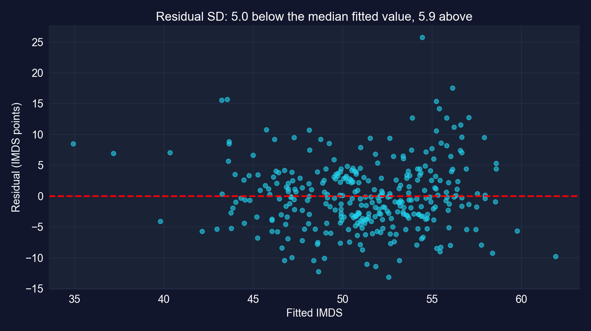{height="250"}

[中程度の不均一分散：傾きのEEは17.5%上がり、$t$ は13.25から11.27に下がります。すべての結論が生き残ります。ここからはロバストな数を使いましょう。]{.takeaway .fragment}

::: {.notes}
章の閾値に従うと、17.5%の差は「小さい」（10%未満）と「ロバストを使わなければならない」（20%超）の間に位置します。章のベストプラクティスはいずれにせよロバストEEを報告することです。残差プロットは中央値の当てはめ値を上回るとわずかに広い散らばりを示します（残差の標準偏差 5.9 vs 5.0）。第7章で扱われない標準的な注意：同じ県の自治体はショックを共有することがあり（空間相関）、HC1はそれに対処しません。本書で後に導入されるクラスターロバストEEなら対処するでしょう。
:::

## 課題4：傾きはちょうど5か？ {.smaller}

``` {.python code-line-numbers="1-4|5-7"}
# continues from the previous block (model_robust already fitted)
beta_hat = model_robust.coef()["ln_NTLpc2017"]           # 3.370
se_robust = model_robust.se()["ln_NTLpc2017"]            # robust SE
df = int(model_robust._N) - len(model_robust.coef())     # 333 - 2 = 331
t_manual = (beta_hat - 5) / se_robust                    # H0: beta2 = 5
p_two_sided = 2 * stats.t.sf(abs(t_manual), df=df)       # two-sided p-value
print(t_manual, df, p_two_sided)
```

[↗ Colab で試す](https://colab.research.google.com/notebooks/empty.ipynb){.colab-link target="_blank" data-preview-link="false"}

| $H_0$ | $t$ | 自由度 | $p$ | 決定 |
|:--|--:|--:|--:|:--|
| $\beta_2 = 5$ | −5.45 | 331 | [$9.8\times 10^{-8}$]{.key} | 棄却 |

[傾き5は排除されます。ロバスト区間 [2.78, 3.96] のかなり上にあります。検定と区間は同じ物語を語ります。]{.takeaway .fragment}

::: {.notes}
課題4（半誘導）、章の指示どおりロバストEEを使います。stats.t.sf は生存関数 1 − cdf なので、2 × sf(|t|) が両側p値です。古典的EEでは（このスライド用に計算）検定は t = −6.41 を与え、さらに強い棄却です。7.5のCI–検定の双対性はロバストEEでも成り立ちます。5はロバスト区間の外側なので、5%で棄却されます。
:::

## 課題5：関連は正か？ {.smaller}

``` {.python code-line-numbers="1-3|4"}
# continues from the previous block
t_onesided = model_robust.tstat()["ln_NTLpc2017"]        # robust t for H0: beta2 = 0
p_onesided = stats.t.sf(t_onesided, df=df)               # right tail: Ha beta2 > 0
print(t_onesided, p_onesided)
```

[↗ Colab で試す](https://colab.research.google.com/notebooks/empty.ipynb){.colab-link target="_blank" data-preview-link="false"}

| $H_0$ | $H_a$ | ロバスト $t$ | 片側 $p$ | 決定 |
|:--|:--|--:|--:|:--|
| $\beta_2 \le 0$ | $\beta_2 > 0$ | 11.27 | [$1.8\times 10^{-25}$]{.key} | 棄却 |

[*正の関連*の圧倒的な証拠です。ここで片側検定が正当なのは、方向が推定の前に述べられ、推定値がその方向を指しているからです。]{.takeaway .fragment}

::: {.notes}
課題5（自立的）。片側p値は両側の半分です。推定値が予測された符号を持つからです（7.6節）。「正の関係の強い証拠」は関連についての言明です。章の課題6は、有意性が因果を証明するかを学生に論じるよう求め、証明しません。
:::

## 課題6のコード：大きさを文脈に置く

``` {.python code-line-numbers="1-4|5-8|9-10"}
# continues from the previous block
imds_range = reg_data["imds"].max() - reg_data["imds"].min()   # 44.5 points
imds_std = reg_data["imds"].std()                               # 6.76 points
beta = model_robust.coef()["ln_NTLpc2017"]                      # 3.370
print(beta, 100 * beta / imds_range, 100 * beta / imds_std)     # per log unit
print(beta * 0.693, 100 * beta * 0.693 / imds_range)            # doubling lights
ci_r = model_robust.confint().loc["ln_NTLpc2017"]               # robust CI
print(ci_r.iloc[0] * 0.693, ci_r.iloc[1] * 0.693)               # CI for doubling
sd_x = reg_data["ln_NTLpc2017"].std()                           # 1.18 log units
print(beta * sd_x, beta * sd_x / imds_std, model._r2)           # one-SD contrast, R²
```

[↗ Colab で試す](https://colab.research.google.com/notebooks/empty.ipynb){.colab-link target="_blank" data-preview-link="false"}

::: {.notes}
課題6（自立的）は統計的有意性 vs 実際的有意性の議論を求めます。章のコードは範囲、標準偏差、2倍の効果を計算し、2倍の効果のCIと1標準偏差の対比はこのスライド用に加えました。
:::

## 課題6の出力：疑いなく有意、大きさは控えめ {.smaller}

| 比較 | IMDSの変化 | 相対的に |
|:--|--:|:--|
| 光 +1 対数単位（×2.72） | 3.37 | IMDS範囲の7.6%；その標準偏差の50% |
| 光を2倍（+0.693） | [2.34]{.key} | 範囲の5.2% · ロバストCI [1.93,&nbsp;2.74] |
| 光の対数 +1標準偏差（1.18） | 3.98 | IMDSの0.59標準偏差 |

[範囲 = 44.5ポイント、標準偏差 = 6.76 · 2倍のCIと1標準偏差の行はこのスライド用に計算 · $R^2 = 0.347$]{.comment}

::: {.incremental}
- **1%、5%、10%で有意**：ロバスト $p < 0.001$
- **実際的には**：自治体の光を2倍にするとIMDSが約2.3ポイント増えるのと結びつく、0〜100のスケールで控えめな一歩
- **因果的ではない**：都市化、電化、道路、市場アクセスが光と発展の両方を駆動する
:::

[ここでの統計的有意性は疑いの余地なく、経済的有意性は中程度で、因果性は確立されていません。三つの異なる問い、三つの異なる答えです。]{.takeaway .fragment}

::: {.notes}
重要概念7.13は5ポイント（範囲の11%）の仮定の効果を使います。実際の推定値は3.37、範囲の7.6%です。光を2倍にするのは大きな変化ですが、約2.3ポイントしか予測しません。政策の読み方：「光を2倍にする」プログラムはそれ自体では発展を変革しません。光は経済活動の代理変数であって、てこではありません。欠落変数がどんな因果的読み方にとっても主要な脅威です。
:::

## スコアカード：ケーススタディ2

| 問い | 答え |
|:--|:--|
| 正確か？ | ロバストEE 0.299；CI [2.78, 3.96] |
| 本物か？ | ロバスト $t = 11.27$：$\beta_2 = 0$ を棄却；片側で正、$p < 0.001$ |
| どの値がもっともらしいか？ | 5ではない（$t = -5.45$） |
| 重要か？ | 光を2倍 ↔ +2.3 IMDSポイント（範囲の5.2%）：中程度 |
| EEは正直か？ | ロバストEEは17.5%大きい：報告する；県レベルの相関はまだ対処されていない |

[同じ五行、三つ目のパターン：正確で本物だが控えめで、EEにはまだHC1が直せない注意（空間相関）が残ります。]{.takeaway .fragment}

::: {.notes}
三つのデータセットを通じて係数はEEの選択によって決して変わりませんが、正直な不確実性は変わります。住宅で+1.4%、国で+48%、自治体で+17.5%です。次のパートはそれらを並べて比較します。
:::

# 正しく読む {#synthesis .divider background-color="#C21E72"}

[第III幕 · 総合]{.act}

::: {.notes}
第III幕は三つのデータセットをまとめ、最もよくある誤読に立ち向かい、重回帰へ何を持ち越すかを列挙します。
:::

## 三つのデータセット、一つの道具一式 {.smaller}

| | 住宅（7.1〜7.7） | 国（ケース1） | 自治体（ケース2） |
|:--|--:|--:|--:|
| N | 29 | 108 | 333 |
| 傾き $b_2$ | 73.771 | 0.1995 | 3.370 |
| 古典的EE | 11.175 | 0.0075 | 0.254 |
| ロバスト（HC1）EE | 11.330 | 0.0111 | 0.299 |
| ロバスト / 古典的 | [1.014]{.key} | [1.484]{.key} | [1.175]{.key} |
| ロバスト $t$ | 6.51 | 17.94 | 11.27 |
| ロバスト95% CI | [50.52,&nbsp;97.02] | [0.1774,&nbsp;0.2215] | [2.78,&nbsp;3.96] |
| $R^2$ | 0.617 | 0.870 | 0.347 |

[どの傾きも高度に有意ですが、EEの補正は1%から48%にわたります。不均一分散が重要かどうかは経験的な問いなので、ロバストEEが既定であるべきです。]{.takeaway .fragment}

::: {.notes}
最も高いR²（国）が最大の不均一分散の問題を伴っており、当てはまりと正直な不確実性が別々の問いであることを示します。最も小さい標本（住宅）が最も不均一分散が少ないです。β2 = 0 についての判定はどれも変わりませんが、三つとも古典的EEは正確さを1%から48%の間で誤って述べていたでしょう。
:::

## 避けるべき七つの誤読

::: {.incremental}
1. 「$\beta_2$ が区間にある確率95%」：いいえ、*区間*の95%が $\beta_2$ を覆う
2. 「$p < 0.001$ だから効果が大きい」：$p$ は $H_0$ に対する証拠を測り、大きさではない
3. 「棄却しないから $\beta_2 = 90$」：データは60や95とも整合的
4. 「どんな片側検定でも $p$ 値を半分に」：推定値が $H_a$ の方向を指すときだけ
5. 「検定で不均一分散が見つかったときだけロバストEE」：既定で使う
6. 「傾きを比較するために結果で標本を分割」：それは $y$ を切り詰め両方の傾きを偏らせる
7. 「有意だから因果的」：このデッキのどの傾きも関連である
:::

[どれも本物の罠で、どれもこのデッキに、章自身の数で正しい読み方を示すスライドがあります。]{.takeaway .fragment}

::: {.notes}
1：7.3節と被覆のシミュレーション。2：7.4節とケース2の課題6。3：7.5節。4：7.6節；このデッキの以前の版は間違った裾についてp値を半分にしていました。5：7.7節。6：ケーススタディ1、課題4。7：三つの例すべて、特に夜間光のケースです。
:::

## 誘惑的な近道、そしてその訂正

[反論。]{.objection} 「$t = 17.9$、$p < 0.001$、$R^2 = 0.87$：資本は明らかに生産性を駆動し、効果を小数第三位まで知っている。」

. . .

[応答。]{.rebuttal} 古典的EEは正確さを48%過大に述べ、残差は漏斗状に開いて曲がり、標本の分割はグループの傾きを偏らせ、水準の横断面には因果的効果を識別するものは何もありません。**有意性は関連がノイズでないことを教えます。それがどれほど大きいか、本当にどれほど正確か、なぜ存在するかは教えません。**

[すべての回帰表を四つの問いで読みましょう。どれほど大きいか、どれほど正確か（正直なEEで）、代替案はどれほどもっともらしいか、そして何がそれを因果的にするか。]{.takeaway .fragment}

::: {.notes}
反論を最強の形にする：関連は本当に強く、EEの選択にロバストです。しかし反論のすべての形容詞が行き過ぎています。「駆動する」は因果的で、「小数第三位まで知る」は不確実性の48%の過小評価を無視しています。第10〜13章は統制を加え、第13章は研究デザインを加えます。まさに有意性が「なぜ」に答えられないからです。
:::

## 何を持ち越すか

::: {.incremental}
- $t = (b_2 - \beta_2^{*})/\operatorname{se}(b_2) \sim T(n-2)$：すべての検定は「推定値 引く 主張、EE単位で」
- 95% CIは $b_2 \pm t_{n-2,\,0.025}\,\operatorname{se}(b_2)$ で、両側5%検定が棄却しないすべての値を含む
- $\operatorname{se}(b_2)$ はより密な当てはまり、より多くのデータ（$1/\sqrt n$）、$x$ のより大きな散らばりで縮む
- 片側検定：主張は $H_a$ に入れ、方向は前もって固定し、半分にするには正しい符号が必要
- 横断面：既定で `vcov="HC1"`；残差を見る；大きな隔たりはモデルの問題を示す
- 常に大きさ**と**正確さを報告する；有意性は重要性ではなく、関連は因果ではない
:::

::: {.notes}
章のキーポイントを、デッキが検証したことで研ぎ澄ましたものです。HC0 vs HC1 の区別、p値を半分にする条件、データセット間のロバスト補正の1%〜48%の範囲、そして結果での選択の注意です。次：重回帰（第10〜11章）。同じt統計量と信頼区間が各係数に適用され、同時検定がそれらを複数の係数へ一度に拡張します。
:::

# 推定し、それから自分の疑いを正直に測りましょう：一つの数だけでなく、範囲と検定を。 {.divider background-color="#C21E72"}
