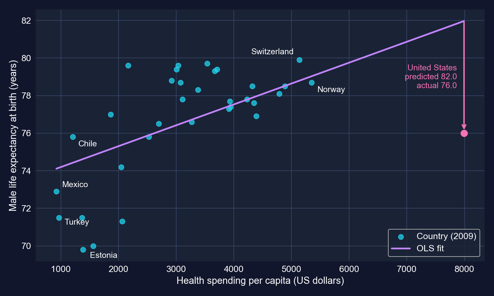
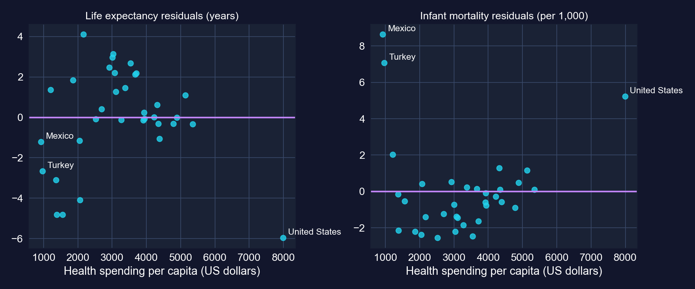
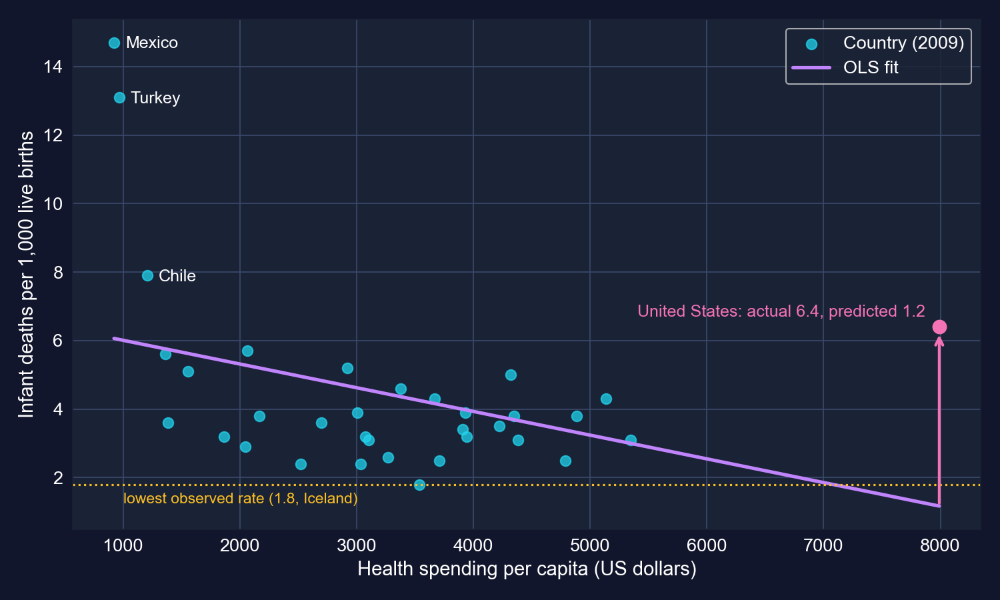
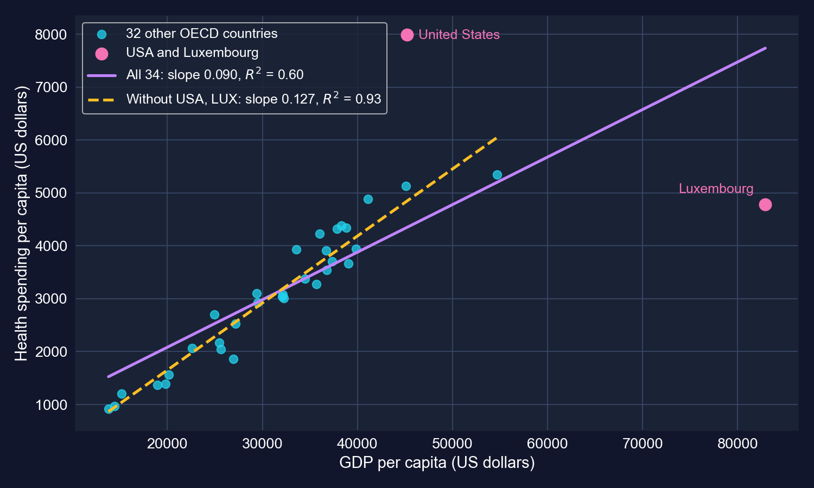
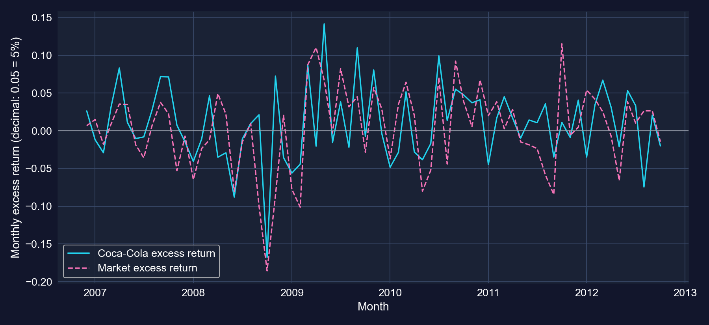
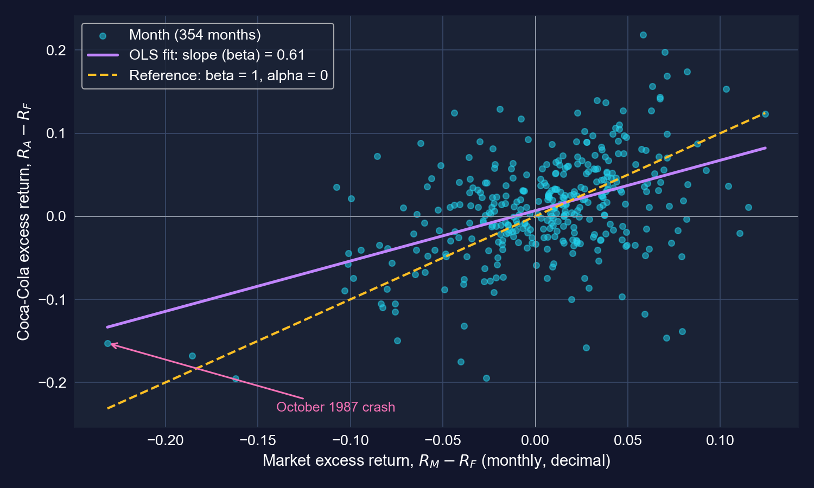
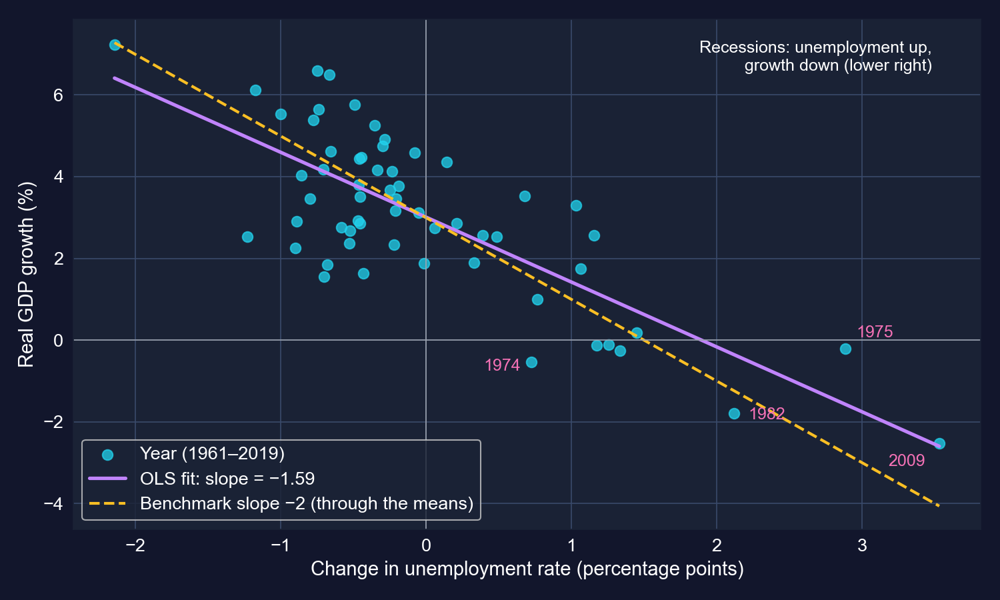
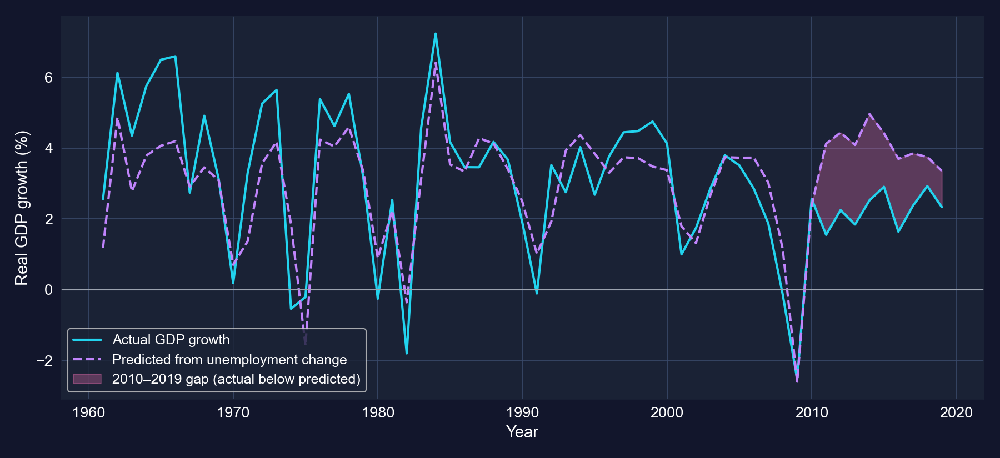

# One tool, four worlds {.divider background-color="#008CB7"}

[Act I · The tension]{.act}

::: {.notes}
This chapter is applications-first: sections 8.1–8.4 are four real case studies, all estimated with the same bivariate OLS regression from Chapters 5–7. What changes from case to case is the data (a cross-section of countries, a monthly financial series, an annual macro series), the units of the slope, the hypothesis worth testing, and the way a few observations or the error structure can change the verdict.
:::

## The same line answers wildly different questions

A health economist, a portfolio manager and a macroeconomist seem to work in separate worlds. Yet each reaches for the **same** instrument:

$$y_i = \beta_1 + \beta_2\, x_i + u_i$$

. . .

The hard part is not *running* the regression. It is reading the slope honestly: in the right **units**, with the right **standard errors**, against the right **hypothesis**, and with an eye on the few observations that can drive it.

[One estimator, four case files. In each, we ask what the slope *means*, how *sure* we are, and what could make it *misleading*.]{.takeaway .fragment}

::: {.notes}
Frame the deck as four case files. Each one follows the same arc: question → data → method → code → output → interpretation → caveats. The recurring thread is a three-part check on every slope: (1) units, what does one unit of x and y mean; (2) uncertainty, classical vs heteroskedasticity-robust standard errors; (3) influence and interpretation, which observations drive it and whether it is causal.
:::

## Four case files — click any case to jump to it {.smaller}

| Case | Question | Data | Headline result |
|:----|:-------------------------|:----------------|:--------------------------|
| [8.1](#case-81) | Does health spending buy longer lives? | 34 OECD countries, 2009 | +1.11 years per \$1,000; infant-mortality slope loses significance with robust SEs |
| [8.2](#case-82) | How does health spending rise with income? | 34 OECD countries, 2009 | +\$90 per \$1,000 of GDP; $R^2$ 0.60 → 0.93 without USA and Luxembourg |
| [8.3](#case-83) | How risky is Coca-Cola stock? | 354 months, 1983–2012 | $\beta = 0.61$, significantly below 1 |
| [8.4](#case-84) | Does Okun's Law hold for the U.S.? | 59 years, 1961–2019 | slope −1.59; the −2 benchmark is rejected at 5% |

::: {.notes}
The case numbers are links: click one to jump to that case's divider. Press M for the menu (every slide title is listed) or O for the overview grid. Cases 8.1 and 8.2 share one dataset (OECD health, 2009) but ask opposite questions: 8.1 treats health spending as the regressor, 8.2 treats it as the outcome.
:::

## Three kinds of data, one estimator {.smaller}

| | Cross-section | Financial time series | Macro time series |
|:--|:--|:--|:--|
| **Cases** | 8.1, 8.2 | 8.3 | 8.4 |
| **Unit of observation** | a country in 2009 | a month | a year |
| **N** | 34 (32 without USA, LUX) | 354 | 59 |
| **Outcome $y$** | life expectancy, infant mortality, health spending | Coca-Cola excess return | real GDP growth |
| **Regressor $x$** | health spending, GDP per capita | market excess return | change in unemployment rate |
| **Typical worry** | heteroskedasticity, influential countries | fat tails, time-varying risk | autocorrelation, structural breaks |
| **SEs in the chapter** | classical and HC1 | classical and HC1 | classical and HC1 |

[The estimator never changes (`pf.feols`). What changes is what can go wrong, so the checks we run must change with the data.]{.takeaway .fragment}

::: {.notes}
Cross-sections: many units observed once; the usual concern is that error variance differs across units (heteroskedasticity) and that a few unusual units dominate. Time series: one unit over many periods; errors are often correlated over time (autocorrelation), and the relationship itself can shift (structural breaks). The chapter reports classical and HC1 standard errors in all four cases. HC1 handles heteroskedasticity only; for time series with autocorrelated errors, HAC (Newey–West) standard errors are the standard fix — they appear in Chapter 13 and Chapter 17.
:::

## Method review: the bivariate regression toolkit {.smaller}

:::: {.columns}
::: {.column width="50%"}
**Estimate**

- Slope: $\hat\beta_2 = \dfrac{\sum (x_i-\bar x)(y_i-\bar y)}{\sum (x_i-\bar x)^2}$
- Intercept: $\hat\beta_1 = \bar y - \hat\beta_2\,\bar x$
- Fit: $R^2 = r_{xy}^2$, the share of the variance of $y$ explained by $x$
:::
::: {.column width="50%"}
**Infer**

- Test $H_0\!: \beta_2 = \beta_2^*$ with $t = \dfrac{\hat\beta_2 - \beta_2^*}{\text{se}(\hat\beta_2)} \sim t(n-2)$
- 95% CI: $\hat\beta_2 \pm t_{0.025,\,n-2}\times \text{se}(\hat\beta_2)$
- $\beta_2^* = 0$ is only the default: Okun's $-2$ and the CAPM's $\beta = 1$ are more interesting nulls
:::
::::

[Every result in this deck is one of these formulas applied to real data. The only moving part is which standard error goes into the denominator.]{.takeaway .fragment}

::: {.notes}
Quick recap of Chapters 5–7. In a bivariate regression R² equals the squared correlation, so the sign of r and the slope always agree. The t-statistic for any hypothesised value β* uses the same standard error; the chapter tests β = 0 everywhere and, implicitly, β = −2 for Okun's Law. We will add the CAPM test β = 1 because "is this stock as risky as the market?" is the economically interesting question.
:::

## Method review: classical vs robust standard errors {.smaller}

$$\text{Classical: } \widehat{\text{Var}}(\hat\beta_2) = \frac{s^2}{\sum (x_i-\bar x)^2}
\qquad
\text{HC1: } \widehat{\text{Var}}(\hat\beta_2) = \frac{n}{n-2}\,\frac{\sum (x_i-\bar x)^2\,\hat u_i^2}{\left[\sum (x_i-\bar x)^2\right]^2}$$

::: {.incremental}
- Classical SEs assume every error has the **same variance** $\sigma^2$ (homoskedasticity)
- HC1 lets each observation carry its own $\hat u_i^2$, weighted by how far its $x_i$ sits from $\bar x$
- So HC1 is **larger** when big residuals sit at extreme values of $x$, and can be *smaller* when they sit near the middle
- The coefficient is identical; only the SE, $t$, $p$ and CI change
:::

[In pyfixest this is one argument: `vcov="HC1"`. We will report both in every case and watch where they disagree.]{.takeaway .fragment}

::: {.notes}
This formula explains every SE comparison in the deck. In 8.1 the USA has both the most extreme spending (high leverage, large (x − x̄)²) and the largest residual, so HC1 is 1.6–1.7× the classical SE. In 8.2 the USA and Luxembourg both sit far from mean GDP with huge residuals, so HC1 is 2.3×. In 8.4 the largest residuals are not at extreme unemployment changes, so HC1 is slightly smaller than the classical SE. HC1 = HC0 × n/(n−k), a small-sample correction; it is Stata's "robust" default.
:::

## The recurring thread: read every slope in its units {.smaller}

| Case | $y$ measured in… | $x$ measured in… | So one unit of $x$ is… |
|:--|:--|:--|:--|
| 8.1 | years; deaths per 1,000 births | US dollars per person | \$1 — tiny, so rescale to \$1,000 |
| 8.2 | US dollars per person | US dollars per person | \$1 of GDP → cents of health spending |
| 8.3 | monthly excess return (decimal) | monthly excess return (decimal) | the same units, so $\beta$ is unit-free |
| 8.4 | % growth of real GDP | percentage-point change in unemployment | 1 percentage point |

[A slope of 0.0011 can be large and a slope of 0.61 can be small. Translate before you judge.]{.takeaway .fragment}

::: {.notes}
This is the first of three checks we apply to every case. 8.1: the coefficient 0.00111 is years per dollar, which looks negligible until rescaled to 1.11 years per $1,000. 8.2: dollars on dollars gives a marginal propensity (9 cents per dollar) and, via the means, an elasticity. 8.3: both sides are returns, so beta is a pure number. 8.4: percent growth on a percentage-point change; mixing up "percent" and "percentage point" is the most common error in reading Okun's Law.
:::

## Five ideas anchor this chapter

::: {.incremental}
- **Economic vs statistical significance**: a slope can be precise yet small, or large yet noisy; report both
- **Robust standard errors (HC1)**: valid inference when error variance differs across observations
- **Influential observations**: two of 34 countries can move a slope by 41% and $R^2$ from 0.60 to 0.93
- **Systematic risk ($\beta$)**: how much an asset moves with the market; $R^2$ splits risk into systematic and idiosyncratic
- **Structural breaks**: a relationship estimated over 59 years can drift; plotting actual vs predicted over time reveals it
:::

[Each idea is the lesson of one case. Act III puts them side by side.]{.takeaway .fragment}

::: {.notes}
These map onto the chapter's Key Concepts 8.1–8.8: economic vs statistical significance (8.1), robust SEs (8.2), income elasticity (8.3), outliers and influence (8.4), beta (8.5), R² in CAPM (8.6), Okun's Law (8.7), structural breaks (8.8).
:::

# Act II · Four case files {.divider background-color="#7A209F"}

[Cross-section · finance · macro]{.act}

::: {.notes}
Four cases, each with its own data, code, output, interpretation and caveats. Each case's first code block is self-contained: paste it into an empty Colab notebook and it runs. Later blocks in the same case say "continues from the previous block".
:::

# Case 8.1 · Does health spending buy longer lives? {#case-81 .divider background-color="#7A209F"}

[Cross-section · 34 OECD countries · classical vs HC1 standard errors]{.act}

::: {.notes}
Case 8.1: two regressions on the same regressor, health spending per capita. Outcome 1: male life expectancy. Outcome 2: infant mortality. Tools: interpreting a slope in rescaled units, comparing classical and robust SEs, reading a large residual.
:::

## The question: do countries that spend more on health live longer? {.smaller}

**Data.** 34 OECD countries in 2009 (`AED_HEALTH2009.DTA`), one row per country.

| Variable | Meaning | Units |
|:--|:--|:--|
| `hlthpc` | health expenditure per capita | US dollars |
| `lifeexp` | **male** life expectancy at birth | years |
| `infmort` | infant mortality | deaths per 1,000 live births |
| `gdppc` | GDP per capita (used in 8.2) | US dollars |
| `code` | three-letter country code | e.g. `USA`, `LUX` |

$$\text{lifeexp}_i = \beta_1 + \beta_2\,\text{hlthpc}_i + u_i \qquad \text{infmort}_i = \beta_1 + \beta_2\,\text{hlthpc}_i + u_i$$

[We expect $\beta_2 > 0$ for life expectancy and $\beta_2 < 0$ for infant mortality. Spending is chosen by countries, not assigned, so expect **associations**.]{.takeaway .fragment}

::: {.notes}
Research questions from the chapter: (1) Is higher health spending associated with longer life expectancy? (2) With lower infant mortality? (3) How does the U.S. compare to the predictions? Note that the life-expectancy variable is male life expectancy (the dataset label says so); female life expectancy is several years higher in every OECD country. The codes in this dataset are not ISO codes (Japan is JAP, Switzerland SWI), which matters if you merge with other data.
:::

## The data: spending varies almost ninefold across the OECD {.smaller}

| Variable | Mean | Std. dev. | Min | Max |
|:--|--:|--:|--:|--:|
| `hlthpc` (US\$) | 3,255.6 | 1,493.7 | 923 (Mexico) | [7,990 (USA)]{.key} |
| `lifeexp` (years) | 76.70 | 2.94 | 69.8 (Estonia) | 79.9 (Switzerland) |
| `infmort` (per 1,000) | 4.45 | 2.72 | 1.8 (Iceland) | 14.7 (Mexico) |

[N = 34 · OECD, 2009 · Table 8.1 of the chapter]{.comment}

[The USA spends \$2,642 more per person than the next-highest country, Norway. That alone makes it a candidate for an influential observation.]{.takeaway .fragment}

::: {.notes}
Spending ranges from $923 (Mexico) to $7,990 (USA), a range of $7,067. Norway is second at $5,348, so the USA is $2,642 beyond the next country and $4,734 above the mean. Life expectancy runs from 69.8 to 79.9 years; infant mortality from 1.8 to 14.7. Keep the USA in mind: in a bivariate regression, an observation far from the mean of x has high leverage, so its residual has a large pull on the slope and on the robust SE.
:::

## Code: load the data and summarize it

``` {.python code-line-numbers="1-3|4-5|6-8"}
!pip install -q pyfixest                      # pyfixest is not preinstalled in Colab
import pandas as pd                           # tabular data
import pyfixest as pf                         # OLS with R-style formulas and robust SEs
url = "https://raw.githubusercontent.com/quarcs-lab/data-open/master/AED/AED_HEALTH2009.DTA"
data_health = pd.read_stata(url)              # 34 OECD countries in 2009, one row each
table81 = data_health[["hlthpc", "lifeexp", "infmort"]].describe().T   # one row per variable
table81["range"] = table81["max"] - table81["min"]                      # max minus min
print(table81[["mean", "std", "min", "max", "range"]].round(2))         # Table 8.1
```

[↗ Try it in Colab](https://colab.research.google.com/notebooks/empty.ipynb){.colab-link target="_blank" data-preview-link="false"}

::: {.notes}
Self-contained: paste into an empty Colab cell. pd.read_stata reads the Stata file straight from GitHub. describe().T puts one variable per row, which is easier to read for three variables.
:::

## Code: life expectancy on health spending, two kinds of SEs

``` {.python code-line-numbers="1-3|4-5|6-7"}
# continues from the previous block
model_lifeexp = pf.feols("lifeexp ~ hlthpc", data=data_health)                     # classical SEs
model_lifeexp_robust = pf.feols("lifeexp ~ hlthpc", data=data_health, vcov="HC1")  # robust SEs
model_lifeexp.summary()                           # coefficients with classical (iid) SEs
model_lifeexp_robust.summary()                    # same coefficients, HC1 SEs, t, p, CI
slope_life = model_lifeexp.coef()["hlthpc"]       # years of life per extra US dollar
print(f"per $1,000: {slope_life*1000:.2f} years; R2 = {model_lifeexp._r2:.3f}")
```

[↗ Try it in Colab](https://colab.research.google.com/notebooks/empty.ipynb){.colab-link target="_blank" data-preview-link="false"}

[Fitting twice costs nothing: `vcov` changes the standard errors, never the line.]{.takeaway .fragment}

::: {.notes}
pf.feols without a vcov argument uses classical ("iid") standard errors; vcov="HC1" switches to heteroskedasticity-robust ones. The chapter reports both. Multiplying the slope by 1,000 converts "years per dollar" into "years per $1,000", the unit the chapter uses for interpretation.
:::

## Output: +1.11 years per \$1,000, but the robust SE is 1.6× larger {.smaller}

| Variable | Coef. | SE (iid) | $t$ | $p$ | SE (HC1) | $t$ | $p$ |
|:--|--:|--:|--:|--:|--:|--:|--:|
| `Intercept` | 73.084 | 1.024 | 71.36 | <&nbsp;0.001 | 1.565 | 46.70 | <&nbsp;0.001 |
| `hlthpc` | [0.001112]{.key} | 0.000287 | 3.88 | <&nbsp;0.001 | 0.000464 | 2.40 | 0.023 |

[N = 34 · $R^2 = 0.320$ · 95% CI for the slope: [0.000528,&nbsp;0.001696] (iid), [0.000167,&nbsp;0.002056] (HC1)]{.comment}

::: {.incremental}
- **Units:** 0.001112 years per dollar = **1.11 years per \$1,000** of spending per person
- **Robust 95% CI per \$1,000:** from 0.17 to 2.06 years, positive but wide
- **Intercept 73.1:** predicted life expectancy at zero spending, far below the lowest observed spending (\$923), so it has no meaning on its own
:::

[Significant either way ($p$ = 0.023 with HC1), but the robust interval is 1.6× wider. Health spending explains 32% of the cross-country variation.]{.takeaway .fragment}

::: {.notes}
Classical t = 3.88 (p < 0.001); robust t = 2.40 (p = 0.023), matching the chapter's "classical t ≈ 3.9, robust t ≈ 2.4". The HC1 SE is 1.62 times the classical one. R² = 0.320: about a third of the variation in male life expectancy across these 34 countries lines up with spending. Remember the units: the CI per $1,000 is the HC1 CI multiplied by 1,000.
:::

## Reading the slope: does the line predict real gaps?

::: {.incremental}
- Chile spends \$1,210 per person; Norway spends \$5,348, a gap of **\$4,138**
- The slope predicts a life-expectancy gap of $4.138 \times 1.11 \approx$ **4.6 years**
- The actual gap is 78.7 − 75.8 = **2.9 years**
- The line is an *average* relationship across 34 countries; any one pair can be far from it
:::

[A slope summarizes the cloud, not every pair inside it. A typical prediction error is about 2.4 years (the RMSE in the output).]{.takeaway .fragment}

::: {.notes}
The chapter's own illustration. The fitted line overstates the Chile–Norway gap by 1.7 years. pyfixest reports RMSE = 2.39 years (it divides the sum of squared residuals by n); the standard error of the regression, which divides by n − 2, is 2.46 years. Either way, misses of this size are typical. A good habit: whenever you use a slope to predict a specific comparison, quote the RMSE alongside it.
:::

## The USA lives 6 years shorter than its spending predicts



[At \$7,990 the line predicts 82.0 years; the USA records 76.0. Its residual of −6.0 years is the largest of all 34 countries.]{.takeaway .fragment}

::: {.notes}
Predicted value for the USA: 73.084 + 0.001112 × 7,990 = 82.0 years, which is above every country in the sample (Switzerland's 79.9 is the highest observed). Actual: 76.0. Residual −5.97. The next-largest negative residuals are Estonia (−4.8) and Hungary (−4.8). The chapter's explanations — how money is spent, prices, access, inequality, lifestyle — are all outside the model, which is exactly why the residual is large.
:::

## Why the robust SE is larger: big residuals at extreme spending {.smaller}

{height="360"}

[HC1 weights each squared residual by $(x_i-\bar x)^2$. The USA is both the most extreme spender and the worst-fitting country, so it inflates the robust SE.]{.takeaway .fragment}

::: {.notes}
Connect back to the HC1 formula. The USA's spending is $4,734 above the mean; Mexico and Turkey are about $2,300 below. Those three have large residuals, so HC1 attributes a lot of uncertainty to the slope. The chapter's Key Concept 8.2 illustrates heteroskedasticity with the infant-mortality regression, where the scatter around the line is wider among low-spending countries; the general point is that the *error* variance is not constant across levels of *x*: the residual spread is not the same at all spending levels, and the largest residuals sit at high-leverage points.
:::

## Code: infant mortality on health spending

``` {.python code-line-numbers="1-3|4-5|6-7"}
# continues from the previous block
model_infmort = pf.feols("infmort ~ hlthpc", data=data_health)                     # classical SEs
model_infmort_robust = pf.feols("infmort ~ hlthpc", data=data_health, vcov="HC1")  # robust SEs
model_infmort.summary()                           # slope, classical SE, t, p
model_infmort_robust.summary()                    # same slope, HC1 SE, t, p
slope_inf = model_infmort.coef()["hlthpc"]        # infant deaths per 1,000 births per extra dollar
print(f"per $1,000: {slope_inf*1000:.2f}; from $2,000 to $4,000: {slope_inf*2000:.2f}")
```

[↗ Try it in Colab](https://colab.research.google.com/notebooks/empty.ipynb){.colab-link target="_blank" data-preview-link="false"}

::: {.notes}
Same regressor, a new outcome. The last line reproduces the chapter's illustration: moving from $2,000 to $4,000 per capita is a $2,000 change, so the predicted change in infant mortality is the slope times 2,000.
:::

## Output: the verdict flips with robust standard errors {.smaller}

| Variable | Coef. | SE (iid) | $t$ | $p$ | SE (HC1) | $t$ | $p$ |
|:--|--:|--:|--:|--:|--:|--:|--:|
| `Intercept` | 6.702 | 1.064 | 6.30 | <&nbsp;0.001 | 1.877 | 3.57 | 0.001 |
| `hlthpc` | −0.000693 | 0.000298 | −2.33 | [0.027]{.key} | 0.000515 | −1.35 | [0.188]{.key} |

[N = 34 · $R^2 = 0.145$ · 95% CI for the slope: [−0.001299,&nbsp;−0.000086] (iid), [−0.001741,&nbsp;0.000356] (HC1)]{.comment}

::: {.incremental}
- **Units:** −0.69 infant deaths per 1,000 births for every extra \$1,000 per person
- **Classical SEs:** significant at 5% ($t = -2.33$)
- **HC1:** the SE is 1.7× larger, $t = -1.35$, $p = 0.19$, and the CI includes zero
:::

[Same slope, opposite verdicts. With robust SEs, the data cannot rule out a zero association.]{.takeaway .fragment}

::: {.notes}
This is the chapter's cautionary example. Classical inference says the negative association is significant (p = 0.027); robust inference says it is not (p = 0.188). Because the cross-section is heteroskedastic — and dominated by a few high-leverage countries — the robust result is the one to report. The robust 95% CI per $1,000 runs from −1.74 to +0.36 deaths per 1,000 births.
:::

## The USA again: 6.4 infant deaths where the line predicts 1.2



[The prediction for the USA (1.2) is lower than any country actually achieves (Iceland, 1.8). A straight line extrapolated to \$7,990 promises the impossible.]{.takeaway .fragment}

::: {.notes}
Predicted: 6.702 − 0.000693 × 7,990 = 1.17. Actual: 6.4. Residual +5.2, the third largest after Mexico (+8.6) and Turkey (+7.1). Two lessons. First, the USA is again far off the line. Second, linear extrapolation to the edge of the data gives a prediction outside the range of anything observed — a sign that the relationship is probably not linear over the whole spending range (diminishing returns would flatten it).
:::

## Interpreting the infant-mortality slope: magnitude vs evidence

::: {.incremental}
- **Economic magnitude** (the chapter's example): going from \$2,000 to \$4,000 per person predicts 1.39 fewer deaths per 1,000 births, i.e. about 139 fewer infant deaths a year in a country with 100,000 births
- **Statistical evidence:** with robust SEs we cannot distinguish that slope from zero ($p = 0.19$)
- **Fit:** spending explains only 14.5% of the variation; Mexico and Turkey's high rates dominate the cloud
:::

[Economically large if true, statistically weak in this sample. Report both, and do not let a big number stand in for evidence.]{.takeaway .fragment}

::: {.notes}
This is Key Concept 8.1 in action: economic and statistical significance are separate questions. The 139-deaths illustration is arithmetic on the point estimate (1.39 per 1,000 × 100,000 births / 1,000); it inherits the full uncertainty of the slope. A 95% robust CI from −1.74 to +0.36 per $1,000 is consistent with a sizeable reduction and with none at all.
:::

## Robustness check: the same regressions without the USA {.smaller}

| Outcome | Sample | Slope per \$1,000 | HC1 $t$ | $p$ | $R^2$ |
|:--|:--|--:|--:|--:|--:|
| Life expectancy | all 34 | 1.11 | 2.40 | 0.023 | 0.320 |
| Life expectancy | without USA (33) | [1.69]{.key} | 5.60 | <&nbsp;0.001 | 0.507 |
| Infant mortality | all 34 | −0.69 | −1.35 | 0.188 | 0.145 |
| Infant mortality | without USA (33) | [−1.20]{.key} | −2.46 | 0.019 | 0.302 |

[Not in the chapter: the same `pf.feols` model with `vcov="HC1"` on 33 countries, mirroring the chapter's own outlier check in 8.2.]{.comment}

[One country flattens both slopes and hides the infant-mortality association. Dropping it is not automatically right, but you must know it matters.]{.takeaway .fragment}

::: {.notes}
This applies the chapter's 8.2 robustness check (exclude influential countries, refit) to the 8.1 regressions. Without the USA, the life-expectancy slope rises by half (1.11 → 1.69 years per $1,000) and its R² from 0.32 to 0.51; the infant-mortality slope grows by about 70% (−0.69 → −1.20) and becomes significant even with robust SEs (p = 0.019). Also note: without the USA the robust and classical SEs for the life-expectancy slope are almost equal (0.000301 vs 0.000299), confirming that the USA was what inflated the robust SE. Whether to drop the USA is a substantive question: it is a real country, not a data error. The honest move is to report both.
:::

## Code: the USA prediction and the drop-one check

``` {.python code-line-numbers="1-4|5-7|8-12"}
# continues from the previous block
resid = data_health["lifeexp"] - model_lifeexp.predict()       # actual minus fitted, by country
print(data_health.assign(resid=resid)
      .nsmallest(3, "resid")[["code", "lifeexp", "resid"]])     # USA has the largest shortfall
us = data_health[data_health["code"] == "USA"]                   # the United States row
print(model_lifeexp.predict(newdata=us),                         # life expectancy at $7,990
      model_infmort.predict(newdata=us))                         # infant mortality at $7,990
no_us = data_health[data_health["code"] != "USA"]                # not in the chapter: 33 countries
for y in ["lifeexp", "infmort"]:                                 # same model for both outcomes
    fit = pf.feols(f"{y} ~ hlthpc", data=no_us, vcov="HC1")      # robust SEs, as before
    print(y, round(fit.coef()["hlthpc"] * 1000, 2),              # slope per $1,000
          round(fit.tstat()["hlthpc"], 2), round(fit._r2, 3))    # robust t and R²
```

[↗ Try it in Colab](https://colab.research.google.com/notebooks/empty.ipynb){.colab-link target="_blank" data-preview-link="false"}

::: {.notes}
The first half reproduces the chapter's U.S. comparisons (predicted vs actual). The second half is the drop-one check shown on the previous slide. predict(newdata=...) evaluates the fitted line at new x values.
:::

## Why 8.1 is an association, not the effect of spending

:::: {.columns}
::: {.column width="50%"}
### What the regression captures
- how life expectancy and infant mortality line up with spending across 34 countries in one year
:::
::: {.column width="50%"}
### What it cannot separate
- **income**: rich countries spend more *and* have better nutrition, housing and education
- **how** money is spent: prices, insurance coverage, administrative costs
- lifestyle, inequality, environment, reverse causation (sicker populations may spend more)
:::
::::

[1.11 years per \$1,000 is a cross-country association. It is not what a country would gain by raising its health budget by \$1,000.]{.takeaway .fragment}

::: {.notes}
Standard caveats, stated in the chapter: correlation, not causation; the relationship may not be linear; the USA is an outlier; other factors matter. Add two more: (1) only male life expectancy is used; (2) 34 countries is a small sample, which is why a single country can change the inference. Case 8.2 will show that spending itself is largely explained by GDP, which is the confounder that most threatens a causal reading of 8.1.
:::

# Case 8.2 · How does health spending rise with income? {#case-82 .divider background-color="#7A209F"}

[Cross-section · income elasticity · influential observations]{.act}

::: {.notes}
Case 8.2 flips the role of health spending: it is now the outcome, and GDP per capita is the regressor. Tools: a marginal propensity in dollar units, an elasticity evaluated at the means, classical vs robust SEs, and a robustness check that drops two influential countries.
:::

## The question: is health care a necessity, a luxury, or in between? {.smaller}

$$\text{hlthpc}_i = \beta_1 + \beta_2\,\text{gdppc}_i + u_i$$

| Variable | Mean | Std. dev. | Min | Max |
|:--|--:|--:|--:|--:|
| `gdppc` (US\$) | 33,054.0 | 12,916.8 | 13,806 (Mexico) | [82,901 (Luxembourg)]{.key} |
| `hlthpc` (US\$) | 3,255.6 | 1,493.7 | 923 (Mexico) | [7,990 (USA)]{.key} |

[N = 34 · OECD, 2009 · Table 8.2 of the chapter]{.comment}

[Both variables are in dollars per person, so the slope is a **marginal propensity**: how many cents of health spending go with one more dollar of GDP.]{.takeaway .fragment}

::: {.notes}
Same 34 countries as 8.1. Luxembourg's GDP per capita is 3.9 standard deviations above the mean; the USA's health spending is 3.2 standard deviations above the mean. One country is extreme in x, the other in y — keep that distinction in mind for the robustness check.
:::

## Code: health spending on GDP, classical and robust SEs

``` {.python code-line-numbers="1-4|5-6|7-9|10-12"}
!pip install -q pyfixest                      # pyfixest is not preinstalled in Colab
import pandas as pd                           # tabular data
import pyfixest as pf                         # OLS with robust SEs
url = "https://raw.githubusercontent.com/quarcs-lab/data-open/master/AED/AED_HEALTH2009.DTA"
data_health = pd.read_stata(url)              # 34 OECD countries in 2009
print(data_health[["gdppc", "hlthpc"]].describe().T.round(1))   # Table 8.2
model_hlthpc = pf.feols("hlthpc ~ gdppc", data=data_health)                     # classical SEs
model_hlthpc_robust = pf.feols("hlthpc ~ gdppc", data=data_health, vcov="HC1")  # robust SEs
model_hlthpc_robust.summary()                 # same slope, HC1 inference
slope = model_hlthpc.coef()["gdppc"]          # dollars of health spending per dollar of GDP
x_bar, y_bar = data_health["gdppc"].mean(), data_health["hlthpc"].mean()   # sample means
print("elasticity at the means:", slope * x_bar / y_bar)                  # slope × x̄ / ȳ
```

[↗ Try it in Colab](https://colab.research.google.com/notebooks/empty.ipynb){.colab-link target="_blank" data-preview-link="false"}

::: {.notes}
Self-contained. The last line computes the income elasticity at the sample means, exactly as the chapter does in its interpretation: slope × mean(x) / mean(y).
:::

## Output: \$90 per \$1,000 of GDP, with a robust SE 2.3× larger {.smaller}

| Variable | Coef. | SE (iid) | $t$ | $p$ | SE (HC1) | $t$ | $p$ |
|:--|--:|--:|--:|--:|--:|--:|--:|
| `Intercept` | 284.9 | 455.6 | 0.63 | 0.536 | 862.4 | 0.33 | 0.743 |
| `gdppc` | [0.0899]{.key} | 0.0129 | 6.99 | <&nbsp;0.001 | 0.0292 | 3.08 | 0.004 |

[N = 34 · $R^2 = 0.604$ · 95% CI for the slope: [0.0637,&nbsp;0.1161] (iid), [0.0304,&nbsp;0.1494] (HC1)]{.comment}

::: {.incremental}
- **Units:** each extra \$1,000 of GDP per person goes with **\$90 more** health spending per person, about 9 cents per dollar
- **Robust inference:** $t$ falls from 6.99 to 3.08, still significant ($p = 0.004$), but the robust CI runs from \$30 to \$149 per \$1,000
- **Fit:** GDP per capita accounts for 60% of the cross-country variation in health spending
:::

[The positive slope survives robust SEs, but the classical output overstates the precision by more than half.]{.takeaway .fragment}

::: {.notes}
The HC1 SE (0.0292) is 2.27 times the classical SE (0.0129), the biggest gap in the chapter. The reason is the HC1 formula again: the USA and Luxembourg sit far from mean GDP and have the two largest residuals (+$3,643 and −$2,950), so they dominate the robust variance. The chapter's statement "robust t ≈ 3.1, p ≈ 0.004" matches.
:::

## Method review: from a dollar slope to an income elasticity {.smaller}

$$\eta = \frac{\partial\, \text{hlthpc}}{\partial\, \text{gdppc}}\cdot\frac{\overline{\text{gdppc}}}{\overline{\text{hlthpc}}} = 0.0899 \times \frac{33{,}054}{3{,}256} \approx 0.91$$

::: {.incremental}
- At the sample means, a 1% higher GDP per capita goes with about **0.91% higher** health spending
- **Normal good** means $\eta > 0$: spending rises with income. Any positive slope already says that
- **Necessity** ($0 < \eta < 1$) vs **luxury** ($\eta > 1$): spending rises less, or more, than proportionally
- In a linear model the elasticity **changes along the line**; at the means is one point of evaluation
:::

[$\eta \approx 0.91$ says health spending rises roughly in proportion to income in this sample, close to the border between necessity and luxury.]{.takeaway .fragment}

::: {.notes}
Correction to the chapter: the chapter's Key Concept 8.3 says "an elasticity near 1.0 suggests health care is a 'normal good'". A normal good only requires η > 0; η near 1 means unit elasticity (a constant budget share). Because the linear model has a non-zero intercept, the elasticity varies with the evaluation point; a log-log model (Chapter 9) would estimate a constant elasticity directly. And as the next slides show, the same calculation on the 32-country subset gives η ≈ 1.29, i.e. on the luxury side.
:::

## Code: drop the USA and Luxembourg, then each one alone

``` {.python code-line-numbers="1-3|4-6|7-10|11-14"}
# continues from the previous block
data_health_subset = data_health[(data_health["code"] != "LUX") &
                                 (data_health["code"] != "USA")]    # 32 countries
model_hlthpc_subset = pf.feols("hlthpc ~ gdppc", data=data_health_subset)        # classical SEs
model_hlthpc_subset_robust = pf.feols("hlthpc ~ gdppc", data=data_health_subset,
                                      vcov="HC1")                     # robust SEs
model_hlthpc_subset_robust.summary()                                  # slope, HC1 SE, R²
sub = data_health_subset                                              # shorter name
b_sub = model_hlthpc_subset.coef()["gdppc"]                           # subset slope
print("elasticity:", b_sub * sub["gdppc"].mean() / sub["hlthpc"].mean())   # at subset means
for code in ["USA", "LUX"]:                                           # not in chapter: drop one
    fit = pf.feols("hlthpc ~ gdppc", data=data_health[data_health["code"] != code], vcov="HC1")
    print("without", code, round(fit.coef()["gdppc"], 4),
          round(fit.tstat()["gdppc"], 2), round(fit._r2, 3))          # slope, robust t, R²
```

[↗ Try it in Colab](https://colab.research.google.com/notebooks/empty.ipynb){.colab-link target="_blank" data-preview-link="false"}

::: {.notes}
The first part is the chapter's robustness check (exclude both countries). The loop at the end is a simple extension, labelled as not in the chapter: dropping each country separately shows which one does what.
:::

## Output: without two countries the slope rises 41% and $R^2$ reaches 0.93 {.smaller}

| Variable | Coef. | SE (iid) | $t$ | $p$ | SE (HC1) | $t$ | $p$ |
|:--|--:|--:|--:|--:|--:|--:|--:|
| `Intercept` | −883.3 | 208.9 | −4.23 | <&nbsp;0.001 | 213.4 | −4.14 | <&nbsp;0.001 |
| `gdppc` | [0.1267]{.key} | 0.0064 | 19.69 | <&nbsp;0.001 | 0.0076 | 16.65 | <&nbsp;0.001 |

[N = 32 (USA and Luxembourg excluded) · $R^2 = 0.928$ · 95% CI for the slope: [0.1136,&nbsp;0.1399] (iid), [0.1112,&nbsp;0.1423] (HC1)]{.comment}

::: {.incremental}
- Slope: \$90 → **\$127** per \$1,000 of GDP (+41%)
- $R^2$: 0.604 → **0.928**; the robust SE is now only 1.2× the classical SE
- Elasticity at the subset means: $0.1267 \times 31{,}117 / 3{,}060 \approx$ **1.29**
:::

[Remove two countries and the slope, the fit, the SE gap *and* the economic story (necessity → luxury) all change.]{.takeaway .fragment}

::: {.notes}
The chapter reports the slope (≈0.13) and R² (≈0.93) changes. Note the side effect it does not mention: with a negative intercept, the elasticity at the means rises above 1, so the "health care is neither a luxury nor a necessity" conclusion is not robust to the same outlier check the chapter itself runs. The chapter's comparison table rounds R² to 0.60 and 0.93 and reports "+54%"; from the exact values the increase is 53.7%.
:::

## Two lines, two stories



[The USA sits far *above* any line; Luxembourg sits far to the *right* and below. Together they tilt the full-sample line and loosen the fit.]{.takeaway .fragment}

::: {.notes}
Read the picture before the numbers. Without the two pink points, the 32 countries lie close to a steep line. With them, OLS compromises: Luxembourg (extreme GDP, modest spending) pulls the right end of the line down; the USA (very high spending for its GDP) sits so far above the line that it adds a huge squared residual. Note: the chapter's own Figure 8.2 Panel B labels its axes "in $1000s", but the plotted values are in dollars; this figure uses the correct units.
:::

## Anatomy of influence: drop each country on its own {.smaller}

| Sample | N | Slope | HC1 $t$ | $R^2$ | What changes |
|:--|--:|--:|--:|--:|:--|
| All countries | 34 | 0.0899 | 3.08 | 0.604 | — |
| Without USA | 33 | 0.0814 | 3.37 | [0.701]{.key} | fit improves, slope barely moves |
| Without Luxembourg | 33 | [0.1413]{.key} | 8.33 | 0.826 | slope jumps by 57% |
| Without both | 32 | 0.1267 | 16.65 | 0.928 | both effects |

[Not in the chapter: the same HC1 regression on each subsample.]{.comment}

[The USA is an **outlier** in $y$: a huge residual that mostly adds noise. Luxembourg is a **high-leverage** point in $x$ that drags the slope down.]{.takeaway .fragment}

::: {.notes}
This decomposes the chapter's single robustness check. The USA has GDP close to the upper-middle of the sample ($45,192) but spending $3,643 above the line, so dropping it mainly raises R² (0.60 → 0.70); its effect on the slope is small (0.090 → 0.081). Luxembourg's GDP ($82,901) is far beyond every other country, so it has high leverage; its spending is $2,950 below the line, and dropping it raises the slope from 0.090 to 0.141. The distinction between outliers (unusual y given x) and leverage (unusual x) is the key idea behind influence diagnostics.
:::

## Reading the robustness check correctly

::: {.incremental}
- $R^2 = 0.60$ is **not** a "weak fit" for a cross-section of 34 countries; GDP explains most of the variation
- Removing the two worst-fitting points **mechanically** raises $R^2$: you deleted the largest residuals
- The subset line describes "the other 32 countries", not a "true" relationship that the outliers were hiding
- Legitimate reasons to exclude: a data error, or a unit from a different population (a tiny financial centre whose GDP counts cross-border commuters' output)
- The honest report shows **both** fits and says why they differ
:::

[Outlier checks are for *understanding* a slope, not for choosing the sample that gives the nicest $R^2$.]{.takeaway .fragment}

::: {.notes}
Corrections relative to the chapter's comparison table and text: the chapter labels the full-sample R² of 0.60 a "weak fit" and the subset an "excellent fit", and calls the subset relationship the "true" one. Selecting a sample after seeing the residuals biases R² upward by construction. Luxembourg's GDP per capita is inflated by cross-border workers who produce there but live (and use health care) elsewhere — a substantive reason to treat it differently. The USA's high spending is a real feature of its health system, not a measurement error, so excluding it changes the question being answered.
:::

## Caveats for 8.2

::: {.incremental}
- **Association, not causation**: GDP and health spending both reflect institutions, demographics and prices
- **One year (2009)**: a recession year; GDP fell more than health budgets in many countries
- **Functional form**: a straight line in dollars imposes a varying elasticity; logs (Chapter 9) are the standard alternative
- **Small N**: with 34 observations, two countries move every statistic, as we just saw
:::

[Health spending rises with income, at roughly 9–13 cents per dollar depending on two countries. Everything finer than that needs more data or more structure.]{.takeaway .fragment}

::: {.notes}
The range "9–13 cents per dollar" reports both estimates rather than choosing one. A log-log specification, where the slope is the elasticity directly, is the natural next step and is exactly what Chapter 9 introduces.
:::

# Case 8.3 · How risky is Coca-Cola stock? {#case-83 .divider background-color="#7A209F"}

[Financial time series · CAPM beta · testing $\beta = 1$ and $\alpha = 0$]{.act}

::: {.notes}
Case 8.3: the Capital Asset Pricing Model. Tools: a regression derived from economic theory, a slope with a clear benchmark (β = 1), an intercept with a theoretical prediction (α = 0), and R² read as a decomposition of risk.
:::

## The theory: only market risk earns a premium

$$\underbrace{R_A - R_F}_{\text{asset excess return}} = \alpha_A + \beta_A\,\underbrace{(R_M - R_F)}_{\text{market excess return}} + u$$

::: {.incremental}
- $\beta_A$ = **systematic risk**: how much the asset moves with the market. The market itself has $\beta = 1$
- $\beta > 1$: **aggressive**, amplifies market swings; $\beta < 1$: **defensive**, dampens them
- $\alpha_A$ = return beyond what $\beta$ justifies. The CAPM predicts **$\alpha = 0$**
- $u$ = firm-specific (**idiosyncratic**) shocks, which diversification removes
:::

[The CAPM hands us two hypotheses that are more interesting than "the slope is zero": $\beta = 1$ and $\alpha = 0$.]{.takeaway .fragment}

::: {.notes}
Correction: the chapter labels β > 1 a "growth stock" and β < 1 a "value stock". Growth and value are a different classification, based on valuation ratios such as book-to-market; a growth stock can have a low beta and a value stock a high one. The standard beta labels are aggressive (β > 1) and defensive (β < 1). The empirical CAPM regression is called the "market model" or "characteristic line" in finance.
:::

## The data: 354 months of excess returns, May 1983 – October 2012 {.smaller}

| Variable (monthly) | Meaning | Mean | Std. dev. |
|:--|:--|--:|--:|
| `rm_rf` | market excess return, $R_M - R_F$ | 0.555% | 4.556% |
| `rko_rf` | Coca-Cola excess return, $R_A - R_F$ | 1.018% | [6.160%]{.key} |
| `rf` | one-month Treasury bill rate | 0.350% | 0.221% |

[N = 354 · returns are stored as decimals (0.05 = 5%) · the file also holds Target (`rtgt_rf`) and Walmart (`rwmt_rf`)]{.comment}

[Coca-Cola is *more* volatile than the market (6.2% vs 4.6% a month), yet we will find it is *less* risky in the CAPM sense.]{.takeaway .fragment}

::: {.notes}
Variables are in decimals, so the regression slope is unit-free and the intercept is in decimal return per month. The worst market month in the sample is October 1987 (−23.1% excess return; Coca-Cola −15.3%). The apparent paradox on this slide is resolved by the CAPM: total volatility includes idiosyncratic risk, which diversifies away; beta measures only the part that co-moves with the market.
:::

## Coca-Cola and the market move together, but not one-for-one



[The two lines share the big swings (2008–09), but Coca-Cola also moves on its own news. The regression measures how much of each.]{.takeaway .fragment}

::: {.notes}
This reproduces the chapter's Figure 8.3 Panel A (the last fifth of the sample, for readability). Note the financial-crisis months: the market fell sharply in late 2008 and Coca-Cola fell with it, but by less in most months. The chapter's remark that "individual stock returns fluctuate more than the overall market" is true for total volatility; the beta question is about co-movement.
:::

## Code: estimate the CAPM for Coca-Cola

``` {.python code-line-numbers="1-4|5-7|8-10"}
!pip install -q pyfixest                      # pyfixest is not preinstalled in Colab
import pandas as pd                           # tabular data
import pyfixest as pf                         # OLS with robust SEs
from scipy import stats                       # t distribution for custom tests
url = "https://raw.githubusercontent.com/quarcs-lab/data-open/master/AED/AED_CAPM.DTA"
data_capm = pd.read_stata(url)                # 354 monthly returns, May 1983 – Oct 2012
print(data_capm[["rm_rf", "rko_rf", "rf"]].describe().T.round(4))   # Table 8.3 (excerpt)
model_capm = pf.feols("rko_rf ~ rm_rf", data=data_capm)                     # classical SEs
model_capm_robust = pf.feols("rko_rf ~ rm_rf", data=data_capm, vcov="HC1")  # robust SEs
model_capm_robust.summary()                   # alpha (Intercept), beta (rm_rf), R²
```

[↗ Try it in Colab](https://colab.research.google.com/notebooks/empty.ipynb){.colab-link target="_blank" data-preview-link="false"}

::: {.notes}
Self-contained. The formula reads "Coca-Cola excess return on market excess return": the intercept is alpha and the slope is beta. scipy.stats is imported here for the custom hypothesis tests two slides ahead.
:::

## Output: $\hat\beta = 0.61$, and a positive $\hat\alpha$ {.smaller}

| Variable | Coef. | SE (iid) | $t$ | $p$ | SE (HC1) | $t$ | $p$ |
|:--|--:|--:|--:|--:|--:|--:|--:|
| `Intercept` ($\alpha$) | 0.00681 | 0.00295 | 2.31 | 0.022 | 0.00290 | 2.35 | 0.019 |
| `rm_rf` ($\beta$) | [0.6063]{.key} | 0.0644 | 9.41 | <&nbsp;0.001 | 0.0770 | 7.88 | <&nbsp;0.001 |

[N = 354 · $R^2 = 0.201$ · 95% CI for $\beta$: [0.4796,&nbsp;0.7330] (iid), [0.4549,&nbsp;0.7577] (HC1)]{.comment}

::: {.incremental}
- **Beta 0.61:** a month when the market's excess return is 1 percentage point higher goes with a Coca-Cola excess return about 0.61 points higher
- **Alpha 0.0068:** about 0.68% per month that the market exposure does not explain
- The robust SE for $\beta$ is 1.2× the classical SE; both reject $\beta = 0$ overwhelmingly
:::

[Coca-Cola co-moves with the market at about 61 cents on the market's dollar. Both CIs lie entirely below 1.]{.takeaway .fragment}

::: {.notes}
The chapter reports beta 0.61 with t ≈ 9.4 (classical), and alpha 0.0068. With robust SEs, t = 7.88 for beta and 2.35 for alpha. Testing β = 0 is not very interesting here — every stock co-moves with the market to some extent. The interesting test is β = 1, which comes next.
:::

## Reading beta: three equivalent ways

::: {.incremental}
- **Scenario:** market excess return +10% → predicted Coca-Cola excess return $0.0068 + 0.606 \times 0.10 \approx$ **+6.7%**; market −10% → **−5.4%**
- **Correlation × relative volatility:** $\hat\beta = r_{xy}\,\dfrac{s_y}{s_x} = 0.448 \times 1.352 = 0.606$
- **Risk split:** $R^2 = 0.201$, so the market accounts for 20% of the variance of Coca-Cola's excess return; 80% is idiosyncratic
:::

[Coca-Cola is more volatile than the market, but most of that volatility is its own. The part that moves with the market is only 61% as large as the market's.]{.takeaway .fragment}

::: {.notes}
The decomposition β = r × (s_y / s_x) resolves the paradox from the data slide: Coca-Cola's SD is 1.35× the market's, but its correlation with the market is only 0.45, so beta is 0.61. The chapter's statement "when the market rises 10%, Coca-Cola typically rises only 6.1%" drops alpha and refers to excess returns; including the intercept, the predictions are +6.7% and −5.4%. R² in a CAPM regression is the share of systematic risk in total risk (Key Concept 8.6).
:::

## Code: test $\beta = 1$ and annualize alpha

``` {.python code-line-numbers="1-3|4-6|7-9"}
# continues from the previous block
b = model_capm_robust.coef()["rm_rf"]             # estimated beta
se = model_capm_robust.se()["rm_rf"]              # robust standard error of beta
t_beta1 = (b - 1) / se                            # H0: beta = 1 (as risky as the market)
df = model_capm._N - 2                            # degrees of freedom, n − 2
print("t =", t_beta1, " p =", 2 * stats.t.sf(abs(t_beta1), df))   # two-sided p-value
alpha = model_capm.coef()["Intercept"]            # monthly alpha, in decimals
print("alpha x 12 =", 12 * alpha)                 # simple annualization (the chapter's 8.2%)
print("compounded =", (1 + alpha) ** 12 - 1)      # compounding twelve monthly returns
```

[↗ Try it in Colab](https://colab.research.google.com/notebooks/empty.ipynb){.colab-link target="_blank" data-preview-link="false"}

::: {.notes}
The t-test for any hypothesised value, as in the method-review slide: subtract the null value, divide by the SE, compare with t(n − 2). The chapter tests hypotheses "beyond β = 0" for Okun's Law; this is the same idea applied to the CAPM benchmark β = 1.
:::

## Output: beta is significantly below 1; alpha is about 8% a year {.smaller}

| Hypothesis | Estimate | SE type | $t$ | $p$ | Verdict at 5% |
|:--|--:|:--|--:|--:|:--|
| $H_0: \beta = 1$ | 0.6063 | classical | −6.11 | <&nbsp;0.001 | reject |
| $H_0: \beta = 1$ | 0.6063 | HC1 | [−5.11]{.key} | <&nbsp;0.001 | reject: defensive |
| $H_0: \alpha = 0$ | 0.00681 | classical | 2.31 | 0.022 | reject |
| $H_0: \alpha = 0$ | 0.00681 | HC1 | [2.35]{.key} | 0.019 | reject |

[Alpha annualized: 12 × 0.68% ≈ 8.2% (simple) or 8.5% (compounded)]{.comment}

[The data say clearly that Coca-Cola is a **defensive** stock. They also say it earned more than its beta justified, which the CAPM says should not happen.]{.takeaway .fragment}

::: {.notes}
β = 1 is rejected decisively with either SE (robust t = −5.11). α = 0 is rejected at 5% but not at 1% (p ≈ 0.02). The chapter's "8.2% annually" is the simple ×12 annualization; compounding gives 8.5%. Either way it is economically large, which is why the chapter calls it the "alpha puzzle".
:::

## 80% of Coca-Cola's month-to-month risk is its own



[The fitted line is flatter than the β = 1 reference and crosses zero slightly above the origin. The wide vertical scatter is idiosyncratic risk, about 80% of the variance.]{.takeaway .fragment}

::: {.notes}
Vertical dispersion around the line is the firm-specific component (product news, earnings surprises, management changes). Horizontal dispersion is the market's own variation. A portfolio of many stocks averages away the vertical scatter but not the slope — which is why, in the CAPM, only beta is priced. The October 1987 crash is the leftmost point: the market's excess return was −23.1% and Coca-Cola's −15.3%, roughly what the line predicts.
:::

## Why is alpha positive? Three readings

::: {.incremental}
- **The model is incomplete**: other priced risk factors (size, value, momentum) are missing, so "alpha" is compensation for risks the CAPM ignores
- **Genuine outperformance**: Coca-Cola beat its risk-adjusted benchmark over 1983–2012
- **Selection after the fact**: Coca-Cola is famous *because* it did well. Studying a known winner over its winning period guarantees a positive alpha
:::

[One significant alpha in one hand-picked stock is weak evidence against the CAPM. Tests of the CAPM use many assets at once.]{.takeaway .fragment}

::: {.notes}
These are the chapter's three interpretations, sharpened. The third deserves emphasis: if you search many stocks and report the one with the largest alpha, a p-value of 0.02 is unremarkable. Formal CAPM tests use portfolios or many assets jointly (e.g. the Gibbons–Ross–Shanken test); the dataset's smb and hml variables are the Fama–French size and value factors that a multi-factor model would add (Chapter 10 and later).
:::

## Code: the same regression for other stocks and other periods

``` {.python code-line-numbers="1-4|5-8"}
# continues from the previous block — not in the chapter: simple comparisons, same estimator
for y in ["rko_rf", "rwmt_rf", "rtgt_rf"]:                    # Coca-Cola, Walmart, Target
    fit = pf.feols(f"{y} ~ rm_rf", data=data_capm, vcov="HC1")    # CAPM for each stock
    print(y, fit.coef().round(4).to_dict(), round(fit._r2, 3))    # alpha, beta, R²
half = len(data_capm) // 2                                    # split the 354 months in two
for name, part in [("1983–1998", data_capm.iloc[:half]), ("1998–2012", data_capm.iloc[half:])]:
    fit = pf.feols("rko_rf ~ rm_rf", data=part, vcov="HC1")       # Coca-Cola, each half
    print(name, fit.coef().round(4).to_dict(), fit.pvalue().round(3).to_dict())
```

[↗ Try it in Colab](https://colab.research.google.com/notebooks/empty.ipynb){.colab-link target="_blank" data-preview-link="false"}

::: {.notes}
Two simple contrasts using the chapter's own data and estimator. The first runs the CAPM for the other two stocks in the file (the chapter's Exercise 3 uses hypothetical betas for them). The second splits the sample into two halves of 177 months each to check the chapter's caveat that beta may vary over time.
:::

## Output: betas differ across stocks and drift over time {.smaller}

| Regression (HC1 SEs) | Months | $\hat\alpha$ | $p(\alpha)$ | $\hat\beta$ | SE($\beta$) | $R^2$ |
|:--|--:|--:|--:|--:|--:|--:|
| Coca-Cola, full sample | 354 | 0.0068 | 0.019 | [0.606]{.key} | 0.077 | 0.201 |
| Walmart, full sample | 354 | 0.0080 | 0.017 | 0.748 | 0.091 | 0.236 |
| Target, full sample | 354 | 0.0044 | 0.240 | [1.067]{.key} | 0.116 | 0.333 |
| Coca-Cola, 1983–1998 | 177 | 0.0112 | 0.002 | 0.844 | 0.095 | 0.344 |
| Coca-Cola, 1998–2012 | 177 | 0.0011 | 0.800 | [0.437]{.key} | 0.113 | 0.117 |

[Not in the chapter: the same HC1 CAPM regression on other columns of `AED_CAPM.DTA` and on two halves of the sample (May 1983 – Jan 1998, Feb 1998 – Oct 2012).]{.comment}

[Target is about as risky as the market; the two staples are defensive. Coca-Cola's beta halved over time, and its alpha came from the first half.]{.takeaway .fragment}

::: {.notes}
Three lessons. (1) Beta is stock-specific: the consumer staples (Coca-Cola, Walmart) are below 1, the discount retailer Target is near 1 (its CI includes 1). (2) Beta is not constant: 0.84 in 1983–1998 vs 0.44 in 1998–2012, which supports the chapter's caveat about time-varying beta. (3) The alpha puzzle is concentrated in the first period — consistent with the "selection after the fact" reading, since Coca-Cola's famous run was in the 1980s and 1990s.
:::

## Caveats for 8.3 {.smaller}

::: {.incremental}
- **Standard errors**: for monthly returns HC1 is reasonable: the residuals show almost no autocorrelation (lag-1 correlation −0.04)
- The CAPM itself does not assume returns are independent over time; the **classical OLS standard errors** do. That is a statement about inference, not about the model
- **Time-varying beta**: one beta for 30 years averages over very different periods (0.84 vs 0.44)
- **Fat tails**: crash months such as October 1987 carry a lot of weight in a least-squares fit
- **Market proxy**: a value-weighted index stands in for "the market portfolio" the theory refers to
:::

[$\hat\beta = 0.61$ is a well-measured **average** sensitivity over 1983–2012. Use it to describe the past, not as a constant of nature.]{.takeaway .fragment}

::: {.notes}
Correction to the chapter's "Time Series Considerations": the chapter says "CAPM assumes returns are independent over time". The CAPM is a one-period equilibrium model; independence over time is an assumption behind the classical OLS standard errors. Here the lag-1 autocorrelation of the residuals is −0.04, so autocorrelation-robust (HAC) SEs would barely change the inference. Rolling or split-sample betas (as on the previous slide) are the simplest way to check stability.
:::

# Case 8.4 · Does Okun's Law hold for the U.S.? {#case-84 .divider background-color="#7A209F"}

[Macro time series · testing $\beta_2 = -2$ · structural breaks]{.act}

::: {.notes}
Case 8.4: Okun's Law with annual U.S. data. Tools: interpreting slope and intercept in percentage points, testing a non-zero null hypothesis, and using a plot of actual vs predicted values over time to detect a breakdown of the relationship.
:::

## The question: how much growth do we lose when unemployment rises? {.smaller}

$$\text{rgdpgrowth}_t = \beta_1 + \beta_2\,\text{uratechange}_t + u_t$$

| Variable | Meaning | Mean | Std. dev. | Min | Max |
|:--|:--|--:|--:|--:|--:|
| `rgdpgrowth` | real GDP growth (%) | 3.06 | 2.04 | −2.54 (2009) | 7.24 (1984) |
| `uratechange` | change in unemployment rate (pp) | −0.03 | 0.99 | −2.14 (1984) | [3.53 (2009)]{.key} |

[N = 59 · annual U.S. data, 1961–2019 · Table 8.4 of the chapter]{.comment}

[The benchmark is **$\beta_2 = -2$**: each extra percentage point of unemployment goes with about 2 percentage points less growth.]{.takeaway .fragment}

::: {.notes}
Variables: growth is a percent change; the regressor is a change in a rate, measured in percentage points (pp). The −2 benchmark is the modern rule of thumb. Arthur Okun's own 1962 estimates implied a larger ratio, closer to 3 (he wrote that each extra point of unemployment above 4% was associated with about a 3% shortfall in output); the chapter calls −2 "Okun's original" figure, which is not accurate. The dataset label describes the unemployment rate as the civilian rate for ages 15–64; the chapter text says "16 and older". Neither changes the analysis, but cite the source correctly.
:::

## Code: estimate Okun's Law with classical and robust SEs

``` {.python code-line-numbers="1-3|4-6|7-9"}
!pip install -q pyfixest                      # pyfixest is not preinstalled in Colab
import pandas as pd                           # tabular data
import pyfixest as pf                         # OLS with robust SEs
url = "https://raw.githubusercontent.com/quarcs-lab/data-open/master/AED/AED_GDPUNEMPLOY.DTA"
data_gdp = pd.read_stata(url)                 # annual U.S. data, 1961–2019
print(data_gdp[["rgdpgrowth", "uratechange"]].describe().T.round(2))   # Table 8.4
model_okun = pf.feols("rgdpgrowth ~ uratechange", data=data_gdp)                     # classical
model_okun_robust = pf.feols("rgdpgrowth ~ uratechange", data=data_gdp, vcov="HC1")  # robust
model_okun_robust.summary()                   # intercept, slope, HC1 SE, R²
```

[↗ Try it in Colab](https://colab.research.google.com/notebooks/empty.ipynb){.colab-link target="_blank" data-preview-link="false"}

::: {.notes}
Self-contained. As in the other cases, the chapter fits the model with classical SEs and then with HC1. We will discuss on the caveats slide why neither is the textbook choice for a time series.
:::

## Output: slope −1.59, and $R^2 = 0.59$ {.smaller}

| Variable | Coef. | SE (iid) | $t$ | $p$ | SE (HC1) | $t$ | $p$ |
|:--|--:|--:|--:|--:|--:|--:|--:|
| `Intercept` | 3.008 | 0.171 | 17.59 | <&nbsp;0.001 | 0.170 | 17.69 | <&nbsp;0.001 |
| `uratechange` | [−1.589]{.key} | 0.175 | −9.09 | <&nbsp;0.001 | 0.163 | −9.75 | <&nbsp;0.001 |

[N = 59 · $R^2 = 0.592$ · 95% CI for the slope: [−1.939,&nbsp;−1.239] (iid), [−1.915,&nbsp;−1.263] (HC1)]{.comment}

::: {.incremental}
- **Slope:** a year in which unemployment rises by 1 percentage point has growth about **1.59 percentage points lower**
- **Intercept 3.0:** predicted growth in a year when unemployment is unchanged, roughly the economy's trend growth
- **HC1 SE is slightly smaller** than the classical SE (0.93×): robust is not always bigger
:::

[A strong, tight association: unemployment changes alone account for 59% of the year-to-year variation in growth.]{.takeaway .fragment}

::: {.notes}
Unlike the cross-sections, here the HC1 SE is a little smaller than the classical one: the largest residuals are not concentrated at extreme values of the regressor, so the HC1 formula gives them less weight. Both reject β₂ = 0 overwhelmingly; the economically interesting test is against −2. The correlation between the two series is −0.77.
:::

## Reading the coefficients in percentage points

::: {.incremental}
- **Unemployment 5% → 6%** (+1 pp): predicted growth falls from 3.0% to $3.008 - 1.589 \approx$ **1.4%**
- **Break-even:** unemployment is predicted to stay flat only when growth is about **3.0%**
- **Zero growth** goes with a predicted rise in unemployment of $3.008 / 1.589 \approx$ **1.9 pp**
- Percent vs percentage point: growth is a *percent* change; the regressor is a change in a *rate*, so its unit is the *percentage point*
:::

[Okun's Law is a statement about percentage points. "Unemployment up 1%" would mean from 5% to 5.05%, a completely different claim.]{.takeaway .fragment}

::: {.notes}
The chapter's example: "If unemployment rises from 5% to 6% (+1 point), GDP growth falls from 3% to 1.41%." The 3% is the intercept (growth with unchanged unemployment), and 3.008 − 1.589 = 1.42 from the exact values. The break-even reading of the intercept is the classic macro interpretation: the economy needs to grow at about its trend rate just to keep unemployment constant.
:::

## Code: test the −2 benchmark and inspect the residuals

``` {.python code-line-numbers="1-5|6-7|8-11"}
# continues from the previous block
from scipy import stats                                   # t distribution
b = model_okun.coef()["uratechange"]                      # slope estimate
se = model_okun.se()["uratechange"]                       # classical SE, as in the chapter
t_okun = (b - (-2.0)) / se                                # H0: beta2 = -2
print("t =", t_okun, " p =", 2 * stats.t.sf(abs(t_okun), model_okun._N - 2))
pred = model_okun.predict()                               # fitted growth, year by year
resid = data_gdp["rgdpgrowth"] - pred                     # actual minus predicted
late = (data_gdp["year"] >= 2010).values                  # the 2010s
print("2010s below prediction:", (resid[late] < 0).sum(), "of", late.sum())
print("mean actual vs predicted:", data_gdp["rgdpgrowth"][late].mean(), pred[late].mean())
```

[↗ Try it in Colab](https://colab.research.google.com/notebooks/empty.ipynb){.colab-link target="_blank" data-preview-link="false"}

::: {.notes}
The test subtracts the hypothesised value −2 from the estimate and divides by its SE. The residual lines reproduce the chapter's claims about the 2010s (actual growth below predicted in 9 of 10 years; predicted around 4% vs actual 2–2.5%). Swap model_okun for model_okun_robust in line 3 to get the HC1 version of the test.
:::

## Output: −2 is rejected at 5%, though the estimate is not far from it {.smaller}

| Test of $H_0: \beta_2 = -2$ | Estimate | SE | $t$ | $p$ | 95% CI |
|:--|--:|--:|--:|--:|:--|
| Classical SEs | −1.589 | 0.175 | [2.35]{.key} | 0.022 | [−1.939,&nbsp;−1.239] |
| HC1 SEs | −1.589 | 0.163 | [2.52]{.key} | 0.014 | [−1.915,&nbsp;−1.263] |

::: {.incremental}
- Both CIs **exclude −2**, but only just: −2 lies 0.06–0.09 below their lower ends
- At the 1% level we would **not** reject −2 ($p > 0.01$ either way)
- Economically, −1.59 vs −2 is a difference of 0.4 points of growth per point of unemployment
:::

[Statistically different from −2 at 5%, economically close. The U.S. relationship in 1961–2019 is somewhat weaker than the rule of thumb.]{.takeaway .fragment}

::: {.notes}
The chapter reports t ≈ 2.4 and the CI [−1.94, −1.24], both from the classical SEs. With HC1 the conclusion is the same. A good example of separating statistical from economic significance: a policymaker using −2 instead of −1.59 would misjudge a 1-point unemployment rise by 0.4 points of growth.
:::

## Every year of negative growth had rising unemployment



[Recessions sit in the **lower right**: unemployment up, growth down. All 7 years with negative growth (1974, 1975, 1980, 1982, 1991, 2008, 2009) had unemployment rising.]{.takeaway .fragment}

::: {.notes}
Recession years appear in the lower-right quadrant: with the change in unemployment on the horizontal axis and growth on the vertical axis, recessions combine Δu > 0 with growth < 0. 2009 is the extreme point (unemployment +3.5 pp, growth −2.5%), and it sits almost exactly on the OLS line (predicted −2.6%). 1975 is far above the line: unemployment rose 2.9 pp but growth was only slightly negative.
:::

## Actual vs predicted: the line works until the 2010s



[From 2010 to 2019 actual growth fell **below** the prediction in 9 of 10 years, by 1.6 points on average (2.3% actual vs 3.9% predicted).]{.takeaway .fragment}

::: {.notes}
This is the chapter's Figure 8.4 Panel B with the 2010s gap shaded. As unemployment fell steadily after 2010, the regression predicted growth of around 4%; actual growth was 2–2.5%. Candidate explanations (from the chapter): falling labour-force participation, so lower unemployment overstated labour-market improvement; weak productivity growth; structural changes after the financial crisis. A plot like this reveals what R² alone cannot: whether the errors are random or systematic.
:::

## Was the fit "excellent" before 2008? {.smaller}

| Period | Years | Root-mean-squared error | Mean residual |
|:--|--:|--:|--:|
| 1961–2007 | 47 | 1.16 | +0.37 |
| 2008–2019 | 12 | [1.70]{.key} | — |
| 2010–2019 | 10 | — | [−1.62]{.key} |

[Computed from the chapter's fitted model; no re-estimation.]{.comment}

::: {.incremental}
- Before 2008 the typical miss was still about 1.2 points of growth, e.g. 1974: −0.5% actual vs +1.9% predicted
- After 2008 the misses are larger **and** one-signed, the signature of a shift in the relationship
:::

[The relationship was good, not excellent, before 2008, and it broke down in a systematic way afterwards. One line for 59 years hides that.]{.takeaway .fragment}

::: {.notes}
The chapter says "Pre-2008 fit is excellent" and "Okun's Law held remarkably well for 1961–2007". The RMSE of 1.16 points of growth is good for annual macro data but not excellent, and the pre-2008 residuals average +0.37 because the 2010s pull the line. A one-signed run of residuals is the visual hint of a structural break; formal tests (e.g. a Chow test) and subperiod regressions are the next step and are the subject of the chapter's Exercise 6.
:::

## Caveats for 8.4: time series need time-series inference

::: {.incremental}
- **Autocorrelation:** the residuals' lag-1 correlation is **0.47**; good and bad years come in runs
- HC1 corrects for heteroskedasticity but **not** for autocorrelation; the textbook fix is **HAC (Newey–West)** SEs, used in Chapters 13 and 17
- **Structural break:** one slope for 1961–2019 averages over at least two regimes
- **Not causal:** both growth and unemployment respond to the same demand and supply shocks; Okun's Law is a regularity, not a lever
:::

[With autocorrelated errors, both the classical and HC1 SEs are likely too small, so the rejection of −2 at 5% is less secure than it looks.]{.takeaway .fragment}

::: {.notes}
The chapter's "Data Quality Note" mentions serial correlation, structural breaks and heteroskedasticity but reports only classical and HC1 SEs. The residual autocorrelation of 0.47 is computed from the chapter's fitted model. With positive autocorrelation in both residuals and regressor, conventional SEs typically understate uncertainty. A side note on the regression direction: Okun originally regressed the unemployment change on output growth; reversing the regression does not give the reciprocal slope unless R² = 1, so the size of "Okun's coefficient" partly depends on which variable is put on the left.
:::

# Reading it right {.divider background-color="#C21E72"}

[Act III · The resolution]{.act}

::: {.notes}
Act III puts the four cases side by side and draws the general lessons: units, robust inference, influential observations, hypotheses beyond zero, and what a bivariate slope can and cannot claim.
:::

## Four cases, side by side {.smaller}

| Case | Slope, in its units | $R^2$ | SE ratio, HC1 / classical | Does HC1 change the verdict? | Main threat |
|:--|:--|--:|--:|:--|:--|
| 8.1 life expectancy | +1.11 years per \$1,000 | 0.32 | 1.62 | no ($p$ 0.023) | USA; income confounding |
| 8.1 infant mortality | −0.69 deaths per 1,000 per \$1,000 | 0.14 | 1.73 | [**yes**: $p$ 0.027 → 0.188]{.key} | USA, Mexico, Turkey |
| 8.2 health spending | +\$90 per \$1,000 of GDP | 0.60 | 2.27 | no ($p$ 0.004) | USA, Luxembourg |
| 8.3 CAPM | $\beta = 0.61$ (unit-free) | 0.20 | 1.19 | no | time-varying beta |
| 8.4 Okun | −1.59 pp per pp | 0.59 | 0.93 | no | autocorrelation, break |

[Robust SEs matter most in small cross-sections with high-leverage countries, least in the long time series.]{.takeaway .fragment}

::: {.notes}
The SE ratio column is the recurring thread. It is largest (2.27) where two extreme countries carry huge residuals, and below 1 for Okun's Law. The table also shows the units thread: no two slopes are measured in the same units, and only the CAPM slope is unit-free. R² ranges from 0.14 to 0.60, and in no case does a high or low R² by itself say whether the slope is credible.
:::

## Testing the hypothesis that matters, not just $\beta = 0$ {.smaller}

| Case | Null hypothesis | Why it matters | Robust $t$ | Verdict at 5% |
|:--|:--|:--|--:|:--|
| 8.1–8.2 | $\beta_2 = 0$ | is there any association? | 2.40, −1.35, 3.08 | reject, **not** reject, reject |
| 8.3 | $\beta = 1$ | is the stock as risky as the market? | −5.11 | reject: defensive |
| 8.3 | $\alpha = 0$ | does the CAPM price this stock? | 2.35 | reject (but see selection) |
| 8.4 | $\beta_2 = -2$ | does the rule of thumb hold? | 2.52 | reject, narrowly |

[Theory supplies the interesting null. The $t$-statistic is the same formula with a different number subtracted.]{.takeaway .fragment}

::: {.notes}
All t-statistics here use HC1 SEs. The β = 0 tests are the defaults that software reports; the CAPM and Okun tests are where economic theory gives a specific benchmark. Each test inherits every caveat of its SE: in 8.4 the HAC concern applies, and in 8.3 the alpha test is undermined by how the stock was chosen.
:::

## One country, two case studies: what the USA does to the slopes {.smaller}

| Regression | All countries | Without the USA | Change |
|:--|--:|--:|:--|
| Life expectancy on spending, per \$1,000 | 1.11 | 1.69 | slope +52%, $R^2$ 0.32 → 0.51 |
| Infant mortality on spending, per \$1,000 | −0.69 | −1.20 | becomes significant with HC1 ($p$ 0.019) |
| Health spending on GDP, per \$1,000 | \$89.9 | \$81.4 | $R^2$ 0.60 → 0.70 |

[The USA spends the most and gets less than the line predicts. Whether it belongs in the sample is a question about the population you want to describe.]{.takeaway .fragment}

::: {.notes}
Pulls together the drop-one checks from 8.1 and 8.2 (not in the chapter; same estimator, HC1 SEs). In 8.1 the USA is the most extreme x value, so it has high leverage and flattens both slopes. In 8.2 it is extreme in y at a moderate x, so it mostly lowers R². The same country plays a different statistical role depending on which variable is the regressor.
:::

## The tempting mistake — and the correction

[Objection.]{.rebuttal} "The USA and Luxembourg are outliers. Drop them and the *true* relationship appears: $R^2 = 0.93$."

. . .

[Response.]{.rebuttal} Deleting the two largest residuals raises $R^2$ by construction. The 32-country line describes the other 32 countries; it is not truer, it answers a narrower question. The USA is a real health system, and its distance from the line is the most policy-relevant fact in the dataset.

[Use outlier checks to learn **which** observations drive a result and **why**, then report every version you looked at.]{.takeaway .fragment}

::: {.notes}
The chapter itself slides toward the objection ("The 'true' relationship is stronger"; "Weak fit" vs "Excellent fit"). The response: exclusion is defensible for data errors or units from a different population (Luxembourg's cross-border workers are a substantive argument), not because a point fits badly. A robust habit is to report the full-sample result, the subsample result, and the reason for any difference.
:::

## Five questions to ask of any bivariate slope

::: {.incremental}
1. **Units:** what does one unit of $x$ and of $y$ mean, and how big is the slope in a meaningful unit?
2. **Uncertainty:** classical or robust? Does the verdict change? For time series, is HAC needed?
3. **Influence:** which observations sit far from $\bar x$ or far from the line, and what happens without them?
4. **Hypothesis:** is $\beta = 0$ the interesting null, or does theory supply a better one, such as $\beta = 1$ or $\beta = -2$?
5. **Interpretation:** is this an association, or does something in the design justify a causal reading?
:::

[Each case in this chapter failed at least one question on the first pass. Asking all five is the craft.]{.takeaway .fragment}

::: {.notes}
A checklist students can carry into every later chapter. In 8.1 question 2 changes the infant-mortality verdict; in 8.2 question 3 changes the slope and the elasticity story; in 8.3 question 4 gives the defensive-stock result; in 8.4 questions 2 and 3 (autocorrelation, structural break) qualify the rejection of −2. Question 5 applies to all four: none of them is a causal estimate.
:::

## What to carry forward

::: {.incremental}
- One estimator, `pf.feols`, fits cross-sectional, financial and macro data alike
- Add `vcov="HC1"` for cross-sections; for time series, look ahead to HAC standard errors
- Translate every slope into meaningful units before judging its size
- Find the influential observations, refit without them, and report both
- Test the hypothesis theory gives you, and keep economic and statistical significance apart
:::

[Next: Chapter 9 puts the variables in logs, so slopes become elasticities and percentage effects directly.]{.takeaway .fragment}

::: {.notes}
Bridge to Chapter 9: the 8.2 elasticity discussion showed the limits of a linear dollar-on-dollar model; log specifications estimate elasticities directly. Chapters 10–12 add more regressors, which is the regression answer to the confounding concerns raised in every case here, and Chapter 13 returns to designs that support causal claims.
:::

# Fit the line in any domain — then read the slope in its units, with honest standard errors and an eye on influence. {.divider background-color="#C21E72"}

::: {.notes}
Closing line. Four case files, one estimator: the work is in the reading. Units (8.1, 8.2), honest standard errors (8.1's infant-mortality flip, 8.4's autocorrelation), influence (the USA and Luxembourg), and hypotheses that theory supplies (β = 1, α = 0, β = −2). None of the four slopes is causal; Chapter 13 returns to the designs that can make that step.
:::
