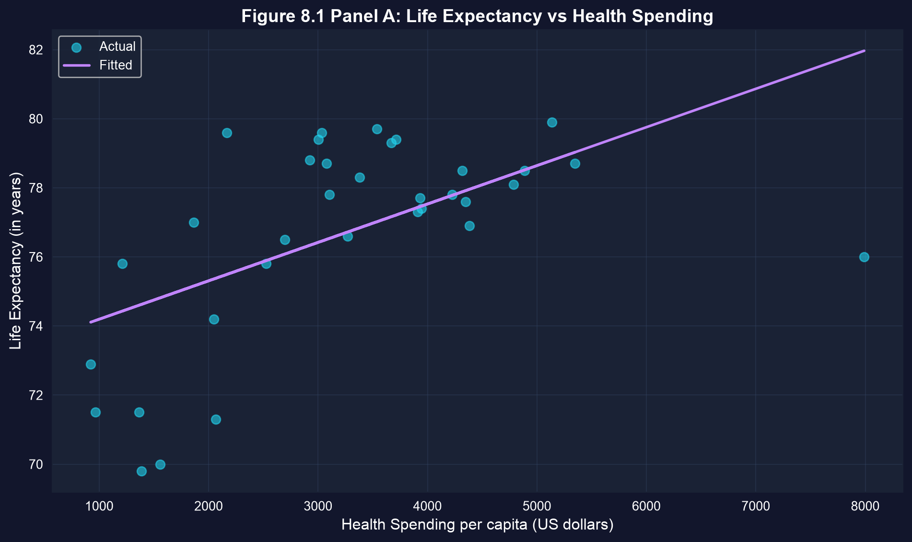
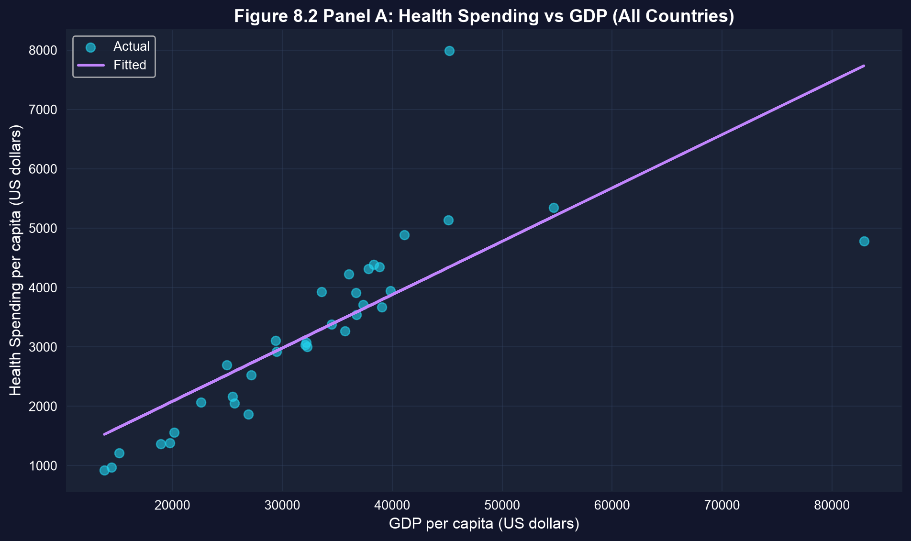
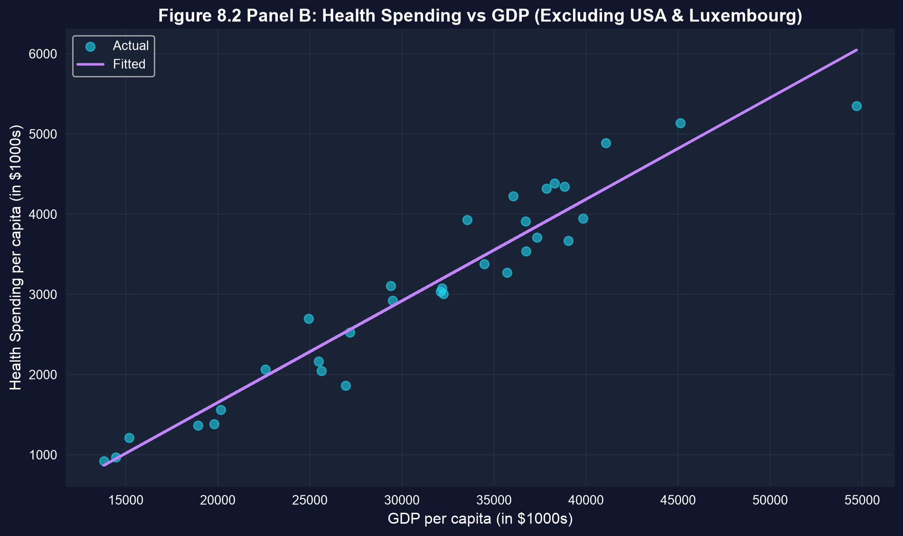
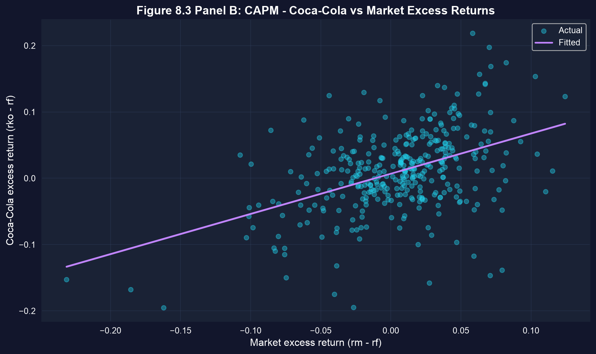
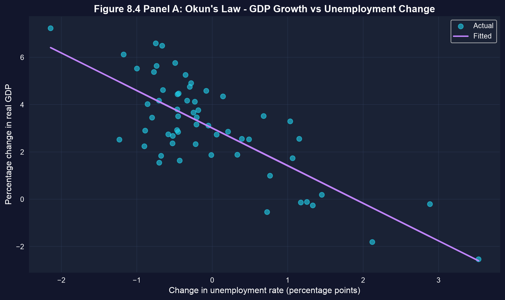

# One tool, four worlds {.divider background-color="#008CB7"}

[Act I · The tension]{.act}

## The same line answers wildly different questions

Health economists, portfolio managers, and macroeconomists seem to work in separate universes.

. . .

Yet each reaches for the **same** instrument: a bivariate regression of $y$ on $x$. The craft is not
running it — it is reading the slope *honestly* once the data fight back.

::: {.notes}
This chapter is applications-first: sections 8.1–8.4 ARE four real case studies. The unifying thread
is that one estimator travels across cross-sectional, financial, and macro data — but each setting
demands care about robust standard errors, outliers, and causation.
:::

## Where we're going

::: {.incremental}
- **Cross-section** — does health spending buy longer lives across 34 OECD countries?
- **Outliers** — how two countries can rewrite a conclusion
- **Finance** — a stock's systematic risk ($\beta$) from the CAPM
- **Macro** — Okun's Law linking unemployment to GDP growth
- **Honest inference** — robust standard errors, economic vs. statistical significance
:::

## Five ideas anchor this chapter

::: {.incremental}
- **Cross-sectional regression** — many units, one moment (34 countries in 2009)
- **Time-series regression** — one unit, many moments (U.S. 1961–2019; monthly returns)
- **Robust standard errors (HC1)** — valid inference when error variance is not constant
- **CAPM** — $R_A - R_F = \alpha + \beta\,(R_M - R_F) + u$; $\beta$ is systematic risk
- **Economic vs. statistical significance** — a slope can be precise yet tiny, or large yet noisy
:::

[Across all four cases, the estimator is `pf.feols` — what changes is how we read it.]{.takeaway .fragment}

# Four case studies {.divider background-color="#7A209F"}

[Act II · The investigation]{.act}

## Case 1 — does health spending buy longer lives?

34 OECD countries, 2009. Regress male life expectancy on per-capita health spending:

$$\text{lifeexp} = \beta_1 + \beta_2 \cdot \text{hlthpc} + u$$

[One snapshot, 34 units — a **cross-sectional** regression. We expect $\beta_2 > 0$: more spending,
longer lives.]{.comment}

## Step 1 — fit it, then demand robust standard errors

``` {.python code-line-numbers="1|2-3|5-6|8|9|10"}
!pip install -q pyfixest                       # pyfixest isn't preinstalled in Colab (-q = quiet)
import pandas as pd                             # load & handle tabular data
import pyfixest as pf                           # OLS with built-in robust SEs

url = "https://raw.githubusercontent.com/quarcs-lab/data-open/master/AED/AED_HEALTH2009.DTA"
data = pd.read_stata(url)                       # 34 OECD countries, 2009 (one row per country)

fit  = pf.feols("lifeexp ~ hlthpc", data=data)             # OLS with classical (iid) SEs
fitr = pf.feols("lifeexp ~ hlthpc", data=data, vcov="HC1") # same slope, heteroskedasticity-robust SEs
fitr.summary()                                  # β1, β2, robust SE, t, p, R²
```

[↗ Try it in Colab](https://colab.research.google.com/notebooks/empty.ipynb){.colab-link target="_blank" data-preview-link="false"}

::: {.notes}
pf.feols fits OLS; passing vcov='HC1' swaps in heteroskedasticity-robust standard errors. The point
estimate is identical — only the SEs, t-stats, and p-values change.
:::

## More spending buys years — but the U.S. sits far below the line



[$+\$1{,}000$ spending $\approx +1.1$ years ($\hat\beta_2 = 0.00111$). Robust $t \approx 2.4$ — still significant, but weaker than the classical $t \approx 3.9$.]{.takeaway .fragment}

## Why robust standard errors matter: the infant-mortality twist

Same data, outcome = infant mortality. The slope is negative ($-0.69$ deaths per \$1,000), as hoped —
but the verdict depends on *which* standard error you trust:

| Standard error | $t$-statistic | $p$-value | Verdict at 5% |
|---|---|---|---|
| Classical (iid) | $-2.3$ | $\approx 0.03$ | [significant]{.key} |
| Robust (HC1) | $-1.3$ | $\approx 0.19$ | [**not** significant]{.key} |

[Cross-sections are usually heteroskedastic. Report robust SEs by default — classical ones can manufacture significance.]{.takeaway .fragment}

## Case 2 — two countries can rewrite the conclusion

``` {.python code-line-numbers="1|2-3|5-6|8|9|10|11"}
!pip install -q pyfixest                       # pyfixest isn't preinstalled in Colab
import pandas as pd                             # tabular data
import pyfixest as pf                           # OLS estimation

url = "https://raw.githubusercontent.com/quarcs-lab/data-open/master/AED/AED_HEALTH2009.DTA"
data = pd.read_stata(url)                       # 34 OECD countries

full   = pf.feols("hlthpc ~ gdppc", data=data)  # health spending on GDP — all 34 countries
sub_df = data[(data["code"] != "USA") & (data["code"] != "LUX")]  # drop two influential outliers
sub    = pf.feols("hlthpc ~ gdppc", data=sub_df)   # refit on the remaining 32 countries
print(full._r2, sub._r2)                        # R² leaps 0.60 → 0.93 once outliers are removed
```

[↗ Try it in Colab](https://colab.research.google.com/notebooks/empty.ipynb){.colab-link target="_blank" data-preview-link="false"}

## Drop the USA and Luxembourg — and the cloud snaps into a line

:::: {.columns}
::: {.column width="50%"}

:::
::: {.column width="50%"}

:::
::::

[$R^2$ jumps from $\approx 0.60$ to $\approx 0.93$. Always find your influential points before trusting a slope.]{.takeaway .fragment}

## Case 3 — how much does a stock move with the market?

The Capital Asset Pricing Model regresses a stock's excess return on the market's excess return:

$$R_A - R_F = \alpha + \beta\,(R_M - R_F) + u$$

[$\beta$ is **systematic risk**: $\beta>1$ amplifies the market, $\beta<1$ is defensive. Pure theory
says the intercept $\alpha = 0$. 354 monthly returns on Coca-Cola, 1983–2012.]{.comment}

## Step 3 — estimate Coca-Cola's beta

``` {.python code-line-numbers="1|2-3|5-6|8|9"}
!pip install -q pyfixest                       # pyfixest isn't preinstalled in Colab
import pandas as pd                             # tabular data
import pyfixest as pf                           # OLS estimation

url = "https://raw.githubusercontent.com/quarcs-lab/data-open/master/AED/AED_CAPM.DTA"
capm = pd.read_stata(url)                       # 354 monthly excess returns, 1983–2012

fit = pf.feols("rko_rf ~ rm_rf", data=capm)     # Coca-Cola excess return on market excess return
fit.summary()                                   # α (intercept), β (slope = systematic risk), R²
```

[↗ Try it in Colab](https://colab.research.google.com/notebooks/empty.ipynb){.colab-link target="_blank" data-preview-link="false"}

## Coca-Cola is defensive — and the market explains only a fifth of it



[$\hat\beta = 0.61$ (less volatile than the market), $R^2 \approx 0.20$. A significant $\hat\alpha \approx 0.68\%$/month is the "alpha puzzle."]{.takeaway .fragment}

## Case 4 — does Okun's Law hold for the U.S.?

Annual U.S. data, 1961–2019. Regress real GDP growth on the change in the unemployment rate:

$$\text{growth} = \beta_1 + \beta_2 \cdot \text{URATEchange} + u$$

[One country over 59 years — a **time-series** regression. Okun's 1962 benchmark is $\beta_2 = -2.0$.]{.comment}

## Step 4 — fit Okun's Law and compare to −2.0

``` {.python code-line-numbers="1|2-3|5-6|8|9"}
!pip install -q pyfixest                       # pyfixest isn't preinstalled in Colab
import pandas as pd                             # tabular data
import pyfixest as pf                           # OLS estimation

url = "https://raw.githubusercontent.com/quarcs-lab/data-open/master/AED/AED_GDPUNEMPLOY.DTA"
gdp = pd.read_stata(url)                        # 59 years of U.S. data, 1961–2019

fit = pf.feols("rgdpgrowth ~ uratechange", data=gdp)  # GDP growth on the change in unemployment
fit.summary()                                   # slope ≈ −1.59 vs Okun's −2.0; R² ≈ 0.59
```

[↗ Try it in Colab](https://colab.research.google.com/notebooks/empty.ipynb){.colab-link target="_blank" data-preview-link="false"}

## Rising unemployment, falling growth — close to Okun, not identical



[$\hat\beta_2 = -1.59$, $R^2 = 0.59$. We reject $\beta_2 = -2.0$ ($t \approx 2.4$), yet it's "close enough" for policy.]{.takeaway .fragment}

# Reading it right {.divider background-color="#C21E72"}

[Act III · The resolution]{.act}

## Four lessons that travel across every case

::: {.incremental}
- **Robust SEs are the default** — cross-sections and time series are rarely homoskedastic; HC1 can flip a verdict.
- **Hunt for influential points** — two countries moved $R^2$ from 0.60 to 0.93.
- **Separate the two significances** — report the *magnitude* (1.1 years, $\beta=0.61$, $-1.59$), not just the p-value.
- **Association is not causation** — richer countries differ in many ways; a slope is a correlation until a design earns more.
:::

[Response.]{.rebuttal} The U.S. spends the most on health yet lives below the line — proof that *how*
you spend, and everything the regression omits, can dominate the slope itself.

## What to carry forward

::: {.incremental}
- One estimator, `pf.feols`, fits cross-sectional, financial, and macro data alike.
- Add `vcov="HC1"` for heteroskedasticity-robust inference — make it a habit.
- Test hypotheses beyond $\beta = 0$ (Okun's $-2.0$; CAPM's $\alpha = 0$).
- Always check outliers, report economic magnitude, and resist the causal leap.
:::

# Fit the line in any domain — then read the slope with an honest eye. {.divider background-color="#C21E72"}
