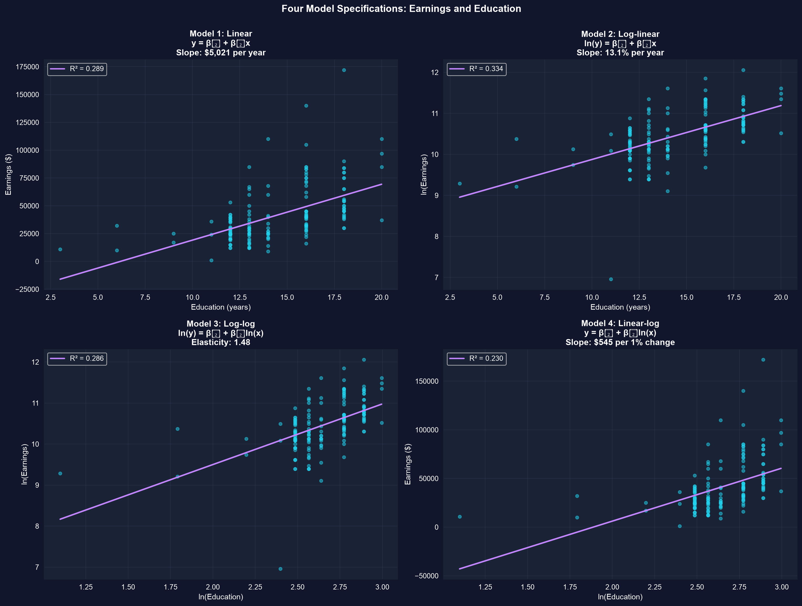
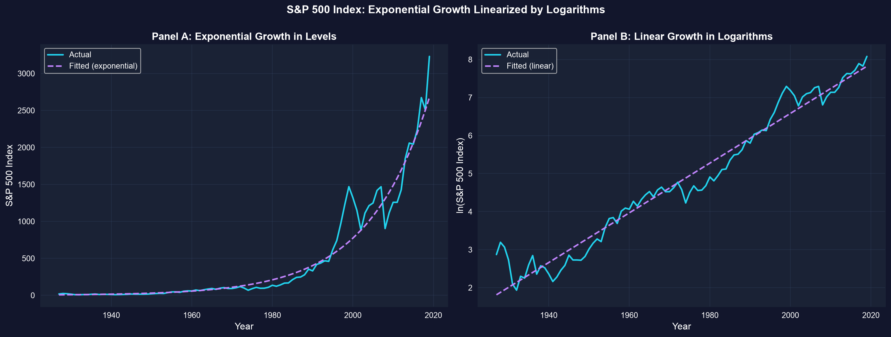

# なぜドルではなく変化率なのか？ {.divider background-color="#008CB7"}

[第1幕 · 問題提起]{.act}

## 経済学者は*比例的な*変化に注目します

\$10,000の昇給は、\$30,000の年収のときと\$300,000の年収のときとでは、まったく異なる意味を持ちます。

. . .

ですから、私たちが通常知りたい数字はドルの金額ではなく**変化率**です — 教育の収益率、価格弾力性、成長率などです。自然対数は、回帰の傾きをその変化率に直接変換してくれる唯一の変換です。

::: {.notes}
経済理論は圧倒的に比例的な反応について論じています。需要の弾力性、収益率、成長率などです。対数を使えば、推定量を変えることなくOLS（最小二乗法）にその言語を話させることができます。
:::

## これから扱う内容

::: {.incremental}
- $\ln$の**ある性質** — これが計量経済学の主役である理由
- **準弾力性と弾力性** — $y$が$x$に反応する二つの方法
- **四つの関数形**（level、log-linear、log-log、linear-log）と、それぞれの傾きの読み方
- **所得と教育** — 同じデータ、四つの解釈、`pyfixest`を用いて
- **指数成長** — 対数が直線化し、72の法則が倍増時間を読み取ります
:::

## 五つの考え方がこの章を支えます

::: {.incremental}
- **自然対数 (ln) $\ln$** — $e^x$の逆関数。*乗法的な*差を*加法的な*差に変換します
- **重要な近似** — $\Delta \ln(x) \approx \Delta x / x$、したがって $100 \times \Delta\ln(x) \approx \%\Delta x$
- **準弾力性** — $x$の**1単位**の変化あたりの$\%\Delta y$（log-linearの傾き）
- **弾力性** — $x$の**1%**の変化あたりの$\%\Delta y$（log-logの傾き）、単位に依存しません
- **複利成長** — $x_t = x_0(1+r)^t$ は対数をとると直線になります
:::

[対数を使えば、一本の回帰の傾きを変化率として読み取れます — これがすべての要点です。]{.takeaway .fragment}

# 対数から弾力性へ {.divider background-color="#7A209F"}

[第2幕 · 調査]{.act}

## 重要なのは対数のこの性質一つ： $\Delta \ln(x) \approx \Delta x / x$

*小さな*変化については、$\ln(x)$の変化は$x$の比例的な変化そのものです — 100を掛ければ変化率が得られます。

``` {.python code-line-numbers="1|3-4|6-9"}
import numpy as np                           # numpy → logs, exponentials, arrays

x0, x1 = 40, 40.4                            # x rises from 40 to 40.4 (a 1% increase)

exact  = (x1 - x0) / x0                      # exact proportionate change = 0.010000
approx = np.log(x1) - np.log(x0)             # log approximation Δln(x)   = 0.009950
print(f"exact proportionate change: {exact:.6f}  ({exact*100:.2f}%)")
print(f"log approximation Δln(x):   {approx:.6f}  ({approx*100:.2f}%)")
print(f"difference: {abs(exact-approx):.6f}")   # tiny — the approximation is excellent for small moves
```

[↗ Colab で試す](https://colab.research.google.com/notebooks/empty.ipynb){.colab-link target="_blank" data-preview-link="false"}

::: {.notes}
ここで必要なのはnumpy（Colabにプリインストール済み）だけです。1.0000%と0.9950%の差が近似誤差です — 約10%以下では無視できるほど小さく、これこそが対数がこれほど便利な理由です。
:::

## 二つの反応：準弾力性と弾力性

::: {.incremental}
- **準弾力性** $= \dfrac{\Delta y / y}{\Delta x}$ — $x$の**1単位**の変化（例えば就学年数が1年増える）→ $y$の変化率。**log-linear**の傾きで推定します。
- **弾力性** $= \dfrac{\Delta y / y}{\Delta x / x}$ — $x$の**1%**の変化 → $y$の変化率。単位に依存しません。**log-log**の傾きで推定します。
:::

| 形 | モデル | 傾き $\beta_1$ の読み方 |
|---|---|---|
| Linear | $y = \beta_0 + \beta_1 x$ | $x$の1単位あたりの$\Delta y$（単位） |
| Log-linear | $\ln y = \beta_0 + \beta_1 x$ | $x$の1単位あたり $100\beta_1 \approx \%\Delta y$ |
| Log-log | $\ln y = \beta_0 + \beta_1 \ln x$ | $\beta_1 = $ 弾力性（%あたり%） |
| Linear-log | $y = \beta_0 + \beta_1 \ln x$ | $x$の1%あたり $\beta_1/100 = \Delta y$ |

## 私たちの問い：所得は教育とともにどう変化するのか？

30歳のフルタイム労働者171人（2010年）。所得は**右に歪んでいる**（平均\$41,413、中央値\$36,000、最大\$172,000）ため、対数スケールが長い裾を引き寄せます。対数をとり、`pyfixest`で四つの形すべてを当てはめます。

``` {.python code-line-numbers="1|3-5|7-9|11-15|17-18"}
!pip install -q pyfixest                     # pyfixest is NOT preinstalled in Colab (-q = quiet)

import pandas as pd                          # tabular data
import numpy as np                           # np.log for the transforms
import pyfixest as pf                        # OLS with R-style formulas

url = "https://raw.githubusercontent.com/quarcs-lab/data-open/master/AED/AED_EARNINGS.DTA"
data = pd.read_stata(url)                    # 171 workers: earnings, education
data["lnearn"] = np.log(data["earnings"])    # log of the outcome
data["lneduc"] = np.log(data["education"])   # log of the regressor

m_lin    = pf.feols("earnings ~ education", data=data)   # 1. linear:      $ per year
m_loglin = pf.feols("lnearn ~ education",   data=data)   # 2. log-linear:  semi-elasticity
m_loglog = pf.feols("lnearn ~ lneduc",      data=data)   # 3. log-log:     elasticity
m_linlog = pf.feols("earnings ~ lneduc",    data=data)   # 4. linear-log:  $ per 1%

print(100 * m_loglin.coef()["education"])    # 13.1 → ~13.1% more earnings per extra year
m_loglin.summary()                           # β0, β1, SE, t, p, R²
```

[↗ Colab で試す](https://colab.research.google.com/notebooks/empty.ipynb){.colab-link target="_blank" data-preview-link="false"}

::: {.notes}
log-linearモデルは労働経済学の標準です。13.1%の収益率は自動的にスケールします — 労働者が\$30k稼ごうと\$100k稼ごうと同じように読めます。t = 9.21、p < 0.001、R² = 0.334。
:::

## 同じデータ、四本の当てはめ線 — 四つの異なる問い



[$\ln$(所得)のモデルの中ではlog-linearが最もよく当てはまります（R² = 0.334）。$x$だけを対数化すると、線は収穫逓減の方向へ曲がります。]{.takeaway .fragment}

## 四つの傾きを読む

::: {.incremental}
- **Linear：** 1年あたり所得が\$5,021増える — 固定のドル金額（上位層では現実的でない）。
- **Log-linear：** 1年あたり所得が約**13.1%増える** — 準弾力性であり、通常の選択です。
- **Log-log：** 弾力性**1.48** — 教育が1%上昇すると所得が約1.48%高くなることと関連します。
- **Linear-log：** 教育の1%あたり所得が約**\$544増える** — 変化率からドルを得ます。
:::

[$R^2$は**同じ**被説明変数を持つモデル間でのみ比較してください — levelとlogの結果の間では比較しないでください。]{.takeaway .fragment}

## 指数成長は対数をとると直線になります

$x_t = x_0(1+r)^t$ はlevelでは上向きに曲がりますが、$\ln(x_t) \approx \ln(x_0) + r\,t$ は線形です — したがって$\ln x$を時間に回帰すると、成長率$r$が傾きとして得られます。

``` {.python code-line-numbers="1|3-4|6-7|9|10-12"}
!pip install -q pyfixest                     # self-contained cell: install pyfixest (quiet)

import pandas as pd                          # tabular data
import pyfixest as pf                        # OLS with R-style formulas

url = "https://raw.githubusercontent.com/quarcs-lab/data-open/master/AED/AED_SP500INDEX.DTA"
data = pd.read_stata(url)                    # S&P 500 index, 1927–2019 (lnsp500 precomputed)

fit = pf.feols("lnsp500 ~ year", data=data)  # slope = average annual growth rate r
r = fit.coef()["year"]                       # ≈ 0.065
print(f"growth rate: {100*r:.2f}% per year") # ≈ 6.5% per year
print(f"Rule of 72: doubles every {72/(100*r):.0f} years")  # ≈ 11 years
```

[↗ Colab で試す](https://colab.research.google.com/notebooks/empty.ipynb){.colab-link target="_blank" data-preview-link="false"}

::: {.notes}
lnsp500はすでにデータセットに含まれています。72の法則は ln(2) ≈ 0.693 と ln(1+r) ≈ r から導かれます。72を変化率（%）で割れば、おおよその倍増時間が即座に得られます。
:::

## 対数は曲線を読み取れる傾きに変えます



[1927–2019年にかけて**年6.5%**の成長 → 指数は約**11年**ごとに倍増します（72の法則）。]{.takeaway .fragment}

# 正しく読む {.divider background-color="#C21E72"}

[第3幕 · 解決]{.act}

## 近似には限界があり — 対数には定義域があります

[反論。]{.objection} 「log-linearの傾きは0.131だから、教育1年の収益率はちょうど13.1%だ。」

. . .

[応答。]{.rebuttal} $100\beta_1$は小さな係数に対して成り立つ**近似**です。$\beta_1 = 0.131$のとき、*正確な*効果は $100\,(e^{0.131}-1) \approx 14.0\%$ です — 近いですが同一ではありません。また$\ln$はゼロや負の値では定義されないため、対数は厳密に正の変数にのみ適用できます。

[$|\beta_1|$が約0.10を超えたら正確な $100(e^{\beta_1}-1)$ を報告してください。ゼロになりうる変数は決して対数化しないでください。]{.takeaway .fragment}

## 持ち帰るべきこと

::: {.incremental}
- $\Delta\ln(x) \approx \Delta x/x$：対数の変化は（小さな変化については）比例的な変化**そのもの**です。
- **Log-linear** → 準弾力性（1単位あたり $100\beta_1 \approx \%\Delta y$）；**log-log** → 弾力性（%あたり%）。
- 形は**経済理論＋データ＋解釈**から選びます — log-linearが一般的な標準です。
- **指数成長は対数で線形になります**：$\ln x$を時間に回帰すると、傾きが成長率になります。
- 有限の変化率の効果は**近似**として扱ってください（$100(e^{\beta_1}-1)$が正確です）。対数には正のデータが必要です。
:::

# logで当てはめ、変化率で読む — そして近似が成り立つかを確認する。 {.divider background-color="#C21E72"}
