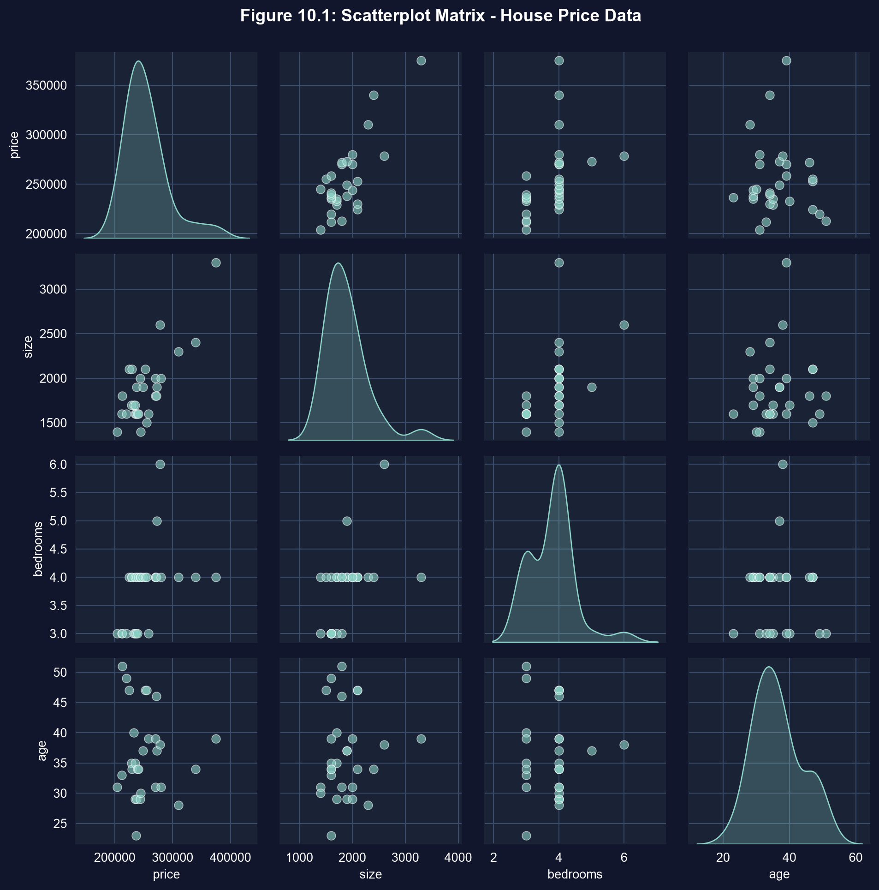
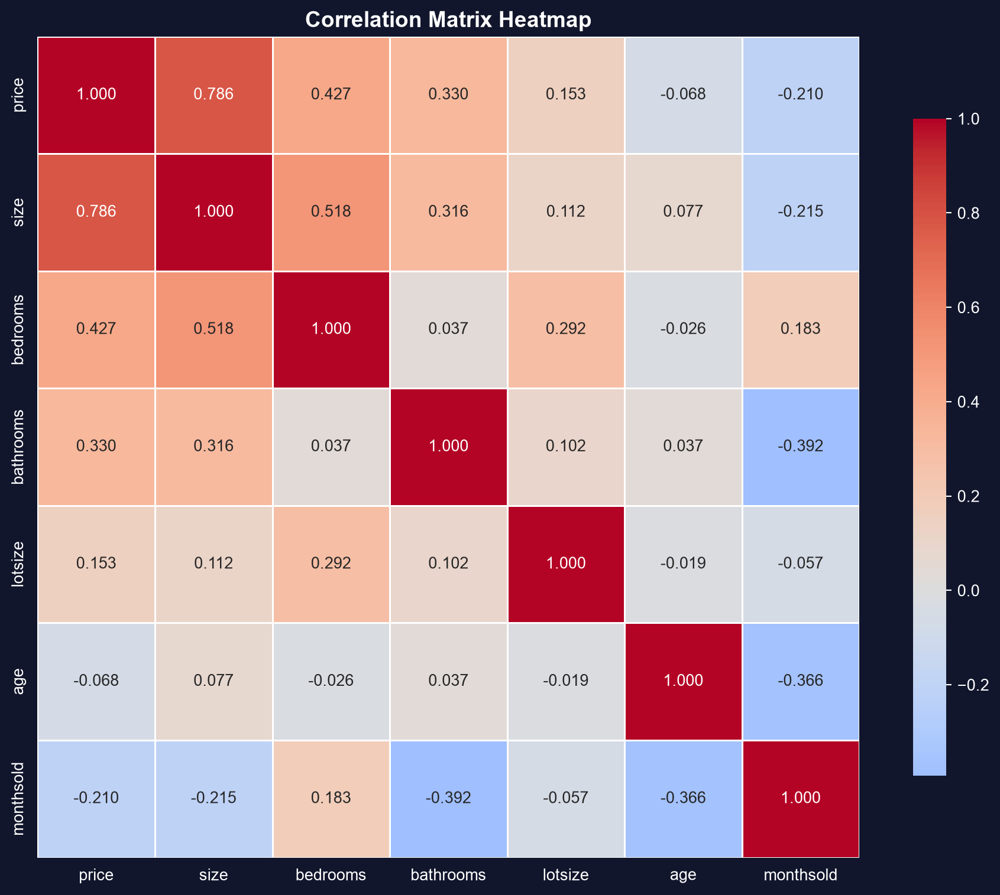
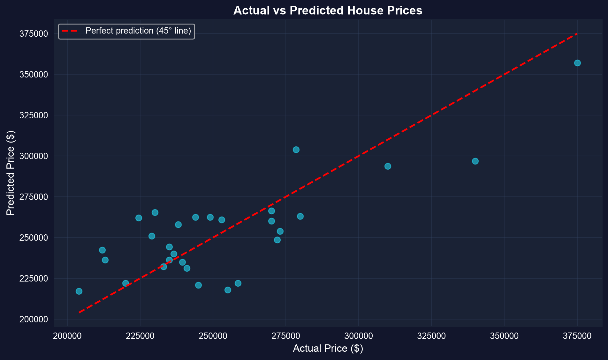

# The question {.divider background-color="#008CB7"}

[Act I · The tension]{.act}

## One cause at a time is a fantasy

House prices depend on size **and** bedrooms **and** age **and** lot size — all at once.

. . .

A bivariate regression of price on bedrooms alone says each bedroom is worth **\$23,667**.
But bigger houses *also* have more bedrooms. How much is the bedroom really worth, once we
hold size fixed? **Multiple regression** is the tool that separates tangled effects.

::: {.notes}
The headline tension: observational data mixes many causes. Multiple regression is how we
isolate the partial effect of one variable while controlling for the rest.
:::

## Where we're going

::: {.incremental}
- **Look first** — scatterplot matrix and correlations before any model
- **Estimate** a multiple regression by OLS with pyfixest
- **Interpret** each slope as a *partial effect* — holding the others constant
- **Compare** models with $R^2$ vs adjusted $R^2$ (and AIC/BIC)
- **Diagnose** confounding and perfect collinearity
:::

## Six ideas anchor this chapter

::: {.incremental}
- **Multiple regression** — $\hat{y} = b_1 + b_2 x_2 + \cdots + b_k x_k$; each slope is a *partial* effect
- **Correlation matrix** — every pairwise $r$ at a glance, before modeling
- **Control variable** — added to keep a confounder from biasing the focal slope
- **Confounder** — drives both $x$ and $y$, faking a relationship if omitted
- **Adjusted $R^2$** — $R^2$ with a penalty for extra regressors
- **Perfect collinearity** — one regressor is an exact combination of others → inestimable
:::

[A multiple-regression slope answers "all else equal" — the question economics actually asks.]{.takeaway .fragment}

# From one variable to many {.divider background-color="#7A209F"}

[Act II · The investigation]{.act}

## The bedrooms coefficient is a trap

29 house sales in Davis, California (1999), with size, bedrooms, bathrooms, lot size, age, month sold.

$$\widehat{\text{price}} = b_1 + b_2\,\text{size} + b_3\,\text{bedrooms} + \cdots + b_7\,\text{monthsold}$$

[On its own, `bedrooms` looks like a \$23,667 driver. The suspicion: that number is really *size*
showing up in disguise. To find out, we first look at how the variables move together.]{.comment}

## Step 1 — see every pair at once with a scatterplot matrix

``` {.python code-line-numbers="1-2|4-5|7-9|10"}
import pandas as pd                          # tabular data
import seaborn as sns                        # statistical visualization

url = "https://raw.githubusercontent.com/quarcs-lab/data-open/master/AED/AED_HOUSE.DTA"
data = pd.read_stata(url)                    # 29 Davis, CA house sales

plot_vars = ["price", "size", "bedrooms", "age"]   # columns to cross-plot
g = sns.pairplot(data[plot_vars],            # every two-way scatter + KDE on the diagonal
                 diag_kind="kde",
                 plot_kws={"color": "#1fb2dd"})     # brand cyan markers
```

[↗ Try it in Colab](https://colab.research.google.com/notebooks/empty.ipynb){.colab-link target="_blank" data-preview-link="false"}

::: {.notes}
A scatterplot matrix is pure exploratory data analysis — it reveals linear associations,
nonlinearities, clusters, and outliers before any formal modeling.
:::

## Every pair, in one view



[Look before you model: the matrix shows which predictors move with price — and with each other.]{.takeaway .fragment}

## Step 2 — quantify the pairwise links with a correlation matrix

``` {.python code-line-numbers="1-2|4-5|7-8|10-12"}
import pandas as pd                          # tabular data
import seaborn as sns                        # heatmap

url = "https://raw.githubusercontent.com/quarcs-lab/data-open/master/AED/AED_HOUSE.DTA"
data = pd.read_stata(url)                    # load the 29 house sales

corr_vars = ["price", "size", "bedrooms", "bathrooms", "lotsize", "age"]
corr = data[corr_vars].corr()               # pandas .corr() → pairwise correlation matrix

sns.heatmap(corr, annot=True, fmt=".2f",     # print each r in its cell
            cmap="coolwarm", center=0)        # diverging colours around 0
corr                                          # show the raw matrix too
```

[↗ Try it in Colab](https://colab.research.google.com/notebooks/empty.ipynb){.colab-link target="_blank" data-preview-link="false"}

## Size is the strongest predictor — and it moves with bedrooms



[$r(\text{price},\text{size}) = 0.79$ · $r(\text{price},\text{bedrooms}) = 0.43$ · $r(\text{size},\text{bedrooms}) = 0.52$ — size and bedrooms overlap, so their effects will be hard to separate.]{.takeaway .fragment}

## Step 3 — fit the full multiple regression with pyfixest

``` {.python code-line-numbers="1|3-4|6-7|9-10|11"}
!pip install -q pyfixest                     # install pyfixest in Colab (-q = quiet; not preinstalled)

import pandas as pd                          # tabular data
import pyfixest as pf                         # pyfixest → OLS regression, R-style formulas

url = "https://raw.githubusercontent.com/quarcs-lab/data-open/master/AED/AED_HOUSE.DTA"
data = pd.read_stata(url)                    # load the 29 Davis, CA house sales

fit = pf.feols("price ~ size + bedrooms + bathrooms + lotsize + age + monthsold",
               data=data)                    # OLS with six regressors at once
fit.summary()                                # partial slopes, SEs, t, p, R²
```

[↗ Try it in Colab](https://colab.research.google.com/notebooks/empty.ipynb){.colab-link target="_blank" data-preview-link="false"}

::: {.notes}
`feols` takes an R-style formula; adding predictors with `+` is all it takes to go from
bivariate to multiple. Classical SEs here (AED switches to robust SEs in Chapter 12).
:::

## Only size clears the bar — once everything is controlled


[`size` $= \$68.37$/sq ft, $t = 4.44$, $p < 0.001$ (95% CI ≈ \$36–\$100). Every other interval straddles zero.]{.takeaway .fragment}

## Controlling for size unmasks the bedroom

::: {.incremental}
- **Bedrooms alone:** \$23,667 per bedroom — impressive, and misleading.
- **Bedrooms + size:** the bedrooms slope collapses to **\$1,553**.
- Most of the "bedrooms effect" was really *size*: bigger houses have more bedrooms **and** cost more.
- `size` is a textbook **confounder** of bedrooms — and adding it as a **control** fixes the estimate.
:::

[A partial effect is the honest number: what one extra bedroom adds, *holding size fixed*.]{.takeaway .fragment}

## The FWL theorem: a partial effect *is* a bivariate slope on residuals

``` {.python code-line-numbers="1-2|4-6|8-10|11"}
import pandas as pd
import pyfixest as pf                                 # pyfixest OLS

data = pd.read_stata("https://raw.githubusercontent.com/quarcs-lab/data-open/master/AED/AED_HOUSE.DTA")

# Step 1 — strip out the part of size explained by the other regressors
others = pf.feols("size ~ bedrooms + bathrooms + lotsize + age + monthsold", data=data)
data["resid_size"] = others._u_hat                    # residualized size (size "net of" the rest)

# Step 2 — regress price on residualized size alone
pf.feols("price ~ resid_size", data=data).coef()      # → 68.37, exactly the full-model size slope
```

[↗ Try it in Colab](https://colab.research.google.com/notebooks/empty.ipynb){.colab-link target="_blank" data-preview-link="false"}

::: {.notes}
Frisch–Waugh–Lovell: the multiple-regression slope on size equals the bivariate slope of price
on the part of size that is independent of the other regressors. That residual variation is
exactly what a partial effect uses.
:::

## More variables always raise $R^2$ — not always adjusted $R^2$



[Simple (size only): $R^2 = 0.617$, $\bar{R}^2 = 0.603$. Full (six regressors): $R^2 = 0.651$ but $\bar{R}^2$ *falls* to $0.555$.]{.takeaway .fragment}

## Choosing between models

::: {.incremental}
- Plain $R^2$ can only go **up** when you add regressors — it rewards clutter.
- **Adjusted $R^2$** divides by degrees of freedom, so junk predictors push it **down**.
- **AIC / BIC** penalize complexity harder still; smaller is better, BIC favors parsimony.
- On $n = 29$ houses, the five extra predictors barely earn their keep — the simple model is competitive.
:::

[With few observations, parsimony wins: don't buy a lower $\bar{R}^2$ with variables that add nothing.]{.takeaway .fragment}

# Reading it right {.divider background-color="#C21E72"}

[Act III · The resolution]{.act}

## When a coefficient simply cannot exist

[Objection.]{.objection} "If more predictors help, why not add `size_twice = 2 × size`?"

. . .

[Response.]{.rebuttal} **Perfect collinearity.** `size_twice` carries zero new information, so OLS
has no unique solution — the software silently drops one of the pair. Like identical twins with one
set of measurements: distinct names, identical data. Watch for it whenever one regressor is an exact
combination of others.

[Correlation among regressors is normal; an *exact* linear dependence is fatal to estimation.]{.takeaway .fragment}

## What to carry forward

::: {.incremental}
- Each multiple-regression slope is a **partial effect** — the change in $y$ per unit of $x_j$, others held fixed.
- **Look before you model:** scatterplot matrix (`sns.pairplot`) + correlation matrix (`.corr()`).
- Omitting a **confounder** biases the focal slope; adding it as a **control** corrects it (\$23,667 → \$1,553).
- Compare specifications with **adjusted $R^2$**, AIC, and BIC — not plain $R^2$.
- **Perfect collinearity** makes a model inestimable; moderate correlation just widens standard errors.
:::

# Hold the others constant — then the slope tells the truth. {.divider background-color="#C21E72"}
