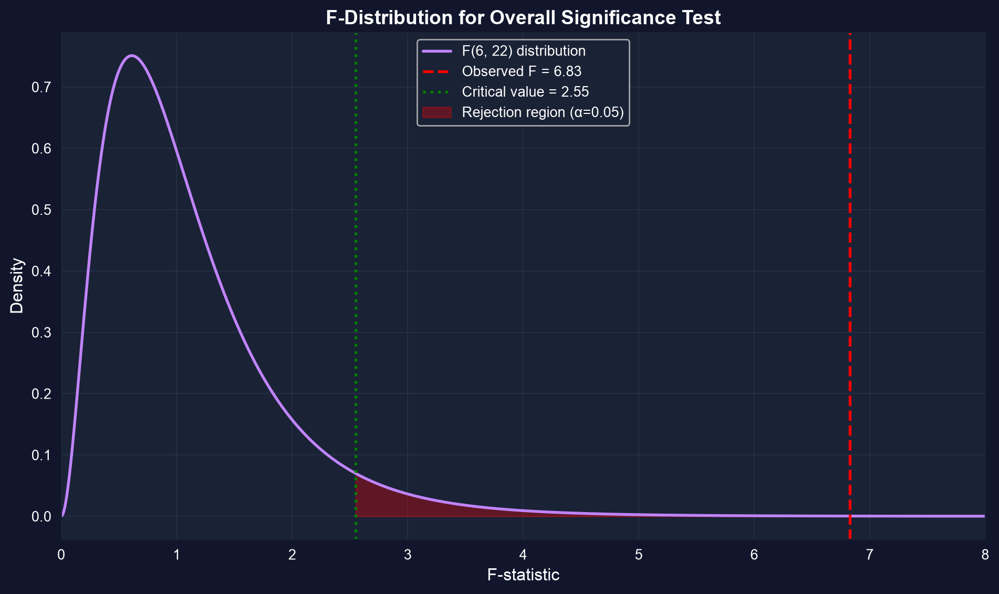
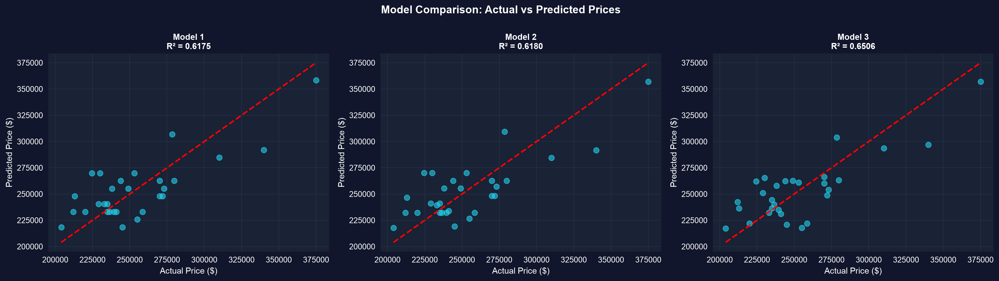

# 問い {.divider background-color="#008CB7"}

[第I幕 · 緊張]{.act}

## 6つの変数が住宅価格の説明を競い合う

カリフォルニア州デービスの住宅29件の価格を、**面積、寝室数、浴室数、敷地面積、築年数、販売までの月数**に回帰します。

$$\text{price} = \beta_1 + \beta_2\,\text{size} + \beta_3\,\text{bedrooms} + \cdots + \beta_7\,\text{monthsold} + u$$

. . .

どの係数もゼロではない値として返ってきます。しかし点推定値は証拠ではありません——**これらの効果のうち、どれが単なる標本抽出の雑音にすぎないのでしょうか。** 推測とは、シグナルを偶然から見分ける方法のことです。

::: {.notes}
第10章と同じ住宅データセットで、今回は推測まで完全に扱います。この章全体のテーマは、29件という小標本において、本当の効果を雑音から分離することです。
:::

## これから進む道

::: {.incremental}
- 完全モデルを**推定し**、その係数、標準誤差、$t$統計量を読み解く
- **精度を定量化する**——なぜ $se(b_j)$ は当てはまりと変動によって縮小し、多重共線性によって拡大するのか
- 各効果について**信頼区間** $b_j \pm t_{n-k,\,0.025}\,se(b_j)$ を構築する
- $t$検定で**1つの係数を**一度に、$F$検定で**複数の係数のグループを**検定する
- 結果を専門的に**提示する**——ロバスト標準誤差、有意性の星印、簡潔さ
:::

## 6つのアイデアがこの章を支える

::: {.incremental}
- **$b_j$ の $t$統計量**——仮定した値からの標準化された距離で、$T(n-k)$ に従う
- **自由度 $n-k$**——$k$ 個のパラメータを推定した後に残るデータの「予算」（ここでは $29-7=22$）
- **標準誤差 $se(b_j)$**——良い当てはまりと独自の変動によって縮小し、多重共線性のもとで膨れ上がる
- **全体の $F$検定**——モデルは全体として $y$ を説明しているか（$H_0:\beta_2=\cdots=\beta_k=0$）
- **制約付き vs. 制約なし**——変数の*グループ*を同時に検定するために $\text{RSS}$ を比較する
- **有意性の星印**——`*` `**` `***` が 10%、5%、1% の閾値を一目で示す
:::

[追加するパラメータ1つごとに自由度を1つ消費します——標本が29件のとき、その代償は現実的です。]{.takeaway .fragment}

# 推定値から証拠へ {.divider background-color="#7A209F"}

[第II幕 · 調査]{.act}

## 完全モデルを当てはめる——面積が支配し、残りは静かだ

``` {.python code-line-numbers="1|3-4|6|8-9|11"}
!pip install -q pyfixest                     # pyfixest isn't preinstalled in Colab (-q = quiet)

import pandas as pd                          # tabular data
import pyfixest as pf                         # OLS with R-style formulas

url = "https://raw.githubusercontent.com/quarcs-lab/data-open/master/AED/AED_HOUSE.DTA"
data = pd.read_stata(url)                    # 29 Davis, CA house sales (1999)

fit = pf.feols("price ~ size + bedrooms + bathrooms + lotsize + age + monthsold",
               data=data)                    # multiple regression, intercept auto-added

fit.summary()                                # coefficients, SEs, t, p for all 7 parameters
```

[↗ Colab で試す](https://colab.research.google.com/notebooks/empty.ipynb){.colab-link target="_blank" data-preview-link="false"}

::: {.notes}
size = $68.37/平方フィート (p = 0.0002)；bedrooms、bathrooms、lotsize、age、monthsold はすべて非有意。R² = 0.651、n = 29、k = 7、自由度 = 22。
:::

## 基準を超えるのは `size` だけ——1平方フィートあたり $\$68.37$

::: {.incremental}
- **size**：$\$68.37$/平方フィート、$t = 4.44$、$p = 0.0002$——他のすべてを一定に保ったとき、強く有意
- **bedrooms** $\$2{,}685$（$p=0.77$）、**bathrooms** $\$6{,}833$（$p=0.67$）、**age** $-\$833$（$p=0.26$）——いずれも非有意
- **$R^2 = 0.651$**——モデルは価格の変動の65%を説明しますが、**自由度調整済み $R^2 = 0.555$** です
:::

[ゼロでないことと有意であることは同じではありません：6つの傾きのうち5つは、ゼロであっても十分あり得ます。]{.takeaway .fragment}

## 精度には公式がある——そして多重共線性はその敵だ

$$se(b_j) = \frac{s_e}{\sqrt{\sum_i \widetilde{x}_{ji}^2}}, \qquad \widetilde{x}_{ji} = x_j \text{ を他のすべての回帰変数で残差化したもの}$$

[$se(b_j)$ は、モデルの当てはまりが良いとき（$s_e$ が小さいとき）、そして $x_j$ が*他の*回帰変数にはない変動を持っているときに縮小します。より大きな住宅ほど寝室数が多いため、残差化の後に `bedrooms` はほとんど残りません——だからその標準誤差は膨れ上がります。]{.comment}

[$n=29$ で予測変数が相関している場合、推定値は構造的に不正確になります——データは限界まで引き伸ばされているのです。]{.takeaway .fragment}

## 信頼区間は各効果にとってあり得る範囲だ

``` {.python code-line-numbers="1|3-4|6|8|10-11"}
import pandas as pd                          # tabular data
import pyfixest as pf                         # estimation
from scipy import stats                       # t critical value

url = "https://raw.githubusercontent.com/quarcs-lab/data-open/master/AED/AED_HOUSE.DTA"
data = pd.read_stata(url)                    # load the 29 houses

fit = pf.feols("price ~ size + bedrooms + bathrooms + lotsize + age + monthsold", data=data)

fit.confint()                                # 95% CI: b_j ± t(n-k, 0.025) · se(b_j)
t_crit = stats.t.ppf(0.975, df=29 - 7)       # critical value from T(22) ≈ 2.074
```

[↗ Colab で試す](https://colab.research.google.com/notebooks/empty.ipynb){.colab-link target="_blank" data-preview-link="false"}

## ゼロを含まないのは `size` の区間だけ


[`size`：$[\$36.45,\ \$100.29]$——下限ですら1平方フィートあたり $\$36$ を加えます。ゼロを除外する区間は、5%での有意性そのものです。]{.takeaway .fragment}

## $t$検定は、ある係数がある値に等しいかどうかを問う

``` {.python code-line-numbers="1|3|5|7-8|10"}
import numpy as np                           # arrays
# from the fitted model: b_size = 68.37, se_size = 15.39, df = 22

fit = pf.feols("price ~ size + bedrooms + bathrooms + lotsize + age + monthsold", data=data)

b, se = fit.coef()["size"], fit.se()["size"] # estimate and its standard error

t = (b - 50) / se                            # H0: beta_size = 50  →  t = (68.37 - 50)/15.39
p = 2 * (1 - stats.t.cdf(abs(t), df=29 - 7)) # two-sided p-value from T(22)

print(f"t = {t:.2f},  p = {p:.3f}")          # t = 1.19, p = 0.245 → fail to reject
```

[↗ Colab で試す](https://colab.research.google.com/notebooks/empty.ipynb){.colab-link target="_blank" data-preview-link="false"}

::: {.notes}
beta=50 を検定すると t=1.19、p=0.245：点推定値が $68.37 であっても、データは $50/平方フィートと整合的です。棄却しないことは受容することと同じではありません。beta=0 については、t = 68.37/15.39 = 4.44、p = 0.0002。
:::

## 1つの $t$検定では複数の変数を同時に判断できない

bedrooms、bathrooms、lotsize、age、monthsold を**1つずつ**検定することは、それらが相関していることを無視しており——偽の「有意」が生じる確率を膨らませます。

. . .

その代わりに、2つのモデルを残差平方和で比較します：

$$F = \frac{(\text{RSS}_R - \text{RSS}_U)/q}{\text{RSS}_U/(n-k)} \sim F(q,\, n-k)$$

[**制約付き**モデルは変数を落とし、**制約なし**モデルは残します。それらを落とすと当てはまりは悪くなるのでしょうか。]{.comment}

## $F$検定は変数のグループをまとめて判断する

``` {.python code-line-numbers="1|3-4|6|8-10|12"}
import numpy as np                           # arrays
from scipy import stats                       # F distribution

full = pf.feols("price ~ size + bedrooms + bathrooms + lotsize + age + monthsold", data=data)
size_only = pf.feols("price ~ size", data=data)   # restricted: drop the other 5

rss_u, rss_r = np.sum(full._u_hat**2), np.sum(size_only._u_hat**2)
q, n_k = 5, 29 - 7                           # 5 restrictions, 22 residual df
F = ((rss_r - rss_u) / q) / (rss_u / n_k)    # joint F-statistic
p = 1 - stats.f.cdf(F, q, n_k)               # upper-tail p-value

print(f"F({q},{n_k}) = {F:.2f},  p = {p:.3f}")   # F = 0.42, p = 0.832
```

[↗ Colab で試す](https://colab.research.google.com/notebooks/empty.ipynb){.colab-link target="_blank" data-preview-link="false"}

## 2つの $F$検定、2つの判定



::: {.incremental}
- **全体**：$F(6,22) = 6.83$、$p = 0.0003$——モデルは*全体として*価格を説明します。**棄却。**
- **5つの追加変数**：$F(5,22) = 0.42$、$p = 0.832$——`size` を超えて加える分には、まとめて冗長です。**棄却しない。**
:::

[モデルは機能しています——しかしその仕事はすべて `size` 単独が担っているのです。]{.takeaway .fragment}

# 正しく読み解く {.divider background-color="#C21E72"}

[第III幕 · 解決]{.act}

## ロバスト標準誤差を報告し、星印にシグナルを担わせる

``` {.python code-line-numbers="1|3|5|7"}
# vcov="HC1" → heteroskedasticity-robust standard errors (White's correction)

robust = pf.feols("price ~ size + bedrooms + bathrooms + lotsize + age + monthsold",
                  data=data, vcov="HC1")     # coefficients unchanged; SEs recomputed

robust.summary()                             # size: 68.37*** (p ≈ 0.0002) still dominates
```

[↗ Colab で試す](https://colab.research.google.com/notebooks/empty.ipynb){.colab-link target="_blank" data-preview-link="false"}

[`size` を $68.37^{***}$ と報告し、残りは星印なしにします——読み手は証拠がどこにあるかを一目で見て取れます。ここではロバスト標準誤差はほとんど動きません（$\$15.39 \to \$15.36$）：軽度の不均一分散です。]{.takeaway .fragment}

## シンプルが勝つ：簡潔さは詰め込みすぎたモデルに勝る



::: {.incremental}
- size のみ：$R^2 = 0.617$、**自由度調整済み $R^2 = 0.603$**——*最も高い*自由度調整済み $R^2$
- 完全モデル：$R^2 = 0.651$ ですが自由度調整済み $R^2 = 0.555$——6つの追加パラメータで、差し引きでは損失
:::

[$R^2$ は変数が増えると常に上がります。自由度調整済み $R^2$ は複雑さに対して料金を課します。パラメータに見合う働きをするモデルを選びましょう。]{.takeaway .fragment}

## 2つの注意点を視野に入れておく

[異論。]{.objection} 「5つの変数は非有意だ——だから寝室数や浴室数は価格に影響しない。」

. . .

[応答。]{.rebuttal} **棄却しないことは受容することではありません。** $n = 29$ で予測変数が一緒に動く場合、データはこれらの効果を単純に解像できないだけであって——それらがゼロだということではありません。より大きく、共線性の低い標本であれば解像できるかもしれません。

[推測は、*この*標本が支持できる範囲を定量化します。小さく相関したデータは、見かけよりも少ないことしか支持しません。]{.takeaway .fragment}

## 持ち帰るべきこと

::: {.incremental}
- $t$統計量 $t = b_j/se(b_j)$ は $T(n-k)$ に従います。ゼロを除外する信頼区間は、その水準での有意性を意味します。
- $se(b_j)$ は当てはまりと独自の変動によって下がり、**多重共線性によって上がります**——小標本の税です。
- 係数の*グループ*には **$F$検定**を使いましょう：全体（$H_0:$ すべての傾き $=0$）と部分集合（制約付き vs. 制約なし）。
- 横断面データには既定で**ロバスト（HC1）標準誤差**を、有意性の星印とともに報告しましょう。
- モデルは**自由度調整済み $R^2$ と簡潔さ**で判断し、素の $R^2$ では判断しないようにしましょう——ここでは `size` 単独で十分です。
:::

# 効果を推定し、それからどれをデータが実際に擁護できるのかを問いましょう。 {.divider background-color="#C21E72"}
