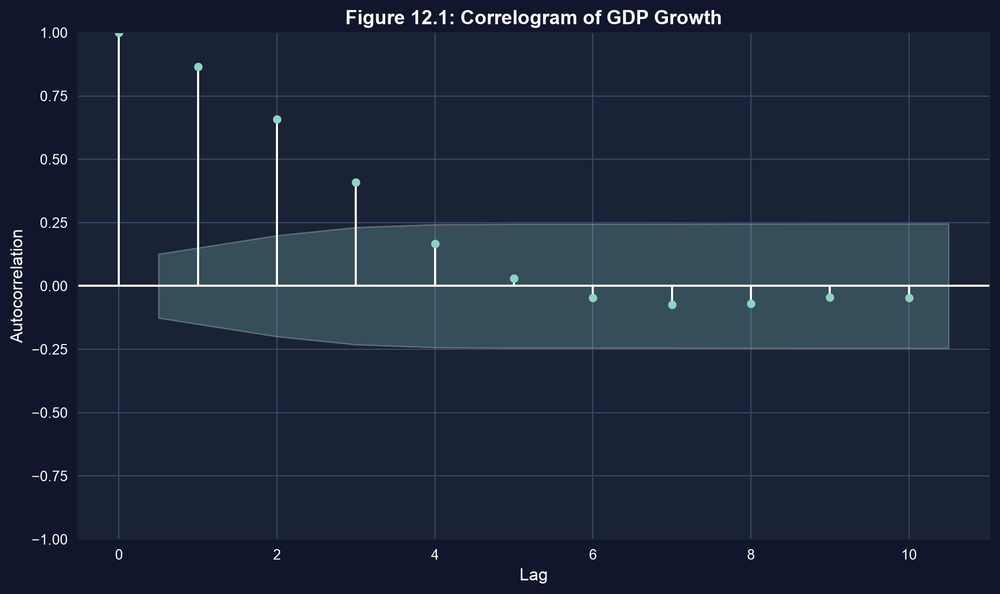
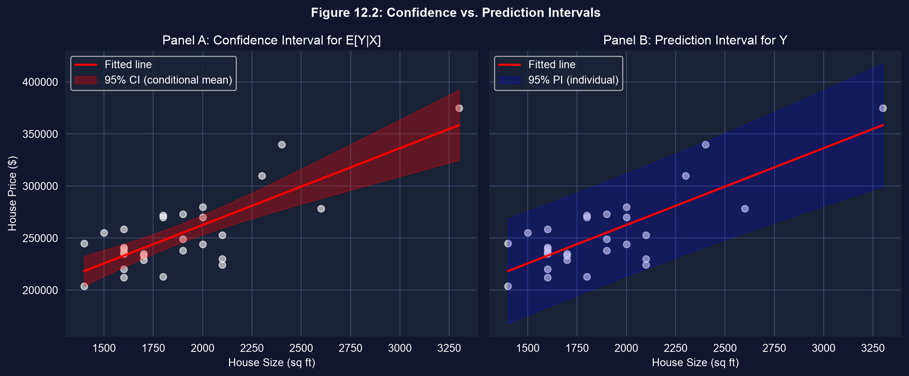
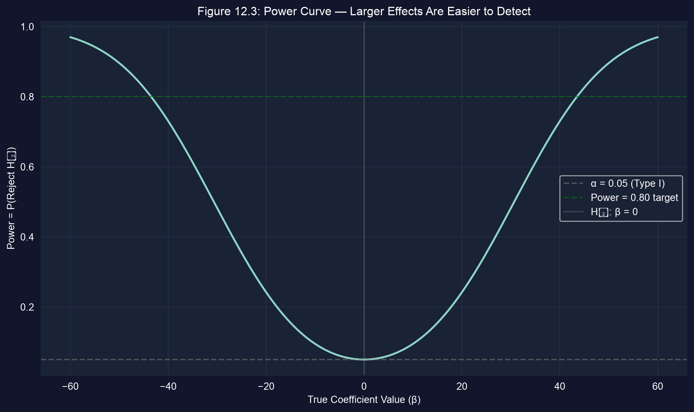

# Cuando los supuestos estándar se rompen {.divider background-color="#008CB7"}

[Acto I · La tensión]{.act}

## MCO da la línea correcta — pero puede mentir sobre qué tan seguros estamos

La fórmula clásica del error estándar supone que los errores son independientes y están
igualmente dispersos. Los datos reales rara vez cooperan: los cortes transversales son
**heterocedásticos**, los datos agrupados están **agrupados en clusters**, las series de
tiempo tienen **autocorrelación**.

. . .

Bajo los tres casos, los coeficientes MCO siguen siendo **insesgados** — la línea sigue
siendo correcta. Lo que se rompe es el **error estándar**: los estadísticos $t$, los
valores $p$ y los intervalos construidos sobre él se vuelven poco confiables. Este capítulo
repara la incertidumbre y luego pregunta qué puede y qué no puede predecir la regresión.

::: {.notes}
El modelo mental central de todo el capítulo: coeficientes sin cambios, inferencia reparada.
Todo en el Acto II es una reparación distinta; el Acto III trata de los límites que ninguna reparación elimina.
:::

## Hacia dónde vamos

::: {.incremental}
- **Reparar los EE** — robustos a heterocedasticidad (HC1), robustos por cluster y HAC (Newey–West)
- **Predecir con honestidad** — el resultado promedio vs. un resultado individual
- **Conocer el piso** — por qué los pronósticos individuales siguen siendo amplios sin importar el tamaño de la muestra
- **Vigilar la muestra** — la selección sobre $Y$ sesga; la selección sobre $X$ solo cuesta precisión
- **Juzgar estimadores y pruebas** — MELI, el bootstrap y la potencia de una prueba
:::

## Seis ideas anclan este capítulo

::: {.incremental}
- **EE robustos** — HC1 para heterocedasticidad; coeficientes sin cambios, solo se mueven los EE
- **EE robustos por cluster** — errores correlacionados *dentro* de los grupos, independientes entre ellos
- **Autocorrelación** — el error de un período hace eco en el siguiente; se corrige con EE **HAC**
- **IC para $E[Y\mid X^*]$** — el resultado *promedio*; se encoge a cero cuando $n\to\infty$
- **Intervalo de predicción** — un resultado *individual*; el piso "$1+$" nunca desaparece
- **Potencia $=1-\beta$** — la probabilidad de que un efecto verdadero sea realmente detectado
:::

[Los coeficientes se quedan en su lugar; este capítulo trata de confiar en los números que están *alrededor* de ellos.]{.takeaway .fragment}

# Reparando los errores estándar {.divider background-color="#7A209F"}

[Acto II · La investigación]{.act}

## Tres violaciones, tres arreglos — los coeficientes nunca cambian

::: {.incremental}
- **Heterocedasticidad** (la varianza del error varía) — común en cortes transversales → EE robustos **HC1**
- **Errores agrupados en clusters** (correlacionados dentro de los grupos) — paneles, jerarquías → EE **robustos por cluster**
- **Autocorrelación** (errores correlacionados en el tiempo) — series de tiempo → EE **HAC (Newey–West)**
:::

[La estimación puntual de MCO es insesgada bajo los tres casos. Solo el error estándar necesita la corrección.]{.takeaway .fragment}

## Los EE robustos son una sola palabra clave: `vcov="HC1"`

``` {.python code-line-numbers="1|3-4|6-7|9-10|12"}
!pip install -q pyfixest                     # pyfixest isn't preinstalled in Colab (-q = quiet)

import pandas as pd                          # tabular data
import pyfixest as pf                         # pyfixest → OLS with robust SEs, R-style formulas

url = "https://raw.githubusercontent.com/quarcs-lab/data-open/master/AED/AED_HOUSE.DTA"
data = pd.read_stata(url)                    # 29 Davis, CA house sales (1999)

f = "price ~ size + bedrooms + bathrooms + lotsize + age + monthsold"
default = pf.feols(f, data=data)             # classical SEs (assume homoskedasticity)

robust = pf.feols(f, data=data, vcov="HC1")  # SAME coefficients, heteroskedastic-robust SEs
```

[↗ Pruébalo en Colab](https://colab.research.google.com/notebooks/empty.ipynb){.colab-link target="_blank" data-preview-link="false"}

::: {.notes}
`vcov="HC1"` es el cambio completo. Las estimaciones puntuales son idénticas byte por byte al ajuste por defecto;
solo difieren `.se()`, `.tstat()`, `.pvalue()` y `.confint()`.
:::

## Para estas casas, los EE robustos cuentan la misma historia

Cada pie² adicional vale alrededor de **\$68** en el precio de venta, y es fuertemente
significativo en cualquier caso: el EE robusto para `size` es **15.36** vs. el por defecto **15.39** ($p = 0.0002$).

. . .

Los mayores ajustes son `bathrooms` (EE robusto ~23% mayor) y `lotsize` (~26%
menor) — pero ambos se mantienen lejos de la significancia bajo cualquier método.

[Una regla general: si los EE robustos se mueven más de ~30%, la heterocedasticidad es real — reporta los robustos.]{.takeaway .fragment}

## Las series de tiempo arrastran un eco — el correlograma lo muestra



[La autocorrelación positiva significa que las observaciones consecutivas no son independientes — por lo que hay *menos* información de la que sugiere el conteo de la muestra.]{.takeaway .fragment}

## Los EE HAC (Newey–West) toman en cuenta ese eco

``` {.python code-line-numbers="1-2|4-5|7|9|11-12|14"}
import numpy as np                           # numerics
from statsmodels.regression.linear_model import OLS as smOLS  # for HAC covariance

url = "https://raw.githubusercontent.com/quarcs-lab/data-open/master/AED/AED_REALGDPPC.DTA"
growth = pd.read_stata(url)["growth"].dropna()   # real GDP-per-capita growth series

n = len(growth); m = int(0.75 * n**(1/3))    # Newey–West lag rule m ≈ 0.75·T^(1/3) → 4

se_default = growth.std() / np.sqrt(n)        # assumes independence (too small here)

fit = smOLS(growth, np.ones(n)).fit(         # intercept-only model = the mean growth rate
          cov_type="HAC", cov_kwds={"maxlags": m})  # HAC-corrected covariance

print(se_default, fit.bse.iloc[0])           # HAC SE is LARGER — honest about serial dependence
```

[↗ Pruébalo en Colab](https://colab.research.google.com/notebooks/empty.ipynb){.colab-link target="_blank" data-preview-link="false"}

::: {.notes}
La tasa de crecimiento media se ajusta como un MCO solo con intercepto para que HAC se aplique limpiamente. El EE HAC excede al
por defecto precisamente porque la autocorrelación positiva en el rezago 1 significa menos observaciones independientes efectivas.
:::

## La predicción se divide en dos: el promedio vs. el individuo

La misma línea ajustada responde dos preguntas distintas, con precisiones muy diferentes:

$$\underbrace{E[Y\mid X^*]}_{\text{resultado promedio}} \qquad\text{vs.}\qquad \underbrace{Y\mid X^* = E[Y\mid X^*] + u^*}_{\text{un resultado individual}}$$

[El individuo arrastra un término extra e irreducible $u^*$ — el "$1+$" bajo la raíz cuadrada que **nunca** se encoge, ni siquiera con datos infinitos.]{.takeaway .fragment}

## Predice un precio — y ambos tipos de intervalo

``` {.python code-line-numbers="1|3|5-6|8-9|11-13|15"}
from scipy import stats                      # t-distribution for interval widths

fit = pf.feols("price ~ size", data=data)    # simple regression on size

x = data["size"].values; xbar = x.mean()     # ingredients for the SE formulas
Sxx = ((x - xbar)**2).sum(); n = len(data)

s_e = np.sqrt((fit._u_hat**2).sum() / (n - 2))   # RMSE — the irreducible noise floor s_e
pred = fit.predict(newdata=pd.DataFrame({"size": [2000]}))[0]  # point prediction at 2000 sq ft

t = stats.t.ppf(0.975, n - 2)                # 95% critical value, df = n − 2
se_cm = s_e * np.sqrt(1/n + (2000 - xbar)**2 / Sxx)        # conditional-MEAN SE
se_pi = s_e * np.sqrt(1 + 1/n + (2000 - xbar)**2 / Sxx)    # INDIVIDUAL SE (note the leading 1)

print(pred, t*se_cm, t*se_pi)                # point, CI half-width, PI half-width
```

[↗ Pruébalo en Colab](https://colab.research.google.com/notebooks/empty.ipynb){.colab-link target="_blank" data-preview-link="false"}

::: {.notes}
Misma predicción puntual (~$263k) para ambos. La única diferencia entre se_cm y se_pi es el "1" inicial,
que es Var(u*). Ese único término es la razón por la que los dos intervalos difieren por ~5×.
:::

## El intervalo de predicción es ~5× más ancho — y se mantiene así



[Para una casa de 2{,}000 pies²: punto ≈ \$263k · IC ≈ [\$253k, \$272k] · IP ≈ [\$213k, \$312k]. Más datos estrechan el IC, apenas tocan el IP.]{.takeaway .fragment}

## Una muestra sesgada puede romper la línea misma

::: {.incremental}
- **Selección sobre $X$** (p. ej. sobremuestrear casas grandes) — MCO sigue siendo **insesgado** si $X$ está en el modelo; solo pierdes precisión.
- **Selección sobre $Y$** (p. ej. una encuesta descarta a los de mayores ingresos) — MCO es **sesgado** para la población; necesita ponderaciones muestrales, una corrección de Heckman o un modelo de selección.
:::

[Ningún EE robusto repara una mala muestra. Siempre pregúntate si la muestra representa a la población que te importa.]{.takeaway .fragment}

# Mejores estimadores, y los límites de una prueba {.divider background-color="#C21E72"}

[Acto III · La resolución]{.act}

## MCO es "el mejor" — hasta que sus supuestos fallan

Bajo los supuestos clásicos, MCO es **MELI** (Mejor Estimador Lineal Insesgado) por el
teorema de Gauss–Markov. Cuando falla la homocedasticidad o la independencia, MCO sigue siendo insesgado pero
ya no es el más eficiente — los **MCG factibles (FGLS)** pueden ser más ajustados.

. . .

En la práctica, la mayoría del trabajo aplicado se queda con **MCO con EE robustos**: la pérdida de eficiencia es pequeña,
y un modelo de ponderación GLS mal especificado puede hacer más daño que bien.

[Usa por defecto MCO + EE robustos. Recurre a FGLS solo cuando confíes en el modelo de varianza del error.]{.takeaway .fragment}

## El bootstrap: deja que los datos dibujen su propia distribución

En lugar de confiar en una aproximación normal, **remuestrea los datos con reemplazo** ~1,000
veces, reestima cada vez, y lee los percentiles 2.5 y 97.5 de los coeficientes
resultantes como un IC al 95%.

[El bootstrap no supone normalidad y funciona para estadísticos complicados — ideal para muestras pequeñas como estas $n = 29$ casas.]{.takeaway .fragment}

## Cada prueba hace un compromiso entre dos formas de equivocarse

| Decisión | $H_0$ verdadera | $H_0$ falsa |
|---|---|---|
| Rechazar $H_0$ | **Error Tipo I** ($\alpha$) | Correcto — **potencia** |
| No rechazar | Correcto | **Error Tipo II** ($\beta$) |

Apretar $\alpha$ reduce los falsos positivos pero eleva $\beta$ — menos efectos reales detectados.
**Potencia $= 1-\beta$** es la probabilidad de captar un efecto verdadero.

[Con solo $n=29$, la prueba de bedrooms no rechazó ($p=0.773$) — probablemente un fallo Tipo II, no una prueba de "ningún efecto".]{.takeaway .fragment}

## La potencia aumenta con el tamaño del efecto — y con la muestra



``` {.python code-line-numbers="1|3-5|7-10|12"}
from scipy import stats; import numpy as np  # distributions + numerics

alpha, se, n = 0.05, 15, 30                  # significance, hypothetical SE, sample size
tcrit = stats.t.ppf(1 - alpha/2, df=n - 1)   # two-sided critical value
betas = np.linspace(-60, 60, 500)            # grid of true effect sizes to evaluate

ncp = betas / se                             # non-centrality: effect in SE units
power = 1 - (stats.t.cdf(tcrit - ncp, n - 1) # P(reject | true β) under the alternative
             - stats.t.cdf(-tcrit - ncp, n - 1))

# here power reaches the 0.80 target only around |β| ≈ 44 — small effects need a bigger n
print(betas[np.argmax(power >= 0.80)])
```

[↗ Pruébalo en Colab](https://colab.research.google.com/notebooks/empty.ipynb){.colab-link target="_blank" data-preview-link="false"}

## Qué llevar adelante

::: {.incremental}
- Los coeficientes MCO sobreviven a la heterocedasticidad, el clustering y la autocorrelación — los **EE** necesitan reparación: HC1 / cluster / HAC.
- El arreglo es barato: una sola palabra clave `vcov=`, o un ajuste HAC solo con intercepto para una media de serie de tiempo.
- Predecir un **promedio** es preciso; predecir un **individuo** no lo es — el piso "$1+$" es $\approx s_e$ para siempre.
- La selección sobre $Y$ **sesga**; la selección sobre $X$ solo cuesta precisión — los EE robustos no pueden rescatar una mala muestra.
- MCO + EE robustos es el valor por defecto seguro; el **bootstrap** evita la normalidad; la **potencia** decide qué significa un resultado nulo.
:::

# Confía en la línea, repara la incertidumbre — y respeta lo que una muestra no puede decirte. {.divider background-color="#C21E72"}
