# 9つの問い、1つの道具箱 {.divider background-color="#008CB7"}

[第I幕 · 緊張]{.act}

::: {.notes}
本書全体を1つにまとめる章へようこそ。すべてのケーススタディは、異なる実データに対して同じ推定量（OLS、そして13.8ではそのいとこであるIV）を用います。ケースごとに変わるのは、問い、データ構造、標準誤差、そして何よりも、傾きを解釈できるようにする変動の源泉です。
:::

## 回帰は記述する — しかし *なぜ* かを説明できるのか？

今や私たちは、線を当てはめ、コントロール変数を加え、傾きを読み取ることができます。しかし傾きは**関連**です。親の教育水準が高い学校ほど成績が高く、財産権の強い国ほど豊かです。では説明変数は結果を *引き起こす* のでしょうか？

. . .

この章では、実データに対する**9つのケーススタディ**を順に扱います。最初の4つは、観察データによる回帰をその限界まで押し進めます。最後の4つは、傾きを**因果的な**主張に変える**研究デザイン**（RCT、差の差分法、回帰不連続、または操作変数）を導入します。

[すべてのケースに通底する問いは同じです。*説明変数の変動はどこから来るのか？*]{.takeaway .fragment}

::: {.notes}
このデッキを登山になぞらえて位置づけましょう。記述する → 定式化する → バイアスを診断する → 因果のためにデザインする、という流れです。各ケースは独立していて、それぞれ固有のデータ、コード、出力、解釈を持つので、どのケースも単独で教えることができます。次のスライドのアジェンダを使ってジャンプしてください。
:::

## 9つのケースファイル — どのケースをクリックしてもジャンプできます {.smaller}

| ケース | 問い | 手法 | 主要な結果 |
|:----|:-------------------------|:-----------------|:--------------------------|
| [13.1](#case-131) | 学校のテストスコアを決めるものは？ | 重回帰 | 親の教育1年あたり +73.9 APIポイント |
| [13.2](#case-132) | 規模に関する収穫は一定か？ | Cobb–Douglas、HAC SE | 弾力性の和は1.04（p = 0.636） |
| [13.3](#case-133) | なぜフィリップス曲線は崩れたのか？ | 欠落変数バイアス | +0.265 = −0.128 + 1.146 × 0.343 |
| [13.4](#case-134) | 燃費を決めるものは？ | log-log、クラスター化SE | 重量の弾力性 −0.56 |
| [13.5](#case-135) | 費用分担は支出を減らすか？ | RCT | 95%プラン: 無料医療と比べ −\$1,108 |
| [13.6](#case-136) | 無料医療は子どもの栄養を改善したか？ | 差の差分法 | 年齢別体重zスコアで +0.52単位 |
| [13.7](#case-137) | 議席を持つことは政党に有利か？ | 回帰不連続 | +4.8パーセントポイント |
| [13.8](#case-138) | 制度は繁栄をもたらすか？ | 操作変数 | IV 0.94 vs OLS 0.52 |
| [13.9](#case-139) | 生データはどう最終データになるのか？ | 読み込み・結合・クリーニング | — |

::: {.notes}
ケース13.1–13.4は観察的、13.5–13.8は因果のためのデザイン、13.9はそれらすべての土台となるワークフローです。

ケース番号はリンクになっています。クリックするとそのケースの区切りスライドに直接ジャンプします。Mを押すとメニュー（すべてのスライドタイトルが一覧表示されます）、Oを押すと概観グリッドが開きます。すべてのケースは同じ流れに従います。問い → データ → 手法 → コード → 出力 → 解釈 → 留意点。
:::

## 登山：記述から因果へ

::: {.incremental}
- **記述する**（13.1、13.4）：コントロール変数と誠実な標準誤差を伴う条件付き関連
- **構造を課す**（13.2）：理論に基づく関数形によって、係数が弾力性として解釈でき、検定可能な制約が得られる
- **バイアスを診断する**（13.3）：欠落変数の公式は、欠けている説明変数が傾きを *どれだけ* ゆがめるかを教えてくれる
- **因果のためにデザインする**（13.5–13.8）：RCT、DiD、RD、IVが**信頼できる反実仮想**を構築する
:::

[コントロール変数は、私たちが *測定できる* 交絡因子しか閉じられません。デザインは、測定できない交絡因子を閉じます。]{.takeaway .fragment}

::: {.notes}
梯子のアイデア：各段ごとに、より弁護しやすい仮定を1つ追加していきます。記述は因果的な主張を一切しません。構造は理論を加えます。OVBの公式はバイアスの方向と大きさを教えてくれます。デザインは「すべてをコントロールした」（検証不能）を、検証可能で弁護できる特定の識別仮定、すなわち無作為割当、平行トレンド、カットオフでの連続性、除外制約に置き換えます。
:::

## 1つの推定量、不確実性に誠実であるための3つの方法 {.smaller}

| SEの種類 | pyfixestの構文 | 誤差がこうであるときに使う… | ケース |
|:--|:--|:--|:--|
| 不均一分散頑健 | `vcov="HC1"` | 独立で分散が不均一（横断面） | 13.1, 13.7, 13.8 |
| HAC（Newey–West） | `vcov="NW"` + `time_id`, `lag` | 時間を通じて自己相関（時系列） | 13.2, 13.3 |
| クラスター頑健 | `vcov={"CRV1": "group"}` | グループ内で相関 | 13.4（メーカー）、13.5（家族）、13.6（コミュニティ） |

[係数は3つすべてで同一です。変わるのは標準誤差だけであり、したがって $t$ 統計量、$p$ 値、信頼区間が変わります。]{.comment}

[標準誤差を、データがどのように生成されたかに合わせましょう。13.4では、クラスター化によってSEがHC1の6〜9倍になります。]{.takeaway .fragment}

::: {.notes}
この章は、全体を通じて1つの推定関数 pf.feols を使います。vcov引数は推測だけを変えます。HC1は独立な観測値間の不均一分散を扱います。Newey–West（HAC（不均一分散・自己相関頑健））は、近い時点間の相関も許容します。この章では24年のCobb–Douglas系列に3ラグ、45年の1970年以降のフィリップス系列に5ラグを使います。CRV1は各クラスター（メーカー、家族、コミュニティ）内の任意の相関を許容します。13.4では、この選択が見かけだけの問題ではないことを見ていきます。
:::

## 5つのアイデアがこの章を支えます

::: {.incremental}
- **生産関数**：投入 $\to$ 産出。Cobb–Douglas $Q = AK^{\beta_2}L^{\beta_3}$ は対数で線形
- **規模に関する収穫一定**：すべての投入を2倍にすると産出が2倍になる、すなわち $\beta_2 + \beta_3 = 1$
- **選択バイアス**：処置された単位と処置されていない単位は、処置の *前* から異なる。無作為割当はこの差を取り除く
- **平行トレンド**：処置がなければ両グループが同じように動いたはずだ、というDiDの仮定
- **反実仮想**：観測されない「何が起きたであろうか」。各デザインはこれを異なる方法で補う
:::

[信頼できる因果推定値は、より良い回帰ではありません。より良い *変動の源泉* です。]{.takeaway .fragment}

::: {.notes}
これらはこの章のキーコンセプトです。生産関数とCRSは13.2を、選択バイアスは13.5を、平行トレンドは13.6を支え、反実仮想のアイデアは13.5–13.8を結びつけます。
:::

# 第II幕-a · 観察的回帰を、その限界まで {.divider background-color="#7A209F"}

[ケース13.1–13.4 · 記述する、構造化する、診断する]{.act}

::: {.notes}
観察データによる4つのケースです。厳密な意味で因果を主張するものは1つもありません。それぞれが道具を教えます。コントロール変数と多重共線性（13.1）、対数と制約の検定（13.2）、OVBの公式（13.3）、クラスター化（13.4）です。
:::

# ケース13.1 · 学校の成績を決めるものは？ {#case-131 .divider background-color="#7A209F"}

[重回帰 · 横断面 · HC1標準誤差]{.act}

::: {.notes}
ケース13.1：カリフォルニアのAcademic Performance Index（学力到達指数）です。道具：二変量回帰 vs 重回帰、相関行列、多重共線性、偏効果の読み取り。
:::

## 問い：家庭背景か、それとも学校の資源か？ {.smaller}

**データ。** カリフォルニアの高校807校、1999年（`AED_API99.DTA`）。**Academic Performance Index（API）** は200から1000までの範囲で、州の目標は800です。

| 変数 | 意味 |
|:--|:--|
| `api99` | Academic Performance Index、1999年（結果変数） |
| `edparent` | 親の平均教育年数（年） |
| `meals` | 無料・減額昼食プログラムに参加する生徒の割合（貧困の代理変数） |
| `englearn` | 英語学習者の割合 |
| `yearround` | 複数トラックの通年カレンダーを運用していれば1 |
| `credteach`, `emerteach` | 正規・緊急資格を持つ教員の割合 |

[すべての説明変数は、家庭・学区・教員の選択の結果です。ですから因果効果ではなく**関連**を予想してください。]{.takeaway .fragment}

::: {.notes}
経済学的な問い：学校の成績を決めるのは、資源（教員）なのか、人口学的要因（親の教育、貧困、言語）なのか。ここには無作為に割り当てられたものは何もありません。家庭はどこに住むかを選び、教員は学校間で自己選別し、学区はカレンダーを選びます。解釈の際にはこの点を念頭に置いてください。
:::

## ほとんどの学校は800の目標に遠く及びません

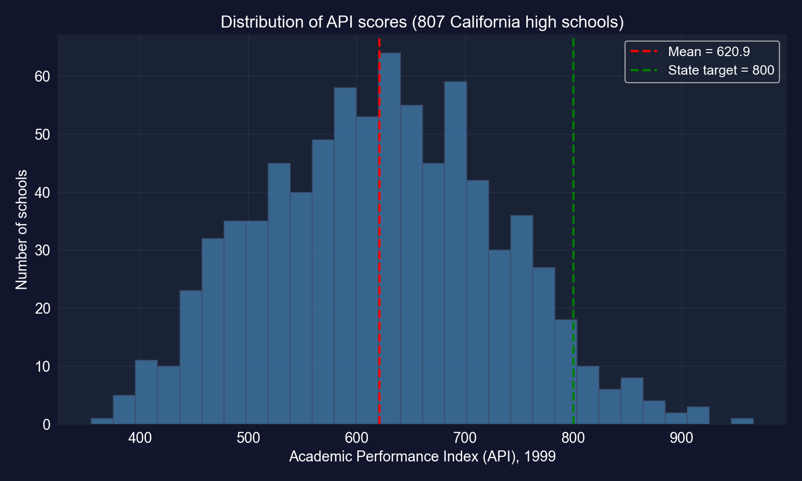

[平均的な学校は約621点で、800に達する学校はわずか4.8%です。したがって結果変数には、説明すべき十分な変動があります。]{.takeaway .fragment}

::: {.notes}
ほぼ対称的で、わずかに左に歪んでいます。スコアは400未満から900超まで分布します。平均620.9。API ≥ 800の学校はわずか4.8%（同じデータから計算）。説明すべき変動がたくさんあります。
:::

## コード：データを読み込み、二変量回帰を当てはめる

``` {.python code-line-numbers="1-3|4-6|7-8|9-10"}
!pip install -q pyfixest                    # pyfixest is not preinstalled in Colab
import pandas as pd                         # tabular data
import pyfixest as pf                       # OLS / IV with R-style formulas
# 807 California high schools, 1999
url = "https://raw.githubusercontent.com/quarcs-lab/data-open/master/AED/AED_API99.DTA"
data_api = pd.read_stata(url)               # read the Stata file into a DataFrame
vars_api = ["api99", "edparent", "meals", "englearn", "yearround", "credteach", "emerteach"]
data_api[vars_api].describe()               # summary statistics for the 7 variables
fit_api_biv = pf.feols("api99 ~ edparent", data=data_api, vcov="HC1")  # bivariate OLS
fit_api_biv.summary()                       # intercept, slope, robust SE, R²
```

[↗ Colab で試す](https://colab.research.google.com/notebooks/empty.ipynb){.colab-link target="_blank" data-preview-link="false"}

::: {.notes}
自己完結型：空のColabセルに貼り付けてください。vcov="HC1"は不均一分散頑健な標準誤差を要求し、独立な学校の横断面に適切です。
:::

## 出力：1つの説明変数が変動の83.5%を説明する {.smaller}

:::: {.columns}
::: {.column width="46%"}
| | 係数 | SE | $t$ |
|:--|--:|--:|--:|
| 切片 | −400.314 | 15.993 | −25.03 |
| `edparent` | [79.529]{.key} | 1.219 | 65.25 |

[N = 807 · HC1 SE · $R^2 = 0.835$ · 傾きの95% CI: [77.14, 81.92]]{.comment}

親の平均教育が1年増えるごとに、**APIが79.5ポイント高い**ことと関連します。
:::
::: {.column width="54%"}
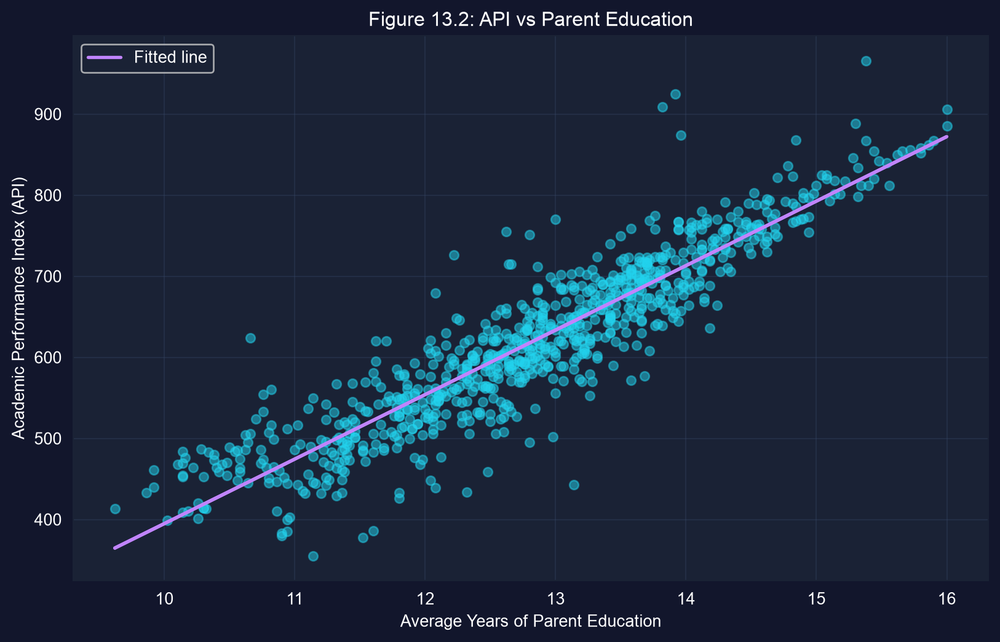
:::
::::

[巨大で精密な傾きですが、`edparent` は所得・言語・近隣環境の代理でもあります。次に、コントロール変数を加えます。]{.takeaway .fragment}

::: {.notes}
推定された式：API = −400.3 + 79.5 × edparent。R² = 0.835で、横断面としては異例に高い値です。切片は外挿であり（教育年数ゼロはデータの範囲外で、データは9.6年から16年まで）、それ自体には意味がありません。二変量の傾きは、親の教育と相関するものすべてを束ねています。
:::

## コード：説明変数どうしは相関しているか？

``` {.python code-line-numbers="1-3|4-5|6-7"}
# continues from the previous block (data_api, vars_api already defined)
import seaborn as sns                       # statistical plotting (heatmap)
import matplotlib.pyplot as plt             # figure handling
corr_matrix = data_api[vars_api].corr()     # pairwise Pearson correlations
print(corr_matrix.round(2))                 # numeric matrix, 2 decimals
sns.heatmap(corr_matrix, annot=True, fmt=".2f", cmap="coolwarm", center=0)  # coloured matrix
plt.show()                                  # display the heatmap
```

[↗ Colab で試す](https://colab.research.google.com/notebooks/empty.ipynb){.colab-link target="_blank" data-preview-link="false"}

[コントロール変数を加える前に、それらがどれだけ強く一緒に動くかを確認しましょう。それが、各変数の個別の効果をどれだけ精密に推定できるかを決めます。]{.takeaway .fragment}

::: {.notes}
相関行列は、最も手早い多重共線性の診断法です。強く相関した説明変数は重複する情報を持つので、OLSには、それぞれの効果を区別するための独立な変動がほとんど残りません。
:::

## 出力：説明変数は強く相関している {.smaller}

:::: {.columns}
::: {.column width="52%"}
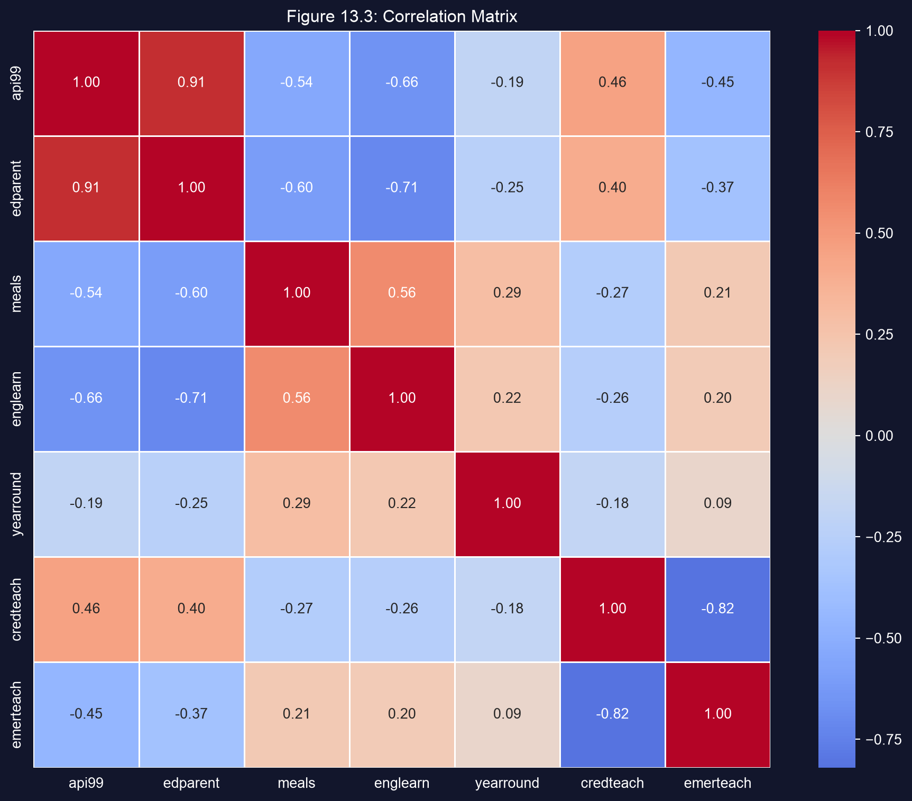{height="440"}
:::
::: {.column width="48%"}
| ペア | $r$ |
|:--|--:|
| `api99`–`edparent` | [0.91]{.key} |
| `api99`–`englearn` | −0.66 |
| `api99`–`meals` | −0.54 |
| `edparent`–`englearn` | −0.71 |
| `edparent`–`meals` | −0.60 |
| `credteach`–`emerteach` | −0.82 |
:::
::::

[親の教育、貧困、英語学習者は、*同じ* 学校をおおむね記述しているので、それぞれの個別の効果を引き離すのは難しいでしょう。]{.takeaway .fragment}

::: {.notes}
APIとmeals（−0.54）およびenglearn（−0.66）の強い負の相関、edparentとの強い正の相関（0.91）。説明変数どうしでは、edparent–englearn −0.71、edparent–meals −0.60、そして2つの教員資格変数は −0.82でほぼ鏡像です。これらの重複する変数のうち、固有の情報が少ないほうの標準誤差は膨らむと予想されます。
:::

## コード：重回帰

``` {.python code-line-numbers="1-3|4-10"}
# continues from the previous block
fit_api_mult = pf.feols("api99 ~ edparent + meals + englearn + yearround + credteach + emerteach",
                        data=data_api, vcov="HC1")   # six regressors, robust SEs
fit_api_mult.summary()                               # full coefficient table
coef_df = pd.DataFrame({                             # compact table of results
    "Coefficient": fit_api_mult.coef(),              # point estimates
    "Std Error": fit_api_mult.se(),                  # HC1 standard errors
    "t-stat": fit_api_mult.tstat(),                  # coefficient / SE
    "p-value": fit_api_mult.pvalue()                 # two-sided p-values
}).round(3)
print(coef_df)
```

[↗ Colab で試す](https://colab.research.google.com/notebooks/empty.ipynb){.colab-link target="_blank" data-preview-link="false"}

::: {.notes}
同じデータ、6つの説明変数。各係数はいまや偏効果です。すなわち、他の5つの説明変数を固定したうえでのAPIとの関連です。
:::

## 出力：親の教育はあらゆるコントロールを生き延びる {.smaller}

| 変数 | 係数 | SE | $t$ | $p$ | 95% CI |
|:--|--:|--:|--:|--:|:--|
| 切片 | −345.328 | 44.027 | −7.84 | <&nbsp;0.001 | [−431.75,&nbsp;−258.91] |
| `edparent` | [73.942]{.key} | 1.835 | 40.29 | <&nbsp;0.001 | [70.34,&nbsp;77.54] |
| `meals` | 0.079 | 0.092 | 0.86 | 0.390 | [−0.10,&nbsp;0.26] |
| `englearn` | −0.358 | 0.177 | −2.02 | 0.044 | [−0.71,&nbsp;−0.01] |
| `yearround` | 25.956 | 10.752 | 2.41 | 0.016 | [4.85,&nbsp;47.06] |
| `credteach` | 0.387 | 0.349 | 1.11 | 0.268 | [−0.30,&nbsp;1.07] |
| `emerteach` | −1.470 | 0.358 | −4.11 | <&nbsp;0.001 | [−2.17,&nbsp;−0.77] |

[N = 807 · HC1 SE · $R^2 = 0.853$（`edparent` のみの0.835に対して）]{.comment}

[5つのコントロール変数を加えても、親の教育の傾きは79.5から73.9へわずかに下がるだけで、コントロール変数が $R^2$ に加えるのはたった1.8ポイントです。]{.takeaway .fragment}

::: {.notes}
キーコンセプト13.1：親の教育の係数は、meals、英語学習者、通年カレンダー、教員資格をコントロールした後でも約74ポイントにとどまります。R²の上昇が小さいのは、edparentが他の変数の測定するものの大半をすでに捉えているためです。
:::

## 係数の読み方（1）：「一定に保つ」とは何を意味するか

::: {.incremental}
- **`edparent` 73.9**：貧困、言語、カレンダー、資格構成が *同じ* 学校どうしを比べると、親の教育が1年多いことは、APIが73.9ポイント高いことと対応する
- **`meals` 0.08（$p = 0.39$）**：単独では、貧困はAPIと $-0.54$ で相関するが、いったん親の教育を固定すると、**個別の** 予測情報を何も加えない
- これは貧困が無関係だという意味では**ありません**。貧困は `edparent` と大きく重なり合うので（$r = -0.60$）、データでは両者を分離できないのです
:::

[偏効果は「他の点では似た学校と比べて…」に答えるものであり、その答えはどの変数を固定するかに依存します。]{.takeaway .fragment}

::: {.notes}
各係数は、他のすべての説明変数について似ている学校どうしの比較として解釈してください。強く共線的な変数（meals）の係数が非有意であることは「他を所与としたときに検出できる個別の関連はない」を意味するのであって、「効果がゼロ」ではありません。
:::

## 係数の読み方（2）：共線性と符号の変化

::: {.incremental}
- **`emerteach` 1パーセントポイントあたり −1.47**：緊急資格の教員が多いほど、スコアは低い（$p < 0.001$）
- その鏡像である **`credteach`** は非有意（$p = 0.27$）：両者は $-0.82$ で相関しているので、同じ変動を奪い合う
- **`yearround` +26.0**（$p = 0.016$）：単純な相関は負（$-0.19$）だが、残りを条件付けると、通年の学校はスコアが26ポイント *高い*
:::

[共線的な説明変数は功績を予測不能な形で分け合い、条件付けによって符号が反転しうることがあります。これは13.3の欠落変数の教訓を予告しています。]{.takeaway .fragment}

::: {.notes}
credteachとemerteachはほぼ鏡像（正規資格 vs 緊急資格）なので、より固有の変動を持って入ったほうが効果を吸収します。yearroundの符号の変化は13.3のちょっとした予告です。何を条件付けるかが傾きを変えるのです。
:::

## なぜこれらは関連であって因果効果ではないのか

:::: {.columns}
::: {.column width="50%"}
### 回帰が固定しているもの
- 測定された6つの特性
- それ以外は何も
:::
::: {.column width="50%"}
### 回帰が固定できないもの
- 家庭の所得、家庭内の資源、私的な家庭教師
- どの家庭が *どの* 学区を選ぶか
- 教員が *どのように* より楽な学校へ自己選別するか
:::
::::

[`edparent` は一連の有利さの束の代理変数です。ですから73.9は条件付きの関連であって、「親を学校に戻すことの効果」ではありません。]{.takeaway .fragment}

::: {.notes}
観察的回帰の標準的な留意点：edparentとAPIの両方と相関する欠落変数（所得、資産、近隣環境）はedparentの係数に乗り移ります。家庭の学区への選択や教員の学校への選別も、因果的な読み取りを壊します。この章は、カリフォルニアの「類似校」指標が、まさにこの種の回帰を使って学校を比較可能な同類とベンチマークしていることに触れています。これは、条件付き関連で十分な記述的用途です。
:::

# ケース13.2 · 投入を2倍にすると産出も2倍になるか？ {#case-132 .divider background-color="#7A209F"}

[Cobb–Douglas生産関数 · log-logモデル · HAC標準誤差]{.act}

::: {.notes}
ケース13.2：Douglasの米国製造業データ、1899–1922年。道具：対数変換、弾力性、線形制約の検定、対数予測の逆変換、時系列のためのHAC標準誤差。
:::

## 問い：米国製造業における規模に関する収穫 {.smaller}

**Cobb–Douglas** 生産関数は、資本 $K$ と労働 $L$ を産出 $Q$ へ写像します。

$$Q = A\,K^{\beta_2}\,L^{\beta_3}$$

| $\beta_2 + \beta_3$ が… | 規模に関する収穫 | 両方の投入を2倍にすると… |
|:--|:--|:--|
| $= 1$ | 一定 | 産出が2倍になる |
| $> 1$ | 逓増 | 産出が2倍より多くなる |
| $< 1$ | 逓減 | 産出が2倍より少なくなる |

[規模に関する収穫は *単一の数* $\beta_2 + \beta_3$ に帰着し、それを推定し検定できます。]{.takeaway .fragment}

::: {.notes}
Aは全要素生産性（技術水準）です。β₂とβ₃は資本と労働の産出弾力性です。両方の投入をλ倍にすると産出がλ^(β₂+β₃)倍になるので、その和が規模に関する収穫を決めます。競争市場の理論はしばしば収穫一定を予測します。
:::

## 対数をとると、乗法モデルが線形回帰になる

$$\ln Q = \underbrace{\ln A}_{\beta_1} + \beta_2 \ln K + \beta_3 \ln L + u$$

[このモデルはいまやパラメータについて線形なので、OLSが適用できます。各傾きは**弾力性**です。$\beta_2 = \partial \ln Q / \partial \ln K$、すなわち労働を固定したうえで、資本が1%変化したときの産出の変化率です。]{.comment}

[ここで対数は2つの仕事をします。モデルをOLSで推定可能にすることと、係数を単位に依存しない弾力性にすることです。]{.takeaway .fragment}

::: {.notes}
キーコンセプト13.2。両辺が対数なので、係数は比例的な反応を測ります。厳密には「Kの1%変化はQをβ₂%変化させる」は微分（微積分）の言明です。有限の変化に対しては近似であり、小さな変化に対しては非常に優れています。
:::

## データ：産出・資本・労働の24年分（1899 = 100） {.smaller}

:::: {.columns}
::: {.column width="50%"}
| 1922年の指数 | 値 | 1899年以来の成長 |
|:--|--:|--:|
| 産出 $Q$ | 240 | 2.4倍 |
| 資本 $K$ | 431 | [4.3倍]{.key} |
| 労働 $L$ | 161 | 1.6倍 |
:::
::: {.column width="50%"}
**なぜHAC標準誤差か？**

- **時系列**：好況、不況、技術ショックは持続するので、誤差は**自己相関**している
- 変動性は期間によって異なる（例：第一次世界大戦）ので、誤差は**不均一分散**である
- Newey–West（HAC）SEは両方に対応する。この章では**3ラグ**を使う
:::
::::

[資本は産出や労働よりはるかに速く成長しました。回帰が産出の成長を2つの投入へどう割り振るかが、弾力性の問いです。]{.takeaway .fragment}

::: {.notes}
Douglas（1976）のデータ。すべての系列は1899 = 100の指数です。既定のOLS SEは無相関で均一分散の誤差を仮定しますが、ここでは誤りです。HC1は不均一分散を直しますが自己相関を無視します。HAC（不均一分散・自己相関一致）SEは両方を直します。観測値がわずか24個なので、HAC SE自体も不正確です。
:::

## コード：対数変換し、Newey–West SEで推定する

``` {.python code-line-numbers="1-4|5-7|8-10|11-13"}
!pip install -q pyfixest                    # pyfixest is not preinstalled in Colab
import numpy as np                          # np.log for the transform
import pandas as pd                         # tabular data
import pyfixest as pf                       # OLS with R-style formulas
url = "https://raw.githubusercontent.com/quarcs-lab/data-open/master/AED/AED_COBBDOUGLAS.DTA"
data_cobb = pd.read_stata(url)              # 24 years of U.S. manufacturing, 1899–1922
data_cobb["lnq"] = np.log(data_cobb["q"])   # log output
data_cobb["lnk"] = np.log(data_cobb["k"])   # log capital
data_cobb["lnl"] = np.log(data_cobb["l"])   # log labor
data_cobb["_time"] = range(len(data_cobb))  # time index required by Newey–West
fit_cobb = pf.feols("lnq ~ lnk + lnl", data=data_cobb,
                    vcov="NW", vcov_kwargs={"time_id": "_time", "lag": 3})  # HAC SEs, 3 lags
fit_cobb.summary()                          # elasticities, HAC SEs, R²
```

[↗ Colab で試す](https://colab.research.google.com/notebooks/empty.ipynb){.colab-link target="_blank" data-preview-link="false"}

::: {.notes}
自己完結型。vcov="NW"を時間インデックスとlag = 3とともに指定している点に注意してください。これがこの章の仕様です。素のOLS SEはこの時系列の自己相関を無視してしまいます。
:::

## 出力：労働の弾力性は資本の約3.5倍 {.smaller}

| 変数 | 係数 | HAC SE | $t$ | $p$ | 95% CI |
|:--|--:|--:|--:|--:|:--|
| 切片 | −0.177 | 0.398 | −0.45 | 0.660 | [−1.000,&nbsp;0.646] |
| `lnk`（資本） | [0.233]{.key} | 0.063 | 3.72 | 0.001 | [0.103,&nbsp;0.363] |
| `lnl`（労働） | [0.807]{.key} | 0.135 | 6.00 | <&nbsp;0.001 | [0.529,&nbsp;1.086] |

[N = 24 · Newey–West SE、3ラグ · $R^2 = 0.957$]{.comment}

::: {.incremental}
- 労働を固定すると、資本の1%増加は産出の **≈ 0.23%** 増と関連する
- 資本を固定すると、労働の1%増加は産出の **≈ 0.81%** 増と関連する
:::

[1900年代初頭の製造業は労働主導でした。労働の弾力性（0.81）は資本の弾力性（0.23）の約3.5倍です。]{.takeaway .fragment}

::: {.notes}
推定された式：ln Q = −0.177 + 0.233 ln K + 0.807 ln L。「≈」は重要です。弾力性は小さな比例的変化を記述します。大きな変化については、代わりに (1+Δ)^β − 1 を計算してください。弾力性の労働/資本比：0.807 / 0.233 ≈ 3.46。非常に高いR²は、3つの系列すべてがともに上昇トレンドを持つことを部分的に反映しています（留意点のスライドを参照）。
:::

## コード：HAC共分散行列で規模に関する収穫一定を検定する

``` {.python code-line-numbers="1-2|3-6|7-9"}
# continues from the previous block
from scipy import stats                     # F distribution for the p-value
R = np.array([0.0, 1.0, 1.0])               # restriction vector: picks out β_K + β_L
b_hat = fit_cobb.coef().values              # coefficients [Intercept, lnk, lnl]
V_hac = fit_cobb._vcov                      # Newey–West (HAC) covariance matrix
df_resid = fit_cobb._N - len(b_hat)         # residual degrees of freedom: 24 − 3 = 21
f_stat = (R @ b_hat - 1.0)**2 / (R @ V_hac @ R)   # Wald statistic for H0: β_K + β_L = 1
p_value = 1 - stats.f.cdf(f_stat, 1, df_resid)    # p-value from F(1, 21)
print(R @ b_hat, f_stat, p_value)           # estimated sum, F, p
```

[↗ Colab で試す](https://colab.research.google.com/notebooks/empty.ipynb){.colab-link target="_blank" data-preview-link="false"}

[この検定はHAC共分散行列を再利用するので、推測は前のスライドのHAC標準誤差と整合します。]{.takeaway .fragment}

::: {.notes}
キーコンセプト13.3：2つの係数に対する1つの線形制約の検定です。古典的な制約付き vs 制約なしのF検定はiid誤差を仮定しますが、それはすでに否定した通りです。V_HACを用いるWald形式は頑健です。R·b̂は推定された和、R·V·Rᵀはその分散です。
:::

## 出力：データは規模に関する収穫一定と整合する {.smaller}

:::: {.columns}
::: {.column width="45%"}
| 量 | 値 |
|:--|--:|
| $\hat\beta_K + \hat\beta_L$ | [1.040]{.key} |
| 和のHAC SE | 0.084 |
| $F(1, 21)$ | 0.23 |
| $p$ 値 | [0.636]{.key} |
| 和の95% CI | [0.87,&nbsp;1.21] |
:::
::: {.column width="55%"}
- $H_0: \beta_K + \beta_L = 1$ は、いかなる慣例的な水準でも**棄却されない**
- しかし95%区間は **0.87から1.21** にわたる：緩やかな収穫逓減 *または* 逓増もデータに適合する
- 「棄却しない」は「証明する」ではない。24年では、検定の検出力は限られている
:::
::::

[推定値（1.04）は1に近く、統計的に1と区別できません。これは、収穫一定を証明はしないものの、支持します。]{.takeaway .fragment}

::: {.notes}
この章はF = 0.23、p = 0.636を報告しています。95% CIは同じHAC SE（0.084）とt(21) = 2.08を使います：1.040 ± 2.08 × 0.084 ≈ [0.87, 1.21]。この区間は章の出力から導いた算術であり、新たな推定ではありません。結果は誠実に提示してください。証拠はCRSと整合し、また、そこからの緩やかな逸脱とも整合します。
:::

## 当てはめたモデルは24年間の産出を追跡する

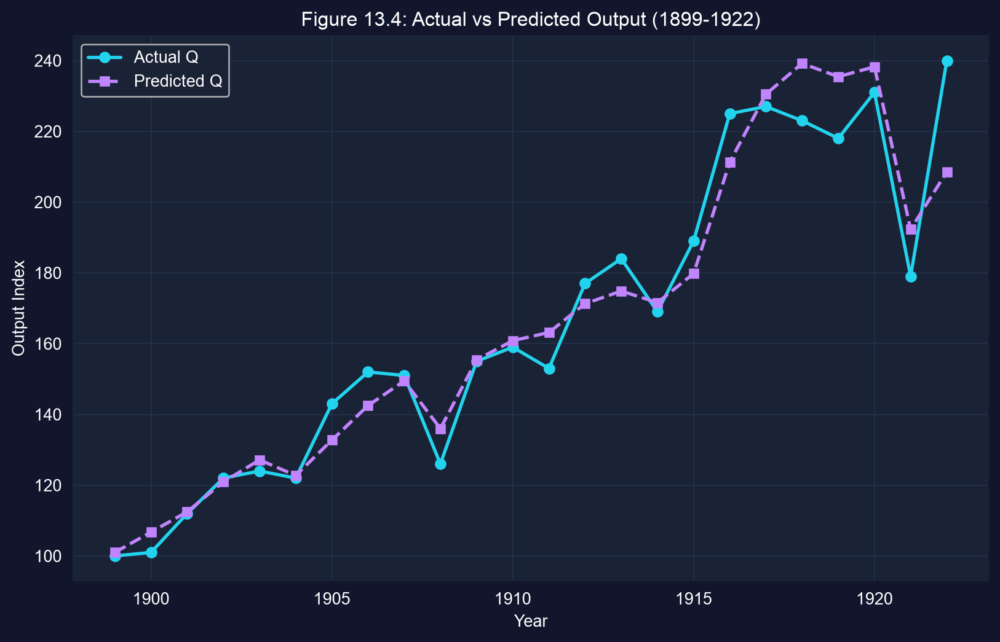

[対数モデルから *水準* を予測するには、指数化し、**かつ** $e^{\hat\sigma^2/2}$ で再スケーリングします。ここでは $\hat\sigma = 0.058$ なので、補正は非常に小さい（×1.0017）です。]{.takeaway .fragment}

::: {.notes}
コード（章内）：se = sqrt(Σû² / (N − k))；q_pred = exp(se²/2) · exp(fitted ln Q)。正規誤差では E[e^u] = e^(σ²/2) > 1 なので、当てはめた対数を単に指数化すると平均水準を過小予測します。ここでは σ̂ = 0.058 なので、係数は1.0017です。予測系列は実績の産出によく追随し、最大のズレは1920–22年の変動にあります。
:::

## 留意点：24個のトレンドのある観測値が謙虚さを求める理由

::: {.incremental}
- **トレンドのある系列**：$Q$、$K$、$L$ はすべて時間とともに上昇するので、$R^2 = 0.957$ の一部は共通トレンドであり、生産関係ではない（見せかけの回帰の懸念）
- **技術を一定とみなす**：$A$ は単一の定数。資本とともに成長した省略された技術進歩は $\hat\beta_K$ に乗り移る
- **小標本**：24個の点、しかもこれほど少ない年数ではHAC SE自体がノイジー
- **集計**：1つの「代表的」製造業部門が多数の産業を代表している
:::

[CRS検定は有益ですが、個別の弾力性は脆弱なものとして扱ってください。]{.takeaway .fragment}

::: {.notes}
これらは集計時系列生産関数の標準的な留意点であって、この章が計算する結果ではありません。見せかけの回帰の問題（あるトレンドのある系列を別のものに回帰する）は時系列の章で扱います。自然な拡張は、技術変化を代理する時間トレンドを加えることですが、このデッキはそれを推定しません。
:::

# ケース13.3 · なぜフィリップス曲線は崩れたのか？ {#case-133 .divider background-color="#7A209F"}

[欠落変数バイアス · 時系列 · HAC標準誤差]{.act}

::: {.notes}
ケース13.3：この章で最も重要な *診断的* ケースです。同じ2つの変数が2つの期間で正反対の傾きを与え、欠落変数バイアスの公式がその理由を正確に説明します。
:::

## 問い：失業とインフレの安定したトレードオフは存在するか？

::: {.incremental}
- **Phillips（1958）**：失業が低いほど賃金インフレが高かったので、政策立案者は *メニュー* を見た：曲線上の一点を選ぶ
- **1970年代のスタグフレーション**：高失業 *かつ* 高インフレが同時に起こり、メニューは崩壊した
- **Friedman–Phelps**：曲線は**期待インフレ**とともにシフトする。期待を外すと曲線は定式化を誤る
:::

$$\text{Inflation}_t = \beta_1 + \beta_2\,\text{Urate}_t + \beta_3\,\text{ExpInflation}_t + u_t$$

[期待インフレがモデルに入るべきものなら、それを省略することは無害ではありません。失業の傾きをゆがめ、反転させることさえあります。]{.takeaway .fragment}

::: {.notes}
データ：AED_PHILLIPS.DTA、米国1949–2014年（66年）。inflgdp = GDPデフレーターによる年間インフレ率（%）；urate = 民間失業率（%）；inflgdp1yr = Survey of Professional Forecastersによる1年先の期待インフレ。このデータセットでは期待系列が1970年以降しか利用できないので、拡張モデルは1970年以降でのみ推定できます。
:::

## コード：1970年以前のフィリップス曲線

``` {.python code-line-numbers="1-3|4-5|6-9|10"}
!pip install -q pyfixest                    # pyfixest is not preinstalled in Colab
import pandas as pd                         # tabular data
import pyfixest as pf                       # OLS with R-style formulas
url = "https://raw.githubusercontent.com/quarcs-lab/data-open/master/AED/AED_PHILLIPS.DTA"
data_phillips = pd.read_stata(url)          # U.S. annual data, 1949–2014
data_pre1970 = data_phillips[data_phillips["year"] < 1970].copy()   # 1949–1969
data_pre1970["_time"] = range(len(data_pre1970))                    # time index for HAC
fit_pre = pf.feols("inflgdp ~ urate", data=data_pre1970,
                   vcov="NW", vcov_kwargs={"time_id": "_time", "lag": 3})  # HAC, 3 lags
fit_pre.summary()                           # slope on unemployment
```

[↗ Colab で試す](https://colab.research.google.com/notebooks/empty.ipynb){.colab-link target="_blank" data-preview-link="false"}

::: {.notes}
自己完結型。21個の年次観測値、1949–1969年、3ラグのNewey–West SE。
:::

## 出力：1970年以前には、トレードオフが存在する {.smaller}

:::: {.columns}
::: {.column width="46%"}
| | 係数 | HAC SE | $p$ |
|:--|--:|--:|--:|
| 切片 | 7.106 | 1.581 | <&nbsp;0.001 |
| `urate` | [−1.030]{.key} | 0.325 | 0.005 |

[N = 21（1949–1969） · NW、3ラグ · $R^2 = 0.454$]{.comment}

失業が1**パーセントポイント**高いことは、インフレが約1.03**パーセントポイント**低いことと関連します。
:::
::: {.column width="54%"}
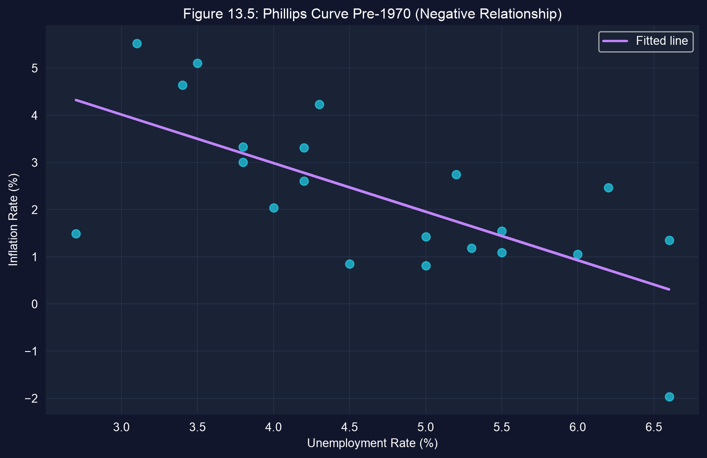
:::
::::

[古典的な右下がりのフィリップス曲線：負で統計的に有意（$p = 0.005$）です。]{.takeaway .fragment}

::: {.notes}
両変数ともパーセントで測られているので、傾きは1パーセントポイントあたりのパーセントポイントであり、比例的な意味での「1%」ではありません。単純な曲線が当時なぜ機能したかについての章の説明：1950–60年代は期待インフレが低く安定していたので、それを省略しても害は小さかった。（このデータセットではSPFの期待系列が1970年に始まるため、それを直接確かめることはできません。）
:::

## コード：1970年以降の同じ回帰

``` {.python code-line-numbers="1-3|4-6"}
# continues from the previous block
data_post1970 = data_phillips[data_phillips["year"] >= 1970].copy()  # 1970–2014
data_post1970["_time"] = range(len(data_post1970))                   # time index for HAC
fit_post = pf.feols("inflgdp ~ urate", data=data_post1970,
                    vcov="NW", vcov_kwargs={"time_id": "_time", "lag": 5})  # HAC, 5 lags
fit_post.summary()                          # has the slope survived?
```

[↗ Colab で試す](https://colab.research.google.com/notebooks/empty.ipynb){.colab-link target="_blank" data-preview-link="false"}

[仕様は同一です。変わるのは期間だけ、そしてそれに伴い、より長い系列のためのラグ長だけです。]{.takeaway .fragment}

::: {.notes}
45個の年次観測値、1970–2014年。この章はより長い系列に5つのNewey–Westラグを使います。
:::

## 出力：1970年以降、傾きの符号が反転する {.smaller}

:::: {.columns}
::: {.column width="46%"}
| | 係数 | HAC SE | $p$ |
|:--|--:|--:|--:|
| 切片 | 1.928 | 1.868 | 0.308 |
| `urate` | [+0.265]{.key} | 0.326 | 0.420 |

[N = 45（1970–2014） · NW、5ラグ · $R^2 = 0.028$]{.comment}

点推定値はいまや**正**ですが、**有意ではなく**（$p = 0.42$）、$R^2$ は0.45から0.03へ崩壊します。
:::
::: {.column width="54%"}
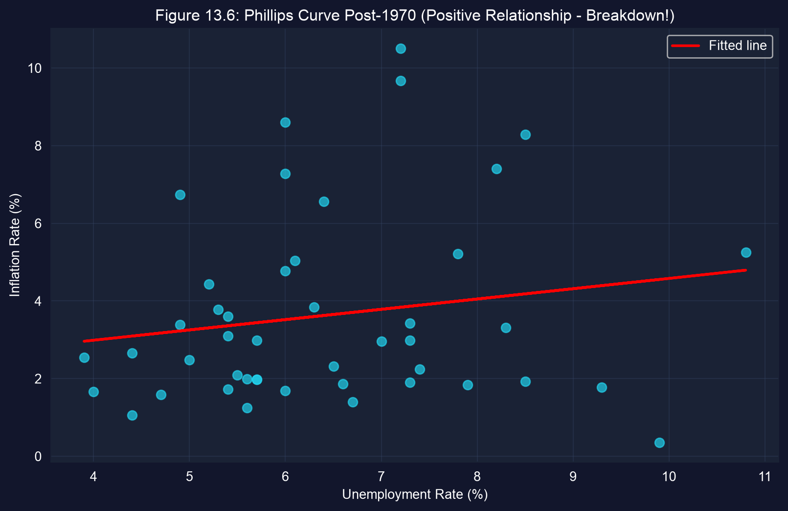
:::
::::

[同じ2つの変数、正反対の符号。経済が変わったのか、それとも二変量モデルが初めから何かを欠いていたのか。]{.takeaway .fragment}

::: {.notes}
キーコンセプト13.4。正確に述べましょう：傾きの符号は反転しますが、ゼロの関係は棄却できません（95% CIは −0.39から +0.92）。スタグフレーションは、高失業かつ高インフレの点として現れます。Friedman–Phelpsの答え：欠けているピースは期待インフレです。
:::

## OVBの公式：省略された説明変数が傾きに何をするか

$$\underbrace{y = \beta_1 + \beta_2 x + \beta_3 z + u}_{\text{long (true) model}} \qquad \underbrace{z = \gamma_1 + \gamma\,x + v}_{\text{auxiliary regression}}$$

. . .

$z$ を長いモデルに代入し、$y$ を $x$ だけに回帰します。

$$E[b_2] = \beta_2 + \underbrace{\beta_3\,\gamma}_{\text{omitted variables bias}}$$

[バイアスは（省略された $z$ の $y$ への効果）×（$z$ が含まれる $x$ とどう動くか）です。これが消えるのは $\beta_3 = 0$ **または** $\gamma = 0$ のときだけです。]{.takeaway .fragment}

::: {.notes}
キーコンセプト13.5。バイアスの方向：sign(β₃) × sign(γ)。zがyを上げ（β₃ > 0）、xとともに上がる（γ > 0）なら、短い傾きは上方にバイアスされ、十分な上方バイアスは負の真の傾きを正に変えうる。同じ標本に対するOLSでは、標本内版 b₂(short) = β̂₂ + β̂₃·γ̂ が期待値だけでなく厳密に成り立ちます。
:::

## コード：期待インフレを加え、次に補助回帰を実行する

``` {.python code-line-numbers="1-4|5-6|7-9|10"}
# continues from the previous block
data_exp = data_post1970.dropna(subset=["inflgdp1yr"]).copy()  # rows with expected inflation
data_exp["_time"] = range(len(data_exp))                       # time index for HAC
fit_augmented = pf.feols("inflgdp ~ urate + inflgdp1yr", data=data_exp,
                         vcov="NW", vcov_kwargs={"time_id": "_time", "lag": 5})  # long model
fit_aux = pf.feols("inflgdp1yr ~ urate", data=data_exp)        # auxiliary: z on x
beta2 = fit_augmented.coef()["urate"]       # true slope on unemployment
beta3 = fit_augmented.coef()["inflgdp1yr"]  # effect of expected inflation
gamma = fit_aux.coef()["urate"]             # how expectations co-move with unemployment
print(beta2 + beta3 * gamma, fit_post.coef()["urate"])  # predicted vs actual short slope
```

[↗ Colab で試す](https://colab.research.google.com/notebooks/empty.ipynb){.colab-link target="_blank" data-preview-link="false"}

::: {.notes}
inflgdp1yrは、Survey of Professional Forecastersによる1年先の期待インフレです。1970年以降の45年すべてで利用できるので、長い・短い・補助の回帰は同じ標本を使い、それが分解を厳密にしています。
:::

## 出力：期待をコントロールすると、負の傾きが戻る {.smaller}

| 変数（長いモデル） | 係数 | HAC SE | $t$ | $p$ | 95% CI |
|:----------------------|------:|------:|----:|----:|:-------------|
| 切片 | 0.270 | 0.634 | 0.43 | 0.672 | [−1.01,&nbsp;1.55] |
| `urate`（$\hat\beta_2$） | [−0.128]{.key} | 0.081 | −1.58 | 0.122 | [−0.29,&nbsp;0.04] |
| `inflgdp1yr`（$\hat\beta_3$） | [1.146]{.key} | 0.085 | 13.48 | <&nbsp;0.001 | [0.97,&nbsp;1.32] |

[N = 45 · NW、5ラグ · $R^2 = 0.881$ · 補助回帰：$\hat\gamma = 0.343$（SE 0.195、$p = 0.086$、既定SE）]{.comment}

[期待インフレが大半の仕事をし（$R^2$ が0.03から0.88へ跳ね上がる）、失業の傾きは再び負になります。]{.takeaway .fragment}

::: {.notes}
β̂₃ ≈ 1.15：実際のインフレは期待インフレとほぼ1対1で動く（この章の「係数 ≈ 1」。β₃ = 1を正式に検定したわけではありません）。β̂₂ = −0.128はフィリップス曲線の符号を持ちますが5%で有意ではありません（p = 0.12）。したがってトレードオフは符号としては回復するものの、確実には立証されていません。γ̂ = 0.343：失業が高い年ほど期待インフレも高かった。
:::

## OVBの算術が符号の反転を厳密に説明する {.smaller}

$$b_2^{\text{short}} = \hat\beta_2 + \hat\beta_3\,\hat\gamma = -0.128 + 1.146 \times 0.343 = +0.265$$

| 部分 | 値 | 意味 |
|:--|--:|:--|
| $\hat\beta_2$ | −0.128 | 期待を固定したうえでの失業の傾き |
| $\hat\beta_3\hat\gamma$ | [+0.393]{.key} | 期待インフレを省略したことによるバイアス |
| $b_2^{\text{short}}$ | +0.265 | 1970年以降の二変量の傾き：厳密に一致 |

[二変量の傾きは、期待インフレの効果の功績を失業に与えていました。バイアス（+0.39）は符号を反転させるほど大きかったのです。]{.takeaway .fragment}

::: {.notes}
この章はこれを「完璧な一致」と呼びます。構成上、完璧です。共通の標本に対するOLSでは分解は代数的恒等式です。その価値は、短い傾きを *帰属させる* ことにあります：真のトレードオフの −0.128 と、欠落変数バイアスの +0.393 です。経済の物語：1970年代の供給ショック（石油）が失業とインフレ期待をともに上げたので γ > 0；そして期待はインフレを押し上げる（β₃ > 0）；したがってバイアスは正です。
:::

## 留意点：トレードオフは符号としては回復するが、証明はされていない

::: {.incremental}
- **不精確さ**：拡張された傾き（$-0.128$、$p = 0.12$）と $\hat\gamma$（$p = 0.086$）は5%で有意ではない
- **測定**：期待インフレは *予測者の調査* であり、賃金・価格設定者が実際に期待したものの代理である
- **同時性**：インフレと失業はどちらも同じショックと政策の結果なので、これは因果的な構造方程式ではない
- **その他の欠落変数**：供給ショックや政策レジームは、なお長いモデルをバイアスさせうる
:::

[OVBの公式は診断ツールです。*名前のついた* 欠落変数によるバイアスの方向と大きさを教えてくれます。名前をつけていない欠落変数を排除することはできません。]{.takeaway .fragment}

::: {.notes}
この章自身も、1970年以降の傾き（p ≈ 0.42）と拡張されたurateの係数（p ≈ 0.12）が有意でないことに触れています。政策論争に対するより広い教訓：いったん期待が調整されると、長期的には利用できるトレードオフはほとんど残らない。これが、中央銀行が期待を固定することに注力する理由です。
:::

# ケース13.4 · 燃費を決めるものは？ {#case-134 .divider background-color="#7A209F"}

[log-logモデル · 26,995台の車両 · クラスター頑健標準誤差]{.act}

::: {.notes}
ケース13.4：車両の大きな横断面です。道具：log-logモデルからの弾力性、そしてグループ化されたデータがなぜクラスター頑健な標準誤差を必要とするか。
:::

## 問い：なぜ燃費はもっと改善しなかったのか？ {.smaller}

:::: {.columns}
::: {.column width="55%"}
**データ。** 1980–2006年に米国で販売された26,995の車種、**39メーカー**から（`AED_AUTOSMPG.DTA`）。対数はデータにあらかじめ計算済みです。

- `mpg`：ガロンあたりマイル（8.7から76.4）
- `curbwt`：ポンド単位の重量（1,450から6,700）
- `hp`, `torque`：エンジン出力と引張力
- `year`：モデル年（技術トレンド）
- `mfr`：メーカー（クラスター化変数）
:::
::: {.column width="45%"}
| 上位メーカー | 車種数 |
|:--|--:|
| GMC | [7,979]{.key} |
| Chrysler | 4,172 |
| Ford | 3,709 |
| Toyota | 1,554 |
| Nissan | 1,079 |
| Volkswagen | 831 |
| Honda | 743 |
:::
::::

[エンジンは改善し続けました。では効率の向上はどこへ行ったのでしょう？ このケースは燃費を車両の属性に結びつけます。]{.takeaway .fragment}

::: {.notes}
政策的背景：石油ショック後の効率需要、CAFE燃費基準、SUVとトラックの台頭、着実なエンジン技術。観測値はモデル単位の記録であり、販売台数で加重されていません。パネルはメーカー間で非常にアンバランスです。GMCだけで7,979行（約30%）、平均は1メーカーあたり約692です。
:::

## 1985年以降、向上は燃費ではなく出力に回された

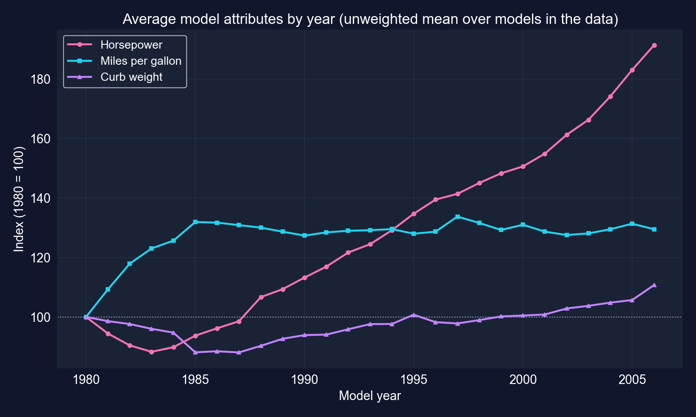

[1985年から2006年にかけて、平均馬力は着実に上昇した一方、平均MPGはほとんど動きませんでした。]{.takeaway .fragment}

::: {.notes}
同じデータから作ったスライド専用の図（モデル年ごとの単純平均）です。1980 → 2006年：mpg 19.4 → 25.2（指数129.5）、hp 126.5 → 242.3（指数191.5）、重量 3,517 → 3,894 lb（指数110.7）。これらは販売加重された車両群の平均ではないので、提供されたモデルの属性として読んでください。
:::

## なぜメーカーでクラスター化するのか？

同じメーカーの車両は、エンジンプラットフォーム、技術チーム、設計思想、試験手法を共有します。ですからその回帰誤差は**メーカー内で相関**します。

. . .

:::: {.columns}
::: {.column width="50%"}
### 既定 / HC1 SEが仮定すること
- 26,995個の**独立な**情報
- 小さすぎるSE、大きすぎる $t$ 統計量
:::
::: {.column width="50%"}
### クラスター頑健（CRV1）SEが許容すること
- 39メーカーそれぞれの**内部**での任意の相関
- メーカー**間**でのみ独立性
:::
::::

[誤差が相関していると、実効的な標本サイズは行数よりクラスター数に近くなります。]{.takeaway .fragment}

::: {.notes}
キーコンセプト13.6。クラスター内相関を無視すると不確実性を過小評価し、誤った棄却につながります。CRV1は、小標本補正を伴うpyfixestの標準的なクラスター頑健推定量です。
:::

## コード：メーカーでクラスター化したSEによるlog-log回帰

``` {.python code-line-numbers="1-3|4-6|7-9|10-11"}
!pip install -q pyfixest                    # pyfixest is not preinstalled in Colab
import pandas as pd                         # tabular data
import pyfixest as pf                       # OLS with R-style formulas
url = "https://raw.githubusercontent.com/quarcs-lab/data-open/master/AED/AED_AUTOSMPG.DTA"
data_auto = pd.read_stata(url)              # 26,995 vehicles, 1980–2006 (logs pre-computed)
print(data_auto[["mpg", "curbwt", "hp", "torque", "year"]].describe())  # summary statistics
print(data_auto["mfr"].value_counts().head(10))                       # observations per maker
# log MPG on log HP, log weight, log torque and a linear year trend
fit_auto = pf.feols("lmpg ~ lhp + lcurbwt + ltorque + year", data=data_auto,
                    vcov={"CRV1": "mfr"})   # cluster-robust SEs by manufacturer
fit_auto.summary()                          # elasticities + clustered SEs
print(data_auto["mfr"].nunique())           # number of clusters: 39
```

[↗ Colab で試す](https://colab.research.google.com/notebooks/empty.ipynb){.colab-link target="_blank" data-preview-link="false"}

::: {.notes}
自己完結型。データセットにはすでにlmpg、lhp、lcurbwt、ltorqueが含まれています。yearは水準で入るので、その係数はエンジンと重量を固定したうえでの、モデル年あたりのMPGの比例的変化です。
:::

## 出力：重量が燃費の支配的な決定要因 {.smaller}

| 変数 | 係数 | CRV1 SE | $t$ | $p$ | 95% CI |
|:--|--:|--:|--:|--:|:--|
| 切片 | −20.843 | 1.988 | −10.48 | <&nbsp;0.001 | [−24.87,&nbsp;−16.82] |
| `lhp` | −0.181 | 0.065 | −2.79 | 0.008 | [−0.31,&nbsp;−0.05] |
| `lcurbwt` | [−0.562]{.key} | 0.057 | −9.94 | <&nbsp;0.001 | [−0.68,&nbsp;−0.45] |
| `ltorque` | −0.141 | 0.064 | −2.21 | 0.033 | [−0.27,&nbsp;−0.01] |
| `year` | [0.0152]{.key} | 0.0011 | 13.84 | <&nbsp;0.001 | [0.013,&nbsp;0.017] |

[N = 26,995 · SEはメーカーでクラスター化（39クラスター） · $R^2 = 0.777$]{.comment}

[重量が最大の弾力性を持ち、year のトレンドは属性を固定したうえでの着実な技術進歩を示します。]{.takeaway .fragment}

::: {.notes}
モデルはlog MPGの変動の78%を説明します。残りは空力、変速機、燃料種別などを反映しています。CIはG − 1 = 38の自由度でクラスター頑健なSEを使っている点に注意してください。
:::

## 弾力性の読み方：技術は重量と出力に「費やされた」

::: {.incremental}
- **重量 −0.56**：出力、トルク、yearを固定すると、1%重い車両は **≈ 0.56% 低いMPG** になる（最大の効果）
- **馬力 −0.18** と **トルク −0.14**：1%の増加あたり、それぞれ ≈ 0.18% と ≈ 0.14% 低いMPG
- **year +0.0152**：重量・出力・トルクを *固定* すると、MPGはモデル年あたり約 **1.5%** 上昇する（$100 \times (e^{0.0152}-1) = 1.53\%$）
- **逆説の解消**：技術トレンドは属性を所与としてMPGを上げ続けた一方、馬力と重量の上昇がそれを引き下げた
:::

[技術者は毎年エンジンをより効率的にし、買い手はその向上を、より強力な（そしてやや重い）車として受け取ったのです。]{.takeaway .fragment}

::: {.notes}
すべての弾力性の言明は、小さな変化に対する近似です（log-logモデル）。yearの係数は準弾力性です：100 × 0.0152 ≈ 1.52% が近似であり、正確な比例的変化は1.53%です。この章からの政策的含意：CAFE遵守において重量は大きく影響する。軽量素材と小型ターボエンジンは後の対応です（データの終了後）。
:::

## クラスター化は標準誤差を6〜9倍大きくする {.smaller}

| 変数 | HC1 SE（クラスターを無視） | CRV1 SE（メーカー別） | 比 |
|:--|--:|--:|--:|
| `lhp` | 0.0071 | 0.0651 | 9.1倍 |
| `lcurbwt` | 0.0080 | 0.0566 | [7.0倍]{.key} |
| `ltorque` | 0.0076 | 0.0640 | 8.4倍 |
| `year` | 0.00017 | 0.0011 | 6.4倍 |

[係数は同じで、変わるのは `vcov` だけです。HC1の比較：`pf.feols("lmpg ~ lhp + lcurbwt + ltorque + year", data=data_auto, vcov="HC1")`]{.comment}

[クラスター化を無視すれば、あらゆる $t$ 統計量が6〜9倍に膨らみます。トルクの効果（クラスター化で $t = 2.21$）は $t \approx 18.6$ に見えてしまうでしょう。]{.takeaway .fragment}

::: {.notes}
この比較はスライド用に計算したもの（同じモデル、同じデータ、vcovだけが異なる）で、クラスター化がSEを増やすという章の記述を定量化します。あるメーカー内の誤差は強く相関しているので、26,995行はその数が示唆するよりはるかに少ない独立な情報しか含みません。ltorqueのHC1 t：−0.1415 / 0.0076 ≈ −18.6。
:::

## 留意点：これは工学的な関連であって因果効果ではない

::: {.incremental}
- **同時の選択**：重量・出力・トルクは設計者によって一緒に選ばれるので、「他がすべて等しいとき1%重い車」はモデル間の比較であって実験ではない
- **少なく、アンバランスなクラスター**：39メーカーで、GMCだけが行の約30%。クラスター頑健な推測は、同程度の大きさのクラスターが多数あるときに最も有効
- **販売加重でない**：販売台数に関わらず、すべてのモデルが等しく数えられる
- **重複するエンジン指標**：馬力とトルクは関連するエンジン特性を捉えるので、それぞれの個別の効果がぼやける
:::

[これらの限界の範囲内では、大きな重量弾力性とyearのトレンドは頑健で、首尾一貫した物語を語ります。]{.takeaway .fragment}

::: {.notes}
標準的な留意点です。クラスターが少ない、あるいは非常に不均等だと、CRV1 SEはなお小さすぎることがあります。ワイルドクラスターブートストラップが通常の対処法です（ここでは扱いません）。この章のキーテイクアウェイは13.4を「高度な因果手法」の下に挙げていますが、これは観察的・記述的な回帰です。因果のためのデザインではなく、道具のケース（クラスター化）です。
:::

# 第II幕-b · 因果を識別する4つのデザイン {.divider background-color="#7A209F"}

[ケース13.5–13.8 · RCT · DiD · RD · IV]{.act}

::: {.notes}
ここからは、各ケースが因果的な問いを立て、それぞれが信頼できる反実仮想を供給するデザインで答えます。推定量は依然としてOLS（または2SLS）です。変わるのは、なぜ私たちがその傾きを信じるのか、です。
:::

## なぜ生の比較は因果効果ではないのか

$$\underbrace{E[Y \mid D{=}1] - E[Y \mid D{=}0]}_{\text{observed difference}} = \underbrace{E[Y_1 - Y_0 \mid D{=}1]}_{\text{effect on the treated (ATT)}} + \underbrace{E[Y_0 \mid D{=}1] - E[Y_0 \mid D{=}0]}_{\text{selection bias}}$$

[$Y_1$、$Y_0$：処置ありと処置なしの潜在的結果。各単位について、私たちは常にそのうち一方しか観測しません。もう一方が**反実仮想**です。]{.comment}

[この幕のすべてのデザインは、**選択バイアス**の項をゼロへ追い込むための戦略です。]{.takeaway .fragment}

::: {.notes}
選択バイアスは、処置がなくても処置群と非処置群が示したであろう差です。観察データでは一般にゼロではありません：手厚い保険を買う人は医療が必要になると予想している；勝った政党はもともと強かった；豊かな国は良い制度を賄える。これは潜在的結果の言い方による「交絡」です。
:::

## 反実仮想を構築する4つの方法 {.smaller}

| デザイン | 反実仮想がどこから来るか | ケース |
|:--|:--|:--|
| **RCT** | 無作為に割り当てられた対照群 | 13.5 RAND医療保険 |
| **差の差分法** | 対照群の時間を通じた *変化* | 13.6 南アフリカの診療所 |
| **回帰不連続** | カットオフのちょうど反対側の単位 | 13.7 上院選挙 |
| **操作変数** | 操作変数のみによって駆動される処置の変動 | 13.8 植民地期の制度 |

[各デザインは、検証不能な「すべてをコントロールした」を、議論できる1つの特定の仮定に置き換えます。]{.takeaway .fragment}

::: {.notes}
この表を念頭に置いてください。デッキ末尾の総括で、各デザインについて識別仮定、推定対象、主な脅威を加えます。
:::

# ケース13.5 · 費用分担は医療支出を減らすか？ {#case-135 .divider background-color="#7A209F"}

[ランダム化比較試験 · RAND医療保険実験 · 家族でクラスター化したSE]{.act}

::: {.notes}
ケース13.5：ゴールドスタンダードです。道具：処置ダミーへの回帰、クラスター頑健な共分散を用いた同時F検定、そして無作為割当の論理。
:::

## 問い：医療が安くなると医療が増えるのか？

**モラルハザード**：保険が利用時点で医療を安くするなら、人々はより多く利用するのか？ その問いは、免責額や自己負担をめぐるあらゆる議論を貫いています。

. . .

**なぜ観察データでは不十分か。** 人々は自分で保険を *選ぶ* からです。

- 病気になると予想する人ほど、より手厚いプランを買う
- 所得・教育・健康はすべて、プランの選択と支出の両方に影響する

[観察データでは、「手厚いプラン → 高い支出」はプランの効果と**誰が選んだか**を混ぜ合わせています。]{.takeaway .fragment}

::: {.notes}
逆の因果もあります：健康状態が保険の選択に影響します。したがって自分で選んだプラン間で支出を比べると、効果に選択バイアスを足したものを推定することになり、両者を分離する術がありません。
:::

## デザイン：保険プランへの無作為割当

:::: {.columns}
::: {.column width="52%"}
**RAND医療保険実験（1974–1982）**

- 家族をプランに**無作為割当**
- 共同保険（自己負担する請求額の割合）：**0%（無料医療）**、25%、25/50%混合、50%、95%、または個人免責額
- 3〜5年間追跡
:::
::: {.column width="48%"}
**なぜ機能するか**

- 割当は健康・所得・選好から独立
- だからグループは**期待において**同一
- 選択バイアス $= 0$（**期待において**）なので、平均の差が各プラン対無料医療の**因果効果**を推定する
:::
::::

[無作為化はグループを厳密に等しくはしません。*処置の前の* あらゆる差を純粋な偶然にします。それは標準誤差がすでに織り込んでいることです。]{.takeaway .fragment}

::: {.notes}
キーコンセプト13.7。推定対象：実験参加者の中で、無料医療ではなくプランjに割り当てられることの平均効果。家族（個人ではなく）が割り当てられたので、同じ家族のメンバーの結果は相関します。ゆえに家族でクラスター化したSEです。
:::

## データ：実験の1年目 {.smaller}

| | 値 |
|:--|--:|
| 人・年の観測値、全年 | 20,203 |
| 使用した観測値（1年目のみ） | [5,639]{.key} |
| 1年目の家族（クラスター） | 1,930 |
| 年間支出の中央値（2011年 \$） | \$479 |
| 最大の年間支出 | \$175,831 |

[結果変数 `spending` = 入院・外来の医療支出（2011年ドル）。プランダミー：`coins25`, `coinsmixed`, `coins50`, `coins95`, `coinsindiv`；無料医療は省略された基準。]{.comment}

[支出は極端に歪んでいる（中央値 \$479、最大 \$175,831）ので、グループ平均はノイジーになります。]{.takeaway .fragment}

::: {.notes}
この章は教科書に従い、1年目のみを使います。重い右の裾（ごく少数の非常に高額な入院）が、一部のプラン平均が不正確になる理由であり、とくに小さなグループで顕著です。
:::

## コード：実験を読み込み、プラン別の平均支出を比較する

``` {.python code-line-numbers="1-3|4-6|7-8"}
!pip install -q pyfixest                    # pyfixest is not preinstalled in Colab
import pandas as pd                         # tabular data
import pyfixest as pf                       # OLS with R-style formulas
url = "https://raw.githubusercontent.com/quarcs-lab/data-open/master/AED/AED_HEALTHINSEXP.DTA"
data_health = pd.read_stata(url)            # RAND HIE, all years (20,203 person-years)
data_health_y1 = data_health[data_health["year"] == 1]   # first year only: 5,639 obs
spending_by_plan = data_health_y1.groupby("plan")["spending"].agg(["mean", "std", "count"])
print(spending_by_plan)                     # mean, SD and size of each randomized group
```

[↗ Colab で試す](https://colab.research.google.com/notebooks/empty.ipynb){.colab-link target="_blank" data-preview-link="false"}

[無作為割当があれば、このグループ平均の単純な表はすでに因果的な比較になっています。]{.takeaway .fragment}

::: {.notes}
自己完結型。groupby("plan")は無作為化された各アームごとに1行を返します。標準偏差に注目してください：50%プランのSDは ≈ $11,644 で、隣接プランの約3倍です。ごく少数の超高額支出者のためです。
:::

## 出力：無料医療が最も支出が多い

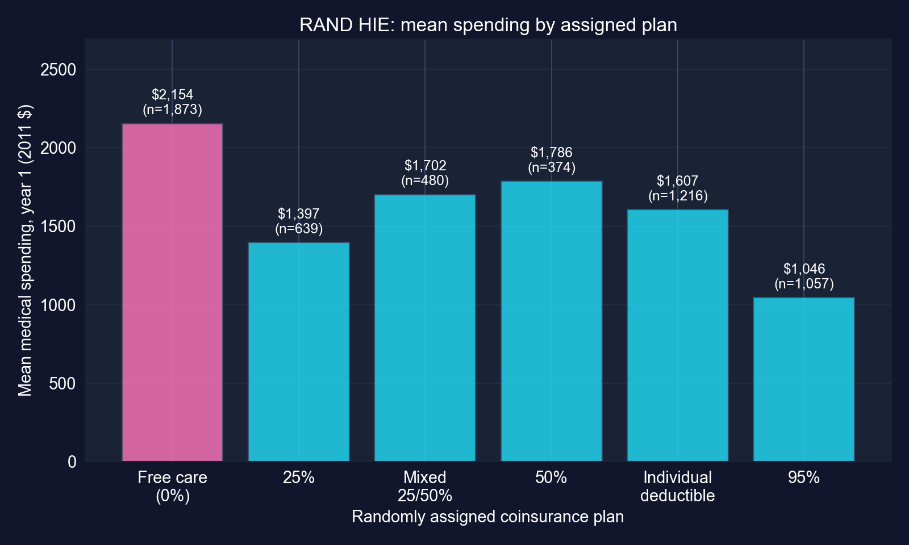

[すべての費用分担プランが無料医療より支出が少なく、95%プランは約半分です。]{.takeaway .fragment}

::: {.notes}
章のグループ平均から作ったスライド専用の図です：無料医療 $2,154（n = 1,873）；25% $1,397（639）；混合 $1,702（480）；50% $1,786（374）；個人免責額 $1,607（1,216）；95% $1,046（1,057）。順序は共同保険率に対して完全には単調ではありません（50% > 25%）：次のスライドで50%グループがランク付けするには不正確すぎることを示します。
:::

## コード：家族でクラスター化したSEによるRCT回帰

``` {.python code-line-numbers="1-3|4"}
# continues from the previous block
# spending on plan dummies; free care (coins0) is the omitted baseline
fit_rct = pf.feols("spending ~ coins25 + coins50 + coins95 + coinsmixed + coinsindiv",
                   data=data_health_y1, vcov={"CRV1": "idfamily"})  # cluster by family
fit_rct.summary()                           # each coefficient = plan mean − free-care mean
```

[↗ Colab で試す](https://colab.research.google.com/notebooks/empty.ipynb){.colab-link target="_blank" data-preview-link="false"}

[グループダミーの完全な集合に対する回帰は、グループ平均を厳密に再現します：切片 = 基準の平均、傾き = そこからの差です。]{.takeaway .fragment}

::: {.notes}
確認：切片 2,153.57 = 無料医療の平均；2,153.57 − 1,107.75 = 1,045.82 = 95%プランの平均。回帰はクラスター化された標準誤差と同時検定の枠組みを加えます。
:::

## 出力：ほとんどの費用分担プランが支出を有意に削減する {.smaller}

| 変数 | 係数（\$） | CRV1 SE | $t$ | $p$ | 95% CI | 基準に対する% |
|:--|--:|--:|--:|--:|:--|--:|
| 切片（無料医療） | 2,153.57 | 118.31 | 18.20 | <&nbsp;0.001 | [1,921.5,&nbsp;2,385.6] | — |
| `coins25` | −756.91 | 190.04 | −3.98 | <&nbsp;0.001 | [−1,129.6,&nbsp;−384.2] | −35% |
| `coins50` | −367.72 | 618.04 | −0.59 | [0.552]{.key} | [−1,579.8,&nbsp;844.4] | −17% |
| `coins95` | [−1,107.75]{.key} | 150.37 | −7.37 | <&nbsp;0.001 | [−1,402.6,&nbsp;−812.9] | −51% |
| `coinsmixed` | −451.70 | 239.42 | −1.89 | 0.059 | [−921.3,&nbsp;17.9] | −21% |
| `coinsindiv` | −546.50 | 162.15 | −3.37 | <&nbsp;0.001 | [−864.5,&nbsp;−228.5] | −25% |

[プラン：`coins25` 25% · `coins50` 50% · `coins95` 95% · `coinsmixed` 25/50% · `coinsindiv` 個人免責額 · N = 5,639 · SEは家族でクラスター化（1,930） · $R^2 = 0.007$]{.comment}

[3つのプランは明らかに無料医療を下回ります。50%プランは有意に異なり**ません**（$p = 0.55$）：そのCIは $-\$1{,}580$ から $+\$844$ にわたります。]{.takeaway .fragment}

::: {.notes}
%列 = 係数 / 無料医療の平均。50%プランの巨大なSE（618、他は150–240）は、その小さなサイズ（374）と極端な外れ値（SD ≈ $11,644）から来ています。混合25/50%は境界線上（p = 0.059）です。「すべてのプランが支出を減らす」と言うのではなく、不正確な推定値は誠実に報告してください。
:::

## コード + 出力：プランは同時に意味を持つか？

``` {.python code-line-numbers="1-4|5-8|9-10"}
# continues from the previous block
import numpy as np                          # matrix algebra
from scipy.stats import f as f_dist         # F distribution
coef_names = ["coins25", "coins50", "coins95", "coinsmixed", "coinsindiv"]
coefs = np.array([fit_rct.coef()[c] for c in coef_names])        # the 5 plan effects
idx = [list(fit_rct.coef().index).index(c) for c in coef_names]  # their positions
V_sub = fit_rct._vcov[np.ix_(idx, idx)]     # clustered covariance of the 5 effects
f_val = coefs @ np.linalg.inv(V_sub) @ coefs / len(coef_names)   # Wald F statistic
p_val = 1 - f_dist.cdf(f_val, len(coef_names), fit_rct._N - len(fit_rct.coef()))
print(f_val, p_val)                         # H0: all five plan effects = 0
```

[↗ Colab で試す](https://colab.research.google.com/notebooks/empty.ipynb){.colab-link target="_blank" data-preview-link="false"}

[結果：$F = 11.39$、$p < 0.001$。保険の手厚さが無関係だという仮説を棄却します：**プランの設計は支出を因果的に変える**のです。]{.takeaway .fragment}

::: {.notes}
H0：5つのプラン係数すべてがゼロ（どのプランも無料医療と異ならない）。F(5, 5,633) = 11.39、p ≈ 6 × 10⁻¹¹。Wald統計量はクラスター頑健な共分散行列を使うので、同時検定はクラスター化されたSEと整合します。
:::

## 解釈：モラルハザードは実在し、しかも中程度である

::: {.incremental}
- **因果的な読み**：プランは無作為化されたので、95%プランの −\$1,108 は、無料医療ではなく95%共同保険に直面することの *効果* であり、1年目に約 **51%少ない** 支出である
- **大きさ**：費用分担は支出をプランに応じておよそ4分の1から2分の1削減する。それは意味があるが劇的ではない
- **$R^2 = 0.007$ は因果性とは無関係**：個人の健康ショックが支出変動の大半を駆動する。低い $R^2$ は個人をうまく予測できないことを意味するのであって、効果にバイアスがあるわけではない
- **政策**：無料医療は利用を増やす。費用分担はコストを下げるが、*必要な* 医療も削減しかねない
:::

[RCTは平均の差を因果効果に変えます。残る問題は、バイアスではなく精度です。]{.takeaway .fragment}

::: {.notes}
この章は低いR²が「実はよいこと」だと言います。より正確には、R²は因果効果の識別には無関係です。無作為化はR²に関わらず不偏性を保証します。低いR²は結果に他の変動が多いことを意味するだけです。RAND の結果は米国の医療保険設計を形作りました（Medicare/Medicaidの費用分担、後のACA論争）。
:::

## RCTへの脅威：それでも何がうまくいかなくなりうるか

::: {.incremental}
- **脱落**：自分のプランを嫌う家族が脱落すると（重い費用分担のもとでより起こりやすい）、残ったグループはもはや比較可能でない
- 登録時の**不遵守と拒否**は、無作為化が作った均衡を崩しうる
- **均衡チェック（この章では実行していない）**：ベースラインの年齢・所得・健康をプラン間で比較する。偶然によってのみ異なるべき
- **外的妥当性**：1970年代の米国6サイト。医療はそれ以来変わった
- **倫理とコスト**：保険を無作為化することはめったに可能でない。それが次の3つのデザインが存在する理由
:::

[無作為化は、*実験に参加した人々にとっての* 効果を識別します。その信頼性は、無作為化されたグループを無傷に保つことに依存します。]{.takeaway .fragment}

::: {.notes}
標準的なRCTの留意点です。Aron-Dine、Einav、Finkelstein（2013、Journal of Economic Perspectives）はRAND実験を再検討し、プラン間での脱落や拒否の差を論じています。データセットにはベースライン共変量（age、famincome、educ、健康状態）が含まれるので、均衡表は容易な演習です。
:::

# ケース13.6 · 無料医療は子どもの栄養を改善したか？ {#case-136 .divider background-color="#7A209F"}

[差の差分法 · 南アフリカ、1993年 vs 1998年 · コミュニティでクラスター化したSE]{.act}

::: {.notes}
ケース13.6：無作為化はありませんが、より曝露された/されていないコミュニティ間の前後比較です。道具：2×2のDiD表、交互作用回帰、平行トレンドの仮定。
:::

## 問い：1994年の医療改革は子どもの栄養を改善したか？

- **政策（1994年）**：アパルトヘイト後の南アフリカは、公的なプライマリケアを**幼い子どもと妊婦に無料**にした（Tanaka 2014が研究）
- **誰が恩恵を受けうるか**：無料医療は、診療所が手の届く範囲にある場合にのみ役立つ
- **処置群**：**1993年に診療所があった**コミュニティの子ども（`hightreat = 1`）；比較群：診療所がなかったコミュニティの子ども
- **結果変数**：`waz`、**年齢別体重の $z$ スコア**、子どもの栄養の標準的な尺度

[改革への曝露は、子どもがどこに住んでいたかに依存しました。それが自然な処置群と比較群を与えます。]{.takeaway .fragment}

::: {.notes}
データ：AED_HEALTHACCESS.DTA、農村部のKwaZulu-Natalの0〜4歳児1,071人、1993年（前）と1998年（後）に調査、54コミュニティ；出典Tanaka（2014、AEJ: Economic Policy）。データセットはhightreatを「1993年にコミュニティに診療所があれば = 1」とラベル付けしています。（この章は「多くの新しい診療所を得たコミュニティ」と語りますが、スライドはデータセットのラベルと出典論文に従います：処置の強度は、新たに無料になった医療への既存の診療所アクセスです。）1993年と1998年の子どもは別の子ども（0〜4歳の2つのコホート）であり、同じ子どもを追跡したものではない点に注意してください。
:::

## デザイン：水準の差と共通トレンドの両方を差し引く

| グループ | 1993年（前） | 1998年（後） | 変化 |
|:--|:-:|:-:|:-:|
| 高処置（診療所あり） | $\bar Y_{T,0}$ | $\bar Y_{T,1}$ | $\Delta_T$ |
| 低処置（診療所なし） | $\bar Y_{C,0}$ | $\bar Y_{C,1}$ | $\Delta_C$ |

$$\text{DiD} = (\bar Y_{T,1} - \bar Y_{T,0}) - (\bar Y_{C,1} - \bar Y_{C,0}) = \Delta_T - \Delta_C$$

[最初の差分はコミュニティ間の恒久的な差を取り除きます。2つめの差分は、全員に共通する変化（全国的なトレンド、経済）を取り除きます。]{.takeaway .fragment}

::: {.notes}
キーコンセプト13.8。識別仮定、**平行トレンド**：改革がなければ、処置コミュニティの平均wazは比較コミュニティと同じ量（Δ_C）だけ変化したであろう。推定対象：処置群に対する平均効果（ATT）、すなわち診療所アクセスのあるコミュニティの子ども。
:::

## コード：2×2の平均の表と、手計算のDiD

``` {.python code-line-numbers="1-3|4-6|7-11|12"}
!pip install -q pyfixest                    # pyfixest is not preinstalled in Colab
import pandas as pd                         # tabular data
import pyfixest as pf                       # OLS with R-style formulas
url = "https://raw.githubusercontent.com/quarcs-lab/data-open/master/AED/AED_HEALTHACCESS.DTA"
data_access = pd.read_stata(url)            # 1,071 children aged 0–4; 1993 and 1998
print(data_access.groupby(["hightreat", "post"])["waz"].agg(["mean", "count"]))  # 2×2 means
m = data_access.groupby(["hightreat", "post"])["waz"].mean()  # the four cell means
pre_control, post_control = m[(0, 0)], m[(0, 1)]   # no clinic: 1993, 1998
pre_treat, post_treat = m[(1, 0)], m[(1, 1)]       # clinic: 1993, 1998
did_estimate = (post_treat - pre_treat) - (post_control - pre_control)
print(post_control - pre_control, post_treat - pre_treat, did_estimate)  # ΔC, ΔT, DiD
```

[↗ Colab で試す](https://colab.research.google.com/notebooks/empty.ipynb){.colab-link target="_blank" data-preview-link="false"}

::: {.notes}
自己完結型で、章のコード（各セル平均をブールフィルタで計算する）と同等です。hightreatとpostは0/1の指標変数、postXhigh = post × hightreat もデータにあります。
:::

## 出力：処置群は0.52だけ余分に改善した {.smaller}

| 平均 `waz`（n） | 1993年（前） | 1998年（後） | 変化 |
|:--|:-:|:-:|:-:|
| 低処置（診療所なし） | −0.414（325） | −0.069（288） | +0.345 |
| 高処置（診療所あり） | −0.545（246） | 0.321（212） | +0.867 |
| **差（高 − 低）** | −0.131 | +0.391 | [+0.522]{.key} |

[DiD $= 0.867 - 0.345 = 0.522$。同じ数が2つの *列* の差としても現れます：$0.391 - (-0.131) = 0.522$。]{.comment}

[診療所のあるコミュニティの子どもはわずかに *後れて* 始まり、明らかに先んじて終わり、比較群より0.52だけ多く向上しました。]{.takeaway .fragment}

::: {.notes}
両グループとも向上しました（子どもの栄養はどこでも改善していました）。比較群の +0.345 は、改革がなければ処置群に何が起きたかの推定値です。それを引くと0.522が残ります。
:::

## 単純 vs デザイン：2つの近道、2つの異なるバイアス {.smaller}

| 比較 | 推定値 | 何を誤るか |
|:--|--:|:--|
| 後のみの差（1998年：高 − 低） | 0.391 | 処置群の子どもが0.131**低く**始まったことを無視するので、**下方に**バイアス |
| 前後、処置群のみ | 0.867 | **共通の**向上（+0.345）を改革の功績にするので、**上方に**バイアス |
| **差の差分法** | [0.522]{.key} | ベースラインの差と共通トレンドの両方を取り除く |

[各単一の差は、1つの交絡因子で汚染されています。2つの差分の両方を使えば両方を取り除けます。]{.takeaway .fragment}

::: {.notes}
どちらの単純な数も2×2表から直接得られます（新たな推定はなし）。前後の推定値（0.867）はDiDより66%大きく、後のみの差（0.391）は25%小さい。これは「OLS vs デザイン」の筋道です：単純な比較は、デザインなしで報告してしまうであろうものです。
:::

## コード：交互作用項を持つ回帰としてのDiD

``` {.python code-line-numbers="1-3|4-5"}
# continues from the previous block
# waz on group, period and their interaction (postXhigh = post × hightreat)
fit_did = pf.feols("waz ~ hightreat + post + postXhigh", data=data_access,
                   vcov={"CRV1": "idcommunity"})   # cluster by community (54 clusters)
fit_did.summary()                           # postXhigh = the DiD estimate
print(fit_did.coef()["postXhigh"], did_estimate)   # identical: 0.522 and 0.522
```

[↗ Colab で試す](https://colab.research.google.com/notebooks/empty.ipynb){.colab-link target="_blank" data-preview-link="false"}

[回帰は同じ0.522を与え、さらにコミュニティ内の相関を織り込んだ標準誤差を与えます。]{.takeaway .fragment}

::: {.notes}
処置はコミュニティ水準で変動し、同じコミュニティの子どもは観測されないショックを共有するので、コミュニティでクラスター化します。回帰形式は共変量やより多くの期間へ自然に拡張できます。
:::

## 出力：すべての係数が2×2表の1つのセル {.smaller}

| 変数 | 係数 | CRV1 SE | $t$ | $p$ | 95% CI | 2×2表での対応 |
|:--|--:|--:|--:|--:|:--|:--|
| 切片 | −0.414 | 0.115 | −3.60 | 0.001 | [−0.645,&nbsp;−0.183] | 対照、1993年 |
| `hightreat` | −0.131 | 0.197 | −0.67 | 0.508 | [−0.526,&nbsp;0.264] | ベースラインの差 |
| `post` | 0.345 | 0.137 | 2.52 | 0.015 | [0.070,&nbsp;0.620] | 共通トレンド（$\Delta_C$） |
| `postXhigh` | [0.522]{.key} | 0.235 | 2.22 | [0.031]{.key} | [0.050,&nbsp;0.994] | **DiD** |

[N = 1,071 · SEはコミュニティでクラスター化（54クラスター） · $R^2 = 0.040$]{.comment}

[ベースラインの差は小さく非有意（$p = 0.51$）で、DiD効果は5%で有意（$p = 0.031$）ですが、そのCIは広いです。]{.takeaway .fragment}

::: {.notes}
読み方のガイド：切片 = 対照群の前の平均；hightreat = 1993年の処置 − 対照；post = 対照の1993→1998年の変化；postXhigh = 処置群の余分な変化。非有意なベースラインの差は心強い（改革前にグループは似ていた）ものの、平行トレンドの検定ではありません。
:::

## 反実仮想：処置群がどこにいたであろうか

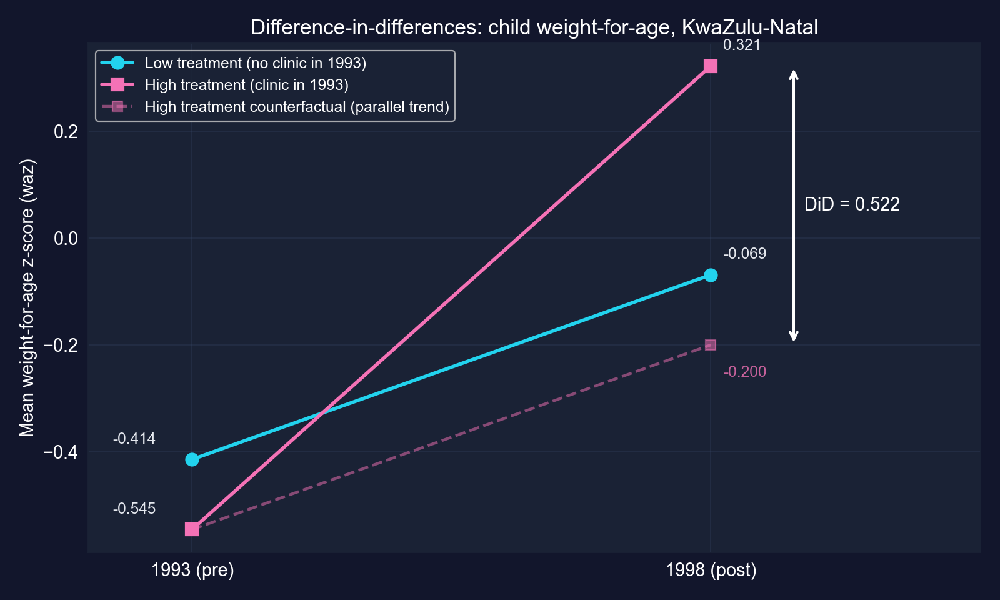

[効果は、実際に起きたこと（0.321）と平行トレンドの反実仮想（−0.200）との間の垂直の差であり、それは0.522です。]{.takeaway .fragment}

::: {.notes}
4つのセル平均から作ったスライド専用の図です。破線は、可視化された仮定です：比較群の傾きを借りています。もし処置コミュニティがすでにより急な経路にあったなら、破線は誤りであり、推定値もそうです。
:::

## 解釈：大きな効果、不精確に測定されている

::: {.incremental}
- **単位**：`waz` は *基準となる成長標準* のSD単位で測られるので、効果は **+0.52 $z$ 単位** である。この標本では `waz` のSDは1.59なので、それは約 **0.33標本SD** に相当する
- **有意性**：$p = 0.031$ なので、5%で「効果なし」を棄却する
- **精度**：95% CIは **[0.05, 0.99]**；データは、無視できる効果から非常に大きな効果まで、何でも支持する
- **因果的な主張**：**平行トレンドが成り立つ場合の**、診療所コミュニティの子どもに対する改革の効果
:::

[DiDは信頼できる *方向* ともっともらしい大きさを与えます。54コミュニティでは、精度は中程度です。]{.takeaway .fragment}

::: {.notes}
この章は0.52「SD」と言いますが、zスコアはこの標本ではなく基準となる母集団に対して標準化されています。この標本の散らばり（SD 1.59）に対しては効果は約3分の1 SDで、なお相当なものです。この章の言い換え（例「25パーセンタイルから45パーセンタイルへ」「6〜12か月の成長」）は単位SDの分布を仮定しておりデータから計算されていないので、ここでは繰り返しません。低いR²（0.04）は識別とは無関係です。
:::

## 脅威：平行トレンドは2期間では検定できない

::: {.incremental}
- **ここでは検定不能**：前期間が1つしかないので、1994年 *より前* にグループがともにトレンドしていたかを確認できない（前期間が増えればイベントスタディ型のチェックが可能）
- **異なる場所**：診療所のあるコミュニティは異なるかもしれず（道路、水、所得）、いずれにせよより速く改善していた可能性がある
- **同時並行の変化**：診療所コミュニティを優遇した1994年以降の他のプログラムは、改革の効果として数えられてしまう
- **構成の変化**：1993年と1998年で異なる子どもが測定されている。処置コミュニティに誰が住むかが変われば、平均も変わる
- **推測**：54クラスターなので、CRV1 SEは妥当だが厳密ではない
:::

[すべてのDiD推定値は破線に依存します。制度的知識、プレトレンド、プラセボ検定でそれを弁護してください。]{.takeaway .fragment}

::: {.notes}
標準的なDiDの脅威です。出典研究（Tanaka 2014）は反証演習を報告しています：改革前の既存トレンドなし、適格でなかった子どもへの効果なし。これらはこの章では実行していません。この章の妥当性の証拠のリスト（「必要性に基づく配置」「他のプログラムなし」）は、データで示されるのではなく主張されています。
:::

# ケース13.7 · 政党は上院議席を保持することで有利になるか？ {#case-137 .divider background-color="#7A209F"}

[回帰不連続 · 米国上院選挙、1914–2010年 · HC1標準誤差]{.act}

::: {.notes}
ケース13.7：鋭いカットオフ（得票の50%が誰が勝つかを決める）が、接戦における現職性にほぼ無作為な変動を作り出します。道具：ランニング変数、カットオフ、RD回帰、推定値の局所性。
:::

## 問い：現職の優位性は存在するか？

議席を保持する政党は、再びそれを勝ち取る傾向があります。しかしそれは、**議席を保持することが役立つ**からでしょうか、それとも**勝った政党がそもそも強かった**からでしょうか？

. . .

**データ**（`AED_INCUMBENCY.DTA`）：米国上院選挙1,390回、1914–2010年

- `margin`：選挙 $t$ における**民主党の勝利マージン**（パーセントポイント、−100から+100）
- `win` $= 1$ なら `margin` $> 0$（民主党が議席を勝ち取った）
- `vote`：その議席の *次の* 選挙、$t+1$ における**民主党の得票シェア**（欠損なし1,297）

[単位は *政党の* 議席なので、このケースは**政党の**現職優位性を測ります：前回その議席を勝ち取ったことによる民主党への利得です。]{.takeaway .fragment}

::: {.notes}
この章は問いを候補者の現職優位性として表現しています。データセットのラベルは、結果が次の選挙での民主党の得票シェアであり、ランニング変数が選挙tでの民主党マージンであることを示しているので、推定対象は政党水準の現職効果です（Lee 2008の下院研究のように）。候補者は再出馬するかもしれないし、しないかもしれません。
:::

## デザイン：かろうじて勝った選挙とかろうじて負けた選挙を比べる

:::: {.columns}
::: {.column width="50%"}
- **ランニング変数**：`margin`
- **カットオフ**：`margin` $= 0$
- **処置**：勝利。これはカットオフで *鋭く* オンになる
- **鍵となる仮定、連続性**：処置がなければ、平均的な結果はカットオフを通じて *滑らかに* 変化するであろう
:::
::: {.column width="50%"}
$$\text{vote}_{t+1} = \beta_1 + \beta_2\,\text{win}_t + \beta_3\,\text{margin}_t + u$$

[$\beta_2$ は、マージンの滑らかな効果をコントロールしたうえでの、margin $= 0$ における結果の**ジャンプ**です。]{.comment}
:::
::::

[50%のほんのわずかの範囲内では、誰が勝つかはコイン投げに近いので、勝者と敗者は勝利という点を *除いて* 比較可能です。]{.takeaway .fragment}

::: {.notes}
キーコンセプト13.9。推定対象：カットオフ *における* 勝利の効果、すなわち接戦に対するもの。構成上、局所的です。この章の仕様は、カットオフの両側に1つの共通の傾きを課し、マージンの値に関わらずすべての選挙を使います。
:::

## 単純 vs デザイン：すべての勝者とすべての敗者を比べるのはひどくバイアスされている {.smaller}

| 比較 | 次の選挙の民主党得票シェア | 差 |
|:--|:-:|--:|
| 民主党が**勝った**議席（702） | 62.6% | |
| 民主党が**負けた**議席（595） | 40.9% | |
| **単純な差** | | [21.7 pp]{.key} |
| **カットオフでのRD推定値**（次のスライド） | | 4.8 pp |

[生の21.7ポイントの差の大半は**選択**です：民主党が余裕で勝つ州は、現職であろうとなかろうと、民主党に投票し続けるでしょう。]{.takeaway .fragment}

::: {.notes}
単純な差 = win = 1 と win = 0 の選挙の平均 `vote` の単純な差（同じ1,297観測値；スライド用に計算）。RD推定値はその4分の1未満です。これがデザインが取り除く選択バイアスです。
:::

## コード：RD回帰

``` {.python code-line-numbers="1-3|4-6|7-8|9-11"}
!pip install -q pyfixest                    # pyfixest is not preinstalled in Colab
import pandas as pd                         # tabular data
import pyfixest as pf                       # OLS with R-style formulas
url = "https://raw.githubusercontent.com/quarcs-lab/data-open/master/AED/AED_INCUMBENCY.DTA"
data_incumb = pd.read_stata(url)            # 1,390 Senate elections, 1914–2010
print(data_incumb[["vote", "margin", "win"]].describe())   # running variable and outcome
data_rd = data_incumb[data_incumb["vote"].notna()].copy()  # keep races with a t+1 outcome
naive = data_rd.groupby("win")["vote"].mean()               # naive: winners vs losers
fit_rd = pf.feols("vote ~ win + margin", data=data_rd, vcov="HC1")  # jump + linear margin
fit_rd.summary()                            # win coefficient = discontinuity at 0
print(fit_rd.confint().loc["win"])          # 95% CI for the jump
```

[↗ Colab で試す](https://colab.research.google.com/notebooks/empty.ipynb){.colab-link target="_blank" data-preview-link="false"}

::: {.notes}
自己完結型。8行目は前のスライドで使った単純な比較を加えます。残りは章のコードです。93回の選挙に次の選挙の結果がなく、除外されます（1,390 → 1,297）。
:::

## 出力：かろうじて勝つと、次回に約4.8パーセントポイント上乗せされる {.smaller}

| 変数 | 係数 | HC1 SE | $t$ | $p$ | 95% CI |
|:--|--:|--:|--:|--:|:--|
| 切片 | 47.331 | 0.526 | 89.95 | <&nbsp;0.001 | [46.30,&nbsp;48.36] |
| `win` | [4.785]{.key} | 0.860 | 5.56 | <&nbsp;0.001 | [3.10,&nbsp;6.47] |
| `margin` | 0.348 | 0.017 | 20.42 | <&nbsp;0.001 | [0.315,&nbsp;0.381] |

[N = 1,297 · HC1 SE · $R^2 = 0.578$]{.comment}

::: {.incremental}
- **かろうじて負けた**（margin $\to 0^-$）：予測される次回の民主党シェア **47.3%**
- **かろうじて勝った**（margin $\to 0^+$）：47.3 + 4.8 = **52.1%**
- 今回のマージンが1ポイント増えるごとに：次回 **+0.35ポイント**（仮定により両側で）
:::

[カットオフでのジャンプは4.8%ではなく4.8**パーセントポイント**であり、精密に推定されています。]{.takeaway .fragment}

::: {.notes}
結果変数はパーセントの得票シェアなので、効果はパーセントポイントで表されます。「4.8%」（この章が所々で使う言い回し）は4.8%の比例的増加を意味し、異なる、誤った言明です。95% CI：3.1から6.5 pp。
:::

## 不連続を可視化する

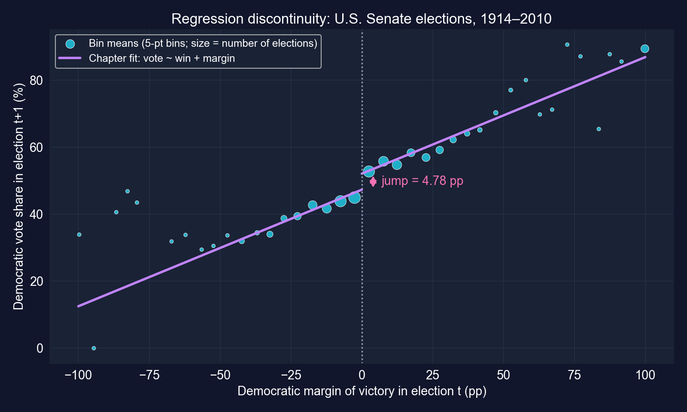

[ビンはゼロでジャンプします：ちょうど勝った選挙は、ちょうど負けた選挙よりはっきり上に位置します。]{.takeaway .fragment}

::: {.notes}
スライド専用の図です。この章はこのプロットを記述するものの、ASCIIアートしか示していません。ビンのサイズは選挙数に応じて変わります。ほとんどの選挙は ±25ポイント以内です。共通の傾きを持つ1本の直線は中央部にはよく当てはまりますが、端（例えば ±100の無投票当選）を外します。これが頑健性の議論の動機になります。
:::

## 解釈：局所的で政党水準の因果効果

::: {.incremental}
- **因果的**：margin $= 0$ 付近では、勝利はほぼ無作為だから。かろうじて勝つ政党とかろうじて負ける政党は、似た州・候補者・状況に直面する
- **局所的**：**接戦**に当てはまり、地滑り的勝利には当てはまらない。安全な議席での優位性は識別されない
- **政党水準**：同じ上院議員が再出馬するか否かに関わらず、民主党の議席保持の優位性
- **メカニズム**（ここでは分離していない）：知名度、資金調達、メディアへのアクセス、有権者サービス
:::

[RDは幅を信頼性と引き換えにします：非常に信じられる効果を、狭い選挙の集合について。]{.takeaway .fragment}

::: {.notes}
選択バイアスはカットオフでのみ取り除かれます。そこから離れると、勝者と敗者は体系的に異なります（単純な21.7が示すように）。この章の政策論（任期制限、選挙資金）は、推定値そのものが識別するものを超えています。
:::

## 脅威：推定値はグローバルな線形当てはめに依存している {.smaller}

::: {.incremental}
- **グローバルで局所的でない**：この章はマージン −100から+100まで1本の直線を当てはめ、±100での**45回の無投票当選**を含む。1,297選挙のうち ±10ポイント以内はわずか **451** 回
- **共通の傾き**：両側に同じ傾きを強いることは、真の関係が0付近で曲がっている場合にジャンプをバイアスしうる
- **標準的な実務**：0の周りのバンド幅内の局所線形回帰、各側で別々の傾き、データ駆動のバンド幅（例：`rdrobust`）、加えて感度チェック
- **ソーティング**：政党が非常に接戦の結果を操作できるなら、かろうじて勝つ側は体系的に異なる。`margin` の密度と0での共変量の均衡を確認する
:::

[デザインは信頼できます。特定の4.8をどれだけ信頼するかは関数形に依存するので、局所的な頑健性チェックが次のステップです。]{.takeaway .fragment}

::: {.notes}
これらは標準的なRDの実務で、このデッキでは記述するだけで推定していません。この章はRDを「モデルの定式化に対して頑健」と挙げますが、実務ではRD推定値は多項式の次数とバンド幅に敏感でありうるので、局所線形・バンド幅選択のアプローチ（Calonico、Cattaneo、Titiunik）がいまや標準です。McCraryの密度検定はカットオフでのソーティングを確認します。
:::

# ケース13.8 · 制度は繁栄をもたらすか？ {#case-138 .divider background-color="#7A209F"}

[操作変数 · 二段階最小二乗法 · 64の旧植民地]{.act}

::: {.notes}
ケース13.8：Acemoglu, Johnson and Robinson（2001）。道具：内生性、操作変数の関連性と除外、第1段階、pyfixestでの2SLS、誘導形、対数の結果の解釈。
:::

## 問い：なぜある国は豊かで、別の国は貧しいのか？

GDPを制度の質に回帰すると、強い正の傾きが得られます。しかし制度は**内生的**です：

| 内生性の源泉 | OLSバイアスのありうる方向 |
|:--|:--|
| **逆の因果**：豊かな国はより良い制度を賄える | 上方 |
| **欠落変数**：地理・文化・歴史が両方に影響する | おそらく上方 |
| **測定誤差**：「制度」は測りにくい | ゼロへ（希薄化） |

[OLSは3つすべてを混ぜ、バイアスは逆方向に引っ張るので、純バイアスの符号さえ決められません。]{.takeaway .fragment}

::: {.notes}
説明変数の測定誤差はOLSをゼロへバイアスします（希薄化）。逆の因果と正に相関する欠落要因は通常それを上方へバイアスします。ですからOLS推定値は大きすぎることも小さすぎることもあり、それはまさに操作変数が必要になるときです。
:::

## デザイン：操作変数としての入植者死亡率

**歴史的な論証（AJR 2001）：**

入植者死亡率（1600年代〜1800年代） $\to$ 植民地制度の種類 $\to$ 今日の制度 $\to$ 今日のGDP

::: {.incremental}
- 高い死亡率：ヨーロッパ人は入植せず、**収奪的**制度を築いた
- 低い死亡率：ヨーロッパ人は入植し、**財産を保護する**制度を築いた
- **関連性**：死亡率は制度を予測しなければならない。これは**第1段階**が検定する
- **除外**：死亡率は今日のGDPに**制度を通じてのみ**影響しなければならない。これは検定できない
:::

[操作変数が妥当なのは、処置を動かし、*かつ* 結果への他の経路を持たない場合のみです。2つめの条件は、データではなく論証に依拠します。]{.takeaway .fragment}

::: {.notes}
キーコンセプト13.10。変数：logpgp95 = 1995年のPPP一人当たりGDPの対数；avexpr = 収用リスクに対する平均的な保護（制度の質の0–10指数）；logem4 = 入植者死亡率の対数。推定対象：効果が異質な場合、IVは入植者死亡率によって駆動された制度の変動に対する局所平均効果を識別する；効果が一定の場合は因果効果である。
:::

## コード：（バイアスのある）OLSベンチマークから始める

``` {.python code-line-numbers="1-3|4-6|7-8"}
!pip install -q pyfixest                    # pyfixest is not preinstalled in Colab
import pandas as pd                         # tabular data
import pyfixest as pf                       # OLS and IV with R-style formulas
url = "https://raw.githubusercontent.com/quarcs-lab/data-open/master/AED/AED_INSTITUTIONS.DTA"
data_inst = pd.read_stata(url)              # 64 former colonies (Acemoglu–Johnson–Robinson)
print(data_inst[["logpgp95", "avexpr", "logem4"]].describe())  # outcome, regressor, instrument
fit_ols = pf.feols("logpgp95 ~ avexpr", data=data_inst, vcov="HC1")  # OLS: endogenous
fit_ols.summary()                           # benchmark slope
```

[↗ Colab で試す](https://colab.research.google.com/notebooks/empty.ipynb){.colab-link target="_blank" data-preview-link="false"}

::: {.notes}
自己完結型。標本：64か国；avexprは3.5から10（平均6.5、SD 1.47）；logpgp95は6.1から10.2。
:::

## 出力：OLSは強い関連を見出す {.smaller}

| 変数 | 係数 | HC1 SE | $t$ | $p$ | 95% CI |
|:--|--:|--:|--:|--:|:--|
| 切片 | 4.660 | 0.320 | 14.56 | <&nbsp;0.001 | [4.02,&nbsp;5.30] |
| `avexpr` | [0.522]{.key} | 0.050 | 10.46 | <&nbsp;0.001 | [0.422,&nbsp;0.622] |

[N = 64 · HC1 SE · $R^2 = 0.540$]{.comment}

0–10の収用保護指数が1ポイント高いことは、一人当たりGDPが **0.52対数ポイント** 高いことと対応します：$e^{0.522} - 1 \approx$ **69%高い**。

[大きく精密な *関連* ですが、前のスライドのあらゆる内生性の問題を受け継いでいます。]{.takeaway .fragment}

::: {.notes}
対数の結果変数では、係数bは説明変数の1単位の変化に対して100·(e^b − 1)%を意味します。0.522なら68.6%です。「52%」という近道は小さなbに対してのみ妥当です。
:::

## コード：第1段階、関連性を確認する

``` {.python code-line-numbers="1-2|3-5"}
# continues from the previous block
fit_first = pf.feols("avexpr ~ logem4", data=data_inst, vcov="HC1")  # institutions on instrument
fit_first.summary()                         # does settler mortality predict institutions?
first_f = fit_first.tstat()["logem4"] ** 2  # one instrument: first-stage F = t²
print(first_f)                              # rule of thumb: F > 10 → not weak
```

[↗ Colab で試す](https://colab.research.google.com/notebooks/empty.ipynb){.colab-link target="_blank" data-preview-link="false"}

[操作変数が1つの場合、第1段階の $F$ 統計量は、操作変数に対する $t$ 統計量の2乗にすぎません。]{.takeaway .fragment}

::: {.notes}
関連性は、検定可能なIVの条件です。弱い第1段階は2SLSをOLSへバイアスさせ、通常のSEを信頼できなくします。
:::

## 出力：入植者死亡率は制度を強く予測する {.smaller}

:::: {.columns}
::: {.column width="40%"}
| | 係数 | HC1 SE |
|:--|--:|--:|
| 切片 | 9.341 | 0.704 |
| `logem4` | [−0.607]{.key} | 0.150 |

[N = 64 · $R^2 = 0.270$ · $t = -4.04$]{.comment}

第1段階 $F = (-4.04)^2 =$ [16.32]{.key} $> 10$
:::
::: {.column width="60%"}
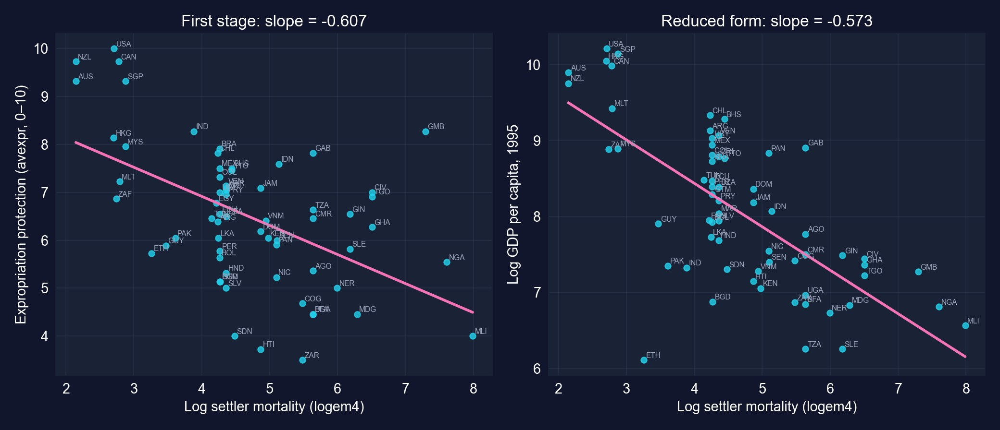
:::
::::

[入植者にとってより致命的だった場所は、今日の財産権保護が弱い。操作変数は**関連性**があり、$F > 10$ の経験則を満たします。]{.takeaway .fragment}

::: {.notes}
入植者死亡率の対数が1単位増加する（死亡率が約2.7倍高い）と、収用保護が0.61ポイント少なくなります。右パネル（誘導形）は2つ先のスライドで使います。
:::

## コード：1行での二段階最小二乗法

``` {.python code-line-numbers="1-3|4-7"}
# continues from the previous block
# formula syntax: outcome ~ exogenous regressors | endogenous ~ instrument
fit_iv = pf.feols("logpgp95 ~ 1 | avexpr ~ logem4", data=data_inst, vcov="HC1")  # 2SLS
fit_iv.summary()                            # causal slope under the IV assumptions
print(fit_ols.coef()["avexpr"], fit_iv.coef()["avexpr"])   # OLS vs IV
import numpy as np                          # for np.exp
print(np.exp(fit_iv.coef()["avexpr"]))      # multiplicative effect on GDP: e^b
```

[↗ Colab で試す](https://colab.research.google.com/notebooks/empty.ipynb){.colab-link target="_blank" data-preview-link="false"}

[`|` は外生的な部分（`1`、切片だけ）を、内生的な説明変数とその操作変数から分けます。]{.takeaway .fragment}

::: {.notes}
pyfixestは両段階を内部で実行し、重要なことに、正しい2SLSの標準誤差を計算します。OLSで2段階を手で実行すると、係数は正しくてもSEは誤りです。
:::

## 出力：IV推定値はOLS推定値の1.8倍 {.smaller}

| 変数 | 係数 | HC1 SE | $t$ | $p$ | 95% CI |
|:----------------------|------:|------:|----:|----:|:-------------|
| 切片 | 1.910 | 1.193 | 1.60 | 0.114 | [−0.47,&nbsp;4.29] |
| `avexpr`（操作変数化） | [0.944]{.key} | 0.179 | 5.28 | <&nbsp;0.001 | [0.587,&nbsp;1.302] |

[N = 64 · 2SLS、操作変数 `logem4` · HC1 SE]{.comment}

[制度の質が1ポイント高いことは、操作変数が妥当なら、一人当たりGDPを0.94対数ポイント高く *引き起こします*。]{.takeaway .fragment}

::: {.notes}
IV係数0.944 vs OLS 0.522（比1.81、つまりIVは約80%大きい）。SEがOLSの3.6倍大きい点に注意してください（0.179 vs 0.050）：IVは入植者死亡率によって駆動された制度の変動の一部のみを使うので、精度が低くなります。
:::

## IV = 誘導形 ÷ 第1段階

$$\hat\beta_{IV} = \frac{\text{effect of } Z \text{ on } Y}{\text{effect of } Z \text{ on } X} = \frac{-0.573}{-0.607} = 0.944$$

{width="78%"}

[誘導形：$-0.573$ は、log GDPをlog入植者死亡率に回帰した傾き（二変量OLS、同じ64か国）です。]{.comment}

[IVは、操作変数のGDPへの総効果を、その制度への効果で再スケーリングします。識別力はすべて入植者死亡率から来ます。]{.takeaway .fragment}

::: {.notes}
操作変数が1つで他に説明変数がない場合、2SLSは誘導形の傾きと第1段階の傾きの比に等しくなります（間接最小二乗法）。誘導形回帰（logpgp95をlogem4に）はスライド用に計算したもので、その比は章の0.944を厳密に再現します。除外制約が破れて死亡率が他の経路を通じてGDPに影響するなら、分子にその経路が含まれ、IV推定値はバイアスされます。
:::

## OLS vs IV：同じ問い、異なる変動の源泉 {.smaller}

| | OLS | 2SLS（IV） |
|:--|--:|--:|
| `avexpr` の係数 | 0.522 | [0.944]{.key} |
| 標準誤差（HC1） | 0.050 | 0.179 |
| 95% CI | [0.42,&nbsp;0.62] | [0.59,&nbsp;1.30] |
| +1指数ポイントのGDP効果、$100(e^{b}-1)$ | +69% | [+157%]{.key} |
| `avexpr` +1 SD（1.47ポイント）のGDP効果 | ×2.2 | ×4.0 |
| 使用する変動 | 制度のすべての変動 | 入植者死亡率が駆動した部分のみ |

[IV推定値はより大きく、**かつ**より精度が低い。IVの仮定のもとでは、OLSは制度の効果を *過小評価* していました。]{.takeaway .fragment}

::: {.notes}
正確な換算：e^0.944 = 2.57、したがって+157%（この章の「2.57倍」）；e^0.522 = 1.69、したがって+69%。1 SDの計算：0.944 × 1.47 = 1.39対数ポイント → e^1.39 ≈ 4.0；0.522 × 1.47 = 0.77 → ≈ 2.2。「≈ 0.94%」という読み方は誤りです：結果変数は対数で、説明変数は指数ポイントです。
:::

## なぜIVはOLSより大きいのか？

::: {.incremental}
- **この章の説明、希薄化**：`avexpr` の測定誤差がOLSをゼロへバイアスする；その誤差と無関係な変数を使うIVはそれを補正する
- 逆の因果と欠落変数はOLSを**上方**へ押すので、*より大きな* IV推定値は、測定誤差が支配的であることと整合する
- **しかし他の読みも成り立つ**：効果が異質な場合、IVは制度が入植者死亡率によって形作られた国に対する *局所的な* 効果を推定し、それは平均効果と等しいとは限らない
- そして除外制約が破れれば（例えば疾病環境がGDPに直接影響すれば）、IV推定値自体がバイアスされる
:::

[OLS < IV は希薄化バイアスと *整合します*。それを証明はしません。]{.takeaway .fragment}

::: {.notes}
この章はIV > OLSが測定誤差を支配的なバイアスとして指し示すと言います。それは妥当な読みで、AJR（2001）も同じ論証をしますが、いくつかの説明のうちの1つであり、学生は適切な不確実性をもってそれを保持すべきです。
:::

## 脅威：すべては除外制約にかかっている

::: {.incremental}
- **除外**：入植者死亡率は**疾病環境**と**地理**を反映し、それらは制度を通じてのみならずGDPに直接影響しうる
- **他の経路**：入植者は制度だけでなく、人的資本・言語・法の起源を持ち込んだ
- **データ批判**：入植者死亡率の系列は疑問視されており（例：Albouy 2012）、改訂データでの再推定はより弱い
- **弱操作変数の余地**：$F = 16.3$ は $F > 10$ の経験則を満たすが、近年の研究は標準的な $t$ 検定がはるかに強い第1段階を必要とすると論じる
- **小標本**：64か国なので、少数の影響力の大きい観測値が効いてくる
:::

[IVはその物語と同じだけの価値しか持ちません。入植者死亡率は有名で影響力のある操作変数であり、そして大いに議論されてきたものです。]{.takeaway .fragment}

::: {.notes}
標準的なIVの留意点と主要な公刊論争：Glaeser et al.（2004）は入植者が人的資本を持ち込んだと論じ、Albouy（2012、AER）は死亡率データを疑問視します。Lee, McCrary, Moreira and Porter（2022、AER）は、慣例的な臨界値のもとで妥当な5% t検定には第1段階Fが約104を超える必要があることを示します。この章自身の留意点：結果は旧植民地に当てはまり、制度の変化は遅い。
:::

# ケース13.9 · 生データから最終データへ {#case-139 .divider background-color="#7A209F"}

[読み込み · 結合 · クリーニング · あらゆる回帰の裏にある作業]{.act}

::: {.notes}
ケース13.9は推定のケースではありません：他のすべての下にあるワークフローです。短い節：なぜそれが重要か、次にこの章の2つの作業例（結合、クリーニング）。
:::

## 実証プロジェクトの大半は最初の回帰の前に起きる {.smaller}

:::: {.columns}
::: {.column width="50%"}
### よくある課題
- **欠損値**：除外するか、補完するか、モデル化するか？
- **外れ値**：本物の極値か、打ち間違いか？
- **単位**：通貨、インフレ、スケール
- **頻度**：月次 vs 四半期
- **コーディング**：`"M"`, `"m"`, `"Male"`
:::
::: {.column width="50%"}
### ベストプラクティス
- **生データを決して上書きしない**
- **すべての手順をスクリプト化する**（手作業のスプレッドシート編集はしない）
- **検証する**：処理前後の要約統計量
- **報告する**：何行をなぜ除外したか
- **文書化する**：すべての判断を
:::
::::

[データ準備はしばしばプロジェクト時間の60〜80%を占め、あらゆる選択が最終的な係数を動かしうります。]{.takeaway .fragment}

::: {.notes}
データ準備にプロジェクト時間の60〜80%という章の数字は、よくある経験則です。学生への要点：データ加工の選択はモデル化の選択であり、報告されなければなりません。
:::

## この章のすべてのケースは、まずデータを加工した {.smaller}

| ケース | 加工のステップ | なぜ重要か |
|:--|:--|:--|
| 13.2 Cobb–Douglas | $Q$, $K$, $L$ の `np.log()`；時間インデックス | 対数が線形にする；HACは時間順序を必要とする |
| 13.3 Phillips | 1970年で分割；`dropna(subset=["inflgdp1yr"])` | 長い・短いモデルは同じ標本を共有しなければならない |
| 13.4 Autos | 事前計算された対数（`lmpg`, `lcurbwt`, …） | 手作業の変換なしに弾力性 |
| 13.5 RAND | `year == 1` を保持 | 1人につき1観測値 |
| 13.7 Incumbency | 欠損 `vote` を除外（1,390 → 1,297） | 結果がなければ観測値もない |

[各行が推定標本または係数の意味を変えました。だからこそ、それは記述に含まれるのです。]{.takeaway .fragment}

::: {.notes}
これまでのケースの小さなデータ処理をまとめています。例えば13.3では、短いモデルと長いモデルが同じ45年を使うからこそ、厳密なOVB分解が成り立ちます。
:::

## コード：フォーマットの読み込みとテーブルの結合

``` {.python code-line-numbers="1-4|5-7|8-9"}
import pandas as pd                         # tabular data
# data = pd.read_stata("file.dta")          # Stata files
# data = pd.read_csv("file.csv")            # comma-separated text
# data = pd.read_excel("file.xlsx")         # Excel workbooks
df1 = pd.DataFrame({"id": [1, 2, 3], "value_a": [10, 20, 30]})     # table A
df2 = pd.DataFrame({"id": [1, 2, 4], "value_b": [100, 200, 400]})  # table B
print(df1); print(df2)                      # ids 3 and 4 appear in only one table
merged = pd.merge(df1, df2, on="id", how="inner")   # keep ids present in BOTH
print(merged)                               # the inner join result
```

[↗ Colab で試す](https://colab.research.google.com/notebooks/empty.ipynb){.colab-link target="_blank" data-preview-link="false"}

::: {.notes}
読み込みの行は章ではコメントアウトされています（実ファイルではなくテンプレートです）。結合の種類：how="inner"は一致のみを保持；"left"はdf1のすべてを保持；"outer"はすべてを保持し、欠損をNaNで埋めます。
:::

## 出力：内部結合は一致しない行を黙って落とす

:::: {.columns}
::: {.column width="30%"}
| `id` | `value_a` |
|--:|--:|
| 1 | 10 |
| 2 | 20 |
| [3]{.key} | 30 |

[df1]{.comment}
:::
::: {.column width="30%"}
| `id` | `value_b` |
|--:|--:|
| 1 | 100 |
| 2 | 200 |
| [4]{.key} | 400 |

[df2]{.comment}
:::
::: {.column width="40%"}
| `id` | `value_a` | `value_b` |
|--:|--:|--:|
| 1 | 10 | 100 |
| 2 | 20 | 200 |

[merged（内部結合）：id 3と4は消えた]{.comment}
:::
::::

[結合の前後で必ず行数を数えてください。失われた観測値は失われた証拠であり、選択の源泉になりえます。]{.takeaway .fragment}

::: {.notes}
3行入力、3行入力、2行出力。一致しない行が体系的に異なる場合（例えば一方の情報源に小企業が欠けている）、結合そのものが分析する母集団を変えてしまいます。
:::

## コード：ありえない値・欠損・不整合なコードをクリーニングする

``` {.python code-line-numbers="1-6|7-9|10|11"}
import numpy as np                          # np.nan marks missing values
import pandas as pd                         # tabular data
df_dirty = pd.DataFrame({"age": [25, 30, -5, 200, 35],             # two impossible ages
                         "income": [50000, 60000, None, 75000, 80000],  # one missing
                         "gender": ["M", "F", "m", "Female", "M"]})     # inconsistent codes
df_clean = df_dirty.copy()                  # never overwrite the raw data
df_clean.loc[df_clean["age"] < 0, "age"] = np.nan     # impossible: negative age → missing
df_clean.loc[df_clean["age"] > 120, "age"] = np.nan   # impossible: age above 120 → missing
df_clean["income"] = df_clean["income"].fillna(df_clean["income"].median())  # median impute
df_clean["gender"] = df_clean["gender"].str.upper().str[0]   # "m"/"Female" → "M"/"F"
print(df_dirty); print(df_clean)            # before and after
```

[↗ Colab で試す](https://colab.research.google.com/notebooks/empty.ipynb){.colab-link target="_blank" data-preview-link="false"}

::: {.notes}
この章のクリーニング例：ありえない値の検出、欠損値の補完、カテゴリ変数の標準化。各ステップはスクリプト化され、生のフレームが保たれるので可逆です。
:::

## 出力：クリーニングの前後

:::: {.columns}
::: {.column width="50%"}
| `age` | `income` | `gender` |
|--:|--:|:-:|
| 25 | 50,000 | M |
| 30 | 60,000 | F |
| [−5]{.key} | [NaN]{.key} | [m]{.key} |
| [200]{.key} | 75,000 | [Female]{.key} |
| 35 | 80,000 | M |

[raw]{.comment}
:::
::: {.column width="50%"}
| `age` | `income` | `gender` |
|--:|--:|:-:|
| 25 | 50,000 | M |
| 30 | 60,000 | F |
| NaN | 67,500 | M |
| NaN | 75,000 | F |
| 35 | 80,000 | M |

[cleaned]{.comment}
:::
::::

[補完は欠損を67,500（4つの観測された所得の中央値）で埋めますが、それは確実性をでっち上げます。補完された値には印をつけ、いくつあるかを報告してください。]{.takeaway .fragment}

::: {.notes}
50,000、60,000、75,000、80,000の中央値 = 67,500。中央値補完は所得の分散を縮め、他の変数との関係をバイアスしうります。欠損値の指標変数、または多重代入のほうが誠実です。ありえない年齢を（推測せず）NaNにするのは保守的な選択です。
:::

# 正しく読み取る {.divider background-color="#C21E72"}

[第III幕 · 解決]{.act}

::: {.notes}
総括：4つのデザインを比較し、どれがある問いに合うかを決め、単純 vs デザインの数値を振り返り、あらゆる係数を解釈するためのチェックリストを持って去る。
:::

## 4つのデザイン、並べて {.smaller}

| | RCT（13.5） | DiD（13.6） | RD（13.7） | IV（13.8） |
|:--|:--|:--|:--|:--|
| **変動の源泉** | 無作為割当 | グループ × 期間 | 鋭いカットオフ | 操作変数 |
| **識別仮定** | 無傷の無作為化 | 平行トレンド | カットオフでの連続性 | 関連性 + 除外 |
| **推定対象** | 実験における平均効果 | 処置群への効果（ATT） | カットオフでの効果（局所的） | 局所平均効果（LATE） |
| **主な脅威** | 脱落、不遵守 | プレトレンド、他のショック | ソーティング、関数形 | 無効な除外、弱いIV |
| **検定可能？** | 共変量の均衡 | プレトレンド（より多くの期間） | 密度、0での均衡 | 関連性のみ（$F$） |
| **この章の推定値** | [−\$1,108]{.key}（95%プラン） | [+0.52]{.key} z単位 | [+4.8 pp]{.key} | [0.94]{.key} 対数ポイント |

[すべてのデザインは、1つの仮定で信頼性を買います。どの仮定を買ったのか、そして誰にとって推定値が成り立つのかを知ってください。]{.takeaway .fragment}

::: {.notes}
推定対象の行は推定値と同じくらい重要です：各デザインはわずかに異なる問いに答えます。RDは接戦に局所的；IVは操作変数が駆動する変動に局所的；DiDは処置群に対するもの；RCTは実験参加者に対するものです。
:::

## どのデザインがあなたの問いに合うか？

::: {.incremental}
- 処置を**無作為化できる**か？ **RCT**を実行する
- 処置が、スコア・マージン・日付の**既知の閾値**でオンになるか？ **RD**を使う
- 処置された/されていないグループを、処置の**前後**で観測するか？ **DiD**を使い、平行トレンドを弁護する
- 処置を動かすが、**それを通じてのみ**結果に影響する変数があるか？ **IV**を使い、除外を弁護する
- **どれにも当てはまらない？** ならばコントロール変数を伴う回帰は *条件付き関連* を与える；OVBの公式を使ってありうるバイアスの符号を定める
:::

[推定量からではなく、変動の源泉から始めてください。推定量はほぼ常にOLSか2SLSです。]{.takeaway .fragment}

::: {.notes}
これは厳密なアルゴリズムではなく判断の手引きです：多くの実際の研究はデザインを組み合わせます（例：RD型のカットオフを伴うDiD、不完全な遵守を伴うRCT内のIV）。
:::

## 単純 vs デザイン：数値はどれほど離れていたか {.smaller}

| ケース | 単純な比較 | 単純 | デザイン | デザインに基づく |
|:--|:--|--:|:--|--:|
| 13.3 | 二変量の傾き、1970–2014 | +0.265 | 期待インフレを加える | [−0.128]{.key} |
| 13.6 | 処置群、前 vs 後 | +0.867 | DiD | [+0.522]{.key} |
| 13.6 | 処置 vs 対照、1998年のみ | +0.391 | DiD | [+0.522]{.key} |
| 13.7 | すべての勝者 vs すべての敗者 | +21.7 pp | カットオフでのRD | [+4.8 pp]{.key} |
| 13.8 | OLS | 0.522 | 2SLS | [0.944]{.key} |

[単純な数値はわずかにずれていたのではありません：符号が逆（13.3）、66%大きすぎるか25%小さすぎる（13.6）、4.5倍大きすぎる（13.7）、IV推定値を45%下回る（13.8）のです。]{.takeaway .fragment}

::: {.notes}
13.3は因果デザインではなく欠落変数の診断ですが、同じパターンを示すので含めています。RCTにはデータ内に単純な対応物がありません（全員が無作為化された）が、それこそが要点です：無作為化がその必要を取り除くのです。バイアスはケースを通じて両方向に向かうので、単純推定値が大きすぎるという「規則」はありません。
:::

## 魅力的な誤り — そしてその訂正

[反論。]{.objection}「十分なコントロール変数を加えさえすれば、どんな回帰も因果的になる。」

. . .

[応答。]{.rebuttal} コントロール変数は、あなたが**測定できる**交絡因子だけを閉じます。13.1では、5つのコントロール変数を加えても親の教育の傾きはほとんど変わりませんでしたが、それはそれが因果的だという証拠ではありません。13.7では、勝者を敗者と比べると21.7ポイント；カットオフは4.8を与えます。

[識別はデータセットからではなく、*デザイン* から来ます。「係数は何か？」と問う前に「変動はどこから来るのか？」と問うてください。]{.takeaway .fragment}

::: {.notes}
反論を最も強い形で受け止めましょう：コントロール変数は確かに役立ち、OVBの公式はその仕組みを示します。しかし、コントロール変数を加えたときに係数が安定することは因果性の証明ではありません。最も重要な変数は、しばしばあなたが観測しないものだからです。
:::

## あらゆる係数に問うべき5つの問い

::: {.incremental}
1. **単位**：水準、対数、それとも両方？ 弾力性、準弾力性（$100(e^b-1)\%$）、パーセントポイント、それとも $z$ 単位？
2. **何を条件付けているか？** どの変数が固定され、どれが固定されていないか？
3. **どの標準誤差か？** HC1、HAC、それともクラスター化：データの生成のされ方に合っているか？
4. **変動はどこから来るか？** 自己選択、無作為化、トレンドの断絶、カットオフ、それとも操作変数？
5. **誰にとってか？** 全員（ATE）、処置群（ATT）、接戦（局所的）、それとも操作変数のコンプライアー（LATE）？
:::

[最もよくある誤読は、問い1を飛ばすことから生じます：「4.8%」を4.8パーセントポイントの代わりに、「0.52 SD」を *どの* SDかを言わずに、「1%」をパーセントポイントの変化に。]{.takeaway .fragment}

::: {.notes}
あらゆる回帰出力に当てはめられる学生用のチェックリストです。このデッキで訂正した単位の誤り：RD効果はパーセントポイント（%でない）、DiD効果は基準母集団のz単位（標本SDでない）、フィリップスの傾きは失業のパーセントポイントあたりのインフレのパーセントポイント、そして対数の結果の効果はe^b − 1で換算。
:::

## 持ち帰るもの

::: {.incremental}
- **1つの推定量、9つの問い**：学校のスコアから国富まで `pf.feols`
- **対数**は弾力性を与える；Cobb–Douglas弾力性の和は規模に関する収穫を検定する
- **欠落変数**は符号を反転させうり、$E[b_2]=\beta_2+\beta_3\gamma$ がどれだけかを正確に述べる
- **標準誤差をデータに合わせる**：`HC1`、時系列には `NW`、グループには `CRV1`；13.4ではクラスター化がSEを6〜9倍変えた
- **RCT / DiD / RD / IV** はそれぞれ反実仮想を異なる方法で補い、それぞれがあなたの弁護すべき仮定に依拠する
- **データ加工はモデル化**：すべての標本制約は記述に含まれる
:::

::: {.notes}
この章のキーテイクアウェイの振り返りで、デッキが検証したことで更新しました：厳密なOVB分解、クラスター化補正の大きさ、単純 vs デザインの差、単位の慣例。
:::

# 9つのケースファイル、1つの教訓：因果的な傾きはデザインによって得られるのであって、コントロール変数を加えることによってではない。 {.divider background-color="#C21E72"}
