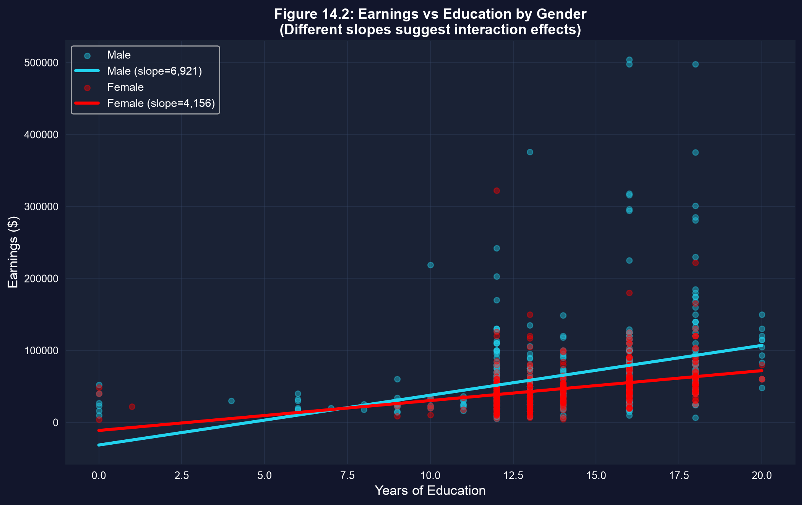
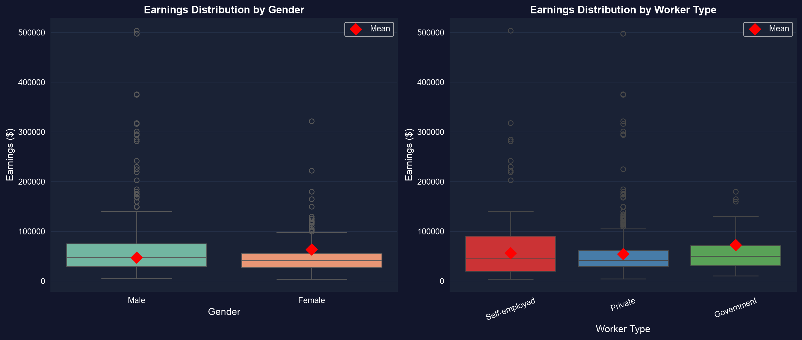

# 回帰におけるカテゴリ {.divider background-color="#008CB7"}

[第I幕 · 緊張]{.act}

## すべての説明変数が数値とは限らない

教育年数や年齢はそのまま回帰に入ります — 連続変数だからです。しかし**性別**、**部門**、**地域**はカテゴリです。「女性」や「公務員」を、係数と数値を掛け合わせる式にどう入れればよいのでしょうか。

. . .

その鍵が**指示変数**です。カテゴリを $0$ または $1$ として符号化します。すると一つの回帰でグループ間の差を測り、それを検定し、さらには各グループに独自の傾きを持たせることもできます。

::: {.notes}
データセット：25〜65歳のアメリカのフルタイム労働者872人（AED_EARNINGS_COMPLETE）。一貫した問いは男女間の賃金格差であり、それがコントロールを加えてもどれだけ残るかです。
:::

## これから扱う内容

::: {.incremental}
- **指示変数**（$0/1$）は二つのグループ間で切片を移動させる
- 一つのダミー変数による回帰は、平均の差の検定そのものである
- **コントロール**を加える → *条件付き*の格差；**交互作用**を加える → グループごとに異なる傾き
- **別々の回帰** + Chow検定 → グループは一つのモデルを共有するか？
- **複数のダミーの集合** → ダミー変数の罠、基準カテゴリ、そしてANOVA（分散分析）
:::

## 六つの考え方がこの章を支える

::: {.incremental}
- **指示変数（ダミー変数）** — あるカテゴリで $1$、それ以外で $0$；切片を移動させる
- **基準カテゴリ** — 切片が表す省略されたグループ；他はそれに*対して*測られる
- **傾きダミー** — *傾き*をグループごとに変える交互作用 $d\times x$
- **条件付き格差 vs 無条件格差** — 生の平均の差 vs コントロール後の格差
- **Chow検定** — プールした回帰と別々の回帰を比べる $F$ 検定
- **ダミー変数の罠** — 全カテゴリ + 切片 = 完全な共線性
:::

[ダミーは切片を動かし、交互作用は傾きを動かす。そして $F$ 検定が、どちらかが本当に動いたかを教えてくれます。]{.takeaway .fragment}

# 格差からモデルへ {.divider background-color="#7A209F"}

[第II幕 · 調査]{.act}

## 14.1 — 一つの指示変数は平均の差である

``` {.python code-line-numbers="1|3-4|6|8|10-11"}
!pip install -q pyfixest                     # pyfixest not preinstalled in Colab
import pandas as pd                          # tabular data
import pyfixest as pf                         # OLS with R-style formulas

url  = "https://raw.githubusercontent.com/quarcs-lab/data-open/master/AED/AED_EARNINGS_COMPLETE.DTA"
data = pd.read_stata(url)                    # 872 full-time workers (gender: 1=F, 0=M)

fit = pf.feols("earnings ~ gender", data=data, vcov="HC1")   # HC1 robust SEs
fit.summary()
# Intercept ≈ 63,000 = MALE mean · gender coef ≈ −16,396 = female−male gap (robust t ≈ −5.1)
```

[↗ Colab で試す](https://colab.research.google.com/notebooks/empty.ipynb){.colab-link target="_blank" data-preview-link="false"}

[ダミー一つでは、切片が基準グループの平均、傾きが格差になります — 回帰は二標本のt検定*そのもの*です。生の格差：女性は約\$16k少なく稼いでいます。]{.takeaway .fragment}

## 14.2 — コントロールは*条件付き*格差を与える（そしてそれは拡大しうる）

``` {.python code-line-numbers="1-2|4|5|7"}
# genderbyeduc = gender × education  (a precomputed interaction column)
m2 = pf.feols("earnings ~ gender + education", data=data, vcov="HC1")

m3 = pf.feols("earnings ~ gender + education + genderbyeduc",   # + slope dummy
              data=data, vcov="HC1")
print(m2.coef()["gender"])                   # ≈ −18,258  (gap WIDENS vs −16,396!)
print(m3.coef()["genderbyeduc"])             # return to schooling differs by gender
```

[↗ Colab で試す](https://colab.research.google.com/notebooks/empty.ipynb){.colab-link target="_blank" data-preview-link="false"}

[教育をコントロールすると格差は約\$18kまで*拡大*します：ここでは女性の方が平均的に教育水準が高いため、教育を一定に保つと説明されていない格差がより多く見えてきます。コントロールは係数をどちらの方向にも動かしうるのです。]{.takeaway .fragment}

## 14.3 — 交互作用は各グループに独自の傾きを持たせる



[平行でない線が交互作用*そのもの*です：女性は $\hat y = (b_1+a_1) + (b_2+a_2)x$、男性は $b_1+b_2x$。傾きダミー $a_2$ は収益の差を表します。]{.takeaway .fragment}

## 14.4 — 別々の回帰 + Chow検定

``` {.python code-line-numbers="1|3-4|6-7|9-10"}
# Fit the SAME model on each subsample — every coefficient free to differ
f = pf.feols("earnings ~ education + age + hours", data=data.query("gender==1"))
m = pf.feols("earnings ~ education + age + hours", data=data.query("gender==0"))

print(f.coef()["education"], m.coef()["education"])   # ≈ 4,200 (F) vs 6,300 (M)
print(f.coef()["hours"],     m.coef()["hours"])       # ≈   700 (F) vs 1,600 (M)
# Chow test of H0: β_F = β_M = robust joint test on all 4 gender terms of the fully
# interacted model: Wald χ² ≈ 32.6 (4 restr.), F ≈ 8.1, p < 0.001 → REJECTS pooling
```

[↗ Colab で試す](https://colab.research.google.com/notebooks/empty.ipynb){.colab-link target="_blank" data-preview-link="false"}

[教育年数*と*労働時間の両方で傾きが異なります — 単なる一定の格差ではありません。Chow検定は「男性と女性に別々の式が必要か？」を形式的に問います。そのロバスト版であるすべての交互作用を含むモデルにおける4つの性別関連の項の同時検定（$F\approx8.1$、$p<0.001$）の答えは：必要です。]{.takeaway .fragment}

## 14.5 — 多数のカテゴリ：ダミー変数の罠に注意

``` {.python code-line-numbers="1-2|4-5|7"}
# Worker type: dself, dprivate, dgovt — these sum to 1 for every worker,
# so all three PLUS an intercept = perfect collinearity (the "trap").
fit = pf.feols("earnings ~ dself + dgovt + education + age",   # drop dprivate = base
               data=data, vcov="HC1")
fit.summary()
# dself ≈ +17,000 · dgovt ≈ −2,000  → gaps vs the PRIVATE-sector base
```

[↗ Colab で試す](https://colab.research.google.com/notebooks/empty.ipynb){.colab-link target="_blank" data-preview-link="false"}

[一つのカテゴリ（または切片）を落とします。基準は切片のグループであり、各係数は*基準からの*格差です。基準を変えると格差のラベルは付け替わりますが、$R^2\approx0.12$ はそのままです。]{.takeaway .fragment}

## コントロールなしの指示変数の集合はANOVAである

``` {.python code-line-numbers="1|3|5-6"}
data["typeworker"] = (1*data.dself + 2*data.dprivate + 3*data.dgovt).astype(int)

fit = pf.feols("earnings ~ C(typeworker)", data=data)   # C() = treat as categorical

# the regression's joint F-test equals the one-way ANOVA F-statistic:
from scipy.stats import f_oneway                          # scipy (preinstalled)
print(f_oneway(*[g.earnings for _, g in data.groupby("typeworker")]))
```

[↗ Colab で試す](https://colab.research.google.com/notebooks/empty.ipynb){.colab-link target="_blank" data-preview-link="false"}



# 正しく読み解く {.divider background-color="#C21E72"}

[第III幕 · 解決]{.act}

## カテゴリが二度以上入るときの二つの罠

[反論。]{.objection} 「gender×education の項はそれ単独では有意でないから、教育を通じた性別の効果はゼロだ。」

. . .

[応答。]{.rebuttal} カテゴリが**水準 + 交互作用**として入るとき、それらの項は相関しています — 個々の $t$ 検定は誤った判断を導きます。すべての性別関連の項について**同時 $F$ 検定**を使いましょう（ここではWald $\chi^2\approx32.6$（制約は4個）、すなわち $F\approx8.1$、$p<0.001$）。そして格差は**記述的**なものであり、差別の証明ではないことを忘れないでください。

[カテゴリの効果は*同時に*検定しましょう。因果的な解釈を正当化する設計が得られるまでは、格差は関連として解釈します。]{.takeaway .fragment}

## 持ち帰ってほしいこと

::: {.incremental}
- カテゴリを $0/1$ の**指示変数**として符号化する；その係数はグループ間の**格差**であり、ダミー一つ = 平均の差の検定である。
- コントロールを加えると**条件付き**格差が得られる — それは縮小*も*拡大もしうる（抑制）。
- **交互作用** $d\times x$ は傾きダミーである — グループの線は平行でなくなる；別々の回帰 + **Chow検定**でモデル全体を確認する。
- $C$ 個のカテゴリでは切片を残してダミーを一つ落とす（**基準カテゴリ**）ことで罠を避ける；その選択はラベルを変えるが当てはまりは変えない。
- 指示変数のみの回帰 = **ANOVA**であり、同じ同時 $F$ 検定を持つ。
:::

# カテゴリを 0/1 の列に変える — そして回帰に格差を測らせ、傾きを曲げさせ、それを検定させましょう。 {.divider background-color="#C21E72"}
