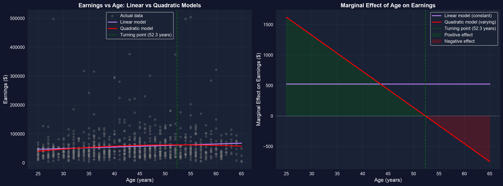
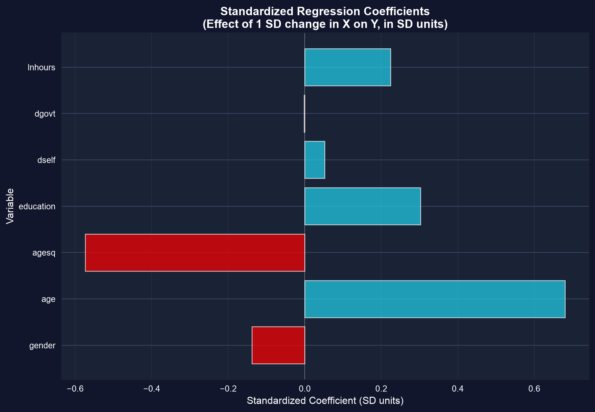
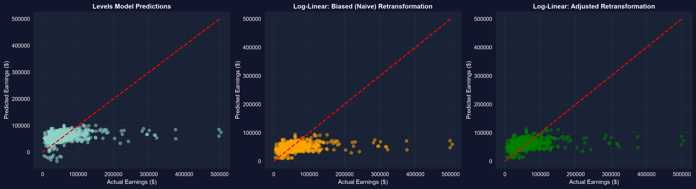

# The problem {.divider background-color="#008CB7"}

[Act I · Straight lines don't fit everything]{.act}

## Real economic relationships bend

Earnings don't rise with age in a straight line — they climb fast when you're young, flatten
in mid-career, and fall near retirement. A plain `earnings ~ age` line misses all of it.

. . .

The fix isn't to abandon OLS. It's to **transform the variables** — logs, squares, interactions —
so a model that is still *linear in its coefficients* can trace a curved story.

::: {.notes}
The whole chapter rests on one idea: "linear regression" means linear in the parameters, not in the
variables. Once you accept that, logs and polynomials open up without leaving the OLS toolkit.
:::

## Where we're going

::: {.incremental}
- **Logs** — level-log, log-linear, log-log, and the percentage/elasticity each implies
- **Quadratics** — capture the inverted-U life-cycle of earnings
- **Standardized coefficients** — compare regressors measured in different units
- **Interactions** — let the return to education change with age
- **Marginal effects** — AME, MEM, MER — when the slope itself varies
- **Prediction** — undo a log transform *without* retransformation bias
:::

## Five ideas anchor this chapter

::: {.incremental}
- **Marginal effect** — the change in $y$ per one-unit change in $x$; once $x$ enters nonlinearly, it *varies with* $x$
- **AME · MEM · MER** — average the effect, evaluate it at the mean, or at chosen profiles
- **Polynomial regression** — add $x^2$ (then $x^3$…) to bend the line, still linear in $\beta$
- **Standardized coefficient** — effect of a 1-SD change in $x$ on $y$, in SD units — a common currency
- **Smearing estimator** — Duan's residual-based fix for the bias in $\exp(\widehat{\ln y})$
:::

[One dataset — 872 workers — runs through every transformation.]{.takeaway .fragment}

## Our data: 872 workers, earnings and its drivers

`AED_EARNINGS_COMPLETE.DTA` — 872 full-time workers aged 25–65 (2000), with `earnings`, `age`,
`education`, hours, sector, and gender.

``` {.python code-line-numbers="1-2|4|6-7"}
import pandas as pd                          # tabular data
import numpy as np                           # logs, squares, z-scores

url = "https://raw.githubusercontent.com/quarcs-lab/data-open/master/AED/AED_EARNINGS_COMPLETE.DTA"
data = pd.read_stata(url)                    # 872 full-time workers, aged 25-65, year 2000

data[["earnings", "age", "education"]].describe().round(1)   # scale before you model
```

[↗ Try it in Colab](https://colab.research.google.com/notebooks/empty.ipynb){.colab-link target="_blank" data-preview-link="false"}

::: {.notes}
pandas/numpy are preinstalled in Colab, so no pip install here. Mean earnings ≈ \$56k; the log models
below tame that right-skew.
:::

# Four ways to bend the line {.divider background-color="#7A209F"}

[Act II · The transformations]{.act}

## Logs change what the coefficient *means*

Three specifications of the same relationship — and three different interpretations.

``` {.python code-line-numbers="1|3-4|6|7|8|10"}
import pyfixest as pf                                 # OLS with R-style formulas
# (pandas, numpy already loaded; data = AED_EARNINGS_COMPLETE)
data["lnage"] = np.log(data["age"])                   # log of age, for the log-log model
# lnearnings already in the data; = np.log(earnings)

levels  = pf.feols("earnings   ~ age   + education", data=data, vcov="HC1")  # $ per unit
loglin  = pf.feols("lnearnings ~ age   + education", data=data, vcov="HC1")  # % per unit (Mincer)
loglog  = pf.feols("lnearnings ~ lnage + education", data=data, vcov="HC1")  # elasticity on age

loglin.summary()                                      # the Mincer earnings equation
```

[↗ Try it in Colab](https://colab.research.google.com/notebooks/empty.ipynb){.colab-link target="_blank" data-preview-link="false"}

::: {.notes}
HC1 = heteroskedasticity-robust SEs, the chapter's default. pyfixest is NOT preinstalled in Colab, so
the full self-contained version adds `!pip install -q pyfixest` at the top (see the next tool-heavy slide).
:::

## The same data, three interpretations of "age"

::: {.incremental}
- **Levels** — $\hat\beta_{\text{age}} \approx \$525$: each extra year adds about **\$525**, no matter the starting earnings.
- **Log-linear** (Mincer) — $\hat\beta_{\text{age}} \approx 0.008$: each year is about **+0.8%** — a *semi-elasticity*; the dollar amount scales with earnings.
- **Log-log** — $\hat\beta_{\ln\text{age}} \approx 0.35$: a **1% rise in age → ≈0.35% rise in earnings** — an *elasticity* (< 1, inelastic).
- **Education** is the star: ≈ **0.10** in the log models — the famous **~10%-per-year Mincer return**.
:::

[Log-linear $\beta$ as a percent is an **approximation** — the exact effect is $100(e^{\beta}-1)\%$, and the gap matters once $|\beta| > 0.1$.]{.takeaway .fragment}

## A quadratic captures the life-cycle hump

Add age-squared: the slope on age is now $\beta_2 + 2\beta_3\,\text{age}$ — it **changes with age**.

``` {.python code-line-numbers="1|3-4|6|7|9|10-12"}
!pip install -q pyfixest                     # pyfixest isn't preinstalled in Colab (-q = quiet)
import pandas as pd; import numpy as np; import pyfixest as pf
url = "https://raw.githubusercontent.com/quarcs-lab/data-open/master/AED/AED_EARNINGS_COMPLETE.DTA"
data = pd.read_stata(url)                     # 872 workers

quad = pf.feols("earnings ~ age + I(age**2) + education", data=data, vcov="HC1")  # age + age^2
b2, b3 = quad.coef()["age"], quad.coef()["I(age ** 2)"]    # linear & quadratic terms

turning_point = -b2 / (2 * b3)                # age where the slope hits zero (earnings peak)
print(f"peak earnings at age {turning_point:.0f}")         # ~ 52
print(f"marginal effect at 25: {b2 + 2*b3*25:,.0f}")       # ~ +$1,600 / yr
print(f"marginal effect at 60: {b2 + 2*b3*60:,.0f}")       # ~ -$450 / yr
```

[↗ Try it in Colab](https://colab.research.google.com/notebooks/empty.ipynb){.colab-link target="_blank" data-preview-link="false"}

::: {.notes}
Linear age coef ≈ +\$3,000–5,000, agesq ≈ −\$30 to −\$50. The joint F-test on age and age² is highly
significant, so the curvature is real, not noise.
:::

## Earnings peak near age 52, then decline



[The slope is **+\$1,600/yr at 25**, **\$0 near age 52**, and **−\$450/yr at 60** — one regressor, three marginal stories.]{.takeaway .fragment}

## Standardize to compare apples and oranges

Dollars-per-year and log-hours can't be compared raw. Re-express every variable in SD units.

``` {.python code-line-numbers="1-2|4|6|7-8"}
# z-score each variable: (x - mean) / sd  → coefficients become "SD of y per SD of x"
cols = ["earnings", "age", "agesq", "education", "lnhours"]
z = data[cols].apply(lambda s: (s - s.mean()) / s.std())      # standardized copies

mz = pf.feols("earnings ~ age + agesq + education + lnhours", data=z, vcov="HC1")
mz.coef().round(3)      # beta* weights — now directly comparable
# age & age^2 dominate; among the rest, education and lnhours carry the most weight
```

[↗ Try it in Colab](https://colab.research.google.com/notebooks/empty.ipynb){.colab-link target="_blank" data-preview-link="false"}

## Standardized weights rank the drivers



[A standardized coefficient answers "which regressor moves earnings most per SD of effort?" — comparable across units.]{.takeaway .fragment}

## Interactions let the return to education shift with age

Does a year of schooling pay the same at 25 as at 55? Multiply the two regressors and test it.

``` {.python code-line-numbers="1|3|5-6|8|9-10"}
inter = pf.feols("earnings ~ age * education", data=data, vcov="HC1")   # age, education, age:education

# return to education at a given age = beta_educ + beta_(age:educ) * age
be, bx = inter.coef()["education"], inter.coef()["age:education"]
print(f"return at 25: {be + bx*25:,.0f}")     # ~ +$5,241 / education-year
print(f"return at 55: {be + bx*55:,.0f}")     # ~ +$6,112 / education-year

# is the interaction itself distinguishable from zero?
inter.wald_test(R=[[0, 0, 0, 1]])             # H0: beta_(age:education) = 0  -> p ~ 0.60
```

[↗ Try it in Colab](https://colab.research.google.com/notebooks/empty.ipynb){.colab-link target="_blank" data-preview-link="false"}

::: {.notes}
`age * education` expands to age + education + age:education. The returns drift from \$5,241 at 25 to
\$6,112 at 55 — only ~1.2×, and the interaction is not significant (p ≈ 0.60), so read it cautiously.
:::

## Predicting from a log model: beware retransformation bias

$\exp(\widehat{\ln y})$ predicts the *median*, not the mean — it systematically underpredicts. Duan's
**smearing** correction fixes it with the residuals themselves.

``` {.python code-line-numbers="1|3|5|7|8-9"}
logmod = pf.feols("lnearnings ~ age + education", data=data, vcov="HC1")  # s_e ~ 0.62

naive = np.exp(logmod.predict())                        # biased: ~ $46k mean (actual ~ $56k)

smear = np.exp(logmod.resid()).mean()                   # Duan factor = mean(exp(residuals)) ~ 1.21
corrected = naive * smear                               # smeared prediction
print(f"naive mean     {naive.mean():,.0f}")            # ~ 46,000
print(f"corrected mean {corrected.mean():,.0f}")        # ~ 55,000, matches the data
```

[↗ Try it in Colab](https://colab.research.google.com/notebooks/empty.ipynb){.colab-link target="_blank" data-preview-link="false"}

::: {.notes}
Jensen's inequality: E[exp(u)] > exp(E[u]). The normality factor exp(s_e²/2) ≈ exp(0.62²/2) ≈ 1.21
gives the same correction when residuals are roughly normal; Duan's smearing needs no such assumption.
:::

## Naive exp() underpredicts; smearing restores the mean



[Always smear before you report dollar predictions from a log model.]{.takeaway .fragment}

# Reading transformed coefficients right {.divider background-color="#C21E72"}

[Act III · The interpretation traps]{.act}

## Three traps, three corrections

[Trap.]{.objection} "Log-linear $\beta = 0.12$ means exactly +12%, and the log-log model fits best because its $R^2$ is highest."

. . .

[Correction.]{.rebuttal} The percent is an **approximation** ($100(e^{0.12}-1) \approx 12.7\%$); and you
**cannot compare $R^2$** across models whose dependent variable differs ($y$ vs $\ln y$) — judge them on
prediction accuracy or economic plausibility instead.

[A transformed coefficient is only as good as its interpretation — know whether you're reading dollars, percents, or elasticities.]{.takeaway .fragment}

## What to carry forward

::: {.incremental}
- **Logs** give percentages and elasticities; the %-reading is approximate — use $100(e^{\beta}-1)$ when $|\beta|$ is large.
- **Quadratics** make the marginal effect vary; report the **turning point** and a few representative slopes (MER).
- **Standardize** to rank regressors across units; **interact** to let one effect depend on another — then **test** it.
- **Don't compare $R^2$** across different dependent variables; **smear** before predicting levels from a log model.
- Every transformation keeps OLS linear *in the coefficients* — the toolkit never changed.
:::

# Transform the variable, not the method — then read the coefficient for what it truly is. {.divider background-color="#C21E72"}
