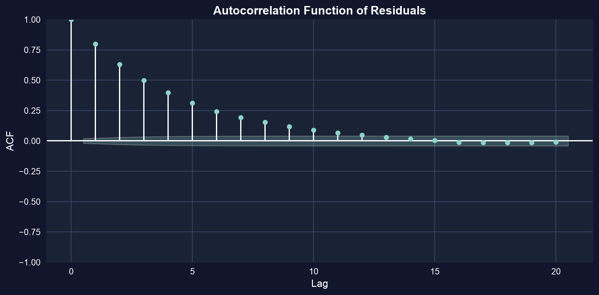
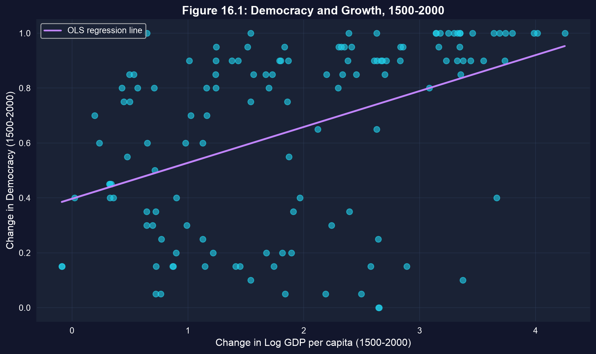
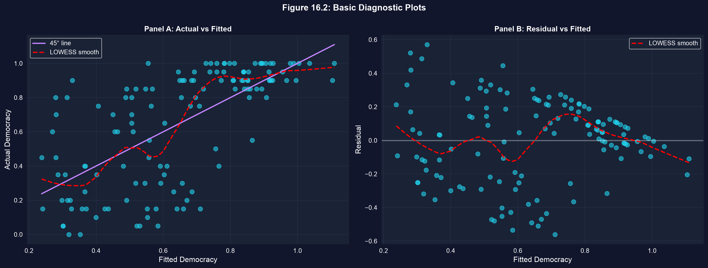
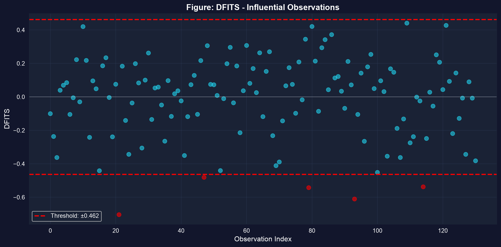

# El modelo todavía puede mentir {.divider background-color="#008CB7"}

[Acto I · La tensión]{.act}

## MCO siempre imprime una respuesta — incluso cuando sus supuestos están rotos

Una tabla de regresión nunca se niega a ejecutarse. Te entrega coeficientes, errores estándar y
estadísticos t, esté o no el modelo bien planteado.

. . .

Así que la verdadera habilidad no es *ajustar* el modelo — es **interrogarlo** después. Este capítulo es una
lista de verificación: diagnostica multicolinealidad, heterocedasticidad, autocorrelación, variables omitidas y
puntos influyentes **antes** de confiar en un solo número.

::: {.notes}
Cada capítulo anterior confiaba en la salida de MCO. Este capítulo enseña los diagnósticos que deciden
si esa confianza estaba justificada. El tema: estimar es fácil; la inferencia honesta es la parte difícil.
:::

## Hacia dónde vamos

::: {.incremental}
- **Multicolinealidad** — cuando los regresores se solapan, y cómo el **FIV** lo señala
- **Qué violaciones sesgan** los coeficientes frente a cuáles solo rompen los **errores estándar**
- **Heterocedasticidad** → errores estándar robustos (HC1)
- **Autocorrelación** → la **FAC** de los residuos y errores estándar HAC
- **Variables omitidas** → sesgo que puedes ver encogerse cuando entran los controles
- **Gráficos de residuos y puntos influyentes** — leer los diagnósticos que quedan
:::

## Seis ideas anclan este capítulo

::: {.incremental}
- **Endogeneidad** — un regresor correlacionado con el error ($E[u \mid x] \neq 0$) → MCO es **sesgado**; ningún ajuste de EE ayuda
- **Variable instrumental (VI)** — una $z$ que mueve $x$ pero toca $y$ solo *a través de* $x$ — rescata las estimaciones causales
- **Apalancamiento** — qué tan lejos se sitúa el $\mathbf{x}_i$ de una fila respecto a la nube de regresores: su poder para inclinar la línea
- **Distancia de Cook** — apalancamiento $\times$ residuo, en un solo número; investiga valores por encima de $4/n$
- **Regresión auxiliar** — regresa un $x_j$ sobre los demás; su $R^2$ alimenta $\text{VIF}_j = 1/(1-R_j^2)$
- **Prueba de especificación (RESET)** — añade $\hat{y}^2, \hat{y}^3$ para señalar un término no lineal faltante
:::

[Un modelo que no pasa ningún diagnóstico es una hipótesis, no un resultado.]{.takeaway .fragment}

# Diagnostica los problemas {.divider background-color="#7A209F"}

[Acto II · La investigación]{.act}

## La multicolinealidad infla los errores estándar — el FIV mide cuánto

Añade una interacción `age × education` a un modelo de ingresos y los errores estándar de `age` y
`education` se disparan. El **factor de inflación de la varianza** lo cuantifica: $\text{VIF}_j = 1/(1 - R_j^2)$.

``` {.python code-line-numbers="1|2-5|6-7|8-9|10-12"}
!pip install -q pyfixest                     # pyfixest not preinstalled in Colab (-q = quiet)
import pandas as pd                           # tabular data
import pyfixest as pf                          # OLS, R-style formulas, robust SEs
from statsmodels.stats.outliers_influence import variance_inflation_factor  # VIF
import statsmodels.api as sm                   # adds the intercept column VIF needs
url = "https://raw.githubusercontent.com/quarcs-lab/data-open/master/AED/AED_EARNINGS_COMPLETE.DTA"
earn = pd.read_stata(url)                      # 872 full-time workers: earnings, age, education
base = pf.feols("earnings ~ age + education", data=earn, vcov="HC1")             # tidy SEs
full = pf.feols("earnings ~ age + education + agebyeduc", data=earn, vcov="HC1") # SEs balloon
X = sm.add_constant(earn[["age", "education", "agebyeduc"]])  # design matrix + intercept
for i, name in enumerate(X.columns):                         # VIF for each regressor
    print(name, round(variance_inflation_factor(X.values, i), 1))  # agebyeduc ≈ 37 → severe
```

[↗ Pruébalo en Colab](https://colab.research.google.com/notebooks/empty.ipynb){.colab-link target="_blank" data-preview-link="false"}

::: {.notes}
La regresión auxiliar agebyeduc ~ age + education devuelve R² ≈ 0.973, así que VIF ≈ 1/(1−0.973) ≈ 37.
MCO sigue siendo insesgado — el daño es enteramente a la precisión.
:::

## La interacción es casi una combinación perfecta de sus partes


[La multicolinealidad es un problema de *precisión*, no de sesgo: las predicciones y las pruebas $F$ conjuntas siguen siendo válidas.]{.takeaway .fragment}

## No todas las violaciones son iguales — algunas sesgan, otras solo engañan

::: {.incremental}
- **Endogeneidad / modelo incorrecto** (supuestos 1–2) → coeficientes **sesgados e inconsistentes**. Necesita un cambio de modelo o una VI — los EE robustos no pueden salvarlo.
- **Heterocedasticidad / autocorrelación** (supuestos 3–4) → coeficientes **todavía insesgados**, pero los errores estándar están mal, así que cada $t$, IC y $p$-valor está mal.
:::

[Pregunta primero: *¿está sesgada mi estimación, o solo mi incertidumbre?* La solución es completamente distinta.]{.takeaway .fragment}

## La heterocedasticidad deja la pendiente intacta pero rompe el EE — usa HC1

Cuando $\text{Var}[u_i \mid \mathbf{x}_i]$ varía con $x$, los EE por defecto están mal (normalmente demasiado pequeños).
Los EE robustos (White / HC1) dejan los coeficientes intactos y corrigen solo los errores estándar.

``` {.python code-line-numbers="1|2-3|4-5|6|7|8-9"}
!pip install -q pyfixest                     # pyfixest not preinstalled in Colab
import pandas as pd                           # tabular data
import pyfixest as pf                          # OLS + robust variance-covariance
url = "https://raw.githubusercontent.com/quarcs-lab/data-open/master/AED/AED_EARNINGS_COMPLETE.DTA"
earn = pd.read_stata(url)                      # 872 workers
classic = pf.feols("earnings ~ age + education", data=earn)              # default (homoskedastic) SEs
robust  = pf.feols("earnings ~ age + education", data=earn, vcov="HC1")  # White / HC1 robust SEs
print(classic.se())                            # coefficients are identical...
print(robust.se())                             # ...only the SEs change (education SE ~13% larger here)
```

[↗ Pruébalo en Colab](https://colab.research.google.com/notebooks/empty.ipynb){.colab-link target="_blank" data-preview-link="false"}

[Usa EE robustos por defecto para datos de corte transversal — son válidos haya o no heterocedasticidad.]{.takeaway .fragment}

## En series de tiempo, los errores persisten — la FAC de los residuos lo revela

Un error AR(1) $u_t = \rho u_{t-1} + \varepsilon_t$ con $\rho = 0.8$ hace que los EE por defecto sean demasiado pequeños.
La función de autocorrelación de los residuos es el detector.

``` {.python code-line-numbers="1|2-4|5-6|7-8|9-10|11|12"}
!pip install -q pyfixest                     # pyfixest not preinstalled in Colab
import numpy as np, pandas as pd              # arrays + tabular data
import pyfixest as pf                          # OLS to get residuals
from statsmodels.tsa.stattools import acf      # autocorrelation function
np.random.seed(10101)                          # reproducible draw
n = 10000; e = np.random.normal(0, 1, n)       # i.i.d. shocks
u = np.zeros(n)                                # container for AR(1) errors
for t in range(1, n): u[t] = 0.8*u[t-1] + e[t] # ρ = 0.8 persistence → errors remember the past
x = np.random.normal(0, 1, n)                  # a regressor
df = pd.DataFrame({"y": 1 + 2*x + u, "x": x})  # y built with the autocorrelated error
resid = pf.feols("y ~ x", data=df)._u_hat      # fit OLS, pull the residuals
print(acf(resid, nlags=5, fft=False).round(3)) # large lag-1 value that decays slowly
```

[↗ Pruébalo en Colab](https://colab.research.google.com/notebooks/empty.ipynb){.colab-link target="_blank" data-preview-link="false"}

::: {.notes}
Las barras significativas más allá de la banda de confianza señalan autocorrelación. El remedio son los EE HAC (Newey–West),
que corrigen a la vez tanto la heterocedasticidad como la autocorrelación.
:::

## Una FAC que decae lentamente es la firma de errores autocorrelacionados



[La autocorrelación no sesga la pendiente — finge precisión. Los EE HAC (Newey–West) restauran una inferencia honesta.]{.takeaway .fragment}

## Omitir un factor de confusión sesga la pendiente — y puedes verla encogerse

¿El crecimiento causa democracia? Regresa el cambio de 500 años en la democracia sobre el crecimiento solo, luego añade
controles institucionales (restricciones al ejecutivo, fecha de independencia, religión). Si el crecimiento estaba sirviendo de proxy
de las instituciones, su coeficiente debería colapsar.

``` {.python code-line-numbers="1|2-3|4-5|6|7-8|9"}
!pip install -q pyfixest                     # pyfixest not preinstalled in Colab
import pandas as pd                           # tabular data
import pyfixest as pf                          # OLS, R-style formulas
url = "https://raw.githubusercontent.com/quarcs-lab/data-open/master/AED/AED_DEMOCRACY.DTA"
dem = pd.read_stata(url)                       # 131 countries, 1500–2000
bi = pf.feols("democracy ~ growth", data=dem, vcov="HC1")                                   # bivariate
mr = pf.feols("democracy ~ growth + constraint + indcent + catholic + muslim + protestant", # + controls
              data=dem, vcov="HC1")
print(bi.coef()["growth"], mr.coef()["growth"])  # 0.131 → 0.047: the effect collapses
```

[↗ Pruébalo en Colab](https://colab.research.google.com/notebooks/empty.ipynb){.colab-link target="_blank" data-preview-link="false"}

## La línea cruda crecimiento–democracia esconde una historia de variable omitida



[El coeficiente del crecimiento cae **0.131 → 0.047** (una caída del 64%) una vez que entran los controles, y $t \approx 6.7 \to 1.8$: un efecto "significativo" se vuelve indistinguible de cero.]{.takeaway .fragment}

## Cuando los supuestos se cumplen, los residuos parecen ruido — así que grafícalos

Ajusta el modelo, luego mira. Un gráfico de residuos vs. ajustados expone la heterocedasticidad (un abanico) y
la no linealidad (una curva); **DFITS** señala las observaciones que mueven el ajuste al eliminarse.

``` {.python code-line-numbers="1|2-5|6-7|8|9-10|11-12|13-14"}
!pip install -q pyfixest                     # pyfixest not preinstalled in Colab
import pandas as pd, numpy as np, matplotlib.pyplot as plt  # data + plotting
import pyfixest as pf                                        # OLS fit
import statsmodels.formula.api as smf                        # refit for influence stats
from statsmodels.stats.outliers_influence import OLSInfluence  # DFITS / DFBETAS
url = "https://raw.githubusercontent.com/quarcs-lab/data-open/master/AED/AED_DEMOCRACY.DTA"
dem = pd.read_stata(url)
fit = pf.feols("democracy ~ growth + constraint + indcent", data=dem)  # the model to diagnose
plt.scatter(fit.predict(), fit._u_hat, alpha=0.5)            # residual vs fitted: look for a fan / curve
plt.axhline(0, ls="--")                                      # reference line at zero
m = smf.ols("democracy ~ growth + constraint + indcent", data=dem).fit()  # OLSInfluence needs a statsmodels fit
dfits = OLSInfluence(m).dffits[0]                            # DFITS for every observation
k, n = 4, len(dem); thresh = 2*np.sqrt(k/n)                  # rule of thumb: flag |DFITS| > 2√(k/n)
print(int((np.abs(dfits) > thresh).sum()), "influential points")  # count the flagged rows
```

[↗ Pruébalo en Colab](https://colab.research.google.com/notebooks/empty.ipynb){.colab-link target="_blank" data-preview-link="false"}

## Residuos vs. ajustados: una dispersión aleatoria es lo que se ve "sano"



[Un patrón aquí (abanico, curva o deriva) significa un supuesto violado — no una regresión fallida, sino un modelo que repensar.]{.takeaway .fragment}

## DFITS señala las observaciones que doblan el ajuste



[Investiga los puntos influyentes — no los elimines de forma refleja. Pregúntate si tu conclusión sobrevive a su eliminación.]{.takeaway .fragment}

# Lee bien los diagnósticos {.divider background-color="#C21E72"}

[Acto III · La resolución]{.act}

## El atajo tentador — y por qué falla

[Objeción.]{.objection} "Mi coeficiente de crecimiento es significativo y los EE robustos apenas se movieron — así que el
efecto es real."

. . .

[Respuesta.]{.rebuttal} Los EE robustos corrigen la *heterocedasticidad*, no la **endogeneidad**. La pendiente democracia–crecimiento
estaba sesgada por instituciones omitidas, y ninguna corrección de errores estándar toca el sesgo — solo lo hacen los
controles o un instrumento. Un gráfico de residuos limpio y un EE pequeño todavía pueden asentarse sobre una
estimación fundamentalmente sesgada.

[Los diagnósticos de *sesgo* (SVO, endogeneidad) y los diagnósticos de *precisión* (HC1, HAC) son listas de verificación separadas. Ejecuta ambas.]{.takeaway .fragment}

## Qué llevarse

::: {.incremental}
- **FIV > 10** señala multicolinealidad severa — un problema de precisión; MCO sigue siendo insesgado.
- Supuestos **1–2** (modelo, endogeneidad) → **sesgo**; supuestos **3–4** (heterocedasticidad, autocorrelación) → **EE incorrectos**.
- Usa EE **robustos HC1** por defecto para cortes transversales; **HAC (Newey–West)** para series de tiempo.
- Las **variables omitidas** sesgan la pendiente — observa cómo el efecto democracia–crecimiento cae 0.131 → 0.047 con controles.
- **Grafica los residuos** y revisa **DFITS / DFBETAS**; investiga los puntos influyentes, no los descartes sin más.
:::

# Estimar es fácil. Ganarse la confianza en la estimación es el verdadero trabajo. {.divider background-color="#C21E72"}
