# 単一の横断面が尽きるところ {.divider background-color="#008CB7"}

[第I幕 · 緊張]{.act}

::: {.notes}
これは総まとめの章です。第1〜16章では横断面に回帰を当てはめてきました。単位ごとに1観測で、順序はありません。現実の経済データはたいていもっと構造を持っています。同じ単位を繰り返し観測するもの（パネル）、時間順に並んだ観測（時系列）、そして回帰変数そのものが選択されているもの（内生性）です。それぞれの構造が、傾きの意味と、その不確実性の大きさを変えます。
:::

## 傾きは、その背後にある変動と同じだけの価値しかない

回帰の傾きは観測を比較します。**単一の横断面**では、唯一の比較は単位の*あいだ（between）*になります。大市場のチーム対小市場のチーム、豊かな国対貧しい国です。それ以外にチーム間で異なるものはすべて、傾きに乗って紛れ込みます。

. . .

この章では、二つの新しい変動の源と一つの警告を加えます。

- **パネルデータ**：同じ単位を時間を通じて観測するので、ある単位を*それ自身と*比較できます
- **時系列**：一つの単位、多くの期間なので、*順序と記憶*を尊重しなければなりません
- **因果性**：回帰変数が誤差と相関していれば、どれだけ構造を足しても役に立ちません

[このデッキ全体を貫く問い：*どの変動がこの係数を識別するのか*、そしてどの標準誤差がそれについて正直なのか？]{.takeaway .fragment}

::: {.notes}
デッキを一つの問いの周りに構成します。プールドOLS（最小二乗法）はすべての変動を使います。固定効果はグループ内の変動だけを使います。一階差分は期間ごとの変化だけを使います。トレンドを持つ系列の水準回帰は、二つの共有トレンド以上のものでは識別されていないことがあります。標準誤差はデータの依存に合わせる必要があります。パネルにはクラスター、時系列にはHACです。
:::

## 十の停車地 — どれでもクリックで移動 {.smaller}

| 停車地 | 問い | 手法 | 主な結果 |
|:----|:--------------------------|:------------------|:-------------------------|
| [17.2](#sec-panel) | 勝利はNBAの収益を上げるか？ | プールドOLS、クラスターSE | 勝利あたり+0.0068；クラスターでSE ×1.81 |
| [17.3](#sec-fe) | …チームを固定したうえで？ | 固定効果（within） | 勝利あたり+0.0045（−33%） |
| [17.4](#sec-re) | FEかREか？ | 変量効果、Hausman | 概念（未推定） |
| [17.4b](#sec-logit) | 誰が\$60kを超えて稼ぐか？ | Logit対LPM | 就学年数あたり+6.2 pp |
| [17.5](#sec-ts) | 長期金利は短期金利に追随するか？ | 水準、HAC SE | $R^2 = 0.95$；HAC SE ×3.65 |
| [17.6](#sec-ac) | その当てはめは見せかけか？ | コレログラム、差分 | ラグ1の$\rho$：0.95 → 0.25 |
| [17.6b](#sec-dyn) | 波及はどれだけ速いか？ | ADL(2,2) | 即時0.74、2か月目で0.53 |
| [17.7](#sec-causal) | 傾きはいつ因果的になるか？ | IVと因果の道具箱 | 第13章のデザインへのリンク |
| [CS 1](#cs-1) | 資本と生産性、108か国 | パネルFE、二元FE | 資本弾力性 0.71 → 0.44 |
| [CS 2](#cs-2) | 339自治体の夜間光 | FE、年効果、FD | 人口の傾き +0.34 → −0.82 |

::: {.notes}
どの停車地も同じ弧をたどります。問い → 手法の復習 → コード → 実際の出力 → 解釈 → 注意点です。停車地の番号はリンクです。クリックするとその区切りスライドへ移動します。Mでメニュー、Oで概観グリッドを表示します。

停車地17.2〜17.6は本章の作業例です。17.7は本章では概念的なので、デッキは考え方を復習し、作業済みの因果デザインについては第13章のデッキを案内します。二つのケーススタディは本章末の課題で、これらのスライドのために完全に実行しました。
:::

## 三つのデータ構造、三つの新しい問題 {.smaller}

| データ | 構造 | サイズ | 素のOLSで何が崩れるか |
|:---------|:--------|:--------|:--------------------|
| `AED_NBA.DTA` | チーム × シーズン | 29チーム、286観測 | チーム内で誤差が相関；チームの特性が傾きを交絡させる |
| `AED_EARNINGS_COMPLETE.DTA` | 横断面、0/1の結果 | 872人の労働者 | 直線が$[0,1]$の外の「確率」を予測する |
| `AED_INTERESTRATES.DTA` | 月次時系列 | 397か月 | トレンドが関係を偽装；誤差が自己相関する |
| Mendez (2020) | 国 × 年 | 108 × 25 | 国の特性が資本の傾きを交絡させる |
| DS4Bolivia | 自治体 × 年 | 339 × 9 | 自治体の特性が人口の傾きを交絡させる |

[どの構造にも二つの修正が必要です。**係数**のため（どの変動か）と、**標準誤差**のため（どの依存か）です。]{.takeaway .fragment}

::: {.notes}
本章のデータセット一覧には842人の労働者とありますが、データファイルは872観測を読み込み、本章のすべての結果は872を使っています。NBAのパネルは不均衡です。10シーズンの28チームに加えて6シーズンのBobcatsなので、286チーム・シーズンであり、290ではありません。
:::

## 一つの推定量、不確実性に正直であるための四つの方法 {.smaller}

| SEの種類 | pyfixestの構文 | 誤差に許すこと… | 使う場面 |
|:--|:--|:--|:--|
| デフォルト（iid） | *（なし）* | 独立、等分散 | ベンチマークのみ |
| 不均一分散にロバスト | `vcov="HC1"` | 独立、不等分散 | 所得のLPM / logit |
| クラスターロバスト | `vcov={"CRV1": "teamid"}` | クラスター**内**で相関、クラスター間で独立 | NBA、CS 1、CS 2 |
| HAC（Newey–West） | `vcov="NW"`, `vcov_kwargs={"time_id": ..., "lag": 24}` | 近い**期間**どうしで相関 | 金利 |

[係数は`vcov`で決して変わりません。変わるのはSE、$t$、$p$、信頼区間だけです。このデッキでは正直なSEはデフォルトの1.8倍（NBA）、4倍（国）、3.65倍（金利）です。]{.takeaway .fragment}

::: {.notes}
pf.feolsが本章の線形モデルの唯一の推定量で、logitはstatsmodelsを使います。vcov引数は推測だけを変えます。クラスターロバストSEは、あるチーム（あるいは国、自治体）の観測どうしのどんな相関パターンも許すので、持続的なチーム効果とチーム内の系列相関の両方をカバーします。Newey–West SEは、選んだラグ数（ここでは24か月）の後で消える相関を許します。
:::

## 本筋：どの変動が傾きを識別するか？

::: {.incremental}
- **プールドOLS**は*すべての*変動を使います。単位のあいだ（between）**と**時間を通じた単位内（within）の両方です
- **between**変動：単位の平均の差（Knicks対Bucks）
- **within**変動：ある単位の、その単位自身の平均からの乖離（Lakersの好シーズン対不調シーズン）。**固定効果はこれだけを使います**
- **変化**（$\Delta x_t$に対する$\Delta y_t$）：期間ごとの動き。**一階差分**と変化での時系列回帰はこれだけを使います
- **トレンドを持つ二系列の水準**：二つの共有トレンド程度のものでしか識別されないことがあり、これが古典的な*見せかけ（spurious）*回帰です
:::

[ある変動の種類から別の種類へ移るときに係数が変わるなら、その変化そのものが交絡についての証拠です。]{.takeaway .fragment}

::: {.notes}
これがデッキの繰り返される本筋です。四回見ることになります。NBA（プールド0.0068 → within 0.0045）、国（資本弾力性0.71 → 0.44）、ボリビアの自治体（人口の傾き+0.34 → −0.82）、金利（水準対変化）です。各変化は、時間不変なもの（パネル）あるいは共通トレンド（時系列）による交絡の診断です。
:::

## 六つの考え方がこの章を支える

::: {.incremental}
- **パネルデータ**：単位$i$*と*時間$t$で添字づけられた観測
- **within推定量**：各単位自身の平均を引いて、その固定的な特性$\alpha_i$を消す
- **Logit**：$x'\beta$をS字曲線に通し、確率が$[0,1]$にとどまるようにする
- **AR($p$)**：$y_t$をそれ自身の過去の値に回帰する。持続性と勢い
- **ADL**：現在と過去の$x$を加える。$\gamma$の累積和が動的効果をたどる
- **Hausman検定**：FEとREを比較する。有意な差はREの仮定を棄却する
:::

[どの考え方も、より厳しい条件のもとで同じ問いに答えます。*本当に$y$を動かしているのは何か？*]{.takeaway .fragment}

::: {.notes}
これらは本章のKey Conceptsです。一つ注意があります。Hausman検定はKey ConceptsとKey Takeawaysに登場しますが、本章では変量効果を推定することも検定を実行することもありません。デッキはそれを結果ではなく概念（17.4）として提示します。
:::

# 第II-a幕 · パネルデータ：同じ単位を何度も {.divider background-color="#7A209F"}

[17.2 – 17.4 · プールドOLS、クラスタリング、固定効果、変量効果、logit]{.act}

::: {.notes}
手法のスライド三枚のあと、NBAの例を最初から最後まで。構造、分散分解、三種類のSEを用いたプールドOLS、固定効果、FE対REの選択です。logitの例（本章でも17.4）が幕を締めます。
:::

# 17.2 · 勝利はNBAチームの収益を上げるか？ {#sec-panel .divider background-color="#7A209F"}

[パネル構造 · within対between · プールドOLS · クラスターロバストSE]{.act}

::: {.notes}
17.2節：NBAのパネルです。道具：パネルの記述、変動の分解、プールドOLS、そして同じチームが十回現れるときにデフォルトSEが誤りである理由です。
:::

## 問いとパネル {.smaller}

**データ。** NBAチームの財務、2001–02年から2010–11年（`AED_NBA.DTA`）：**29チーム、286チーム・シーズン**。収益は百万ドル単位です。

| 変数 | 意味 | 平均 | 範囲 |
|:--|:--|--:|:--|
| `revenue` | チーム収益、\$ 百万 | 95.7 | 58.5 – 187.7 |
| `lnrevenue` | 収益の対数（結果） | 4.532 | 4.069 – 5.235 |
| `wins` | レギュラーシーズンの勝利数（82中） | 41.0 | 9 – 67 |
| `playoff` | チームがプレーオフに進出したら1 | 0.545 | 0 – 1 |
| `teamid`, `season` | パネルの二つの添字$i$と$t$ | | 29チーム × 最大10シーズン |

[このパネルは**不均衡**です。28チームは10シーズンすべてに現れ、Bobcatsは6シーズンだけなので、$N = 286$であり、$29 \times 10 = 290$ではありません。]{.takeaway .fragment}

::: {.notes}
経済的な問い：勝つことはチームの収益を上げるか？より多く勝つチームは、より多くのチケット、グッズ、プレーオフの試合を売ります。しかし大市場のチームは勝てるロスターを買うための資金も多いので、関連は双方向に走りうります。

本章のクラスターSEの議論は「29チーム × 10年 = 290の独立観測」と述べていますが、データは286です。
:::

## パネルを使う三つの方法

$$y_{it} = \beta_1 + \beta_2 x_{it} + u_{it}, \qquad i = 1,\dots,n \;(\text{チーム}),\; t = 1,\dots,T \;(\text{シーズン})$$

::: {.incremental}
- **プールドOLS**：推定ではパネル構造を無視し、**$i$でクラスタリング**してSEを直す
- **固定効果（FE）**：各単位に固有の切片を与え、$y_{it} = \alpha_i + \beta_2 x_{it} + \varepsilon_{it}$とし、$\beta_2$を**単位内（within）**の変化だけから推定する
- **変量効果（RE）**：$\alpha_i$を無作為な抽出として扱い、$u_{it} = \alpha_i + \varepsilon_{it}$とし、**$x$と無相関**と仮定する。withinとbetweenの加重混合を使う
:::

[三つの推定量が異なるのは*どの比較*を行うかであって、計算の高度さではありません。]{.takeaway .fragment}

::: {.notes}
プールドOLSは各チーム・シーズンを係数のための別個の観測として扱いますが、推測のためにはクラスタリングしなければなりません。FEはチーム効果が勝利と相関すること（大市場ほど多く勝つ）を許します。一つのチームを別のチームと決して比較しないからです。REはより有効ですが、チーム効果が回帰変数と無関係のときだけ一致します。
:::

## コード：パネルを読み込み、その構造を調べる

``` {.python code-line-numbers="1-4|5-6|7-8|9"}
!pip install -q pyfixest                     # pyfixest is not preinstalled in Colab
import numpy as np                           # numerical operations
import pandas as pd                          # tabular data
import pyfixest as pf                        # OLS / fixed effects with robust and cluster SEs
url = "https://raw.githubusercontent.com/quarcs-lab/data-open/master/AED/AED_NBA.DTA"
data_nba = pd.read_stata(url)                # one row per team-season
print(data_nba.shape)                        # (286, 65): rows, columns
print(data_nba.groupby("teamid").size().value_counts())   # seasons observed per team
data_nba[["revenue", "lnrevenue", "wins", "playoff"]].describe().round(3)
```

[↗ Colab で試す](https://colab.research.google.com/notebooks/empty.ipynb){.colab-link target="_blank" data-preview-link="false"}

::: {.notes}
自己完結型です。空のColabセルに貼り付けてください。value_countsの行が不均衡パネルを明らかにします。10シーズンの28チーム、6シーズンの1チーム（Bobcats、拡張フランチャイズ）です。
:::

## コード：変動をbetweenとwithinに分ける

$$\underbrace{y_{it}-\bar y}_{\text{全体}} \;=\; \underbrace{\bar y_i-\bar y}_{\text{between}} \;+\; \underbrace{y_{it}-\bar y_i}_{\text{within}}$$

``` {.python code-line-numbers="1-2|3-6|7"}
# continues from the previous block
g = data_nba.groupby("teamid")                      # group the rows by team
for v in ["lnrevenue", "wins"]:
    overall = data_nba[v].std()                     # SD over all 286 team-seasons
    between = g[v].mean().std()                     # SD of the 29 team averages
    within = (data_nba[v] - g[v].transform("mean")).std()   # SD of deviations from own mean
    print(f"{v:10s} overall {overall:.4f}  between {between:.4f}  within {within:.4f}")
```

[↗ Colab で試す](https://colab.research.google.com/notebooks/empty.ipynb){.colab-link target="_blank" data-preview-link="false"}

::: {.notes}
分解は平方和については厳密です。標準偏差では近似的に成り立ちます。betweenの標準偏差は29のチーム平均について、withinの標準偏差は286の乖離について計算されるからです。本章はこれをチートシートのブロックでのみ計算しています。どんなパネルでも最初に実行すべきものです。
:::

## 出力：収益はチーム間で変動し、勝利はチーム内で変動する {.smaller}

| 変数 | 全体の標準偏差 | betweenの標準偏差 | withinの標準偏差 | 分散の割合 |
|:--|--:|--:|--:|:--|
| `lnrevenue` | 0.2360 | [0.2127]{.key} | 0.1085 | between ≈ 81% |
| `wins` | 12.44 | 7.04 | [10.36]{.key} | within ≈ 69% |

[割合：between分散 ÷ 全体分散（0.0452 / 0.0557）と within分散 ÷ 全体分散（107.3 / 154.7）。]{.comment}

::: {.incremental}
- **収益はおもにチームの特性**：Knicksは平均\$162M、Lakersは\$150M；Bucksは\$70M、Grizzliesは\$74M
- **勝利はおもにシーズンごとの物語**：チームの勝利は、チーム平均どうしの違いよりも、自分自身の平均の周りで大きく揺れる
:::

[固定効果は収益分散の81%を捨てますが、勝利分散の69%を保つので、within推定量にはまだ十分に取り組む材料があります。]{.takeaway .fragment}

::: {.notes}
本章の「between約0.21、within約0.11、全体約0.24」はそのまま確認されます。本章が示していないのは勝利の分解で、それが重要です。もし勝利にwithin変動がほとんどなければ、FE推定は非常に不正確になります。ここでは十分にあります。

本章の本文は例示的な収益の数字（Lakers「約$300M」、Grizzlies「$150M」、「$200M+」の差）を使っています。この標本ではLakersの平均は$150.5M、Grizzliesは$73.7Mで、チーム平均間の最大の差（Knicks $162.2M対Bucks $70.5M）は約$92Mです。
:::

## betweenとwithinを並べて

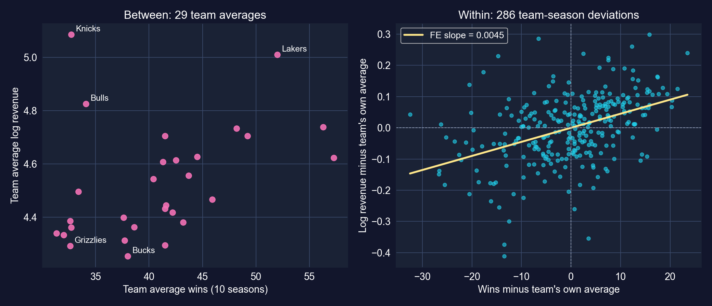

[左のパネルは市場規模と勝利を混ぜています（Knicksは少ししか勝たないのに最も多く稼ぐ）。右のパネルは各チームをそれ自身とだけ比較します。]{.takeaway .fragment}

::: {.notes}
左：チーム間では関係はノイズが多く、KnicksとBullsは市場規模のおかげで多く勝たなくても多く稼ぎます。チーム平均収益とチーム平均勝利の相関はわずか0.40です。右：各チームの平均を除くと、いつもより多くの勝利はいつもより多くの収益を伴います。これがまさに固定効果が使う変動です。黄色い線はFEの傾き0.0045です。
:::

## プールされた像は両方の比較を混ぜる

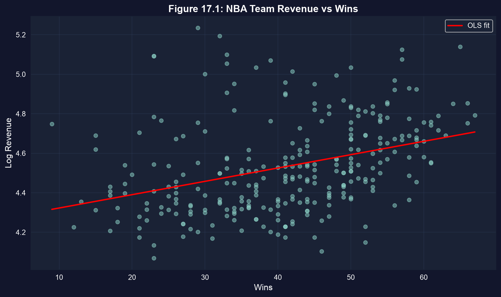

[プールされた傾きは、勝利に市場規模の分を一部帰属させます。大市場のチームは、成績がどうであれ収益軸で高い位置にあります。]{.takeaway .fragment}

::: {.notes}
これが本章の図17.1です。正の傾きは記述としては本物ですが、二つの比較を束ねています。次のコードブロックがそれを推定し、その標準誤差をどう計算するかを問います。
:::

## コード：三種類の標準誤差を用いたプールドOLS

``` {.python code-line-numbers="1-4|5-6|7"}
# continues from the previous block
f_iid = pf.feols("lnrevenue ~ wins", data=data_nba)                 # default (iid) SEs
f_hc1 = pf.feols("lnrevenue ~ wins", data=data_nba, vcov="HC1")     # heteroskedasticity-robust
fit_pool = pf.feols("lnrevenue ~ wins", data=data_nba, vcov={"CRV1": "teamid"})  # by team
for name, f in [("default", f_iid), ("HC1", f_hc1), ("cluster", fit_pool)]:
    print(name, f.coef()["wins"], f.se()["wins"], f.tstat()["wins"])   # same b, new SE
fit_pool.summary()                           # full table with cluster-robust SEs
```

[↗ Colab で試す](https://colab.research.google.com/notebooks/empty.ipynb){.colab-link target="_blank" data-preview-link="false"}

::: {.notes}
同じモデルの三つの当てはめです。固定効果のないモデルに対するpyfixestのデフォルトはiid SEです。HC1は観測間の不均一分散を許します。teamidでのCRV1は、あるチームの十の観測間のどんな相関も許します。
:::

## 出力：同じ傾き、まったく異なる不確実性 {.smaller}

| SEの種類 | `wins`の係数 | SE | $t$ | $p$ | 95% 信頼区間 | SE ÷ デフォルト |
|:--|--:|--:|--:|--:|:--|--:|
| デフォルト（iid） | 0.00675 | 0.00105 | 6.42 | <&nbsp;0.001 | [0.00468,&nbsp;0.00882] | 1.00 |
| HC1 | 0.00675 | 0.00102 | 6.61 | <&nbsp;0.001 | [0.00474,&nbsp;0.00876] | 0.97 |
| チームでクラスター | 0.00675 | [0.00191]{.key} | 3.54 | 0.001 | [0.00284,&nbsp;0.01066] | [1.81]{.key} |

[N = 286 · 29クラスター · $R^2 = 0.127$（三行すべてで同一）]{.comment}

[ここでの問題は不均一分散ではありません（HC1 ≈ デフォルト）。**チーム内の依存**が問題です。それを許すとSEが81%広がり、$t$統計量が半分になります。]{.takeaway .fragment}

::: {.notes}
本章の表を再現します。デフォルト0.0011、ロバスト0.0010、クラスター0.0019、比1.81です。本章は別の箇所でクラスターSEは「2倍以上」であり、クラスタリングは「おおよそ2倍にする」と述べていますが、この例では係数は1.81です。有意性は残り（t = 3.54、p = 0.001）、クラスタリングは結果を覆さずに不確実性を正します。
:::

## なぜクラスタリングか：一つのチームの十シーズンは十個の独立した事実ではない {.smaller}

$$\widehat{V}_{\text{CR}}(\hat\beta) = (X'X)^{-1}\Big(\textstyle\sum_{g=1}^{G} X_g'\hat u_g \hat u_g' X_g\Big)(X'X)^{-1}$$

::: {.incremental}
- 中央の項は**クラスター**$g$について和をとるので、あるチーム*内*の残差のどのペアも相関しうります。*異なる*チームの残差は独立と仮定されます
- チーム内相関の**二つの源**：持続的なチーム効果（Lakersの残差は毎年正）と系列相関（好調な年は好調な年に続く）
- 完全相関の極限では、一つのチームの10シーズンが1観測の情報量を運びます。真実はその間にあります
:::

[クラスタリングはショックが共有される水準で行わなければなりません。$G = 29$クラスターでは$t$の基準の自由度は$G - 1 = 28$しかありません。]{.takeaway .fragment}

::: {.notes}
本章はクラスターの公式を分母の省略記号で書いていますが、上のサンドイッチ形が完全版です。本章からの実務的な注意：クラスターが約30未満では、クラスターロバストSEはまだ小さすぎることがあります。ワイルドクラスターブートストラップが通常の改良です（言及されるが実行されない）。二元クラスタリング（チームとシーズン）は共通のシーズンショックも許します。その分散はV_チーム + V_シーズン − V_チーム×シーズンです。
:::

## 出力：プールド回帰を正しく読む {.smaller}

| 変数 | 係数 | SE | $t$ | $p$ | 95% 信頼区間 |
|:--|--:|--:|--:|--:|:--|
| 切片 | 4.25520 | 0.09572 | 44.45 | <&nbsp;0.001 | [4.05912,&nbsp;4.45128] |
| `wins` | [0.00675]{.key} | 0.00191 | 3.54 | 0.001 | [0.00284,&nbsp;0.01066] |

[N = 286 · `teamid`でクラスターしたCRV1 SE（29クラスター） · $R^2 = 0.127$]{.comment}

::: {.incremental}
- **log-levelモデル**：勝利が一つ増えると$100 \times 0.00675 \approx 0.68\%$収益が増える（対数ポイント近似）
- 勝利が十増えると：$100\,(e^{10 \times 0.00675}-1) = 7.0\%$
- $R^2 = 0.127$：勝利は収益のばらつきをほとんど説明せず、それはおもにチームの特性による
:::

[これは**チーム間とチーム内の関連**です。より多く勝つチームは豊かな市場のチームでもある傾向があるので、この傾きはまだ「勝つことの効果」ではありません。]{.takeaway .fragment}

::: {.notes}
log-level係数の解釈：100 × bは勝利一つあたりの収益の近似的な変化率です。より大きな変化には厳密な変換100(e^{Δx·b} − 1)を使います。切片（4.26、すなわち約$70M）は勝利ゼロでの予測対数収益で、データの外（最小9勝）への外挿です。
:::

# 17.3 · 固定効果：各チームをそれ自身とだけ比較する {#sec-fe .divider background-color="#7A209F"}

[within変換 · LSDV · FEが吸収するもの · 欠落変数バイアス]{.act}

::: {.notes}
17.3節。固定効果はその十年間で変わらないチームに関するすべてを除去します。市場規模、アリーナ、ブランド、オーナーシップ、地域所得（安定している範囲で）です。
:::

## 固定効果モデルとwithin変換 {.smaller}

$$y_{it} = \alpha_i + \beta\,x_{it} + \varepsilon_{it}$$

各チームの式をそのシーズンにわたって平均し、引きます：

$$(y_{it}-\bar y_i) = \beta\,(x_{it}-\bar x_i) + (\varepsilon_{it}-\bar\varepsilon_i)$$

::: {.incremental}
- $\alpha_i$が**消えます**：チーム内で一定なものは、$x$と相関していても$\hat\beta$を偏らせられません
- 同じ推定が二通り：**LSDV**（チームごとに一つのダミー）か、**平均除去（de-meaning）**してからOLS
- 代償：**時間不変**な回帰変数の係数は推定できず、within変動だけが使われます
:::

[FEは「欠落変数なし」という仮定を、「*単位内で時間を通じて変化する*欠落変数なし」という、より弱いものに取り替えます。]{.takeaway .fragment}

::: {.notes}
これが鍵となる識別の仮定で、しばしば厳密な外生性と呼ばれます。時間変化する誤差は各期間で回帰変数と無相関でなければなりません。十シーズンを通じて固定的なチームの特性（市場規模、アリーナ、歴史）はalpha_iに吸収されます。時間を通じて変化し、勝利と収益の両方を動かすもの（新しいスター、新しいアリーナ、新しいTV契約）はそうではありません。
:::

## コード：固定効果と、手計算による確認

``` {.python code-line-numbers="1-3|4-5|6-9"}
# continues from the previous block
fit_fe = pf.feols("lnrevenue ~ wins | teamid", data=data_nba,
                  vcov={"CRV1": "teamid"})   # "| teamid" = one intercept per team
fit_fe.summary()                             # within estimator, cluster SEs by team
print(fit_fe._r2_within)                     # share of WITHIN-team variation explained
# check: the same slope from OLS on de-meaned data (the within transformation)
data_nba["dm_lnrev"] = data_nba["lnrevenue"] - g["lnrevenue"].transform("mean")
data_nba["dm_wins"] = data_nba["wins"] - g["wins"].transform("mean")
print(pf.feols("dm_lnrev ~ dm_wins - 1", data=data_nba).coef())   # identical slope
```

[↗ Colab で試す](https://colab.research.google.com/notebooks/empty.ipynb){.colab-link target="_blank" data-preview-link="false"}

::: {.notes}
式中の縦棒は、チーム固定効果を吸収するようpyfixestに伝えます。最後の三行は、FEが平均除去したデータに対するOLSにほかならないことを示します。傾きはすべての桁で一致します。（手動回帰のSEは29の推定された平均のための自由度の補正が必要ですが、pyfixestがそれを処理します。）
:::

## 出力：チーム内の傾きは三分の一小さい {.smaller}

| 変数 | 係数 | SE | $t$ | $p$ | 95% 信頼区間 |
|:--|--:|--:|--:|--:|:--|
| `wins` | [0.00451]{.key} | 0.00084 | 5.35 | <&nbsp;0.001 | [0.00278,&nbsp;0.00623] |

[N = 286 · 29のチーム固定効果 · `teamid`によるCRV1 SE · within $R^2 = 0.185$ · 手動平均除去OLSの傾き：0.00451]{.comment}

| | プールドOLS | 固定効果 |
|:--|--:|--:|
| `wins`の係数 | 0.00675 | [0.00451]{.key} |
| クラスターSE | 0.00191 | 0.00084 |
| $R^2$ | 0.127（全体） | 0.185（within） |

[チームを固定すると、傾きは**33%**下がり、しかも*より*正確に推定されます。チーム効果を除くことで残差ノイズの大部分が除かれたからです。]{.takeaway .fragment}

::: {.notes}
本章と一致：0.0045、SE 0.0008、t 5.35、within R² 0.185。二つのR²値は比較できません。一方は全体、もう一方はwithinです。また、FE内でもクラスタリングが依然重要であることに注意してください。FEの傾きのiid SEは0.00059なので、クラスタリングはそれを1.42倍に広げ、チーム効果が除去しなかった系列相関を反映します。
:::

## 各チームの内側に一つの傾き

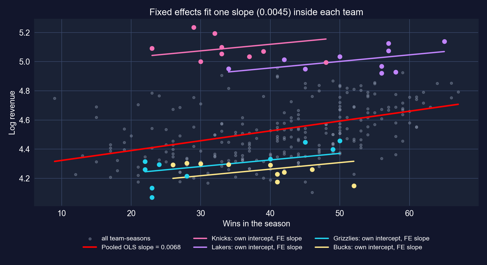

[大市場のチーム（Knicks、Lakers）は高い線に、小市場のチーム（Grizzlies、Bucks）は低い線に乗ります。プールド線がより急なのは、それらの線を*横切って*上るからです。]{.takeaway .fragment}

::: {.notes}
各色の線は、そのチーム自身の切片alpha_iと共通のFEの傾き0.0045を使います。プールド線は低収益・低勝利のチームと高収益・高勝利のチームをつなぎ、そのチーム間の比較こそが余分な急さの出どころです。
:::

## なぜ傾きが下がったか：符号つきの欠落変数バイアス

$$\text{plim}\;\hat\beta_{\text{プールド}} = \beta + \gamma\,\frac{\text{Cov}(\alpha_i, x_{it})}{\text{Var}(x_{it})}$$

::: {.incremental}
- $\gamma > 0$：チーム効果（市場、ブランド）が収益を上げる
- $\text{Cov}(\alpha_i, x_{it}) > 0$：豊かな市場のチームは幾分多く勝ちもする（チーム平均収益と勝利の相関は0.40）
- よってプールドの傾きは**上向きに**偏る：0.00675対0.00451、差は0.00225
:::

[プールドからFEへの変化の方向は、欠落した特性が$x$と$y$の両方を助けるときに欠落変数の公式が予測する通りです。]{.takeaway .fragment}

::: {.notes}
第13章のフィリップス曲線の場合と同じ公式です。バイアス = （欠落変数のyへの効果）×（欠落変数のxへの傾き）。ここでは欠落変数はチーム固定効果です。FEはgammaを推定せず、構成によって項を除去します。0.40の相関は29のチーム平均の対数収益と勝利の間のものです（これらのスライドのために計算）。
:::

## 勝利一つの価値

::: {.incremental}
- **勝利あたり**：同じチームで$100\,(e^{0.00451}-1) = 0.45\%$多い収益
- 標本平均収益の**\$95.7M**で：勝利あたり約**\$0.43M**
- そのチームの通常より**十勝多い**：$100\,(e^{10 \times 0.00451}-1) = 4.6\%$、約**\$4.4M**
- プールドの傾きなら十勝で7.0%（\$6.7M）と言ったはず
:::

[勝つことは利益になりますが、横断面が示唆するよりはるかに少ないです。収益差の大部分の出どころは、勝利の列ではなく市場規模です。]{.takeaway .fragment}

::: {.notes}
本章は効果を「収益$200Mのチームについて」評価します（0.45% × $200M = $900K）。この標本ではどのチーム・シーズンも$200Mに届きません（最大$187.7M；平均$95.7M）ので、デッキは代わりに標本平均で評価します。すべての変換は厳密な指数公式を使います。
:::

## 固定効果が直せるものと直せないもの

:::: {.columns}
::: {.column width="50%"}
**吸収される（時間不変）**

- 市場規模と地域所得水準
- アリーナ、フランチャイズの歴史、ブランド
- オーナーシップのスタイル（安定していれば）
:::
::: {.column width="50%"}
**吸収されない（時間変化）**

- スターの加入、コーチの交代、負傷
- パネル途中の新アリーナやTV契約
- リーグ全体のショック（ロックアウト、不況）
- 収益 → 給与 → 勝利（逆の因果）
:::
::::

[FEは因果の読みを*より妥当に*しますが、保証はしません。自然な次の一歩はシーズン固定効果`| teamid + season`で、リーグ全体のショックに対応します。]{.takeaway .fragment}

::: {.notes}
忠実性に関する二つの注意。本章はFEモデルをシーズン項（γ·season_t）つきで書いていますが、そのコードはlnrevenue ~ wins | teamidを、シーズン効果なしで推定しています。スライドはコードが推定するものを報告します。本章はまたFEを2015年のGolden Stateと2012年・2015年のLakersで例示していますが、それらのシーズンはこの標本の外です（2001–02から2010–11）。シーズン固定効果は拡張として提案され、ここでは推定しません。
:::

# 17.4 · 固定効果か変量効果か？ {#sec-re .divider background-color="#7A209F"}

[変量効果 · 有効性対一致性 · Hausman検定]{.act}

::: {.notes}
17.4節。本章は変量効果とHausman検定を記述しますが、どちらも推定しません。その17.4のコードはプールド対FEの比較を出力します。したがってデッキは手法を復習し、コードが実際に計算するものを報告します。
:::

## 変量効果：勝利と無関係と仮定されるチーム効果

$$y_{it} = \beta_1 + \beta_2 x_{it} + \underbrace{(\alpha_i + \varepsilon_{it})}_{\text{複合誤差}}, \qquad \alpha_i \sim (0,\sigma_\alpha^2),\;\; \varepsilon_{it} \sim (0,\sigma_\varepsilon^2)$$

::: {.incremental}
- **鍵となる仮定**：$\text{Cov}(\alpha_i, x_{it}) = 0$、すなわちチーム効果は回帰変数と無関係
- **推定**：実行可能GLS。*部分的に*平均除去する：$\theta = 1 - \sqrt{\sigma_\varepsilon^2 / (\sigma_\varepsilon^2 + T\sigma_\alpha^2)}$で$y_{it} - \theta\,\bar y_i$
- $\theta = 0$はプールドOLS、$\theta = 1$はFEを与える。REは**その間**にあり、betweenの変動を幾らか使う
:::

[REは仮定で有効性を買います。大市場のチームが多く勝ちもするなら、仮定は崩れ、REはプールドのバイアスの一部を受け継ぎます。]{.takeaway .fragment}

::: {.notes}
準平均除去の公式は標準的な教科書のRE（GLS）変換で、手法の復習としてここに加えました。本章は「実行可能GLS」とだけ述べています。T = 10シーズンでチーム効果の分散が大きいと、thetaは1に近く、REはFEに近づきます。それは公式についての言明であって推定ではありません。REは本章でもこのデッキでも推定されません。
:::

## プールド、RE、FE：それぞれが何を比較するか {.smaller}

| | プールドOLS | 変量効果 | 固定効果 |
|:--|:--|:--|:--|
| **使う変動** | between + within、等しい重み | within + betweenの一部$(1-\theta)$ | withinのみ |
| **$\alpha_i$について仮定** | $x$と無相関（かつ無視） | $x$と無相関 | 何も；$x$と相関しうる |
| **$\alpha_i$が$x$と相関しても一致？** | いいえ | いいえ | **はい** |
| **相関しなければ有効？** | いいえ | **はい** | いいえ |
| **時間不変の回帰変数？** | はい | はい | いいえ |
| **NBAの推定** | 0.00675 | *未推定* | [0.00451]{.key} |

[観察的パネルでは「無相関」の仮定が信じられることはまれなので、FEがデフォルトで、REには正当化が必要です。]{.takeaway .fragment}

::: {.notes}
REは、単位効果が回帰変数に対してもっともらしく無作為であるとき、たとえば回帰変数が無作為に割り当てられるときに、通常は擁護できます。NBAの場合、市場規模はほぼ確実に勝てるロスターを買う能力と相関します。
:::

## Hausman検定：REの仮定は生き残るか？

$$H = (\hat\beta_{FE} - \hat\beta_{RE})'\,\big[\widehat V(\hat\beta_{FE}) - \widehat V(\hat\beta_{RE})\big]^{-1}(\hat\beta_{FE} - \hat\beta_{RE}) \;\sim\; \chi^2_k$$

::: {.incremental}
- $H_0$：$\alpha_i$は回帰変数と無相関なので、**両方**が一致し、REが有効：二つの推定は近いはず
- $H_a$：相関するので、FEだけが一致：推定が乖離する
- 大きな$H$（小さな$p$）はREを棄却する；FEを保つ
:::

[本章は検定を述べますが決して計算しないので、このデッキはNBAについてHausmanの結果を**報告しません**。「ここでHausmanはREを棄却する」という主張はすべて未検証として扱ってください。]{.takeaway .fragment}

::: {.notes}
古典的なHausman統計量はH0のもとでREが完全に有効と仮定しますが、これは不均一分散やクラスター化された誤差では崩れます。ロバストな代替は相関変量効果（Mundlak）検定で、xのチーム平均を回帰変数として加えます。両方とも標準的な実務として言及され、推定されません。

忠実性の注意：本章のKey Conceptsの例はFE係数が「RE係数より顕著に小さい」、Hausman検定が「典型的にREを棄却する」と述べています。REも検定も本章のどこでも推定されません。練習問題3（χ² = 25.4）は仮想で、このデータセットではありません。
:::

## コード：本章の17.4セルが実際に計算するもの

``` {.python code-line-numbers="1|2-5|6"}
# continues from the previous block (the chapter's 17.4 code)
comparison_table = pd.DataFrame({
    "Pooled OLS": [fit_pool.coef()["wins"], fit_pool.se()["wins"], fit_pool._r2, fit_pool._N],
    "Fixed Effects": [fit_fe.coef()["wins"], fit_fe.se()["wins"], fit_fe._r2_within, fit_fe._N]
}, index=["Wins Coefficient", "Wins Std Error", "R²", "N"])
print(comparison_table)                      # R² rows differ in kind: overall vs within
```

[↗ Colab で試す](https://colab.research.google.com/notebooks/empty.ipynb){.colab-link target="_blank" data-preview-link="false"}

| | プールドOLS | 固定効果 |
|:--|--:|--:|
| 勝利の係数 | 0.00675 | 0.00451 |
| 標準誤差（クラスター） | 0.00191 | 0.00084 |
| $R^2$ | 0.127 | 0.185 |
| $N$ | 286 | 286 |

::: {.notes}
pyfixestは固定効果推定に焦点を当てており、変量効果の推定量を持ちません。本章はこれをコードのコメントで注記しています。PythonではlinearmodelsパッケージがRandomEffectsとHausman型の比較を提供します。それは本章の道具箱の外であり、ここでは実行しません。
:::

# 17.4b · 誰が\$60,000より多く稼ぐか？ {#sec-logit .divider background-color="#7A209F"}

[二値の結果 · 線形確率モデル · logit · 限界効果]{.act}

::: {.notes}
本章の17.4はlogitを通じて非線形モデルも導入します。異なるデータ：パネル構造のない労働者の横断面です。教訓：yが0/1のとき、モデルを予測確率と限界効果を通して読むこと。
:::

## 問い：教育、年齢、そして高所得の確率 {.smaller}

**データ。** 872人のフルタイム労働者、2010年（`AED_EARNINGS_COMPLETE.DTA`）。結果：`dbigearn` = 年間所得が\$60,000を超えれば1。

| 変数 | 意味 | 平均 |
|:--|:--|--:|
| `dbigearn` | 所得 > \$60,000 なら1（238人） | 0.273 |
| `education` | 就学年数（0–20） | 13.85 |
| `age` | 年齢（年） | 43.3 |

::: {.incremental}
- **線形確率モデル（LPM）**：$\Pr(y=1\mid x) = x'\beta$；傾きは確率の変化だが、当てはめ値が$[0,1]$から外れうる
- **Logit**：$\Pr(y=1\mid x) = \dfrac{e^{x'\beta}}{1+e^{x'\beta}}$；常に$(0,1)$の中だが、$\beta_j$は**対数オッズ**の単位
:::

[Logitの限界効果$\partial p/\partial x_j = p(1-p)\,\beta_j$は$p$とともに変わるので、*どこで*評価するかを言わなければなりません。]{.takeaway .fragment}

::: {.notes}
本章のデータセット一覧は842人の労働者とありますが、ファイルは872で、すべての結果は872を使います。限界効果はp = 0.5で最大となり、そこではβ/4に等しく、裾に向かってゼロに縮みます。
:::

## コード：二値の結果を作り、logitを当てはめる

``` {.python code-line-numbers="1-4|5-7|8|9-10"}
!pip install -q pyfixest                      # pyfixest is not preinstalled in Colab
import pandas as pd                           # tabular data
import pyfixest as pf                         # OLS for the linear probability model
from statsmodels.formula.api import logit     # logit with R-style formulas
url = "https://raw.githubusercontent.com/quarcs-lab/data-open/master/AED/AED_EARNINGS_COMPLETE.DTA"
data_earnings = pd.read_stata(url)            # 872 full-time workers, 2010
data_earnings["dbigearn"] = (data_earnings["earnings"] > 60000).astype(int)  # 1 = high earner
print(data_earnings["dbigearn"].mean())       # share of high earners
model_logit = logit("dbigearn ~ age + education", data=data_earnings).fit(cov_type="HC1", disp=0)
print(model_logit.summary())                  # coefficients in log-odds units, robust SEs
```

[↗ Colab で試す](https://colab.research.google.com/notebooks/empty.ipynb){.colab-link target="_blank" data-preview-link="false"}

::: {.notes}
自己完結型のブロックです。logitは最尤法で当てはめます。cov_type="HC1"は本章のとおり不均一分散にロバストな（サンドイッチ）標準誤差を要求します。
:::

## 出力：logit係数は対数オッズであって確率ではない {.smaller}

| 変数 | 係数 | SE | $z$ | $p$ |
|:--|--:|--:|--:|--:|
| 切片 | −8.0651 | 0.6914 | −11.67 | <&nbsp;0.001 |
| `age` | 0.0385 | 0.0080 | 4.85 | <&nbsp;0.001 |
| `education` | [0.3742]{.key} | 0.0366 | 10.22 | <&nbsp;0.001 |

[N = 872 · `dbigearn` = 1の割合：0.273 · HC1 SE · McFadden擬似$R^2 = 0.145$]{.comment}

::: {.incremental}
- **符号と有意性**はいつも通り読めます：年齢が高く教育のある労働者ほど\$60kを超えて稼ぐ確率が高い
- **大きさ**はそうではありません：就学年数が一つ増えると**オッズ**が$e^{0.3742} = 1.45$倍になる
- 確率について語るには**限界効果**が必要です
:::

[logit係数の0.37は「37パーセントポイント」ではありません。対数オッズの変化です。]{.takeaway .fragment}

::: {.notes}
擬似R²は対数尤度を定数のみのモデルと比較します。分散の割合ではなく、通常はOLSのR²値よりはるかに低いです。オッズ比がlogit係数の最もすっきりした厳密な読みです。
:::

## コード：限界効果と線形確率モデル

``` {.python code-line-numbers="1-3|4|5-6|7-8"}
# continues from the previous block
ame = model_logit.get_margeff()               # default at="overall": AVERAGE marginal effects
mem = model_logit.get_margeff(at="mean")      # marginal effects AT THE MEANS of age, education
print(ame.summary()); print(mem.summary())
fit_lpm = pf.feols("dbigearn ~ age + education", data=data_earnings, vcov="HC1")
fit_lpm.summary()                             # slopes are directly probability changes
p_lpm = fit_lpm.predict()                     # LPM fitted "probabilities"
print((p_lpm < 0).sum(), p_lpm.min())         # how many fall below zero?
```

[↗ Colab で試す](https://colab.research.google.com/notebooks/empty.ipynb){.colab-link target="_blank" data-preview-link="false"}

::: {.notes}
本章はget_margeff()を呼び、出力を「限界効果（平均で）」と名づけています。しかしstatsmodelsのデフォルトはat="overall"です。各労働者の限界効果を平均します（AME）。平均での限界効果にはat="mean"が必要です。デッキは両方を実行します。
:::

## 出力：「就学年数が一つ増える」への三つの答え {.smaller}

| $\Pr(\text{所得} > \$60\text{k})$への効果 | `education` | SE | `age` | SE |
|:--|--:|--:|--:|--:|
| Logit、**平均**限界効果（`get_margeff()`） | [0.0618]{.key} | 0.0047 | 0.0064 | 0.0013 |
| Logit、**平均での**限界効果（`at="mean"`） | 0.0662 | 0.0062 | 0.0068 | 0.0014 |
| 線形確率モデル（OLS、HC1） | 0.0540 | 0.0050 | 0.0064 | 0.0013 |

[LPM：N = 872 · $R^2 = 0.142$ · `education`の95%信頼区間 [0.0442, 0.0639]]{.comment}

[就学年数が一つ増えると\$60kを超えて稼ぐ確率が平均で約**6.2パーセントポイント**（logit）、または5.4（LPM）上がります。同じ符号、似た大きさです。]{.takeaway .fragment}

::: {.notes}
本章の本文は教育の限界効果が「標本平均で」「約0.05、すなわちおおよそ5パーセントポイントの上昇」と述べています。平均では0.066です。平均限界効果（本章のコードが実際に出力するもの）は0.062で、0.054はLPMの係数です。定性的な教訓は成り立ちます（logitとLPMは符号とおおよその大きさで一致）。数字には正しいラベルが必要です。公式の確認：平均でのp = 0.229なので、0.229 × 0.771 × 0.3742 = 0.066です。
:::

## 二つのモデルが分かれるところ

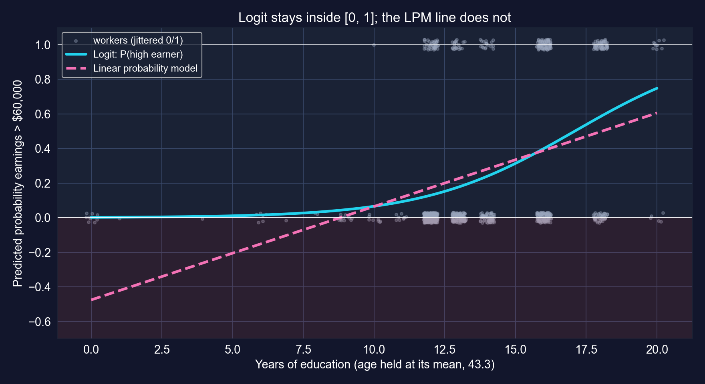

[データでは、**872中30**のLPM当てはめ値が負です（最小−0.59）。どのlogit予測も0.001と0.86の間にとどまります。]{.takeaway .fragment}

::: {.notes}
二つの曲線はデータの中央（就学12〜16年）で一致します。16年では両方とも約0.39〜0.40を予測します。裾で乖離し、そこではLPMの線が進み続け、logitは平らになります。20年ではlogitは0.75、LPMは0.61を予測します。負のLPM予測は就学がごく少ない労働者から生じます。平均限界効果は曲線を一つの数字で要約します。図は、一つの数字がなぜ変動を隠すかを示します。
:::

## logitを正直に読む

::: {.incremental}
- **限界効果を報告し**、どちらかを言う：平均（AME）か平均での（MEM）か。ここでは0.004だけ異なる
- **LPMは良い第一近似**です。データ中央付近の平均効果には使えます。予測と裾にはlogit（またはprobit）を使います
- **関連であって教育の収益ではない**：能力、家庭背景、職業選択が教育とも所得とも相関します
- カットオフは恣意的です：\$60,000は`earnings`の情報の大部分を捨てます。前の章の対数所得回帰はそれをすべて使います
:::

[二値モデルは答えの*スケール*を変えますが、*識別*の問題は変えません。]{.takeaway .fragment}

::: {.notes}
この例がパネルの章にあるのは、本章が非線形モデルを17.4に置いているからにすぎません。ここにパネルは何もありません。識別上の注意点は、所得を教育に回帰するどんな横断面回帰とも同じです。
:::

# 第II-b幕 · 時系列：順序と記憶 {.divider background-color="#7A209F"}

[17.5 – 17.6 · 定常性、見せかけの回帰、HAC、自己相関、ARとADL]{.act}

::: {.notes}
一つの単位（米国財務省証券市場）、397か月です。パネルの問題が時間の問題になります。共有されるチームの特性の代わりに共有されるトレンド、クラスター内相関の代わりに系列相関です。
:::

# 17.5 · 長期金利は短期金利に追随するか？ {#sec-ts .divider background-color="#7A209F"}

[定常性 · 見せかけの回帰 · トレンドつきの水準 · Newey–West HAC]{.act}

::: {.notes}
17.5節：10年物財務省証券金利の1年物金利への水準回帰を、時間トレンドつきで、デフォルトとHACの標準誤差のもとで行います。
:::

## 問いとデータ {.smaller}

**データ。** 米国財務省証券の月次利回り、1982年1月〜2015年1月：**397か月**（`AED_INTERESTRATES.DTA`）。

| 変数 | 意味 | 平均 | 範囲 |
|:--|:--|--:|:--|
| `gs10` | 10年物財務省証券金利、% | 6.19 | 1.53 – 14.59 |
| `gs1` | 1年物財務省証券金利、% | 4.69 | 0.10 – 14.73 |
| `dgs10` | `gs10`の月次変化、パーセントポイント | −0.03 | −1.43 – 0.78 |
| `dgs1` | `gs1`の月次変化、パーセントポイント | −0.04 | −1.81 – 0.76 |

[**経済的な問い**：短期金利（Fedが影響する）の動きのうち、どれだけが長期金利（住宅ローンや投資に重要）に波及するか？]{.takeaway .fragment}

::: {.notes}
期待仮説は、長期金利が将来の短期金利の期待にターム・プレミアムを加えたものを反映すると述べます。そうなら、短期金利の動きは長期金利に波及するはずですが、1対1より小さく波及します。1年物の動きは10年の期待経路の一部しか変えないからです。
:::

## 心に留めておく三つの時系列の考え方

::: {.incremental}
- ラグ$k$での**自己相関**：$r_k = \dfrac{\sum_{t=k+1}^{T}(y_t-\bar y)(y_{t-k}-\bar y)}{\sum_{t=1}^{T}(y_t-\bar y)^2}$。今日は昨日に似る
- **定常性**：平均、分散、自己相関が時間を通じて変わらない。トレンドを持つ系列は**非定常**
- **見せかけの回帰**：トレンドを持つ系列を別の系列に回帰すると、構造的なつながりがなくても高い$R^2$と巨大な$t$統計量が得られる
:::

[トレンドを持つデータでは、大きな$R^2$は報酬ではなく警告です。二つの治療：データを**差分する**か、水準を保ち**HAC**標準誤差を使う（そしてよく考える）。]{.takeaway .fragment}

::: {.notes}
多くのマクロ系列はドリフトつきのランダムウォークのように振る舞います。その水準はさまよい、変化はおおよそ定常です。見せかけの回帰（GrangerとNewbold）は、共通因子による交絡の時系列版です。ここでの共通因子は時間そのものです。
:::

## 両金利は14%からほぼゼロへと下降ドリフトする

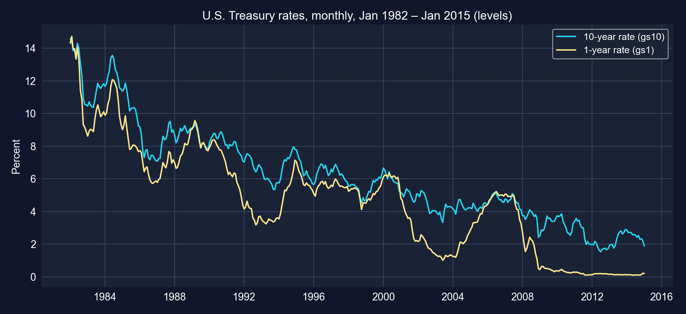

[33年にわたり両金利は十ポイント以上下がります。一方の水準を他方に回帰すればどれも、この共有される下降ドリフトを一部当てはめます。水準では二系列は0.95で相関します。]{.takeaway .fragment}

::: {.notes}
後半の期間にも注意してください。2008年以降、1年物金利はゼロ近く（ゼロ下限）に固定され、10年物金利は動き続けます。1982〜2015年にわたる単一の線形関係は、関係が非常に異なる金融政策レジームを通じて安定だとも仮定します。
:::

## コード：水準回帰、デフォルトとHACのSEで

``` {.python code-line-numbers="1-4|5-6|7-10|11"}
!pip install -q pyfixest                     # pyfixest is not preinstalled in Colab
import numpy as np                           # numerical operations
import pandas as pd                          # tabular data
import pyfixest as pf                        # OLS with default / HAC standard errors
url = "https://raw.githubusercontent.com/quarcs-lab/data-open/master/AED/AED_INTERESTRATES.DTA"
data_rates = pd.read_stata(url)              # 397 months, Jan 1982 – Jan 2015
data_rates["time"] = np.arange(len(data_rates))              # linear time trend 0, 1, 2, ...
fit_levels = pf.feols("gs10 ~ gs1 + time", data=data_rates)   # default SEs
fit_levels_hac = pf.feols("gs10 ~ gs1 + time", data=data_rates, vcov="NW",
                          vcov_kwargs={"time_id": "time", "lag": 24})   # Newey–West, 24 lags
fit_levels_hac.summary()                     # same coefficients, HAC SEs
```

[↗ Colab で試す](https://colab.research.google.com/notebooks/empty.ipynb){.colab-link target="_blank" data-preview-link="false"}

::: {.notes}
自己完結型です。線形時間トレンドを含めると回帰が共通の線形ドリフトを吸収できますが、さまよう非線形のトレンドは吸収できません。24ラグのHACは、月次データ二年分にわたって誤差が相関することを許します。
:::

## 出力：ほぼ完璧な当てはめと、3.6倍小さすぎたSE {.smaller}

| 変数 | 係数 | デフォルトSE | デフォルト$t$ | HAC SE | HAC $t$ | HAC ÷ デフォルト |
|:--|--:|--:|--:|--:|--:|--:|
| 切片 | 5.8994 | 0.2254 | 26.17 | 0.6640 | 8.89 | 2.95 |
| `gs1` | [0.5076]{.key} | 0.0221 | 22.92 | 0.0808 | 6.28 | [3.65]{.key} |
| `time` | −0.0106 | 0.0006 | −16.69 | 0.0018 | −5.79 | 2.88 |

[N = 397 · $R^2 = 0.947$ · HAC：Newey–West、24ラグ · `gs1`のHAC 95%信頼区間：[0.3488, 0.6663]]{.comment}

[線形トレンドを固定すると、短期金利が1ポイント高いことは長期金利が**0.51ポイント**高いことを伴います。当てはめは見事に見えますが、残差が強く持続的なので、デフォルトSEは精度を三倍以上過大評価します。]{.takeaway .fragment}

::: {.notes}
本章と一致：R²は約0.95で、HAC SEはデフォルトの三倍以上（3.65倍）です。時間の係数は、長期金利が短期金利の説明を超えて月あたり約0.011ポイント（年あたり約0.13）下降ドリフトしたことを示します。

本章は後に「長期」水準係数が「≈ 0.90–0.95」だと主張します。トレンドつきでは0.51、トレンドなし（本章のチートシート回帰gs10 ~ gs1）では0.84でR²は0.909です。どちらも0.90–0.95ではありません。
:::

## HAC標準誤差の仕組み

$$\widehat V_{\text{HAC}} = (X'X)^{-1}\Big[\hat\Omega_0 + \sum_{\ell=1}^{L} w_\ell\,\big(\hat\Omega_\ell + \hat\Omega_\ell'\big)\Big](X'X)^{-1}, \qquad w_\ell = 1 - \frac{\ell}{L+1}$$

::: {.incremental}
- $\hat\Omega_\ell = \sum_t \hat u_t \hat u_{t-\ell}\, x_t x_{t-\ell}'$：$\ell$か月離れたスコアの共分散
- **Bartlett重み**$w_\ell$は遠いラグを縮める；$L$は分析者が選ぶ（ここでは24か月）
- HACは**標準誤差**を直します。見せかけの**係数**は直し**ません**
:::

[HACが時系列に対するものは、クラスタリングがパネルに対するものと同じです。同じサンドイッチ、どの誤差が相関しうるかについての異なる考え方です。]{.takeaway .fragment}

::: {.notes}
Newey–West推定量は、中央が異なるクラスターロバスト・サンドイッチです。クラスター内で和をとる代わりに、減衰する重みで近い期間の交差積を和します。Lの選び方：0.75·T^(1/3)のような経験則はT = 397で約5.5を与えますが、本章は強い持続性を踏まえて保守的に24（二年）を選びます。
:::

# 17.6 · 自己相関：水準の当てはめは見せかけか？ {#sec-ac .divider background-color="#7A209F"}

[コレログラム · 帰結 · 一階差分]{.act}

::: {.notes}
17.6節：水準回帰の残差を診断し、次に変化で再推定します。
:::

## 自己相関：何を壊し、どう見るか

::: {.incremental}
- **帰結**：OLS係数は（回帰変数が外生なら）不偏のままですが、デフォルトSEは誤りで、通常**小さすぎ**、$t$検定が過剰に棄却する
- **検出**：残差の**コレログラム**；Breusch–GodfreyのLM検定；AR(1)誤差に対するDurbin–Watson統計量
- **対応**：HAC SE；動学をモデル化する（AR、ADL）；または非定常な系列を**一階差分する**
:::

[ゆっくり減衰するコレログラムは、非定常な、単位根に近い誤差の指紋です。]{.takeaway .fragment}

::: {.notes}
本章はacorr_breusch_godfreyをインポートしますが決して実行しません。デッキは本章のコードどおりコレログラムに頼ります。ホワイトノイズのもとでの単一の自己相関の近似95%バンド：ここでは±1.96/√T = ±0.098です。
:::

## コード：水準回帰の残差自己相関

``` {.python code-line-numbers="1-3|4-5|6-7"}
# continues from the previous block
from statsmodels.tsa.stattools import acf             # autocorrelation function
from statsmodels.graphics.tsaplots import plot_acf    # correlogram plot
data_rates["uhatgs10"] = fit_levels._u_hat            # residuals of the levels regression
acf_resid = acf(data_rates["uhatgs10"].dropna(), nlags=10)   # lags 0..10
for k in range(11): print(k, round(acf_resid[k], 3)) # lag-1 ≈ 0.95
plot_acf(data_rates["uhatgs10"].dropna(), lags=24, alpha=0.05)  # with a 95% band
```

[↗ Colab で試す](https://colab.research.google.com/notebooks/empty.ipynb){.colab-link target="_blank" data-preview-link="false"}

::: {.notes}
水準＋トレンド回帰の残差は、トレンドが吸収しなかったものです。それがさまようなら、回帰は安定な関係を捉えていません。
:::

## 出力：残差はほとんど忘れない {.smaller}

:::: {.columns}
::: {.column width="34%"}
| ラグ | $r_k$ |
|:--|--:|
| 1 | [0.953]{.key} |
| 2 | 0.888 |
| 3 | 0.830 |
| 4 | 0.769 |
| 5 | 0.709 |
| 8 | 0.538 |
| 10 | [0.425]{.key} |

[95%バンド：±0.098]{.comment}
:::
::: {.column width="66%"}
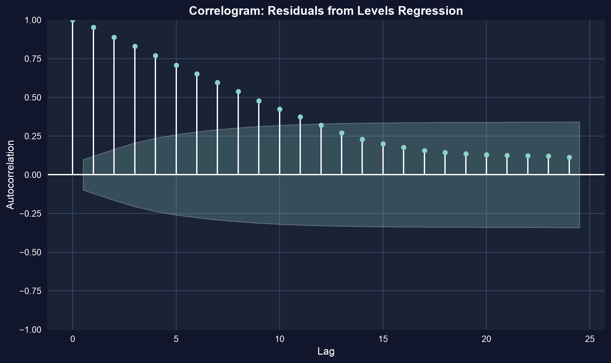{height="400"}
:::
::::

[十か月後でもまだ0.42です。これほど持続的な誤差は、397か月が397観測よりはるかに少ない独立情報しか運ばないことを意味し、だからこそHAC SEが3.65倍大きかったのです。]{.takeaway .fragment}

::: {.notes}
本章と一致：ラグ1 = 0.95、ラグ10 = 0.42です。どのバーもバンドのはるか外です。これは非定常（または単位根に近い）残差の特徴で、水準の関係は一部見せかけかもしれません。
:::

## 一階差分：変化を変化と比較する

$$\Delta y_t = y_t - y_{t-1}, \qquad \Delta\text{gs10}_t = \beta_1 + \beta_2\,\Delta\text{gs1}_t + u_t$$

::: {.incremental}
- 差分は確率的トレンドと任意の線形トレンドを除去する（線形トレンドは切片になる）
- 問いが変わる：「短期金利が今月**動く**とき、長期金利はどれだけ**動く**か？」
- 代償：長期の水準情報は捨てられる。月ごとの変動だけが$\beta_2$を識別する
:::

[固定効果の時系列のいとこです。持続的な成分を落とし、変化を保ちます。]{.takeaway .fragment}

::: {.notes}
この類比は二期間パネルで厳密です。T = 2のとき一階差分と固定効果は一致します。どちらの場合も、変化しない成分（チームの市場、系列の水準）が除かれ、傾きを交絡させられなくなります。
:::

## 月次変化：トレンドなし、ゼロ中心

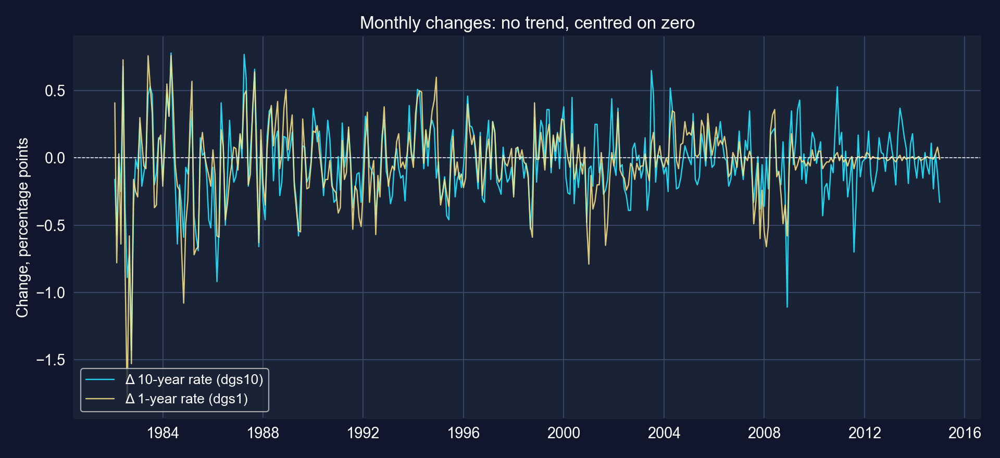

[変化は定常に見えます。ドリフトなし、ゼロ近くの一定の平均ですが、ボラティリティの噴出（1980年代初頭、2008年）があり、ロバストSEを使うべきことを思い出させます。]{.takeaway .fragment}

::: {.notes}
ボラティリティ・クラスタリングは時間を通じた不均一分散の一形態です。本章は変化回帰をデフォルトSEで推定します。同じ回帰のHAC SEはdgs1について0.031の代わりに0.042です（これらのスライドのために計算）が、ここでは実質的に何も変えません（t = 23の代わりに17）。
:::

## コード：変化での回帰

``` {.python code-line-numbers="1-3|4-6"}
# continues from the previous block
fit_changes = pf.feols("dgs10 ~ dgs1", data=data_rates)   # regression in first differences
fit_changes.summary()                                    # N = 396 (first month has no change)
uhat_dgs10 = fit_changes._u_hat                          # residuals in changes
acf_dgs10_resid = acf(uhat_dgs10[~np.isnan(uhat_dgs10)], nlags=10)
print(acf_dgs10_resid[1])                                # lag-1 autocorrelation
```

[↗ Colab で試す](https://colab.research.google.com/notebooks/empty.ipynb){.colab-link target="_blank" data-preview-link="false"}

::: {.notes}
データセットにはすでにdgs10とdgs1が含まれているので、コードでの差分は不要です。変化が定義されないため最初の月は失われます。
:::

## 出力：変化は0.72で波及し、残差は緩む {.smaller}

| 変数 | 係数 | SE | $t$ | $p$ | 95% 信頼区間 |
|:--|--:|--:|--:|--:|:--|
| 切片 | −0.0064 | 0.0091 | −0.71 | 0.480 | [−0.0243,&nbsp;0.0115] |
| `dgs1` | [0.7198]{.key} | 0.0314 | 22.89 | <&nbsp;0.001 | [0.6580,&nbsp;0.7817] |

[N = 396 · デフォルトSE（本章どおり） · $R^2 = 0.571$ · 残差自己相関：ラグ1 = 0.255、ラグ2 = −0.039、ラグ3 = 0.061]{.comment}

| | 水準 + トレンド | 変化 |
|:--|--:|--:|
| 1年物金利の傾き | 0.508 | [0.720]{.key} |
| $R^2$ | 0.947 | 0.571 |
| 残差ラグ1自己相関 | 0.953 | [0.255]{.key} |

[短期金利の1ポイントの**変化**は、同じ月の長期金利の0.72ポイントの変化を伴います。$R^2$は下がりますが、今や正直です。]{.takeaway .fragment}

::: {.notes}
本章のKey Concept 17.7と一致：残差ラグ1自己相関が約0.95から約0.25に下がり、変化での傾きは0.72です。いくらか自己相関が残り（0.255は±0.098のはるか外）、次に動学をモデル化する動機になります。
:::

# 17.6b · 短期金利の動きはどれだけ速く長期金利に届くか？ {#sec-dyn .divider background-color="#7A209F"}

[AR($p$) · ADL($p,q$) · 即時乗数と累積乗数]{.act}

::: {.notes}
本章ではまだ17.6節（自己回帰モデル）です。ADL(2,2)は本章のKey Takeawaysのコードブロックで推定されます。デッキはそれを主要な結果として実行します。
:::

## 動的モデル：過去を回帰に入れる

$$\text{AR}(p):\quad y_t = \beta_0 + \alpha_1 y_{t-1} + \cdots + \alpha_p y_{t-p} + u_t$$

$$\text{ADL}(p,q):\quad y_t = \beta_0 + \sum_{j=1}^{p}\alpha_j\,y_{t-j} + \sum_{j=0}^{q}\gamma_j\,x_{t-j} + u_t$$

::: {.incremental}
- $\alpha_j$：$y$自体の**持続性**（勢いか反転か）
- $\gamma_0$：**即時乗数**、$x$への同じ月の反応
- $\gamma_0+\gamma_1+\dots$：**累積**分布ラグ乗数；**長期乗数**はAR項も考慮する：$\sum_j\gamma_j \,/\, (1-\sum_j \alpha_j)$
:::

[ここでは$y_t = \Delta\text{gs10}_t$、$x_t = \Delta\text{gs1}_t$：**変化**でのADL(2,2)です。]{.takeaway .fragment}

::: {.notes}
長期乗数の公式は安定なADLモデルに対して標準です。xの恒久的な単位変化の後、yはy = (Σγ/(1−Σα))·xで落ち着きます。yとxが変化のとき、これは短期金利の変化の持続的な変化に対する長期金利の変化の長期反応です。学生は主に即時と累積の和を読むべきです。
:::

## コード：ラグを作りADL(2,2)を当てはめる

``` {.python code-line-numbers="1-4|5-7|8-9|10"}
# continues from the previous block
for k in [1, 2]:                                       # lags with .shift(k)
    data_rates[f"dgs10_lag{k}"] = data_rates["dgs10"].shift(k)
    data_rates[f"dgs1_lag{k}"] = data_rates["dgs1"].shift(k)
fit_adl = pf.feols("dgs10 ~ dgs10_lag1 + dgs10_lag2 + dgs1 + dgs1_lag1 + dgs1_lag2",
                   data=data_rates)                    # ADL(2,2), N = 394
fit_adl.summary()                                      # default SEs, as in the chapter
c = fit_adl.coef()                                     # cumulative pass-through:
print(c["dgs1"], c["dgs1"] + c["dgs1_lag1"], c["dgs1"] + c["dgs1_lag1"] + c["dgs1_lag2"])
print(acf(pd.Series(fit_adl._u_hat).dropna(), nlags=1)[1])   # residual lag-1 autocorrelation
```

[↗ Colab で試す](https://colab.research.google.com/notebooks/empty.ipynb){.colab-link target="_blank" data-preview-link="false"}

::: {.notes}
ラグのために三か月が失われ（差分で一つ、二つ目のラグで二つ）、394残ります。コードは本章のKey Takeawaysのチートシートのブロックです。
:::

## 出力：強い即時効果、部分的な反転、正の勢い {.smaller}

| 変数 | 係数 | SE | $t$ | $p$ | 95% 信頼区間 |
|:--|--:|--:|--:|--:|:--|
| 切片 | −0.0067 | 0.0088 | −0.76 | 0.447 | [−0.0239,&nbsp;0.0106] |
| `dgs10_lag1` | 0.2830 | 0.0508 | 5.57 | <&nbsp;0.001 | [0.1831,&nbsp;0.3828] |
| `dgs10_lag2` | −0.1021 | 0.0506 | −2.02 | 0.044 | [−0.2015,&nbsp;−0.0027] |
| `dgs1` | [0.7397]{.key} | 0.0340 | 21.74 | <&nbsp;0.001 | [0.6728,&nbsp;0.8066] |
| `dgs1_lag1` | −0.2588 | 0.0514 | −5.03 | <&nbsp;0.001 | [−0.3599,&nbsp;−0.1576] |
| `dgs1_lag2` | 0.0515 | 0.0492 | 1.05 | 0.296 | [−0.0453,&nbsp;0.1482] |

[N = 394 · デフォルトSE · $R^2 = 0.611$ · 残差ラグ1自己相関 0.008]{.comment}

[同じ月：**0.74**ポイントの波及。翌月には**部分的な反転**（−0.26）。長期金利自身のラグつき変化は**正に**入ります（+0.28）：平均回帰ではなく勢いです。]{.takeaway .fragment}

::: {.notes}
これらは本章のKey Conceptの数字（≈ +0.28、γ0 ≈ 0.74、γ1 ≈ −0.26、γ2 ≈ 0.05、二か月乗数 ≈ 0.53）です。本章の「典型的なADL(2,2)の結果」の下のより長い記述はこれと矛盾します。γ0 ≈ 0.45–0.55、γ1 ≈ +0.15〜+0.25、γ2 ≈ +0.05〜+0.10、合計 ≈ 0.78、R² ≈ 0.40–0.50を与え、ラグつき変化の係数は負（平均回帰）だと述べます。上の推定がデータの与えるものです。HAC SE（これらのスライドのために計算）はどの結論も変えません：γ0 t = 14.0、γ1 t = −4.33、γ2 p = 0.26です。
:::

## 波及、月ごと

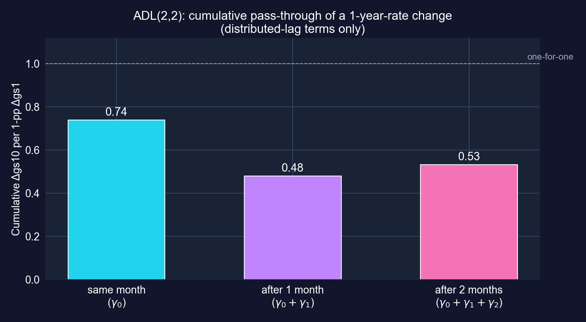

[短期金利の1ポイントの変化のうち約**0.74**が即座に長期金利に現れます。部分的な反転の後、二か月以内に**0.53**が波及します。]{.takeaway .fragment}

::: {.notes}
γ係数の累積和：0.740、0.481、0.532です。自己回帰項を含めると長期乗数は0.532 / (1 − 0.283 + 0.102) = 0.65です（これらのスライドのために計算）。すべて1対1をはるかに下回り、期待仮説と整合的です。1年物金利の変化は、十年にわたる短期金利の期待経路の一部しか動かしません。
:::

## 動学は自己相関を吸収したか？

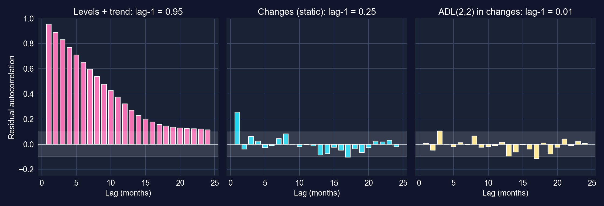

[水準：0.95。静的な変化：0.25。ADL(2,2)：**0.01**。動学をモデル化すると、ホワイトノイズのように見える残差が残ります。]{.takeaway .fragment}

::: {.notes}
左から右へ、定式化は見せかけに見える水準の当てはめから、よく定式化された動的モデルへと上がります。孤立したいくつかのバーは長いラグでまだバンドに触れます。24ラグでは、5%水準で偶然に一つか二つの交差が期待されます。
:::

## コード：静的、AR(2)、ADL(2,2)を一つの標本で比較する

``` {.python code-line-numbers="1-4|5-8"}
# continues from the previous block (computed for these slides)
samp = data_rates.dropna(subset=["dgs10_lag2", "dgs1_lag2"])    # same 394 months for all
models = {"static": "dgs10 ~ dgs1", "AR(2)": "dgs10 ~ dgs10_lag1 + dgs10_lag2",
          "ADL(2,2)": "dgs10 ~ dgs10_lag1 + dgs10_lag2 + dgs1 + dgs1_lag1 + dgs1_lag2"}
for name, fml in models.items():
    f = pf.feols(fml, data=samp); n, k = f._N, len(f.coef())
    bic = n * np.log((f._u_hat ** 2).sum() / n) + k * np.log(n)   # lower is better
    print(name, round(f._r2, 3), round(acf(pd.Series(f._u_hat), nlags=1)[1], 3), round(bic, 1))
```

[↗ Colab で試す](https://colab.research.google.com/notebooks/empty.ipynb){.colab-link target="_blank" data-preview-link="false"}

::: {.notes}
これらのスライドのために計算：三つのモデルを同じ394か月で再当てはめし、R²、残差自己相関、BICが比較可能になるようにします。
:::

## 出力：ADLがすべての基準で勝つ

| モデル | $R^2$ | 残差ラグ1 $\rho$ | BIC |
|:--|--:|--:|--:|
| 静的：$\Delta$gs10 を $\Delta$gs1 に | 0.573 | 0.259 | −1346.8 |
| AR(2)：自身のラグのみ | 0.125 | 0.012 | −1057.9 |
| ADL(2,2) | [0.611]{.key} | [0.008]{.key} | [−1359.7]{.key} |

::: {.notes}
本章の比較表（0.57 / 0.25、0.13 / 0.01、0.61 / 0.01、BICは「より高い/より低い」）が確認されます。BIC値は比較可能にするため、ここでは394か月の共通標本で計算しています。各部分が何を買うかに注意してください。自身のラグだけはほとんど説明しません（R² 0.125）が残差を白色化します。短期金利が変動の大部分を説明します。合わせると、ADLがすべての基準で勝ちます。ADLの静的モデルに対するR²の利得は小さいです（0.038）。
:::

## 時系列回帰を注意深く読む

::: {.incremental}
- **単位**：変化は**パーセントポイント**であって、パーセントではない。「1年物金利の1%の上昇」は「1パーセントポイントの上昇」と読むべき
- **水準と変化は異なる問いに答える**：均衡の共動対月次の波及
- **安定性**：一組の係数が1982〜2015年にわたり、2008年以降のゼロ下限の年を含む
- **デフォルトでは因果的でない**：両金利が同じニュース（インフレ、成長）に反応する；ADLは**予測的**な動学と波及を記述し、統制された実験ではない
:::

[時系列回帰は、その残差がホワイトノイズであり*かつ*その物語が安定性と共通ショックの確認を生き残るとき、信頼できます。]{.takeaway .fragment}

::: {.notes}
スライドで適用した修正：本章のオーバーシュートの例（「Fedが1年物金利を1%上げる」）はパーセントポイントを意味するところでパーセントを使い、その数字（0.60、−0.10、−0.02、0.85で落ち着く）は推定ではなく例示です。共和分と単位根検定が水準の問いの正式な道具です（本章のNext Stepsで名を挙げられる）が、ここでは使いません。
:::

# 第II-c幕 · 関連から原因へ {.divider background-color="#7A209F"}

[17.7 · 内生性 · 操作変数 · 因果の道具箱]{.act}

::: {.notes}
17.7節は本章では概念的です。公式、手法の一覧、print文があり、推定はありません。デッキは概念を復習し、次に第13章のデッキを案内します。そこではRCT、差の差分法、回帰不連続、操作変数のデザインがそれぞれ実データで推定されます。
:::

# 17.7 · 傾きはいつ因果的になるか？ {#sec-causal .divider background-color="#7A209F"}

[概念のみ · 作業済みのデザインは第13章のデッキに]{.act}

::: {.notes}
パネルと時系列の節からの橋渡し：FEは時間不変の交絡因子を除去し、差分はトレンドを除去しましたが、どちらも残るxの変動が無作為と同程度に良いことを保証しません。
:::

## $x$が誤差と相関した瞬間、OLSは偏る

$$y = \beta_1 + \beta_2 x + u, \qquad \text{OLSは } E[u \mid x] = 0 \text{ のときだけ一致する}$$

::: {.incremental}
- **欠落変数**：交絡因子が$x$と$y$の両方を動かす。*NBA*：市場規模が収益を上げ勝利を買う（FEは時間不変の部分を除去した）
- $x$の**測定誤差**：傾きをゼロへ減衰させる
- **同時性 / 逆の因果**：$y$も$x$を動かす。*NBA*：収益が選手に支払い、選手が勝利を生む
:::

[統制変数を加えても、**測定した**交絡因子しか直りません。信頼できる因果の主張には**識別戦略**が必要です。]{.takeaway .fragment}

::: {.notes}
各源はバイアスの方向が異なります。欠落変数はどちらにも向かいえます（欠落変数バイアスの公式の符号）。古典的な測定誤差はゼロへ偏らせます。同時性はフィードバック次第です。固定効果は欠落変数の一つの特定の形、時間不変のものだけに対処します。
:::

## 潜在的結果：因果効果が意味するもの

$$\text{個別効果} = Y_{1i} - Y_{0i}, \qquad \text{ATE} = E[Y_{1i} - Y_{0i}]$$

::: {.incremental}
- $Y_{1i}$：**処置されたら**の結果；$Y_{0i}$：**されなかったら**の結果。観測されるのは常に一方だけ
- 処置群と非処置群の単純な比較：$E[Y_1\mid D{=}1] - E[Y_0\mid D{=}0] = \text{ATT} + \underbrace{E[Y_0\mid D{=}1]-E[Y_0\mid D{=}0]}_{\text{選択バイアス}}$
- どのデザインも、選択バイアスの項をゼロにする、あるいは除去する方法です
:::

[因果推定は**反実仮想**についての主張です。デザインは、あなたの比較群がそれの代わりになる理由の論拠です。]{.takeaway .fragment}

::: {.notes}
本章は潜在的結果とATEを定義します。ATTと選択バイアスへの分解は標準的な結果です（手法の復習として加え、第13章のデッキの第II-b幕でデータとともに扱います）。
:::

## 操作変数：無作為と同程度に良い変動を借りる {.smaller}

操作変数$z$は二つの条件を満たさなければなりません：

::: {.incremental}
- **関連性**：$\text{Cov}(z, x) \neq 0$。*検定可能*：第一段階の$F$（経験則$> 10$）
- **外生性 / 除外**：$\text{Cov}(z, u) = 0$、すなわち$z$は$x$**を通してのみ**$y$に影響する。*検定不可能*：論証しなければならない
:::

. . .

一つの回帰変数と一つの操作変数で、$y = \beta_1 + \beta_2 x + u$を$\text{Cov}(z, y)$に代入します：

$$\text{Cov}(z,y) = \beta_2\,\text{Cov}(z,x) + \underbrace{\text{Cov}(z,u)}_{=\,0} \;\;\Longrightarrow\;\; \hat\beta_{IV} = \frac{\widehat{\text{Cov}}(z,y)}{\widehat{\text{Cov}}(z,x)} = \frac{\text{誘導形}}{\text{第一段階}}$$

[IVはOLSが一致しないところで一致しますが、操作変数が動かす変動についてのみ（*局所的な*効果）、そして除外の論証と同程度にしか良くありません。]{.takeaway .fragment}

::: {.notes}
導出は各条件がどこに入るかを正確に示します。外生性がCov(z,u)の項を消し、関連性が分母を非ゼロにします。弱い第一段階（小さなCov(z,x)）は外生性のわずかな違反を増幅します。pyfixestでの構文はpf.feols("y ~ 1 | x ~ z", data=...)です。データを用いた作業例は第13章のデッキ（ケース13.8）にあります。
:::

## 因果の道具箱 {.smaller}

| 手法 | 変動の源 | 識別の仮定 | 作業例の場所 |
|:--|:--|:--|:--|
| 無作為化実験 | 無作為割り当て | 無作為化が維持（脱落バイアスなし） | [第13.5 · RAND HIE](../ch13/index.html#/case-135){data-preview-link="false"} |
| 固定効果 | 単位内の変化 | **時間変化する**交絡因子なし | このデッキ、[17.3](#sec-fe)、[CS 1](#cs-1)、[CS 2](#cs-2) |
| 差の差分法 | グループ × 期間 | 平行トレンド | [第13.6 · 南アフリカ](../ch13/index.html#/case-136){data-preview-link="false"} |
| 回帰不連続 | ランニング変数のカットオフ | カットオフでの連続性 | [第13.7 · 米国上院](../ch13/index.html#/case-137){data-preview-link="false"} |
| 操作変数 | 操作変数 | 関連性 + 除外 | [第13.8 · 制度](../ch13/index.html#/case-138){data-preview-link="false"} |
| マッチング / 傾向スコア | 観測された共変量 | 観測可能なものだけでの選択 | （本章で名を挙げられる；作業なし） |

[どの行も、検証不可能な「すべてをコントロールした」を、あなたが擁護し、探り、攻撃できる特定の仮定に取り替えます。]{.takeaway .fragment}

::: {.notes}
リンクは第13章のデッキを対応するケースで開きます。固定効果はこの表に属します。単なる推定量ではなくデザインです。その仮定（時間変化する交絡因子なし）は「交絡因子なし」より弱いですが、依然として仮定です。
:::

## 作業済みのデザイン：単純対デザイン、第13章のデッキから {.smaller}

| 第13章ケース | デザイン | 単純な比較 | デザインに基づく推定 |
|:--|:--|--:|--:|
| [13.5](../ch13/index.html#/case-135){data-preview-link="false"} | RCT（健康保険） | *（無作為化：単純版は不要）* | 95%プラン：無料ケア対[−\$1,108]{.key} |
| [13.6](../ch13/index.html#/case-136){data-preview-link="false"} | DiD（子どもの栄養） | 処置群の前対後：+0.867 | [+0.522]{.key} z単位 |
| [13.7](../ch13/index.html#/case-137){data-preview-link="false"} | RD（上院の現職） | 勝者対敗者：+21.7 pp | [+4.8 pp]{.key} |
| [13.8](../ch13/index.html#/case-138){data-preview-link="false"} | IV（制度） | OLS：0.52 | 2SLS：[0.94]{.key} |

[本章のプールド対FEと同じ教訓：比較が変わると数字が変わり、ときに四倍にもなります。]{.takeaway .fragment}

::: {.notes}
数字は検証済みの第13章のデッキから引用（その統合の幕を参照）。ここでは何も再推定しません。本章自身の対比と組み合わせてください。NBAプールド0.0068対FE 0.0045；資本弾力性プールド0.71対FE 0.44；人口の傾きプールド+0.34対FE −0.82です。
:::

## 17.7からの実務的な推奨

::: {.incremental}
- 何かを実行する前に**交絡因子**に名を付ける；どれが時間不変かを問う
- **クラスタリング**（パネル）または**HAC**（時系列）：正直なSEは信頼できる主張の一部
- **複数の定式化を報告する**：プールドとFE、OLSとIV、水準と変化。変化の*パターン*が証拠
- **識別の仮定を一文で述べ**、何がそれを破るかを言う
:::

[デザインが因果の主張を勝ち取ります。有意な$t$統計量はそうではありません。]{.takeaway .fragment}

::: {.notes}
これらは本章の実務的な推奨で、デッキの本筋を加えたものです。定式化を横断する比較はロバストネスの儀式ではなく、主要な診断です。
:::

# 第II-d幕 · 二つのケーススタディ、すべての課題を実行 {.divider background-color="#7A209F"}

[ケーススタディ1 · 国別の生産性 · ケーススタディ2 · ボリビアの夜間光]{.act}

::: {.notes}
本章末の二つのケーススタディは学生の課題として書かれています。ケーススタディ1はヒントのみ、ケーススタディ2はコメントアウトされたコードを与えます。これらのスライドのために、各課題を本章の手法とヒストの範囲内でコーディングし、実行し、解釈しました。本章に現れない結果は「これらのスライドのために計算」とラベルします。
:::

# ケーススタディ1 · 資本は国の内部で生産性を上げるか？ {#cs-1 .divider background-color="#7A209F"}

[108か国 × 25年 · 分散分解 · クラスターSE · FE · 二元FE · 地域]{.act}

::: {.notes}
Mendez (2020)の収束クラブのデータです。本章の研究課題：物的資本と人的資本は国をまたいで労働生産性とどう関連するか、そして国の観測されない特性をコントロールすると推定が変わるか。
:::

## 問いとデータ {.smaller}

**データ。** Mendez (2020)の収束クラブ・パネル：**108か国 × 1990–2014 = 2,700**国・年（均衡）。

| 変数 | 意味 | 平均 | 範囲 |
|:--|:--|--:|:--|
| `ln_lp` | 労働生産性の対数（労働者あたり産出） | 9.80 | 6.90 – 11.94 |
| `ln_kl` | 労働者あたり物的資本の対数 | 10.76 | 6.59 – 13.22 |
| `h` | 人的資本指数（就学に基づく） | 2.99 | 1.32 – 5.20 |
| `region` | アフリカ26 · アメリカ22 · アジア28 · ヨーロッパ30 · オセアニア2か国 | | |

$$\ln lp_{it} = \alpha_i + \beta_k \ln kl_{it} + \beta_h\, h_{it} + \varepsilon_{it}$$

[**訂正。** 本章の変数一覧と課題1のコードは`rk`と`hc`を使っていますが、このファイルには存在しません（コードは`KeyError`で止まります）。列は`kl`と`h`で、スライドは一貫してこれらを使います。]{.takeaway .fragment}

::: {.notes}
前の章のMendezケーススタディと同じファイルで、そこではklとhが正しく使われています。本章の一覧はrgdppcとtfpも挙げますが、ファイルの列はGDPpcとTFPです。両辺が対数なのでbeta_kは弾力性です。hは水準で入るのでbeta_hは準弾力性です。
:::

## 課題1 · コード：パネル構造と分散分解

``` {.python code-line-numbers="1-2|3-6|7|8-11"}
!pip install -q pyfixest                         # pyfixest is not preinstalled in Colab
import numpy as np, pandas as pd, pyfixest as pf # numerics, tables, regressions
base = "https://raw.githubusercontent.com/quarcs-lab/mendez2020-convergence-clubs-code-data/"
dat = pd.read_csv(base + "master/assets/dat.csv")    # 108 countries × 1990–2014
dat["ln_lp"] = np.log(dat["lp"])                     # log labor productivity
dat["ln_kl"] = np.log(dat["kl"])                     # log capital per worker (chapter: "rk")
print(dat["country"].nunique(), dat["year"].nunique(), len(dat))   # 108 25 2700
overall_var = dat["ln_lp"].var()                                    # all country-years
between_var = dat.groupby("country")["ln_lp"].mean().var()          # 108 country means
within_var = dat.groupby("country")["ln_lp"].apply(lambda x: x - x.mean()).var()
print(overall_var, between_var, within_var, between_var / overall_var)
```

[↗ Colab で試す](https://colab.research.google.com/notebooks/empty.ipynb){.colab-link target="_blank" data-preview-link="false"}

::: {.notes}
自己完結型で、訂正した列名を除けば本章の課題1のコードと同一です。本章の課題どおり、標準偏差ではなく分散を使います。
:::

## 課題1 · 出力：変動の95%は国間 {.smaller}

| | `ln_lp`の分散 | 割合 |
|:--|--:|--:|
| 全体（2,700国・年） | 1.391 | 100% |
| between（108の国平均） | [1.328]{.key} | [95.4%]{.key} |
| within（自身の平均からの乖離） | 0.075 | 5.4% |

[割合はきっかり100%に足し上がる必要はありません：between分散は108の平均について、within分散は2,700の乖離について計算されます。]{.comment}

[生産性の差は圧倒的に**恒久的な国間ギャップ**です。プールドOLSはそれに牽引され、固定効果は国の内部で動く5%だけを保ちます。]{.takeaway .fragment}

::: {.notes}
課題の問いへの答え：between成分はNBA（81%）よりはるかに支配的です。含意：プールドOLSとFEは非常に異なる問いに答えます。プールド：資本の豊かな国はより生産的か？FE：ある国が資本を蓄積すると、その生産性は上がるか？
:::

## 課題2 · コード：デフォルト、ロバスト、クラスターのSEを用いたプールドOLS

``` {.python code-line-numbers="1-4|5-6|7-8"}
# continues from the previous block
fit_default = pf.feols("ln_lp ~ ln_kl + h", data=dat)                          # iid SEs
fit_hc1 = pf.feols("ln_lp ~ ln_kl + h", data=dat, vcov="HC1")                  # robust
fit_cluster = pf.feols("ln_lp ~ ln_kl + h", data=dat, vcov={"CRV1": "country"})  # by country
print(pd.DataFrame({"default": fit_default.se(), "HC1": fit_hc1.se(),
                    "cluster": fit_cluster.se()}).round(4))   # same coefficients, three SEs
print((fit_cluster.se() / fit_default.se()).round(2))         # inflation factor
fit_cluster.summary()
```

[↗ Colab で試す](https://colab.research.google.com/notebooks/empty.ipynb){.colab-link target="_blank" data-preview-link="false"}

::: {.notes}
本章の課題2のコードに、ln_klとhを用いたものです。比較が不均一分散と国内の依存を分離できるようHC1を加えています。
:::

## 課題2 · 出力：クラスタリングが標準誤差を四倍にする {.smaller}

| 変数 | 係数 | デフォルトSE | HC1 SE | クラスターSE | クラスター ÷ デフォルト | $t$（デフォルト → クラスター） |
|:--|--:|--:|--:|--:|--:|:--|
| 切片 | 1.6949 | 0.0581 | 0.0724 | 0.2716 | 4.67 | 29.15 → 6.24 |
| `ln_kl` | [0.7136]{.key} | 0.0081 | 0.0089 | 0.0327 | [4.03]{.key} | 87.74 → 21.79 |
| `h` | 0.1410 | 0.0148 | 0.0150 | 0.0612 | [4.12]{.key} | 9.50 → 2.30 |

[N = 2,700 · 108の国クラスター · $R^2 = 0.908$ · クラスター95%信頼区間：`ln_kl` [0.6487, 0.7785]、`h` [0.0196, 0.2623]（$p = 0.023$）]{.comment}

[一つの国の25年は、その*水準*についての証拠としてはほぼ一観測分です。クラスタリングはSEを約**4倍**に膨らませます。`h`は$t = 9.5$から境界上の$t = 2.3$へ落ちます。]{.takeaway .fragment}

::: {.notes}
課題の問いへの答え：クラスターSEはデフォルトの約四倍で、NBAパネルの1.8倍よりはるかに大きいです。国の残差が極めて持続的（変動の95%が国間で、年次データは滑らか）だからです。不均一分散だけ（HC1）はほとんど変えません。
:::

## 課題3 · コード：国の固定効果

``` {.python code-line-numbers="1-3|4-5"}
# continues from the previous block
fit_fe = pf.feols("ln_lp ~ ln_kl + h | country", data=dat,
                  vcov={"CRV1": "country"})          # one intercept per country
fit_fe.summary()                                     # within-country estimates
print(pd.DataFrame({"pooled": fit_cluster.coef(), "FE": fit_fe.coef()}))   # side by side
```

[↗ Colab で試す](https://colab.research.google.com/notebooks/empty.ipynb){.colab-link target="_blank" data-preview-link="false"}

::: {.notes}
まさに本章のヒント：pf.feols('ln_lp ~ ln_kl + h | country')で、国でクラスターしたSEつき（これらのスライドのために計算；本章は出力を示しません）です。
:::

## 課題3 · 出力：資本の弾力性は国内で39%下がる {.smaller}

| 変数 | 係数 | SE | $t$ | $p$ | 95% 信頼区間 |
|:--|--:|--:|--:|--:|:--|
| `ln_kl` | [0.4377]{.key} | 0.0377 | 11.61 | <&nbsp;0.001 | [0.3630,&nbsp;0.5125] |
| `h` | 0.2226 | 0.0566 | 3.93 | <&nbsp;0.001 | [0.1104,&nbsp;0.3348] |

[N = 2,700 · 108の国固定効果 · 国によるCRV1 · within $R^2 = 0.670$ · これらのスライドのために計算]{.comment}

::: {.incremental}
- **`ln_kl`**：プールド0.714 → FE **0.438**。ある国の内部で、労働者あたり資本が1%増えると労働者あたり産出が約0.44%増える
- **`h`**：プールド0.141 → FE **0.223**。指数が一単位増えると：$100(e^{0.2226}-1) = 25\%$高い生産性
:::

[資本の傾きはNBAの場合のように振る舞います（正の交絡因子が除去された）。人的資本は**逆方向**に動きます：FEは常に係数を縮めるわけではありません。]{.takeaway .fragment}

::: {.notes}
どの係数が最も変わるか、そしてなぜか：資本弾力性は39%下がり、労働者あたり資本と生産性の両方を上げる持続的な国の特性（制度、地理、技術水準）からの正の欠落変数バイアスと整合的です。人的資本の係数は上がるので、時間不変の交絡因子は、資本を所与として、生産性に対してhと逆方向に相関していました。本章のKey Concept 17.9は「典型的な発見はFE係数がプールドOLSより小さい」と述べますが、ここでは資本には成り立つが人的資本には成り立ちません。
:::

## プールド対FE対二元FEを一目で

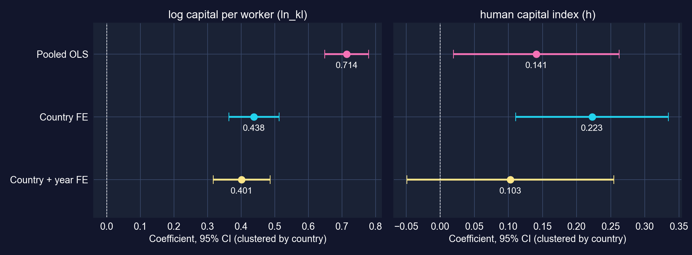

[資本の弾力性は国効果が入ると安定します（0.44 → 0.40）。人的資本のは安定しません：年効果を加えると**有意でなくなり**ます。]{.takeaway .fragment}

::: {.notes}
本筋が示唆するとおり定式化を横断して読んでください。ln_kl：0.714（プールド）、0.438（国FE）、0.401（国と年FE）です。h：0.141、0.223、0.103（p = 0.18）です。人的資本指数はほぼどこでも上昇トレンドなので、共通の年効果が世界的なトレンドを吸収すると、hの独立したwithin変動はほとんど残りません。
:::

## 課題4 · コード：時間トレンドと年効果

``` {.python code-line-numbers="1-4|5-6|7-9"}
# continues from the previous block
fit_twfe = pf.feols("ln_lp ~ ln_kl + h | country + year", data=dat,
                    vcov={"CRV1": "country"})       # two-way FE: country AND year
fit_twfe.summary()
fit_trend = pf.feols("ln_lp ~ ln_kl + h + year | country", data=dat,
                     vcov={"CRV1": "country"})      # a common linear trend instead
fit_trend.summary()
year_fe = fit_twfe.fixef()                          # estimated year effects (1990 = 0)
print(year_fe)
```

[↗ Colab で試す](https://colab.research.google.com/notebooks/empty.ipynb){.colab-link target="_blank" data-preview-link="false"}

::: {.notes}
本章のヒント：pf.feols('ln_lp ~ ln_kl + h | country + year')です。年固定効果は、ある年にすべての国に共通するもの（世界的な景気循環、商品価格、2009年の危機）を吸収します。線形トレンドは制約版です。
:::

## 課題4 · 出力：共通ショックは人的資本にとって重要 {.smaller}

| 変数 | 係数 | SE | $t$ | $p$ | 95% 信頼区間 |
|:--|--:|--:|--:|--:|:--|
| `ln_kl` | [0.4014]{.key} | 0.0428 | 9.38 | <&nbsp;0.001 | [0.3166,&nbsp;0.4862] |
| `h` | 0.1028 | 0.0766 | 1.34 | 0.183 | [−0.0491,&nbsp;0.2547] |

[二元FE（国 + 年） · N = 2,700 · 国によるCRV1 · within $R^2 = 0.337$ · これらのスライドのために計算]{.comment}

[年効果の代わりに線形トレンドを使うと：`ln_kl` 0.4071、`h` 0.1009（$p = 0.183$）、トレンド 年あたり+0.0057（$p = 0.034$）、すなわち資本と就学を超えて年あたり約**0.57%**の共通の生産性成長。]{.comment}

[資本の国内弾力性は共通ショックを生き残ります（≈ 0.40）。人的資本のは生き残りません：そのFE推定は一部、世界的な就学の上昇トレンドを反映していました。]{.takeaway .fragment}

::: {.notes}
年効果を加えるとwithin R²は0.670から0.337へ下がります。年効果が、資本と就学が一部説明していた共通トレンドを今や吸収するからです。トレンドモデルと年効果モデルはほぼ同じ傾きを与えるので、共通成分はおおよそ線形です。
:::

## 課題4 · 共通の年効果

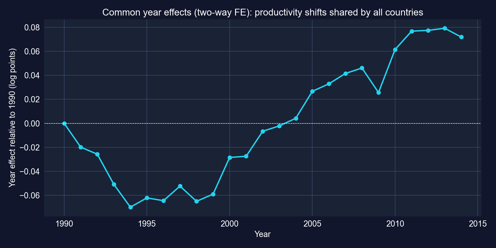

[資本と就学を差し引いた後、共通成分は1990年代初頭に下がり、2000年から2008年に上がり、**2009年**に落ち込み、回復します。]{.takeaway .fragment}

::: {.notes}
1990年代の谷（1994年に約−0.07）は一部、標本内の移行経済を反映します。2009年の落ち込みは世界金融危機です。2014年までに共通効果は1990年比で約+0.07対数ポイントです。これらは資本と人的資本を条件づけているので、総成長ではなく残差の「共通TFP」経路です。
:::

## 課題4 · コード：地域は異なる率で成長するか？収束はあるか？

``` {.python code-line-numbers="1-3|4-8|9-12"}
# continues from the previous block (computed for these slides)
dat["t"] = dat["year"] - 1990                                    # years since 1990
fit_rt = pf.feols("ln_lp ~ ln_kl + h + i(region, t) | country", data=dat, vcov={"CRV1": "country"})
names = fit_rt.coef().index; rt = [k for k in names if k.startswith("region::")]
R = np.zeros((len(rt) - 1, len(names)))                           # H0: all trends = Africa's
for j, k in enumerate(rt[1:]):
    R[j, names.get_loc(k)], R[j, names.get_loc(rt[0])] = 1, -1
print(fit_rt.coef()[rt]); print(fit_rt.wald_test(R=R))           # Wald chi2(4)
first = dat[dat["year"] == 1990].set_index("country")["ln_lp"]   # initial productivity
last = dat[dat["year"] == 2014].set_index("country")["ln_lp"]
conv = pd.DataFrame({"ln_lp0": first, "g": 100 * (last - first) / 24}).reset_index()
pf.feols("g ~ ln_lp0", data=conv, vcov="HC1").summary()          # growth on initial level
```

[↗ Colab で試す](https://colab.research.google.com/notebooks/empty.ipynb){.colab-link target="_blank" data-preview-link="false"}

::: {.notes}
課題は「生産性成長率が地域間で異なるかを検定する」ことと「収束の証拠があるか」を求めます。i(region, t)は各地域に固有の線形トレンドを与え（ヒントが示唆するとおり地域-時間の交互作用）、国FEつきです。収束：1990〜2014年の年平均成長を初期の対数生産性に回帰します（単純な国間回帰；年あたり%の成長は対数差分近似を使います）。
:::

## 課題4 · 出力：地域トレンドは異なる；より貧しい国は追いつかなかった {.smaller}

:::: {.columns}
::: {.column width="48%"}
| 地域トレンド（年あたり） | 係数 | $p$ |
|:--|--:|--:|
| アフリカ | 0.0015 | 0.665 |
| アメリカ | 0.0066 | 0.035 |
| アジア | [0.0135]{.key} | 0.010 |
| ヨーロッパ | 0.0126 | 0.001 |
| オセアニア（2か国） | 0.0067 | <&nbsp;0.001 |

[国FE + `ln_kl` + `h` · CRV1 · トレンド均等の検定：Wald $\chi^2(4) = 11.39$、$p = 0.023$]{.comment}
:::
::: {.column width="52%"}
| 収束回帰 | 係数 | SE | $p$ |
|:--|--:|--:|--:|
| 切片 | 4.520 | 1.836 | 0.015 |
| `ln_lp0`（1990） | [−0.222]{.key} | 0.180 | 0.221 |

[N = 108 · HC1 · $R^2 = 0.018$ · 年あたり%の成長]{.comment}
:::
::::

[資本と就学を超えて、生産性はアジアとヨーロッパで年あたり約1.3%上昇トレンドを示し、アフリカではほとんどありませんでした。**無条件の収束はありません**：初期生産性に対する傾きは小さく有意ではありません。]{.takeaway .fragment}

::: {.notes}
両方ともこれらのスライドのために計算。地域トレンドは資本、人的資本、国FEを条件づけているので、地域の「残差TFP」トレンドです。収束の傾き−0.22は、1990年に生産性が1対数ポイント低い国が年あたりわずか0.22パーセントポイント速く成長したことを意味し、その差はゼロと統計的に区別できません。地域別の年平均成長（生、非条件づけ）：アジア3.25%、ヨーロッパ2.67%、アメリカ2.23%、アフリカ1.41%、オセアニア1.33%です。
:::

## 課題4 · 収束、図で

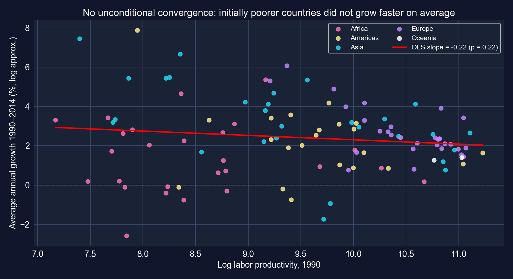

[かすかに負の傾きを持つ雲：いくつかの貧しいアジア経済は突き進み、多くのアフリカ経済はそうではありませんでした。だからこそMendezのデータは一つの世界的収束ではなく収束**クラブ**についてなのです。]{.takeaway .fragment}

::: {.notes}
図はクラブ収束の動機となります。国のグループが異なる定常状態に収束します。クラブの検定は本章の範囲を超えます。
:::

## 課題5 · コード：資本の収益は地域で異なるか？

``` {.python code-line-numbers="1-2|3-5|6-8"}
# continues from the previous block (computed for these slides)
fit_r1 = pf.feols("ln_lp ~ ln_kl + h + C(region)", data=dat, vcov={"CRV1": "country"})
fit_r2 = pf.feols("ln_lp ~ ln_kl + h + C(region) + C(region):ln_kl + C(region):h",
                  data=dat, vcov={"CRV1": "country"})    # region-specific slopes
fit_r1.summary(); fit_r2.summary()
inter = [k for k in fit_r2.coef().index if ":" in k]     # the 8 interaction terms
R = np.array([[1.0 * (k == a) for k in fit_r2.coef().index] for a in inter])
print(fit_r2.wald_test(R=R))                             # H0: all 8 interactions = 0
```

[↗ Colab で試す](https://colab.research.google.com/notebooks/empty.ipynb){.colab-link target="_blank" data-preview-link="false"}

::: {.notes}
課題の三段階：地域ダミー、地域×資本の交互作用、同時検定です。アフリカが基準地域（アルファベット順で最初）です。課題がここでFEを求めないので、国でクラスターしたSEを用いたプールド定式化です。
:::

## 課題5 · 出力：地域の傾きは弱くしか異ならない {.smaller}

| 地域 | 含意される`ln_kl`の傾き | 含意される`h`の傾き |
|:--|--:|--:|
| アフリカ（基準） | 0.640 | 0.257 |
| アメリカ | 0.671 | 0.293 |
| アジア | [0.778]{.key} | −0.075 |
| ヨーロッパ | 0.679 | 0.048 |
| オセアニア（2か国） | 0.649 | 0.110 |

[含意される傾き = 基準の傾き + 地域交互作用 · 8つの交互作用の同時検定：Wald $\chi^2(8) = 13.90$、$p = 0.084$ · 地域ダミーのみ：オセアニアだけがアフリカと異なる（$p = 0.034$） · これらのスライドのために計算]{.comment}

[資本の収益は地域間で似て見え（0.64–0.78）、交互作用は10%でのみ同時に有意です。どの地域固有の交互作用も5%で個別に有意ではありません。]{.takeaway .fragment}

::: {.notes}
人的資本への最高の収益を示す地域は？アメリカ（0.29）とアフリカ（0.26）ですが、hの交互作用は不正確（アジアの交互作用はp = 0.13）なので、順位は信頼できません。これらは課題3が明らかにしたすべての交絡を受けるプールド国間の関連です。
:::

## 課題6 · 政策ブリーフ、数字で {.smaller}

| 定式化 | `ln_kl` | `h` | 使う変動 |
|:--|--:|--:|:--|
| プールドOLS、クラスターSE | 0.714 (0.033) | 0.141 (0.061) | between + within |
| 国FE | [0.438]{.key} (0.038) | 0.223 (0.057) | 国内 |
| 国 + 年FE | 0.401 (0.043) | 0.103 (0.077) | 国内、共通ショックを除く |
| 地域固有の傾き（プールド） | 0.64 – 0.78 | −0.08 – 0.29 | between + within、地域別 |

::: {.incremental}
- **経路**：資本蓄積は国内で生産性と頑健に関連する（弾力性 ≈ 0.4）；人的資本のつながりは共通トレンドを除くと脆い
- **因果的か？** 確立されていない：資本は期待生産性に反応する（逆の因果）し、時間変化する政策とショックが残る
:::

[政策の読み：労働者あたり資本を上げる投資環境が、このデータで最もよく支持される経路であり、プールドの国間推定はそれを約40%過大評価します。]{.takeaway .fragment}

::: {.notes}
課題は200〜300語のブリーフを求めます。このスライドはその証拠基盤を与えます。識別への脅威：逆の因果（より生産的な経済が投資を引きつける）、資本ストックの測定誤差（永久棚卸しで構築され、within変動を滑らかにする）、滑らかにトレンドする人的資本指数です。本章のKey Concept 17.10は、推定量の選択は問いに従うべきだと加えます。ここでは「国が資本を蓄積するとき何が起こるか」にとって関連するのはwithinの推定です。
:::

# ケーススタディ2 · ボリビアの夜間光と人口 {#cs-2 .divider background-color="#7A209F"}

[339自治体 × 2012–2020 · 再形成 · プールド · FE · 年効果 · 一階差分]{.act}

::: {.notes}
DS4Bolivia：本書の最後のDS4Boliviaケーススタディです。横断面の衛星開発データが、夜間光と人口が2012〜2020年の年次で利用できるのでパネルになります。
:::

## 問いとデータ {.smaller}

**データ。** DS4Bolivia（`ds4bolivia_v20250523.csv`）：**339自治体**、年次列`ln_NTLpc2012` … `ln_NTLpc2020`と`pop2012` … `pop2020`、**wide**形式で格納（自治体ごとに一行）。

| 変数 | 意味 |
|:--|:--|
| `ln_NTLpc` | 一人あたり夜間光の対数（結果） |
| `ln_pop` | 人口の対数 |
| `year` | 2012, …, 2020 |
| `asdf_id`, `mun`, `dep` | 自治体id、名前、県（9県） |

$$\ln NTLpc_{it} = \alpha_i + \beta\,\ln pop_{it} + \delta_t + \varepsilon_{it}$$

[**研究課題**：自治体の内部で輝度は時間を通じてどう推移するか、そして固定的な地域特性（標高、遠隔性、気候）を除くと人口とどう動くか？]{.takeaway .fragment}

::: {.notes}
後のための鍵となる解釈上の点：結果は一人あたりの光、ln(NTL) − ln(pop)です。だからln_popの係数は（総光の人口に対する弾力性）− 1に等しいです。係数ゼロは、総光が人口と1対1で伸びることを意味します。
:::

## 課題1 · コード：wide → longに再形成

``` {.python code-line-numbers="1-4|5-8|9-11"}
!pip install -q pyfixest                         # pyfixest is not preinstalled in Colab
import numpy as np, pandas as pd, pyfixest as pf # numerics, tables, regressions
url_bol = "https://raw.githubusercontent.com/quarcs-lab/ds4bolivia/master/ds4bolivia_v20250523.csv"
bol = pd.read_csv(url_bol)                       # 339 municipalities, wide format
years = range(2012, 2021)                        # nine annual observations
ntl_long = bol[["mun", "dep", "asdf_id"] + [f"ln_NTLpc{y}" for y in years]].melt(
    id_vars=["mun", "dep", "asdf_id"], var_name="ntl_var", value_name="ln_NTLpc")
ntl_long["year"] = ntl_long["ntl_var"].str.extract(r"(\d{4})").astype(int)  # "…2015" → 2015
pop_long = bol[["asdf_id"] + [f"pop{y}" for y in years]].melt(
    id_vars=["asdf_id"], var_name="pop_var", value_name="pop")
pop_long["year"] = pop_long["pop_var"].str.extract(r"(\d{4})").astype(int)
```

[↗ Colab で試す](https://colab.research.google.com/notebooks/empty.ipynb){.colab-link target="_blank" data-preview-link="false"}

::: {.notes}
本章のコメントアウトされた課題1のコードを、コメントを外して実行したものです。melt()は九つのNTL列を自治体ごとに九行へ変え、年は正規表現で列名から抽出します。
:::

## 課題1 · コード：一つのパネルに結合して確認する

``` {.python code-line-numbers="1-4|5-6|7-8"}
# continues from the previous block
panel = ntl_long.merge(pop_long[["asdf_id", "year", "pop"]], on=["asdf_id", "year"], how="left")
panel["ln_pop"] = np.log(panel["pop"])                       # log population
panel = panel.sort_values(["asdf_id", "year"]).reset_index(drop=True)
print(panel.shape, panel["asdf_id"].nunique())               # rows × columns, municipalities
print(panel["ln_NTLpc"].isna().sum())                        # missing light values
panel_reg = panel[["ln_NTLpc", "ln_pop", "year", "mun", "dep", "asdf_id"]].dropna()
print(len(panel_reg), panel_reg["asdf_id"].nunique())        # estimation sample
```

[↗ Colab で試す](https://colab.research.google.com/notebooks/empty.ipynb){.colab-link target="_blank" data-preview-link="false"}

| | 行数 | 自治体数 |
|:--|--:|--:|
| 完全パネル（339 × 9） | 3,051 | 339 |
| `ln_NTLpc`が欠損 | 67 | |
| 推定標本 | [2,984]{.key} | [337]{.key} |

::: {.notes}
パネルは課題が期待するとおり339 × 9 = 3,051ですが、67の自治体・年に光の値がないので、推定標本は337自治体をカバーする2,984行です（二つは全年を失います）。したがってパネルは不均衡です。これを報告しましょう。
:::

## 課題6（最初）：水準は、動くよりはるかに大きく異なる

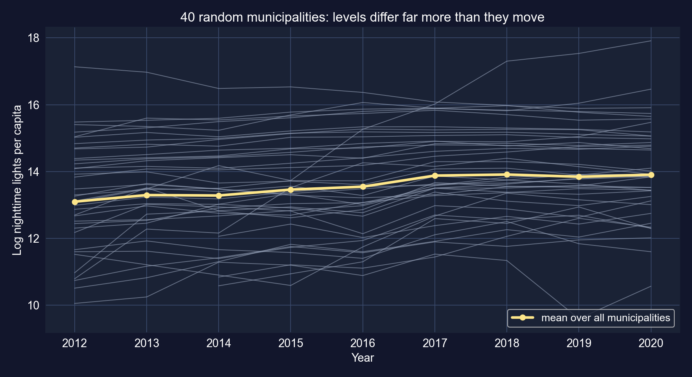

| …の分散 | 全体 | between | within | betweenの割合 |
|:--|--:|--:|--:|--:|
| `ln_NTLpc` | 1.729 | 1.635 | 0.220 | [94.6%]{.key} |
| `ln_pop` | 1.278 | 1.283 | 0.0055 | ≈ 100%（within 0.4%） |

::: {.notes}
後続すべての枠組みとなるので課題6から前倒ししました（これらのスライドのために計算）。光：95%が自治体間で、国と同様です。人口：本質的にすべてbetweenです。自治体内の人口はほとんど動きません（within分散0.0055、全体の約0.4%）。それが人口の傾きのFE推定に効いてきます。ごくわずかな変動から識別されるのです。ln_popのbetweenの割合がわずかに100%を超えるのは、betweenとwithinの分散が異なる分母を使うからです。
:::

## 課題2 · コード：プールドOLS、デフォルト対クラスターのSE

``` {.python code-line-numbers="1-3|4-5"}
# continues from the previous block
fit_def = pf.feols("ln_NTLpc ~ ln_pop + year", data=panel_reg)               # default SEs
fit_pooled = pf.feols("ln_NTLpc ~ ln_pop + year", data=panel_reg, vcov={"CRV1": "asdf_id"})
print((fit_pooled.se() / fit_def.se()).round(2))      # cluster ÷ default, per coefficient
fit_pooled.summary()
```

[↗ Colab で試す](https://colab.research.google.com/notebooks/empty.ipynb){.colab-link target="_blank" data-preview-link="false"}

::: {.notes}
本章のコメントアウトされた課題2のコードを外したもの：同じプールド回帰を、デフォルトSEと自治体でクラスターしたSEで行います。
:::

## 課題2 · 出力：人口とトレンド、プールド {.smaller}

| 変数 | 係数 | SE | $t$ | $p$ | 95% 信頼区間 |
|:--|--:|--:|--:|--:|:--|
| 切片 | −200.1384 | 12.3774 | −16.17 | <&nbsp;0.001 | [−224.4854,&nbsp;−175.7914] |
| `ln_pop` | [0.3385]{.key} | 0.0472 | 7.18 | <&nbsp;0.001 | [0.2457,&nbsp;0.4312] |
| `year` | 0.1044 | 0.0062 | 16.88 | <&nbsp;0.001 | [0.0923,&nbsp;0.1166] |

[N = 2,984 · 337クラスター · $R^2 = 0.130$ · クラスター ÷ デフォルトSE：`ln_pop` **2.37**、`year` **0.71**]{.comment}

::: {.notes}
本章のコメントアウトされた課題2のコードです。切片は年0での予測対数光（二千年遡る外挿）なので−200になります。年を中心化すると解釈できるようになります。クラスタリングは人口のSEを2.37倍に広げますが、年のSEは*狭めます*（0.71倍）。クラスターロバストSEは回帰変数×残差の実際のクラスター内共分散を推定します。それらの積がクラスター内で負に相関するとき、クラスターSEはデフォルトより小さくなります。クラスターSEは常に大きいとは限りません。
:::

## 課題2 · 解釈：より大きな場所、一人あたりより多くの光

::: {.incremental}
- **自治体間**では、人口が1%多いと一人あたりの光が**0.34%**多い
- 総光では、これは$0.34 + 1 = 1.34$の弾力性です：より大きな場所は不釣り合いに明るい（町、送電網、商業）
- **トレンド**：一人あたりの光は人口を固定して平均で年あたり約**0.10対数ポイント**成長した
- 低い$R^2 = 0.13$：一人あたりの光の変動の大部分は人口規模と無関係
:::

[自治体間の比較：都市対農村自治体は、人口よりはるかに多くの点で異なります。]{.takeaway .fragment}

::: {.notes}
一人あたりの構成が重要です。ln(NTL/pop)をln(pop)に回帰すると、傾きは総光の弾力性から1を引いたものです。標高、遠隔性、送電網へのアクセス、経済構造は規模と体系的に異なります。次のFEがそれらの差の時間不変の部分を除きます。
:::

## 課題3 · コード：自治体の固定効果

``` {.python code-line-numbers="1-3|4"}
# continues from the previous block
fit_fe = pf.feols("ln_NTLpc ~ ln_pop + year | asdf_id", data=panel_reg,
                  vcov={"CRV1": "asdf_id"})          # within-municipality estimator
fit_fe.summary(); print(fit_pooled.coef()["ln_pop"], fit_fe.coef()["ln_pop"])
```

[↗ Colab で試す](https://colab.research.google.com/notebooks/empty.ipynb){.colab-link target="_blank" data-preview-link="false"}

::: {.notes}
本章のコメントアウトされた課題3のコードです。縦棒は自治体ごとに一つの切片を吸収し、各変数を自治体で平均除去するのと同じです。
:::

## 課題3 · 出力：人口の傾きが符号を反転する {.smaller}

| 変数 | 係数 | SE | $t$ | $p$ | 95% 信頼区間 |
|:--|--:|--:|--:|--:|:--|
| `ln_pop` | [−0.8237]{.key} | 0.2942 | −2.80 | 0.005 | [−1.4023,&nbsp;−0.2450] |
| `year` | 0.1320 | 0.0066 | 20.04 | <&nbsp;0.001 | [0.1191,&nbsp;0.1450] |

[N = 2,983（シングルトン一つを除外） · 337の自治体FE · CRV1 · within $R^2 = 0.429$]{.comment}

[人口の傾きは**符号を反転**します：プールド+0.34、自治体内では**−0.82**。]{.takeaway .fragment}

::: {.notes}
本章のコメントアウトされた課題3のコード（pyfixestが自治体効果を吸収；平均除去に相当）です。Nが2,983なのは、ある自治体が単一の観測しか持たず、within変動を運ばず除外されるためです。年の係数は年あたり0.132対数ポイント（一人あたりの光で年あたり約14%）に上がります。
:::

## 課題3 · 解釈：符号の反転が意味すること、しないこと

::: {.incremental}
- **総光では**：$-0.82 + 1 = 0.18$。ある自治体の人口が自身のトレンドより速く伸びると、その総光は比例よりはるかに少なく伸びるので、一人あたりの光は下がる
- **固定効果が吸収する**：標高、遠隔性、気候、歴史的なインフラ。横断面の「規模プレミアム」はおもにこれらの特性だった
- **しかし**自治体内の人口はごくわずかしか変動せず（その分散の0.4%）、時間とほぼ線形に動く。モデルに年トレンドがあると、$\beta$は人口の**トレンドからの小さな乖離**から識別される
:::

[−0.82を脆いものとして扱ってください：国勢調査間の人口数値はたいてい推計なので、その年々の乖離は実際の移動ではなく平滑化の産物かもしれません。]{.takeaway .fragment}

::: {.notes}
自治体内では平均除去した対数人口と平均除去した年が0.59で相関します（これらのスライドのために計算）ので、トレンドが人口の変動の大部分を吸収します。国勢調査推計の注意は国勢調査間の人口系列に対する標準的なデータ品質の懸念です。係数を行動的と読む前にデータセットの文書を確認すべきです。
:::

## 課題4 · コード：線形トレンドの代わりに年効果

``` {.python code-line-numbers="1-3|4-6|7"}
# continues from the previous block
fit_yfe = pf.feols("ln_NTLpc ~ ln_pop + C(year) | asdf_id", data=panel_reg,
                   vcov={"CRV1": "asdf_id"})                 # 2012 = reference year
yk = [k for k in fit_yfe.coef().index if k.startswith("C(year)")]
R = np.array([[1.0 * (k == a) for k in fit_yfe.coef().index] for a in yk])
print(fit_yfe.wald_test(R=R))                                # H0: no year effects
print(fit_yfe.coef()[yk].round(3))                           # path relative to 2012
```

[↗ Colab で試す](https://colab.research.google.com/notebooks/empty.ipynb){.colab-link target="_blank" data-preview-link="false"}

::: {.notes}
課題：線形トレンドを年ダミーに置き換え、その同時有意性を検定し、プロットします。自治体FEは残るので、年効果は人口を固定した平均的な自治体内の経路を記述します。（本章の例のコードは生の年平均をプロットしますが、ここでは回帰版を使い、生の平均も同じ物語を語ります：2012年に13.10、2020年に13.91です。）
:::

## 課題4 · 出力：光は2017年に跳ね、その後横ばい

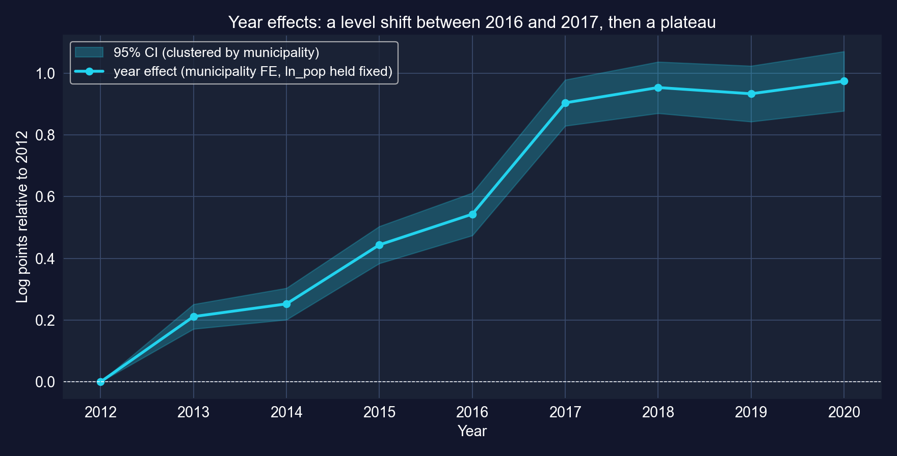

[8つの年効果の同時検定：Wald $\chi^2(8) = 706.3$、$p < 0.001$ · `ln_pop` −0.8173（SE 0.2957） · within $R^2 = 0.469$ · これらのスライドのために計算]{.comment}

[着実な成長ではありません：2016年までに+0.54、2017年への**0.36の跳ね**、その後+0.95近くで横ばいです。跳ねを発展と読む前に、衛星製品やその処理が変わったかを問いましょう。]{.takeaway .fragment}

::: {.notes}
年効果：2013年0.211、2014年0.252、2015年0.444、2016年0.543、2017年0.904、2018年0.953、2019年0.933、2020年0.974です。課題3の年あたり0.132の線形トレンドは、この階段＋横ばいの形を平均したものです。年次の夜間光コンポジットはセンサーの較正と処理で変わりえます。これは2017年に何が起きたかという主張ではなく、データ文書を確認すべきという注意です。人口係数はトレンドからダミーへの切り替えで変わりません。
:::

## 課題5 · コード：一階差分

``` {.python code-line-numbers="1-4|5-7"}
# continues from the previous block
panel_reg = panel_reg.sort_values(["asdf_id", "year"])
panel_reg["d_ln_NTLpc"] = panel_reg.groupby("asdf_id")["ln_NTLpc"].diff()   # vs previous row
panel_reg["d_ln_pop"] = panel_reg.groupby("asdf_id")["ln_pop"].diff()
fd_data = panel_reg.dropna(subset=["d_ln_NTLpc", "d_ln_pop"])               # drop first years
fit_fd = pf.feols("d_ln_NTLpc ~ d_ln_pop", data=fd_data, vcov={"CRV1": "asdf_id"})
fit_fd.summary()                                                            # change on change
```

[↗ Colab で試す](https://colab.research.google.com/notebooks/empty.ipynb){.colab-link target="_blank" data-preview-link="false"}

::: {.notes}
自治体と年でソートし、自治体内の差分をとり、各自治体の最初の年を落とし、自治体でクラスターしたSEで変化を変化に回帰します。
:::

## 課題5 · 出力：一階差分は同じ方向を指すが、精度が低い {.smaller}

| 変数 | 係数 | SE | $t$ | $p$ | 95% 信頼区間 |
|:--|--:|--:|--:|--:|:--|
| 切片 | 0.1200 | 0.0059 | 20.29 | <&nbsp;0.001 | [0.1083,&nbsp;0.1316] |
| `d_ln_pop` | [−0.5205]{.key} | 0.2928 | −1.78 | 0.076 | [−1.0964,&nbsp;0.0554] |

[N = 2,647 · 自治体によるCRV1 · $R^2 = 0.002$ · 切片は平均年次変化（一人あたりの光で年あたり≈ +12.7%）]{.comment}

::: {.notes}
本章のコメントアウトされた課題5のコードです。diff()は前の利用可能な行からの変化をとります。年が欠けると二年にまたがります（少数のケース）。一階差分回帰の切片は線形トレンドの役割を果たします。
:::

## 課題5 · 四つの推定量にわたる人口の傾き

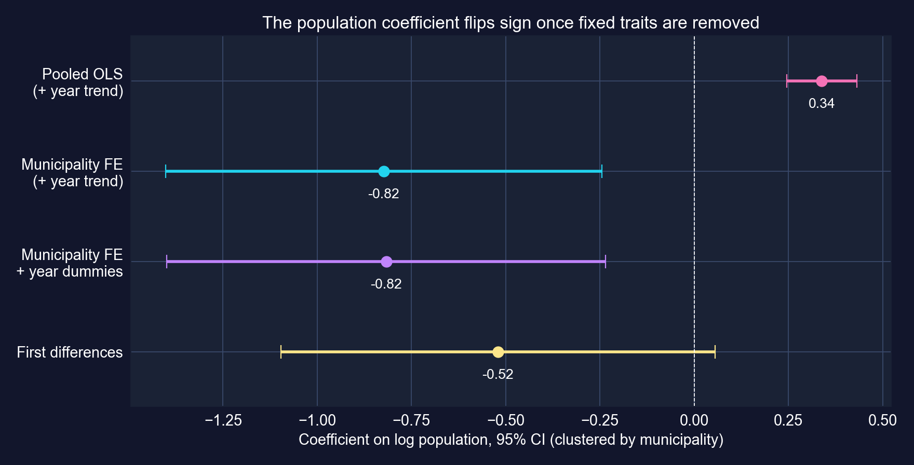

[自治体間では正、自治体内では負、一階差分では境界上のみ。]{.takeaway .fragment}

::: {.notes}
プールド+0.34；トレンドつきFE −0.82；年ダミーつきFE −0.82；FD −0.52です。自治体間の変動を使うのはプールド推定だけです。
:::

## 課題5 · FE対FD：同じ考え方、異なる重み

::: {.incremental}
- どちらも$\alpha_i$を除去する。**FE**は各年を自治体の9年平均と比較；**FD**は各年を前年と比較する
- $T > 2$では、誤差が系列相関するか効果のタイミングが重要なときに異なる：FEは系列*無相関*の誤差で、FDは*ランダムウォーク*の誤差で有効
- ここでは：FE −0.82（$p = 0.005$）、FD −0.52（$p = 0.076$）；同じ符号、重なる信頼区間
:::

[どちらも同じ方向を指しますが、FDは5%でゼロを棄却できません。人口の傾きはこのケーススタディで最も弱い環です。]{.takeaway .fragment}

::: {.notes}
含意される総光の弾力性：プールド1.34、FE 0.18、FD 0.48です。FEとFDが乖離するとき、しばしば測定誤差（差分が信号に対してノイズを増幅する）か動学を示します。自治体内で人口がほとんど動かないので、ここでは両方が当てはまります。
:::

## 課題6 · コード：パネル・ブリーフのための証拠

``` {.python code-line-numbers="1-6|7-8"}
# continues from the previous block (computed for these slides)
for v in ["ln_NTLpc", "ln_pop"]:
    overall = panel_reg[v].var()                                       # all rows
    between = panel_reg.groupby("asdf_id")[v].mean().var()            # municipality means
    within = panel_reg.groupby("asdf_id")[v].apply(lambda x: x - x.mean()).var()
    print(v, round(overall, 4), round(between, 4), round(within, 4))
dep = panel_reg.pivot_table(index="dep", columns="year", values="ln_NTLpc", aggfunc="mean")
print((dep[2020] - dep[2012]).sort_values().round(2))                 # change by department
```

[↗ Colab で試す](https://colab.research.google.com/notebooks/empty.ipynb){.colab-link target="_blank" data-preview-link="false"}

::: {.notes}
課題の提案する追加：分散分解（先に示した）と県別の成長です。全自治体にわたる一人あたりの光の対数の平均変化、2012〜2020年：+0.81です。
:::

## 課題6 · パネル・ブリーフ、数字で {.smaller}

| 証拠 | 結果 |
|:--|:--|
| `ln_NTLpc`の変動 | 95%が自治体間；within変化は小さいが実在 |
| プールド人口の傾き | +0.34（クラスターSE 0.047）：より大きな場所は一人あたり明るい |
| FE / FD 人口の傾き | **−0.82**（$p = 0.005$） / −0.52（$p = 0.076$）：脆い |
| 時間経路（年効果） | 2012 → 2020で+0.97対数ポイント、2017年に0.36の跳ね |
| 県別、2012 → 2020 | Chuquisaca +1.24、Beni +1.20、La Paz +1.04 … Tarija +0.46、**Pando −0.50** |

::: {.incremental}
- **利点**：調査がまれなすべての自治体の年次で一貫した被覆
- **限界**：センサーの変化；推計の人口分母；光は電化された活動しか見ない
- **追加**：時間変化する共変量（電化、道路、移転）
:::

[衛星パネルは自治体の変化を時間を通じて追跡できますが、自治体内の傾きは回帰変数の時間変動と同程度にしか良くありません。]{.takeaway .fragment}

::: {.notes}
ブリーフの問いへの答え：（1）自治体内の変化は広い明化を示し、2017年に前倒しされる；（2）FEの人口係数はプールドの符号を反転する；（3）時間トレンドは線形ではなく階段状；（4）FEとFDは符号で一致し、大きさと精度で異なる；鍵となる仮定は時間変化する交絡因子なし（両方）と誤差構造（どちらがより有効か）；（5）と（6）はスライドのとおり。Pandoは一人あたりの光の平均が下がった唯一の県です。
:::

# 正しく読む {.divider background-color="#C21E72"}

[第III幕 · 解決]{.act}

::: {.notes}
統合：各係数を、それを識別した変動で並べ、各標準誤差を、それが許した依存で並べ、そして決定ガイドとチェックリストを携えて去ります。
:::

## どの変動が各傾きを識別したか？ {.smaller}

| 例 | 係数 | すべての変動（プールド / 水準） | withinまたは変化のみ | 変化 |
|:--|:--|--:|--:|:--|
| NBA収益 | `wins` | 0.00675 | FE：[0.00451]{.key} | −33% |
| 生産性、108か国 | `ln_kl` | 0.714 | FE：[0.438]{.key} | −39% |
| 生産性、108か国 | `h` | 0.141 | FE：[0.223]{.key} | +58% |
| 夜間光、337自治体 | `ln_pop` | +0.338 | FE：[−0.824]{.key}；FD：−0.521 | 符号が反転 |
| 財務省金利 | 1年物金利 | 水準 + トレンド：0.508 | 変化：[0.720]{.key} | 異なる問い |

[withinの推定が小さいという法則はありません。縮むことも、伸びることも、反転することもあります。一定なのは教訓です：**比較が係数を定義する**。]{.takeaway .fragment}

::: {.notes}
デッキの本筋を一つの表に。パネルでは、プールドからwithinへの移行が時間不変の交絡因子を除去します。変化の方向は、それらの交絡因子がxとyにどう関連するか次第です。時系列では、水準と変化は異なる対象を推定します（線形トレンドを除いた均衡の共動対月次の波及）ので、比較はバイアスだけの話ではありません。
:::

## どの標準誤差が正直だったか？ {.smaller}

| 例 | 正直なSE | デフォルトSEに対する比 | デフォルトが無視したもの |
|:--|:--|--:|:--|
| NBA、プールド | チームでクラスター | [1.81]{.key} | 一つのチームの10シーズンは相関する |
| NBA、FE | チームでクラスター | 1.42 | $\alpha_i$を除いた後に残る系列相関 |
| 国、プールド | 国でクラスター | [4.03]{.key}（`ln_kl`） | 国あたり25の滑らかな年 |
| 自治体、プールド | 自治体でクラスター | 2.37（`ln_pop`）、0.71（`year`） | 自治体内の依存、どちらの符号も |
| 財務省金利、水準 | Newey–West、24ラグ | [3.65]{.key} | 0.95の残差自己相関 |

[同じ係数、まったく異なる信頼。推測はデータが実際に持つ依存を許さなければならず、SEをどちらの方向へも動かしえます。]{.takeaway .fragment}

::: {.notes}
どの比もデッキで示した同じ回帰から計算されます。自治体の年トレンドの0.71は、クラスタリングが「kで膨らませる」固定調整ではないという注意です。実際のクラスター内共分散を推定します。
:::

## 推定量を選ぶ：短いガイド

::: {.incremental}
- **単位の特性が$x$と$y$の両方を動かす？** 固定効果（加えて時間効果）；単位でクラスター
- **単位効果が$x$と無関係？** 変量効果；HausmanかMundlakで確認
- **トレンドを持つ時系列？** コレログラムを確認；変化またはAR/ADLの動学を使う；HAC SE
- **二値の結果？** 平均にはLPM；確率にはlogit、限界効果とともに
- **時間変化する交絡因子かフィードバック？** デザインが必要：IV、DiD、RD、RCT
:::

[データの構造とありそうな交絡因子から始め、次に推定量、次に標準誤差を選びます。]{.takeaway .fragment}

::: {.notes}
決定ガイドであってアルゴリズムではありません。多くの応用論文は要素を組み合わせます。クラスターSEつきの二元FEは応用経済学の多くで標準のパネル定式化であり、DiDは処置指標つきの二元FEです。
:::

## 誘惑的な誤り — そして訂正

[反論。]{.objection}「固定効果は観測されない異質性をコントロールするので、FE係数は因果的だ。」

. . .

[応答。]{.rebuttal} FEは単位内で**一定**なものだけを除きます。NBAでは新しいスターが同じシーズンに勝利と収益を上げます。ボリビアでは人口と光が、地域成長を駆動するものと共動します。そしてFEはbetweenの変動を捨てるので、推定は残るwithin変動に依拠します：勝利の分散の69%ですが、自治体人口の分散の0.4%にすぎません。

[FEは仮定（時間変化する交絡因子なし）と代償（変動が少ない）を持つデザインです。「効果」と言う前に両方を確認してください。]{.takeaway .fragment}

::: {.notes}
反論を最も強い形で：FEは大きな一群の欠落変数の問題を実際に解きますし、プールドからFEへの移行はパネルでしばしば最も有益な単一のロバストネス確認です。しかしFEの意味での「観測されない異質性」は時間不変の異質性だけを意味します。
:::

## どんなパネルや時系列の係数にも問う五つの問い

::: {.incremental}
1. **どの変動？** between、within、変化、あるいは二つの共有トレンド？
2. **どの単位？** 対数ポイント、パーセント、パーセントポイント、確率、オッズ？
3. **どの標準誤差？** ショックが共有される水準でクラスター、あるいは正しい期間にわたるHAC？
4. **何を固定？** 単位効果、時間効果、トレンド、ラグつきの値？
5. **まだ$x$と$y$の両方を動かしうるものは？** 時間変化する交絡因子、フィードバック、共通ショック？
:::

[このデッキで訂正した単位の誤り：金利の変化は**パーセントポイント**（%ではない）、logit係数は**対数オッズ**（確率ではない）、対数ポイントの効果は$e^b - 1$で変換。]{.takeaway .fragment}

::: {.notes}
学生がこの章のどんな出力にも適用できるチェックリストです。挙げた訂正は本章の本文に対して適用したものです：1パーセントポイントの金利変化に対する「1%」、平均対平均でのとラベルされる限界効果、log-level係数の厳密なパーセント変換です。
:::

## 持ち帰るもの

::: {.incremental}
- **パネル**：変動を分解する；FEはwithinの部分だけを使う；単位でクラスター
- **FE対RE**：FEは相関する単位効果を生き残る；REはそれらが無相関である必要がある
- **Logit**：限界効果を報告し、AMEかMEMかを言う
- **時系列**：水準での高い$R^2$は警告；残差自己相関を確認
- **動学**：ADL乗数は効果がどう積み上がるかをたどる（0.74 → 0.53）
- **因果性**：FEと差分は一部の交絡因子を除く；デザインが残りを扱う
:::

::: {.notes}
本章のKey Takeawaysの要約を、デッキが検証したもので更新：クラスタリングとHACの訂正の大きさ、三つのパネルでのプールドからFEへの変化、訂正したADL動学です。
:::

# 構造、記憶、そして信頼できるデザイン：それが傾きを答えに変えるものです。 {.divider background-color="#C21E72"}
