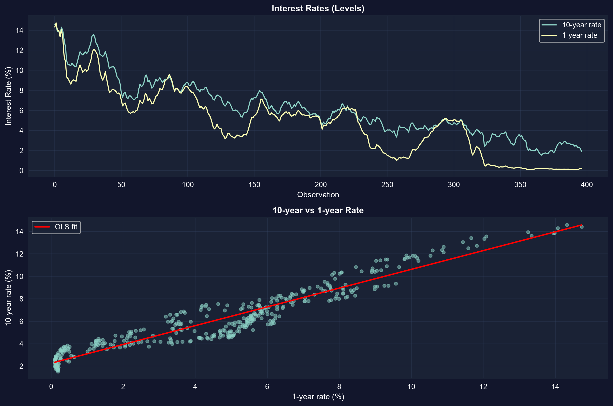
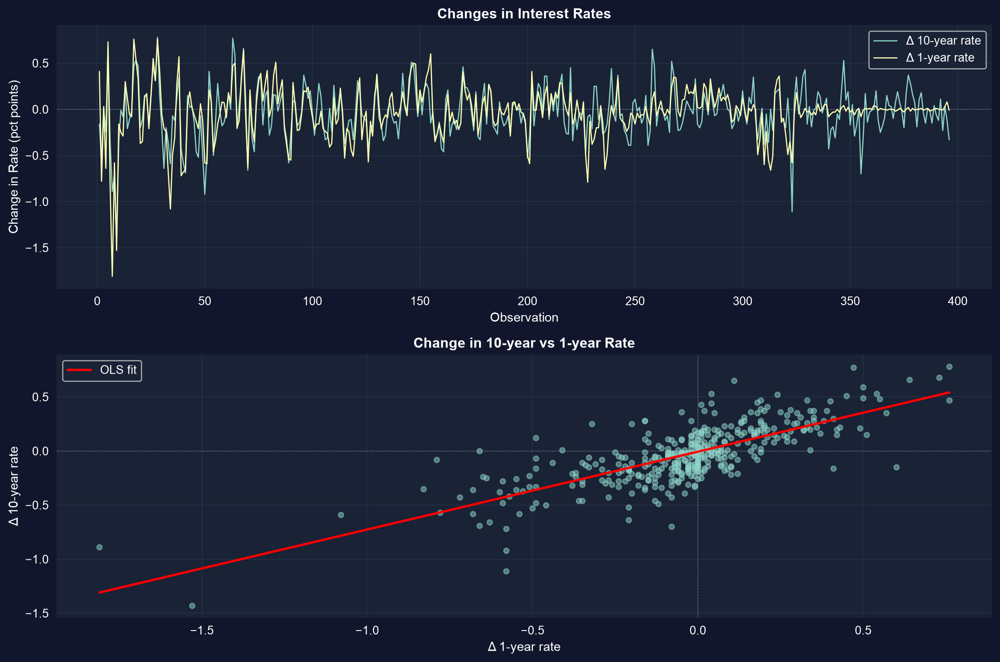

# Where basic regression runs out {.divider background-color="#008CB7"}

[Act I · Panel data]{.act}

## One line through a scatter isn't always enough

A single cross-section can't separate *who a unit is* from *what changed for it*, and a single
time series can't tell a trend from a relationship.

. . .

This capstone extends OLS along three axes: **panel data** (units across time), **time series**
(order and memory), and **causation** (from association to effect).

::: {.notes}
Chapters 1–16 built the regression toolkit on cross-sections. Real economic data usually has more
structure — repeated observations, time ordering, endogeneity — and each needs its own machinery.
:::

## Where we're going

::: {.incremental}
- **Panel data** — the same units over time; split variation *within* vs *between*
- **Fixed effects** — control for everything time-invariant about a unit
- **Logit** — regression when the outcome is 0/1
- **Time series** — autocorrelation, spurious trends, and HAC standard errors
- **Dynamics** — AR and distributed-lag models: today depends on yesterday
- **Causation** — endogeneity, instrumental variables, and the identification toolkit
:::

## Six ideas anchor this chapter

::: {.incremental}
- **Panel data** — observations indexed by unit $i$ *and* time $t$
- **Within estimator** — de-mean each unit to erase its fixed traits $\alpha_i$
- **Logit** — squeeze $x'\beta$ through an S-curve into a probability in $[0,1]$
- **AR($p$)** — regress $y_t$ on its own past; persistence and momentum
- **ADL** — add current and lagged $x$; sum the $\gamma$'s for the long-run effect
- **Hausman test** — FE vs RE: a big gap rejects random effects
:::

[Each frontier is the same question — *what is really driving $y$?* — asked under harder conditions.]{.takeaway .fragment}

## Panel data is double-indexed: unit $i$, time $t$

29 NBA teams over 10 seasons (2001–02 to 2010–11): 286 team-seasons of revenue and wins.

$$y_{it} = \alpha_i + \beta\,x_{it} + \varepsilon_{it}$$

[Total variation splits in two: **between** teams (big-market vs small-market, SD of $\ln$revenue $\approx 0.21$) and **within** a team over time (SD $\approx 0.11$). Which piece your estimator uses decides what it means.]{.comment}

## Pooled OLS needs cluster-robust standard errors

``` {.python code-line-numbers="1|3-4|6-7|9|11-13"}
!pip install -q pyfixest                     # pyfixest is not preinstalled in Colab (-q = quiet)
import pandas as pd                           # tabular data
import pyfixest as pf                          # fast OLS / FE / IV with robust & cluster SEs
url = "https://raw.githubusercontent.com/quarcs-lab/data-open/master/AED/AED_NBA.DTA"
data_nba = pd.read_stata(url)                 # 29 teams × 10 seasons = 286 team-seasons

# cluster SEs by team: observations for one team are correlated over time
fit_pool = pf.feols("lnrevenue ~ wins", data=data_nba, vcov={"CRV1": "teamid"})

fit_pool.summary()                            # wins coef 0.0068, cluster SE 0.0019, t 3.54
# default (non-clustered) SE would be ~1.8x too small → overstated significance
```

[↗ Try it in Colab](https://colab.research.google.com/notebooks/empty.ipynb){.colab-link target="_blank" data-preview-link="false"}

::: {.notes}
Clustering by team roughly doubles the SE (0.0011 → 0.0019). It does not overturn significance here,
but it corrects the understated uncertainty from treating 286 correlated rows as independent.
:::

## Pooled wins-revenue line mixes two very different comparisons


[Big-market teams both win more and earn more, so the pooled slope is confounded. We need to hold the team constant.]{.takeaway .fragment}

## Fixed effects: compare a team only to itself

``` {.python code-line-numbers="1|3|5-6|8"}
import pyfixest as pf                          # (data_nba already loaded above)

# "| teamid" absorbs a separate intercept per team: the within (de-meaning) estimator
fit_fe = pf.feols("lnrevenue ~ wins | teamid", data=data_nba, vcov={"CRV1": "teamid"})

fit_fe.summary()                              # wins coef 0.0045 (was 0.0068 pooled)
# α_i soaks up market size, brand, arena → identified from a team's good vs bad years
# within R² ≈ 0.19; +1 win ≈ +0.45% revenue (t ≈ 5.3)
```

[↗ Try it in Colab](https://colab.research.google.com/notebooks/empty.ipynb){.colab-link target="_blank" data-preview-link="false"}

## The coefficient shrinks 33% — that gap was omitted-variable bias

::: {.incremental}
- **Pooled OLS:** $\hat\beta_{\text{wins}} = 0.0068$ — mixes within and between variation.
- **Fixed effects:** $\hat\beta_{\text{wins}} = 0.0045$ — within-team only; market size is absorbed into $\alpha_i$.
- The 33% drop is the confound: persistent team traits correlated with both wins and revenue.
:::

[FE trades cross-sectional information for a far more credible *within-team* causal reading.]{.takeaway .fragment}

## FE or RE? The Hausman test decides

Random effects is *more efficient* — but only if $\alpha_i$ is uncorrelated with the regressors.

. . .

[**FE** is consistent either way (it allows arbitrary correlation); **RE** adds efficiency only when its
assumption holds. The **Hausman test** compares the two: a significant gap — as in the NBA panel, where
big-market teams both win and earn — rejects RE. Default to FE for observational data.]{.comment}

## Logit: regression when the outcome is 0 or 1

``` {.python code-line-numbers="1-2|4-6|8-9|11-12"}
import pandas as pd                                    # statsmodels/scipy are preinstalled in Colab
from statsmodels.formula.api import logit               # logit with R-style formulas
url = "https://raw.githubusercontent.com/quarcs-lab/data-open/master/AED/AED_EARNINGS_COMPLETE.DTA"
data = pd.read_stata(url)                               # 842 full-time workers, 2010
data["dbigearn"] = (data["earnings"] > 60000).astype(int)   # 1 if high earner (~27%)

m = logit("dbigearn ~ age + education", data=data).fit(disp=0)   # logistic CDF keeps p in [0,1]
print(m.get_margeff().summary())                        # coefficients ≠ marginal effects
# ME of education at the means ≈ 0.05 → +5 pts of P(high earner) per year of schooling
```

[↗ Try it in Colab](https://colab.research.google.com/notebooks/empty.ipynb){.colab-link target="_blank" data-preview-link="false"}

[Logit coefficients must be converted to marginal effects; here they match the linear-probability model in sign and size — but never stray outside $[0,1]$.]{.takeaway .fragment}

# Time series: order and memory {.divider background-color="#7A209F"}

[Act II · Time series]{.act}

## Trending series can fake a relationship



[When two series share a trend, a levels regression gives a huge $R^2$ that may be **spurious** — shared time, not a structural link.]{.takeaway .fragment}

## Levels look great — and that should worry you

``` {.python code-line-numbers="1|3-4|6|8-10|12"}
import pandas as pd, numpy as np, pyfixest as pf        # all preinstalled except pyfixest
url = "https://raw.githubusercontent.com/quarcs-lab/data-open/master/AED/AED_INTERESTRATES.DTA"
data = pd.read_stata(url)                               # monthly 10-yr (gs10) & 1-yr (gs1) rates
data["time"] = np.arange(len(data))                     # linear time index for the trend

fit = pf.feols("gs10 ~ gs1 + time", data=data)          # levels regression → R² ≈ 0.95 (!)

# Newey-West HAC SEs: valid under autocorrelation; 24 monthly lags = 2 years
fit_hac = pf.feols("gs10 ~ gs1 + time", data=data,
                   vcov="NW", vcov_kwargs={"time_id": "time", "lag": 24})
print(fit.se()["gs1"], fit_hac.se()["gs1"])             # HAC SE is ~3x the default SE
```

[↗ Try it in Colab](https://colab.research.google.com/notebooks/empty.ipynb){.colab-link target="_blank" data-preview-link="false"}

[A near-perfect $R^2$ plus a HAC SE three times the default is the classic fingerprint of a spurious levels regression.]{.takeaway .fragment}

## The correlogram exposes autocorrelation

``` {.python code-line-numbers="1|3-4|6-7"}
from statsmodels.tsa.stattools import acf               # autocorrelation function (preinstalled)

data["uhat"] = fit._u_hat                               # residuals from the levels regression
rho = acf(data["uhat"].dropna(), nlags=10)              # autocorrelation at lags 0..10

print(rho[1])                                           # lag-1 ≈ 0.95 — residuals almost unchanged
# slow decay (lag 10 still > 0.4) ⇒ near-unit-root; OLS inference is invalid
```

[↗ Try it in Colab](https://colab.research.google.com/notebooks/empty.ipynb){.colab-link target="_blank" data-preview-link="false"}


## First differencing restores stationarity



[Differencing drops residual lag-1 autocorrelation from $\rho_1 \approx 0.95$ to $\approx 0.25$. In changes, a 1-point move in the 1-year rate maps to a $\approx 0.72$-point move in the 10-year rate.]{.takeaway .fragment}

## Rates have memory: AR and distributed lags

The ADL(2,2) model regresses $\Delta\text{gs10}_t$ on its own lags *and* current + lagged $\Delta\text{gs1}_t$:

$$\Delta y_t = \beta_0 + \sum_{j=1}^{2}\alpha_j \Delta y_{t-j} + \sum_{j=0}^{2}\gamma_j \Delta x_{t-j} + u_t$$

[Contemporaneous pass-through $\gamma_0 \approx 0.74$; summing the $\gamma$'s gives a two-month multiplier $\approx 0.53$ — over half of a short-rate shock reaches the long rate within two months (the *long-run multiplier*).]{.comment}

# From association to cause {.divider background-color="#C21E72"}

[Act III · Causation]{.act}

## OLS is biased the moment $x$ correlates with the error

In $y = \beta_1 + \beta_2 x + u$, OLS needs $E[u \mid x] = 0$. Three things break it:

::: {.incremental}
- **Omitted variables** — a confounder drives both $x$ and $y$
- **Measurement error** — a mis-measured $x$ attenuates the slope
- **Simultaneity** — $y$ also causes $x$ (reverse causation)
:::

[Adding more control variables does not fix endogeneity — you need an *identification strategy*.]{.takeaway .fragment}

## Instrumental variables: borrow exogenous variation

An instrument $z$ must satisfy two conditions, and pyfixest estimates it with a `| x ~ z` term:

``` {.python code-line-numbers="1|3-4|6"}
import pyfixest as pf                          # IV / 2SLS via the formula syntax

# relevance: Corr(z, x) ≠ 0 (testable) · exogeneity: Corr(z, u) = 0 (must be argued)
fit_iv = pf.feols("y ~ 1 | x ~ z", data=df)   # regress y on x, instrumenting x with z

fit_iv.summary()                              # β_IV = Cov(z,y) / Cov(z,x): consistent when OLS is not
```

[↗ Try it in Colab](https://colab.research.google.com/notebooks/empty.ipynb){.colab-link target="_blank" data-preview-link="false"}

[Relevance can be tested; exogeneity cannot — it rests on an economic argument you must defend.]{.takeaway .fragment}

## The causal toolkit — pick the design the data allows

::: {.incremental}
- **RCT** — random assignment makes treatment independent of outcomes (gold standard)
- **IV** — an instrument that moves $x$ but not $y$ directly
- **Fixed effects** — absorb time-invariant confounders
- **Difference-in-differences** — before/after, treated vs control
- **Regression discontinuity** — exploit a threshold assignment rule
:::

[Credible causal inference comes from a convincing *design*, not from piling on controls.]{.takeaway .fragment}

## What to carry forward

::: {.incremental}
- **Panel:** cluster by unit; fixed effects erase time-invariant confounders using within variation.
- **Nonlinear:** logit keeps probabilities in $[0,1]$; read it through marginal effects.
- **Time series:** watch for non-stationarity and autocorrelation — difference, or use HAC SEs.
- **Dynamics:** AR and ADL models capture persistence; sum the lags for the long-run effect.
- **Causation:** OLS needs $E[u\mid x]=0$; IV, DiD, RD, and FE are ways to earn a causal claim.
:::

# Structure, memory, and a credible design — that's what turns a slope into an answer. {.divider background-color="#C21E72"}
